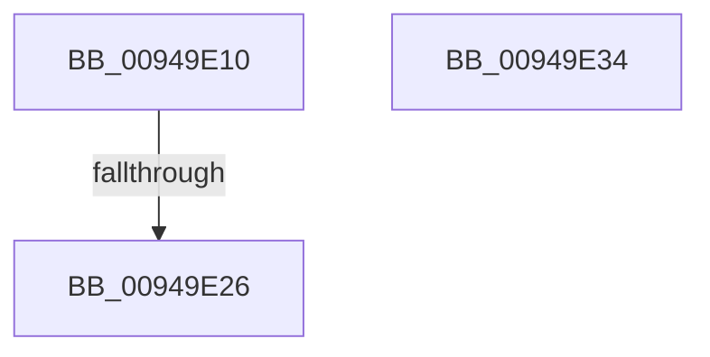

# CmGetKCBCacheSecurity

- RVA: `0x00949E10`–`0x00949E35` (길이 `37` bytes)
- VA: `0x0000000140949E10`
- 실행 섹션: `PAGE`
- PDB 이름 있음: `예`; PDB Function 태그: `아니요`
- unwind 정보 RVA: `0x00090D54`
- 디코드: `13`개 명령, `37/37` bytes 표시
- 미해석 바이트: `0` (있으면 어셈블리에 `.byte`로 보존)

> 이 문서는 커널 이미지의 기계어와 PDB 기호를 분석해 생성했습니다. 4번과 5번은 함수 원형과 자료형을 바이너리 사용 방식에서 추정한 C 해석이며 원본 소스 복구 결과는 아닙니다.

## 1. Dependencies

- 직접 호출 지점: **0**; 고유 호출 대상: **0**
- 직접 호출자로 확인된 함수: **1**
- RIP 상대 이미지 참조: **0**

### Outgoing calls
- 직접 디코드된 call 명령이 없습니다.

### Direct callers
- [CmpSetSecurityDescriptorInfo](CmpSetSecurityDescriptorInfo_function_00949688.md) at `0x0094974E`

### Static image references
- 디코드된 RIP-relative 메모리 참조가 없습니다.

## 2. Other-region calls and transfers

- 다른 실행 섹션으로 향하는 call: **0**
- call이 아닌 외부 분기/꼬리 이동: **1**
  - `0x00949E24` → [sub_00949E35](Unknown_function_00949E35.md) (`tail-transfer`)

## 3. Assembly (complete function range)

```asm
00949E10  48 89 5C 24 20                  mov qword ptr [rsp + 0x20], rbx
00949E15  57                              push rdi
00949E16  48 83 EC 20                     sub rsp, 0x20
00949E1A  48 8B 59 58                     mov rbx, qword ptr [rcx + 0x58]
00949E1E  48 8B FA                        mov rdi, rdx
00949E21  48 85 D2                        test rdx, rdx
00949E24  75 0F                           jne 0x140949e35
00949E26  48 8B C3                        mov rax, rbx
00949E29  48 8B 5C 24 48                  mov rbx, qword ptr [rsp + 0x48]
00949E2E  48 83 C4 20                     add rsp, 0x20
00949E32  5F                              pop rdi
00949E33  C3                              ret
00949E34  CC                              int3
```

## 4. C-style interpretation (structured pseudocode)

```c
__int64 __fastcall CmGetKCBCacheSecurity(__int64 a1, __int64 a2)
{
    __int64 v_rsp;
    unsigned __int64 v_stack_p20;

    v_stack_p20 = v_rbx;
    v_rsp = (v_rsp) - (32);
    v_rsp = (v_rsp) + (32);
    return *(unsigned __int64 *)(a1 + 88);
}
```

## 5. (Beta) C Style

```c
int64_t CmGetKCBCacheSecurity(void *Arg1, int64_t Arg2)
{
    uint8_t *arg1 = (uint8_t *)Arg1;

    int64_t local_rsp;
    uint64_t v_stack_p20;

    v_stack_p20 = local_rbx;
    local_rsp = (local_rsp) - (32);
    local_rsp = (local_rsp) + (32);
    return *(uint64_t *)(arg1 + 0x58);
}
```

### 관측된 메모리 오프셋

구조체 형식이 확인되지 않은 접근은 인자 기준의 오프셋으로만 기록했습니다.

| 기준 인자 | 오프셋 표현 | 폭 (bit) | 접근 |
|---|---:|---:|---|
| `Arg1` | `+ 0x58` | `64` | `R` |

## 6. Execution-region graph

[열기: 2D/3D 그래프와 함수 탐색 컨트롤 패널](../../../control-panel.html?section=page&rva=0x00949E10&view=graph)

- 2D 그래프는 위에서 아래로 흐르고, 3D 그래프는 빈 공간을 드래그해 회전합니다. Shift+드래그는 이동, 휠은 확대·축소, 함수 노드 선택은 대상 보고서 이동입니다.

### Static fallback


