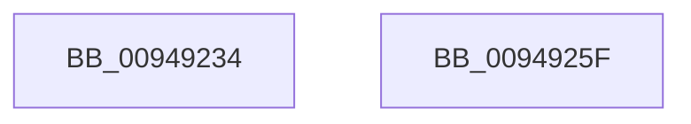

# CmpAssignSecurityDescriptor

- RVA: `0x00949234`–`0x00949260` (길이 `44` bytes)
- VA: `0x0000000140949234`
- 실행 섹션: `PAGE`
- PDB 이름 있음: `예`; PDB Function 태그: `아니요`
- unwind 정보 RVA: `0x00063458`
- 디코드: `12`개 명령, `44/44` bytes 표시
- 미해석 바이트: `0` (있으면 어셈블리에 `.byte`로 보존)

> 이 문서는 커널 이미지의 기계어와 PDB 기호를 분석해 생성했습니다. 4번과 5번은 함수 원형과 자료형을 바이너리 사용 방식에서 추정한 C 해석이며 원본 소스 복구 결과는 아닙니다.

## 1. Dependencies

- 직접 호출 지점: **1**; 고유 호출 대상: **1**
- 직접 호출자로 확인된 함수: **1**
- RIP 상대 이미지 참조: **0**

### Outgoing calls
- `0x00949255` → [CmpGetSecurityDescriptorNodeEx](CmpGetSecurityDescriptorNodeEx_function_00949268.md) (function, `0x00949268`)

### Direct callers
- [CmpCreateTombstone](../../text/66/CmpCreateTombstone_function_0066AF50.md) at `0x0066B0DA`

### Static image references
- 디코드된 RIP-relative 메모리 참조가 없습니다.

## 2. Other-region calls and transfers

- 다른 실행 섹션으로 향하는 call: **0**
- 별도 외부 분기/꼬리 이동을 확인하지 못했습니다.

## 3. Assembly (complete function range)

```asm
00949234  48 83 EC 48                     sub rsp, 0x48
00949238  4D 8B D1                        mov r10, r9
0094923B  49 8D 40 2C                     lea rax, [r8 + 0x2c]
0094923F  48 89 44 24 30                  mov qword ptr [rsp + 0x30], rax
00949244  44 8B CA                        mov r9d, edx
00949247  41 C1 E9 1F                     shr r9d, 0x1f
0094924B  C6 44 24 28 00                  mov byte ptr [rsp + 0x28], 0
00949250  4C 89 54 24 20                  mov qword ptr [rsp + 0x20], r10
00949255  E8 0E 00 00 00                  call 0x140949268
0094925A  48 83 C4 48                     add rsp, 0x48
0094925E  C3                              ret
0094925F  CC                              int3
```

## 4. C-style interpretation (structured pseudocode)

```c
__int64 __fastcall CmpAssignSecurityDescriptor(__int64 a1, int a2, __int64 a3, __int64 a4)
{
    __int64 result;
    __int64 v_rsp;
    unsigned __int64 v_stack_m18;
    unsigned __int8 v_stack_m20;
    unsigned __int64 v_stack_m28;

    v_rsp = (v_rsp) - (72);
    v_stack_m18 = a3 + 44;
    a4 = (unsigned int)(((unsigned int)(a2)) >> (31));
    v_stack_m20 = 0;
    v_stack_m28 = a4;
    result = CmpGetSecurityDescriptorNodeEx(a1, a2, a3, a4);
    v_rsp = (v_rsp) + (72);
    return result;
}
```

## 5. (Beta) C Style

```c
int64_t CmpAssignSecurityDescriptor(int64_t Arg1, int32_t Arg2, void *Arg3, int64_t Arg4)
{
    uint8_t *arg3 = (uint8_t *)Arg3;

    int64_t result;
    int64_t local_rsp;
    uint64_t v_stack_m18;
    uint8_t v_stack_m20;
    uint64_t v_stack_m28;

    local_rsp = (local_rsp) - (72);
    v_stack_m18 = Arg3 + 44;
    Arg4 = (uint32_t)(((uint32_t)(Arg2)) >> (31));
    v_stack_m20 = 0;
    v_stack_m28 = Arg4;
    result = CmpGetSecurityDescriptorNodeEx(Arg1, Arg2, Arg3, Arg4);
    local_rsp = (local_rsp) + (72);
    return result;
}
```

### 관측된 메모리 오프셋

구조체 형식이 확인되지 않은 접근은 인자 기준의 오프셋으로만 기록했습니다.

| 기준 인자 | 오프셋 표현 | 폭 (bit) | 접근 |
|---|---:|---:|---|
| `Arg3` | `+ 0x2C` | `64` | `R` |

## 6. Execution-region graph

[열기: 2D/3D 그래프와 함수 탐색 컨트롤 패널](../../../control-panel.html?section=page&rva=0x00949234&view=graph)

- 2D 그래프는 위에서 아래로 흐르고, 3D 그래프는 빈 공간을 드래그해 회전합니다. Shift+드래그는 이동, 휠은 확대·축소, 함수 노드 선택은 대상 보고서 이동입니다.

### Static fallback


