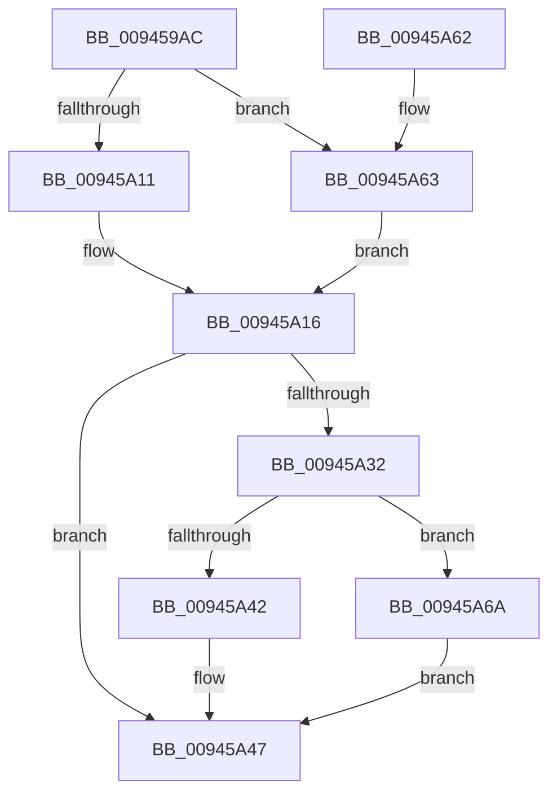

# CmpCheckKeyNodeStackAccess

- RVA: `0x009459AC`–`0x00945A71` (길이 `197` bytes)
- VA: `0x00000001409459AC`
- 실행 섹션: `PAGE`
- PDB 이름 있음: `예`; PDB Function 태그: `아니요`
- unwind 정보 RVA: `0x00090920`
- 디코드: `56`개 명령, `197/197` bytes 표시
- 미해석 바이트: `0` (있으면 어셈블리에 `.byte`로 보존)

> 이 문서는 커널 이미지의 기계어와 PDB 기호를 분석해 생성했습니다. 4번과 5번은 함수 원형과 자료형을 바이너리 사용 방식에서 추정한 C 해석이며 원본 소스 복구 결과는 아닙니다.

## 1. Dependencies

- 직접 호출 지점: **7**; 고유 호출 대상: **7**
- 직접 호출자로 확인된 함수: **1**
- RIP 상대 이미지 참조: **0**

### Outgoing calls
- `0x009459E5` → [HvpGetCellContextInitialize](../85/HvpGetCellContextInitialize_function_00855F10.md) (function, `0x00855F10`)
- `0x009459F5` → [CmpGetSecurityCellForKeyNodeStack](CmpGetSecurityCellForKeyNodeStack_function_009464EC.md) (function, `0x009464EC`)
- `0x00945A11` → [HvpGetCellFlat](../85/HvpGetCellFlat_function_00854C60.md) (function, `0x00854C60`)
- `0x00945A26` → [CmpCheckKeySecurityDescriptorAccess](CmpCheckKeySecurityDescriptorAccess_function_0094715C.md) (function, `0x0094715C`)
- `0x00945A42` → [HvpReleaseCellPaged](../85/HvpReleaseCellPaged_function_00855F40.md) (function, `0x00855F40`)
- `0x00945A63` → [HvpGetCellPaged](../85/HvpGetCellPaged_function_00854CB0.md) (function, `0x00854CB0`)
- `0x00945A6A` → [HvpReleaseCellFlat](../85/HvpReleaseCellFlat_function_0085CC20.md) (function, `0x0085CC20`)

### Direct callers
- [CmpDoAccessCheckOnLayeredSubtree](CmpDoAccessCheckOnLayeredSubtree_function_00945488.md) at `0x009455BF`
- [CmpDoAccessCheckOnLayeredSubtree](CmpDoAccessCheckOnLayeredSubtree_function_00945488.md) at `0x009455E2`

### Static image references
- 디코드된 RIP-relative 메모리 참조가 없습니다.

## 2. Other-region calls and transfers

- 다른 실행 섹션으로 향하는 call: **0**
- 별도 외부 분기/꼬리 이동을 확인하지 못했습니다.

## 3. Assembly (complete function range)

```asm
009459AC  48 89 5C 24 08                  mov qword ptr [rsp + 8], rbx
009459B1  48 89 74 24 10                  mov qword ptr [rsp + 0x10], rsi
009459B6  48 89 7C 24 18                  mov qword ptr [rsp + 0x18], rdi
009459BB  55                              push rbp
009459BC  41 56                           push r14
009459BE  41 57                           push r15
009459C0  48 8B EC                        mov rbp, rsp
009459C3  48 83 EC 40                     sub rsp, 0x40
009459C7  83 65 E0 00                     and dword ptr [rbp - 0x20], 0
009459CB  4C 8B D1                        mov r10, rcx
009459CE  48 83 65 E8 00                  and qword ptr [rbp - 0x18], 0
009459D3  48 8D 4D E8                     lea rcx, [rbp - 0x18]
009459D7  48 83 65 F0 00                  and qword ptr [rbp - 0x10], 0
009459DC  41 8A F1                        mov sil, r9b
009459DF  45 8B F0                        mov r14d, r8d
009459E2  44 8A FA                        mov r15b, dl
009459E5  E8 26 05 F1 FF                  call 0x140855f10
009459EA  49 8B CA                        mov rcx, r10
009459ED  4C 8D 45 E0                     lea r8, [rbp - 0x20]
009459F1  48 8D 55 F0                     lea rdx, [rbp - 0x10]
009459F5  E8 F2 0A 00 00                  call 0x1409464ec
009459FA  48 8B 5D F0                     mov rbx, qword ptr [rbp - 0x10]
009459FE  4C 8D 45 E8                     lea r8, [rbp - 0x18]
00945A02  8B 55 E0                        mov edx, dword ptr [rbp - 0x20]
00945A05  48 8B CB                        mov rcx, rbx
00945A08  F6 83 8C 00 00 00 01            test byte ptr [rbx + 0x8c], 1
00945A0F  74 52                           je 0x140945a63
00945A11  E8 4A F2 F0 FF                  call 0x140854c60
00945A16  48 8D 48 14                     lea rcx, [rax + 0x14]
00945A1A  44 8A CE                        mov r9b, sil
00945A1D  45 8B C6                        mov r8d, r14d
00945A20  41 8A D7                        mov dl, r15b
00945A23  48 8B F8                        mov rdi, rax
00945A26  E8 31 17 00 00                  call 0x14094715c
00945A2B  8B F0                           mov esi, eax
00945A2D  48 85 FF                        test rdi, rdi
00945A30  74 15                           je 0x140945a47
00945A32  F6 83 8C 00 00 00 01            test byte ptr [rbx + 0x8c], 1
00945A39  48 8D 55 E8                     lea rdx, [rbp - 0x18]
00945A3D  48 8B CB                        mov rcx, rbx
00945A40  75 28                           jne 0x140945a6a
00945A42  E8 F9 04 F1 FF                  call 0x140855f40
00945A47  48 8B 5C 24 60                  mov rbx, qword ptr [rsp + 0x60]
00945A4C  8B C6                           mov eax, esi
00945A4E  48 8B 74 24 68                  mov rsi, qword ptr [rsp + 0x68]
00945A53  48 8B 7C 24 70                  mov rdi, qword ptr [rsp + 0x70]
00945A58  48 83 C4 40                     add rsp, 0x40
00945A5C  41 5F                           pop r15
00945A5E  41 5E                           pop r14
00945A60  5D                              pop rbp
00945A61  C3                              ret
00945A62  CC                              int3
00945A63  E8 48 F2 F0 FF                  call 0x140854cb0
00945A68  EB AC                           jmp 0x140945a16
00945A6A  E8 B1 71 F1 FF                  call 0x14085cc20
00945A6F  EB D6                           jmp 0x140945a47
```

## 4. C-style interpretation (structured pseudocode)

```c
__int64 __fastcall CmpCheckKeyNodeStackAccess(__int64 a1, unsigned __int8 a2, int a3, unsigned __int8 a4)
{
    __int64 result;
    __int64 v_rsp;
    unsigned __int64 v_stack_m28;
    unsigned __int64 v_stack_m30;
    unsigned int v_stack_m38;
    unsigned __int64 v_stack_p10;
    unsigned __int64 v_stack_p18;
    unsigned __int64 v_stack_p8;

    v_stack_p8 = v_rbx;
    v_stack_p10 = v_rsi;
    v_stack_p18 = v_rdi;
    v_rsp = (v_rsp) - (64);
    result = HvpGetCellContextInitialize(v_stack_m30, a2, a3, a4);
    result = CmpGetSecurityCellForKeyNodeStack(a1, v_stack_m28, v_stack_m38, a4);
    if (((*(unsigned __int8 *)(v_stack_m28 + 140)) & (1)) == 0) goto loc_00945A63;
    result = HvpGetCellFlat(v_stack_m28, (unsigned int)(v_stack_m38), v_stack_m30, a4);
loc_00945A16:
    result = CmpCheckKeySecurityDescriptorAccess(result + 20, a2, (unsigned int)((unsigned int)((unsigned int)(a3))), a4);
    if (result == 0) goto loc_00945A47;
    if (((*(unsigned __int8 *)(v_stack_m28 + 140)) & (1)) != 0) goto loc_00945A6A;
    result = HvpReleaseCellPaged(v_stack_m28, v_stack_m30, (unsigned int)((unsigned int)((unsigned int)(a3))), a4);
loc_00945A47:
    v_rsp = (v_rsp) + (64);
    return (unsigned int)((unsigned int)((unsigned int)((unsigned int)(result))));
loc_00945A63:
    result = HvpGetCellPaged(v_stack_m28, v_stack_m30, (unsigned int)((unsigned int)((unsigned int)(a3))), a4);
    goto loc_00945A16;
loc_00945A6A:
    result = HvpReleaseCellFlat(v_stack_m28, v_stack_m30, (unsigned int)((unsigned int)((unsigned int)(a3))), a4);
    goto loc_00945A47;
}
```

## 5. (Beta) C Style

```c
int64_t CmpCheckKeyNodeStackAccess(int64_t Arg1, uint8_t Arg2, int32_t Arg3, uint8_t Arg4)
{
    int64_t result;
    int64_t local_rsp;
    uint64_t v_stack_m28;
    uint64_t v_stack_m30;
    uint32_t v_stack_m38;
    uint64_t v_stack_p10;
    uint64_t v_stack_p18;
    uint64_t v_stack_p8;

    v_stack_p8 = local_rbx;
    v_stack_p10 = local_rsi;
    v_stack_p18 = local_rdi;
    local_rsp = (local_rsp) - (64);
    result = HvpGetCellContextInitialize(v_stack_m30, Arg2, Arg3, Arg4);
    result = CmpGetSecurityCellForKeyNodeStack(Arg1, v_stack_m28, v_stack_m38, Arg4);
    if (((*(uint8_t *)(v_stack_m28 + 0x8C)) & (1)) == 0) goto loc_00945A63;
    result = HvpGetCellFlat(v_stack_m28, (uint32_t)(v_stack_m38), v_stack_m30, Arg4);
loc_00945A16:
    result = CmpCheckKeySecurityDescriptorAccess(result + 20, Arg2, (uint32_t)((uint32_t)((uint32_t)(Arg3))), Arg4);
    if (result == 0) goto loc_00945A47;
    if (((*(uint8_t *)(v_stack_m28 + 0x8C)) & (1)) != 0) goto loc_00945A6A;
    result = HvpReleaseCellPaged(v_stack_m28, v_stack_m30, (uint32_t)((uint32_t)((uint32_t)(Arg3))), Arg4);
loc_00945A47:
    local_rsp = (local_rsp) + (64);
    return (uint32_t)((uint32_t)((uint32_t)((uint32_t)(result))));
loc_00945A63:
    result = HvpGetCellPaged(v_stack_m28, v_stack_m30, (uint32_t)((uint32_t)((uint32_t)(Arg3))), Arg4);
    goto loc_00945A16;
loc_00945A6A:
    result = HvpReleaseCellFlat(v_stack_m28, v_stack_m30, (uint32_t)((uint32_t)((uint32_t)(Arg3))), Arg4);
    goto loc_00945A47;
}
```

## 6. Execution-region graph

[열기: 2D/3D 그래프와 함수 탐색 컨트롤 패널](../../../control-panel.html?section=page&rva=0x009459AC&view=graph)

- 2D 그래프는 위에서 아래로 흐르고, 3D 그래프는 빈 공간을 드래그해 회전합니다. Shift+드래그는 이동, 휠은 확대·축소, 함수 노드 선택은 대상 보고서 이동입니다.

### Static fallback


