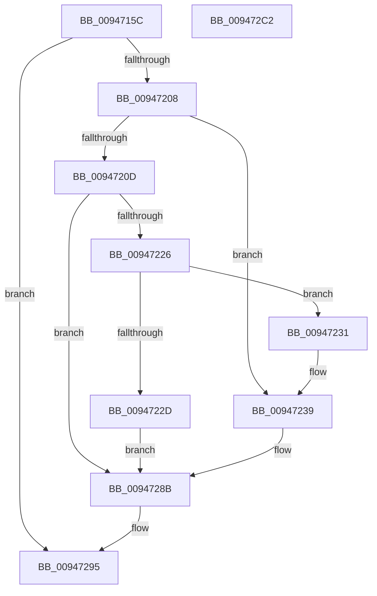

# CmpCheckKeySecurityDescriptorAccess

- RVA: `0x0094715C`–`0x009472C3` (길이 `359` bytes)
- VA: `0x000000014094715C`
- 실행 섹션: `PAGE`
- PDB 이름 있음: `예`; PDB Function 태그: `아니요`
- unwind 정보 RVA: `0x00090A7C`
- 디코드: `92`개 명령, `359/359` bytes 표시
- 미해석 바이트: `0` (있으면 어셈블리에 `.byte`로 보존)

> 이 문서는 커널 이미지의 기계어와 PDB 기호를 분석해 생성했습니다. 4번과 5번은 함수 원형과 자료형을 바이너리 사용 방식에서 추정한 C 해석이며 원본 소스 복구 결과는 아닙니다.

## 1. Dependencies

- 직접 호출 지점: **8**; 고유 호출 대상: **7**
- 직접 호출자로 확인된 함수: **3**
- RIP 상대 이미지 참조: **2**

### Outgoing calls
- `0x009471B1` → [memset](../../text/6C/memset_function_006C6C40.md) (function, `0x006C6C40`)
- `0x009471C2` → [memset](../../text/6C/memset_function_006C6C40.md) (function, `0x006C6C40`)
- `0x009471DB` → [PsGetCurrentThreadProcess](../../text/47/PsGetCurrentThreadProcess_function_0047C7E0.md) (function, `0x0047C7E0`)
- `0x009471F9` → [SeCreateAccessStateEx](SeCreateAccessStateEx_function_00947A80.md) (function, `0x00947A80`)
- `0x0094721B` → [CmpSetAccessStateForBackupRestore](CmpSetAccessStateForBackupRestore_function_00947D2C.md) (function, `0x00947D2C`)
- `0x0094727A` → [SeAccessCheck](../../text/3A/SeAccessCheck_function_003A6BC0.md) (function, `0x003A6BC0`)
- `0x00947290` → [SeDeleteAccessState](../8C/SeDeleteAccessState_function_008C5F70.md) (function, `0x008C5F70`)
- `0x009472A1` → [_security_check_cookie](../../text/6A/_security_check_cookie_function_006AC640.md) (function, `0x006AC640`)

### Direct callers
- [CmpCheckKcbStackAccess](../70/CmpCheckKcbStackAccess_function_00701174.md) at `0x0070119B`
- [CmpCheckKeyNodeStackAccess](CmpCheckKeyNodeStackAccess_function_009459AC.md) at `0x00945A26`
- [CmpCheckSecurityCellAccess](CmpCheckSecurityCellAccess_function_009470C0.md) at `0x00947111`

### Static image references
- `0x0094717D` → RVA `0x00E0A740` (`.data`; read)
- `0x009471D0` → RVA `0x00FC6AC0` (`ALMOSTRO`; read)

## 2. Other-region calls and transfers

- 다른 실행 섹션으로 향하는 call: **5**
  - `0x009471B1` → [memset](../../text/6C/memset_function_006C6C40.md) (`PAGE` → `.text`)
  - `0x009471C2` → [memset](../../text/6C/memset_function_006C6C40.md) (`PAGE` → `.text`)
  - `0x009471DB` → [PsGetCurrentThreadProcess](../../text/47/PsGetCurrentThreadProcess_function_0047C7E0.md) (`PAGE` → `.text`)
  - `0x0094727A` → [SeAccessCheck](../../text/3A/SeAccessCheck_function_003A6BC0.md) (`PAGE` → `.text`)
  - `0x009472A1` → [_security_check_cookie](../../text/6A/_security_check_cookie_function_006AC640.md) (`PAGE` → `.text`)
- 별도 외부 분기/꼬리 이동을 확인하지 못했습니다.

## 3. Assembly (complete function range)

```asm
0094715C  48 89 5C 24 10                  mov qword ptr [rsp + 0x10], rbx
00947161  48 89 74 24 20                  mov qword ptr [rsp + 0x20], rsi
00947166  55                              push rbp
00947167  57                              push rdi
00947168  41 54                           push r12
0094716A  41 56                           push r14
0094716C  41 57                           push r15
0094716E  48 8D AC 24 10 FF FF FF         lea rbp, [rsp - 0xf0]
00947176  48 81 EC F0 01 00 00            sub rsp, 0x1f0
0094717D  48 8B 05 BC 35 4C 00            mov rax, qword ptr [rip + 0x4c35bc]
00947184  48 33 C4                        xor rax, rsp
00947187  48 89 85 E0 00 00 00            mov qword ptr [rbp + 0xe0], rax
0094718E  83 64 24 50 00                  and dword ptr [rsp + 0x50], 0
00947193  45 8B E0                        mov r12d, r8d
00947196  83 64 24 54 00                  and dword ptr [rsp + 0x54], 0
0094719B  40 8A F2                        mov sil, dl
0094719E  4C 8B F1                        mov r14, rcx
009471A1  33 D2                           xor edx, edx
009471A3  41 B8 A0 00 00 00               mov r8d, 0xa0
009471A9  48 8D 4C 24 60                  lea rcx, [rsp + 0x60]
009471AE  45 8A F9                        mov r15b, r9b
009471B1  E8 8A FA D7 FF                  call 0x1406c6c40
009471B6  33 D2                           xor edx, edx
009471B8  48 8D 4D 00                     lea rcx, [rbp]
009471BC  41 B8 E0 00 00 00               mov r8d, 0xe0
009471C2  E8 79 FA D7 FF                  call 0x1406c6c40
009471C7  65 48 8B 3C 25 88 01 00 00      mov rdi, qword ptr gs:[0x188]
009471D0  48 8B 1D E9 F8 67 00            mov rbx, qword ptr [rip + 0x67f8e9]
009471D7  48 83 C3 4C                     add rbx, 0x4c
009471DB  E8 00 56 B3 FF                  call 0x14047c7e0
009471E0  48 8B D0                        mov rdx, rax
009471E3  48 89 5C 24 28                  mov qword ptr [rsp + 0x28], rbx
009471E8  4C 8D 4D 00                     lea r9, [rbp]
009471EC  44 89 64 24 20                  mov dword ptr [rsp + 0x20], r12d
009471F1  4C 8D 44 24 60                  lea r8, [rsp + 0x60]
009471F6  48 8B CF                        mov rcx, rdi
009471F9  E8 82 08 00 00                  call 0x140947a80
009471FE  8B D8                           mov ebx, eax
00947200  85 C0                           test eax, eax
00947202  0F 88 8D 00 00 00               js 0x140947295
00947208  45 84 FF                        test r15b, r15b
0094720B  74 2C                           je 0x140947239
0094720D  45 33 C9                        xor r9d, r9d
00947210  48 8D 4C 24 60                  lea rcx, [rsp + 0x60]
00947215  4D 8B C6                        mov r8, r14
00947218  40 8A D6                        mov dl, sil
0094721B  E8 0C 0B 00 00                  call 0x140947d2c
00947220  8B D8                           mov ebx, eax
00947222  85 C0                           test eax, eax
00947224  78 65                           js 0x14094728b
00947226  83 7C 24 70 00                  cmp dword ptr [rsp + 0x70], 0
0094722B  75 04                           jne 0x140947231
0094722D  33 DB                           xor ebx, ebx
0094722F  EB 5A                           jmp 0x14094728b
00947231  8B 44 24 74                     mov eax, dword ptr [rsp + 0x74]
00947235  89 44 24 50                     mov dword ptr [rsp + 0x50], eax
00947239  48 8B 05 80 F8 67 00            mov rax, qword ptr [rip + 0x67f880]
00947240  48 8D 4C 24 54                  lea rcx, [rsp + 0x54]
00947245  48 89 4C 24 48                  mov qword ptr [rsp + 0x48], rcx
0094724A  48 8D 55 80                     lea rdx, [rbp - 0x80]
0094724E  48 8D 4C 24 50                  lea rcx, [rsp + 0x50]
00947253  48 83 C0 4C                     add rax, 0x4c
00947257  48 89 4C 24 40                  mov qword ptr [rsp + 0x40], rcx
0094725C  45 8B CC                        mov r9d, r12d
0094725F  40 88 74 24 38                  mov byte ptr [rsp + 0x38], sil
00947264  45 33 C0                        xor r8d, r8d
00947267  48 89 44 24 30                  mov qword ptr [rsp + 0x30], rax
0094726C  49 8B CE                        mov rcx, r14
0094726F  48 83 64 24 28 00               and qword ptr [rsp + 0x28], 0
00947275  83 64 24 20 00                  and dword ptr [rsp + 0x20], 0
0094727A  E8 41 F9 A5 FF                  call 0x1403a6bc0
0094727F  F6 D8                           neg al
00947281  1B DB                           sbb ebx, ebx
00947283  F7 D3                           not ebx
00947285  81 E3 22 00 00 C0               and ebx, 0xc0000022
0094728B  48 8D 4C 24 60                  lea rcx, [rsp + 0x60]
00947290  E8 DB EC F7 FF                  call 0x1408c5f70
00947295  8B C3                           mov eax, ebx
00947297  48 8B 8D E0 00 00 00            mov rcx, qword ptr [rbp + 0xe0]
0094729E  48 33 CC                        xor rcx, rsp
009472A1  E8 9A 53 D6 FF                  call 0x1406ac640
009472A6  4C 8D 9C 24 F0 01 00 00         lea r11, [rsp + 0x1f0]
009472AE  49 8B 5B 38                     mov rbx, qword ptr [r11 + 0x38]
009472B2  49 8B 73 48                     mov rsi, qword ptr [r11 + 0x48]
009472B6  49 8B E3                        mov rsp, r11
009472B9  41 5F                           pop r15
009472BB  41 5E                           pop r14
009472BD  41 5C                           pop r12
009472BF  5F                              pop rdi
009472C0  5D                              pop rbp
009472C1  C3                              ret
009472C2  CC                              int3
```

## 4. C-style interpretation (structured pseudocode)

```c
__int64 __fastcall CmpCheckKeySecurityDescriptorAccess(__int64 a1, int a2, int a3, unsigned __int8 a4)
{
    __int64 result;
    __int64 v_rbx;
    __int64 v_rsp;
    unsigned __int64 v_stack_m118;
    unsigned __int64 v_stack_m198;
    unsigned int v_stack_m1A4;
    unsigned int v_stack_m1A8;
    unsigned __int64 v_stack_m1B8;
    unsigned int v_stack_m1C4;
    unsigned int v_stack_m1C8;
    unsigned __int64 v_stack_m1D0;
    unsigned __int64 v_stack_m1D8;
    unsigned __int8 v_stack_m1E0;
    unsigned __int64 v_stack_m1E8;
    unsigned __int64 v_stack_m1F0;
    unsigned int v_stack_m1F8;
    unsigned __int64 v_stack_m28;
    unsigned __int64 v_stack_m38;
    unsigned __int64 v_stack_p10;
    unsigned __int64 v_stack_p20;

    v_stack_p10 = v_rbx;
    v_stack_p20 = v_rsi;
    v_rsp = (v_rsp) - (496);
    result = (*(unsigned __int64 *)(v_rip + 4994492)) ^ (v_rsp);
    v_stack_m38 = result;
    a2 = 0;
    result = memset(v_stack_m1B8, a2, 160, a4);
    a2 = 0;
    result = memset(v_stack_m118, a2, 224, a4);
    v_rbx = (*(unsigned __int64 *)(v_rip + 6813929)) + (76);
    result = PsGetCurrentThreadProcess(v_stack_m118, a2, 224, a4);
    v_stack_m1F0 = v_rbx;
    v_stack_m1F8 = (unsigned int)((unsigned int)(a3));
    result = SeCreateAccessStateEx(*(unsigned __int64 *)(gs_base + (0 + 392)), result, v_stack_m1B8, v_stack_m118);
    if (sign_flag) goto loc_00947295;
    if (a4 == 0) goto loc_00947239;
    a4 = 0;
    result = CmpSetAccessStateForBackupRestore(v_stack_m1B8, (unsigned __int8)((unsigned __int8)(a2)), a1, a4);
    if (sign_flag) goto loc_0094728B;
    if (v_stack_m1A8 != 0) goto loc_00947231;
    v_rbx = 0;
    goto loc_0094728B;
loc_00947231:
    v_stack_m1C8 = (unsigned int)((unsigned int)(v_stack_m1A4));
loc_00947239:
    v_stack_m1D0 = v_stack_m1C4;
    result = (*(unsigned __int64 *)(v_rip + 6813824)) + (76);
    v_stack_m1D8 = v_stack_m1C8;
    v_stack_m1E0 = (unsigned __int8)((unsigned __int8)(a2));
    a3 = 0;
    v_stack_m1E8 = result;
    result = SeAccessCheck(a1, v_stack_m198, a3, (unsigned int)((unsigned int)((unsigned int)(a3))));
    result = (unsigned __int8)(-(result));
    v_rbx = (unsigned int)(~(v_rbx));
    v_rbx = (unsigned int)((v_rbx) & (0xC0000022ULL));
loc_0094728B:
    result = SeDeleteAccessState(v_stack_m1B8, v_stack_m198, a3, (unsigned int)((unsigned int)((unsigned int)(a3))));
loc_00947295:
    a1 = (v_stack_m38) ^ (v_rsp);
    result = _security_check_cookie(a1, v_stack_m198, a3, (unsigned int)((unsigned int)((unsigned int)(a3))));
    return result;
}
```

## 5. (Beta) C Style

```c
int64_t CmpCheckKeySecurityDescriptorAccess(int64_t Arg1, int32_t Arg2, int32_t Arg3, uint8_t Arg4)
{
    int64_t result;
    int64_t local_rbx;
    int64_t local_rsp;
    uint64_t v_stack_m118;
    uint64_t v_stack_m198;
    uint32_t v_stack_m1A4;
    uint32_t v_stack_m1A8;
    uint64_t v_stack_m1B8;
    uint32_t v_stack_m1C4;
    uint32_t v_stack_m1C8;
    uint64_t v_stack_m1D0;
    uint64_t v_stack_m1D8;
    uint8_t v_stack_m1E0;
    uint64_t v_stack_m1E8;
    uint64_t v_stack_m1F0;
    uint32_t v_stack_m1F8;
    uint64_t v_stack_m28;
    uint64_t v_stack_m38;
    uint64_t v_stack_p10;
    uint64_t v_stack_p20;

    v_stack_p10 = local_rbx;
    v_stack_p20 = local_rsi;
    local_rsp = (local_rsp) - (496);
    result = (*(uint64_t *)(v_rip + 0x4C35BC)) ^ (local_rsp);
    v_stack_m38 = result;
    Arg2 = 0;
    result = memset(v_stack_m1B8, Arg2, 160, Arg4);
    Arg2 = 0;
    result = memset(v_stack_m118, Arg2, 224, Arg4);
    local_rbx = (*(uint64_t *)(v_rip + 0x67F8E9)) + (76);
    result = PsGetCurrentThreadProcess(v_stack_m118, Arg2, 224, Arg4);
    v_stack_m1F0 = local_rbx;
    v_stack_m1F8 = (uint32_t)((uint32_t)(Arg3));
    result = SeCreateAccessStateEx(*(uint64_t *)(gs_base + (0 + 0x188)), result, v_stack_m1B8, v_stack_m118);
    if (sign_flag) goto loc_00947295;
    if (Arg4 == 0) goto loc_00947239;
    Arg4 = 0;
    result = CmpSetAccessStateForBackupRestore(v_stack_m1B8, (uint8_t)((uint8_t)(Arg2)), Arg1, Arg4);
    if (sign_flag) goto loc_0094728B;
    if (v_stack_m1A8 != 0) goto loc_00947231;
    local_rbx = 0;
    goto loc_0094728B;
loc_00947231:
    v_stack_m1C8 = (uint32_t)((uint32_t)(v_stack_m1A4));
loc_00947239:
    v_stack_m1D0 = v_stack_m1C4;
    result = (*(uint64_t *)(v_rip + 0x67F880)) + (76);
    v_stack_m1D8 = v_stack_m1C8;
    v_stack_m1E0 = (uint8_t)((uint8_t)(Arg2));
    Arg3 = 0;
    v_stack_m1E8 = result;
    result = SeAccessCheck(Arg1, v_stack_m198, Arg3, (uint32_t)((uint32_t)((uint32_t)(Arg3))));
    result = (uint8_t)(-(result));
    local_rbx = (uint32_t)(~(local_rbx));
    local_rbx = (uint32_t)((local_rbx) & (0xC0000022ULL));
loc_0094728B:
    result = SeDeleteAccessState(v_stack_m1B8, v_stack_m198, Arg3, (uint32_t)((uint32_t)((uint32_t)(Arg3))));
loc_00947295:
    Arg1 = (v_stack_m38) ^ (local_rsp);
    result = _security_check_cookie(Arg1, v_stack_m198, Arg3, (uint32_t)((uint32_t)((uint32_t)(Arg3))));
    return result;
}
```

## 6. Execution-region graph

[열기: 2D/3D 그래프와 함수 탐색 컨트롤 패널](../../../control-panel.html?section=page&rva=0x0094715C&view=graph)

- 2D 그래프는 위에서 아래로 흐르고, 3D 그래프는 빈 공간을 드래그해 회전합니다. Shift+드래그는 이동, 휠은 확대·축소, 함수 노드 선택은 대상 보고서 이동입니다.

### Static fallback


