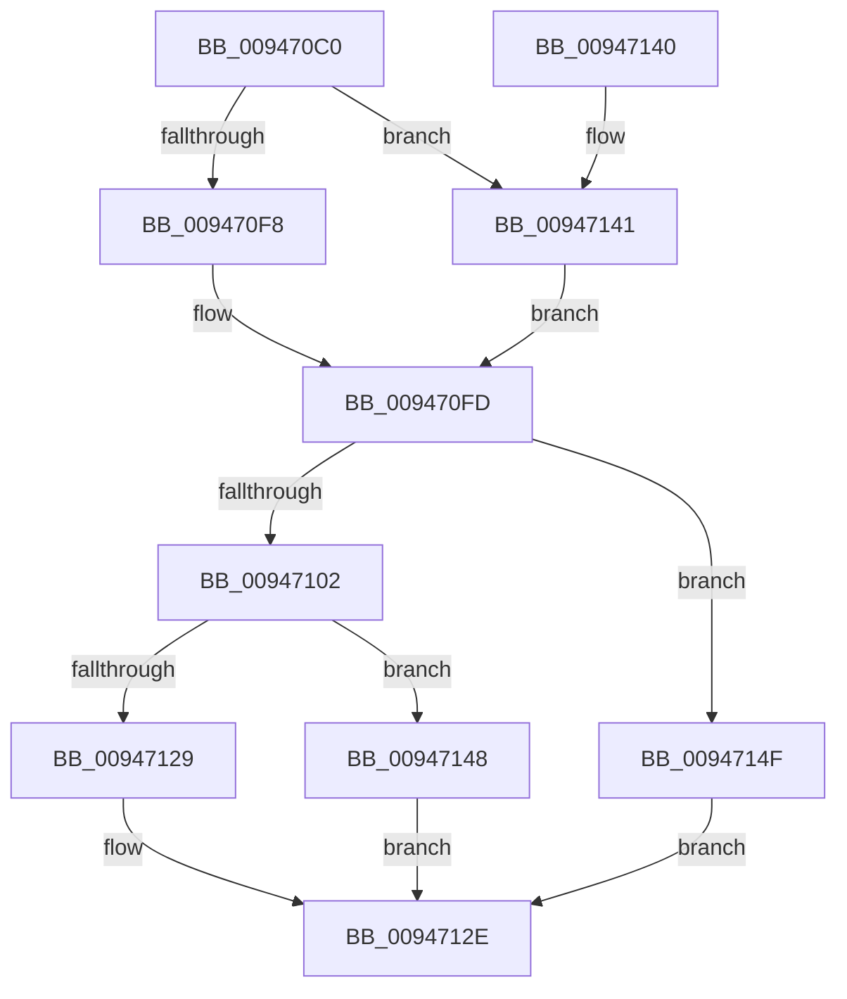

# CmpCheckSecurityCellAccess

- RVA: `0x009470C0`–`0x00947156` (길이 `150` bytes)
- VA: `0x00000001409470C0`
- 실행 섹션: `PAGE`
- PDB 이름 있음: `예`; PDB Function 태그: `아니요`
- unwind 정보 RVA: `0x00090A68`
- 디코드: `42`개 명령, `150/150` bytes 표시
- 미해석 바이트: `0` (있으면 어셈블리에 `.byte`로 보존)

> 이 문서는 커널 이미지의 기계어와 PDB 기호를 분석해 생성했습니다. 4번과 5번은 함수 원형과 자료형을 바이너리 사용 방식에서 추정한 C 해석이며 원본 소스 복구 결과는 아닙니다.

## 1. Dependencies

- 직접 호출 지점: **6**; 고유 호출 대상: **6**
- 직접 호출자로 확인된 함수: **2**
- RIP 상대 이미지 참조: **0**

### Outgoing calls
- `0x009470E2` → [HvpGetCellContextInitialize](../85/HvpGetCellContextInitialize_function_00855F10.md) (function, `0x00855F10`)
- `0x009470F8` → [HvpGetCellFlat](../85/HvpGetCellFlat_function_00854C60.md) (function, `0x00854C60`)
- `0x00947111` → [CmpCheckKeySecurityDescriptorAccess](CmpCheckKeySecurityDescriptorAccess_function_0094715C.md) (function, `0x0094715C`)
- `0x00947129` → [HvpReleaseCellPaged](../85/HvpReleaseCellPaged_function_00855F40.md) (function, `0x00855F40`)
- `0x00947141` → [HvpGetCellPaged](../85/HvpGetCellPaged_function_00854CB0.md) (function, `0x00854CB0`)
- `0x00947148` → [HvpReleaseCellFlat](../85/HvpReleaseCellFlat_function_0085CC20.md) (function, `0x0085CC20`)

### Direct callers
- [CmpValidateHiveSecurityDescriptors](../96/CmpValidateHiveSecurityDescriptors_function_0096DAFC.md) at `0x0096DDE1`
- [CmpCheckKeyAccess](../A6/CmpCheckKeyAccess_function_00A6DE7C.md) at `0x00A6DEF3`

### Static image references
- 디코드된 RIP-relative 메모리 참조가 없습니다.

## 2. Other-region calls and transfers

- 다른 실행 섹션으로 향하는 call: **0**
- 별도 외부 분기/꼬리 이동을 확인하지 못했습니다.

## 3. Assembly (complete function range)

```asm
009470C0  48 8B C4                        mov rax, rsp
009470C3  48 89 58 10                     mov qword ptr [rax + 0x10], rbx
009470C7  48 89 70 18                     mov qword ptr [rax + 0x18], rsi
009470CB  57                              push rdi
009470CC  48 83 EC 20                     sub rsp, 0x20
009470D0  48 83 60 08 00                  and qword ptr [rax + 8], 0
009470D5  48 8B D9                        mov rbx, rcx
009470D8  48 8D 48 08                     lea rcx, [rax + 8]
009470DC  41 8B F9                        mov edi, r9d
009470DF  41 8A F0                        mov sil, r8b
009470E2  E8 29 EE F0 FF                  call 0x140855f10
009470E7  F6 83 8C 00 00 00 01            test byte ptr [rbx + 0x8c], 1
009470EE  4C 8D 44 24 30                  lea r8, [rsp + 0x30]
009470F3  48 8B CB                        mov rcx, rbx
009470F6  74 49                           je 0x140947141
009470F8  E8 63 DB F0 FF                  call 0x140854c60
009470FD  48 85 C0                        test rax, rax
00947100  74 4D                           je 0x14094714f
00947102  44 8A 4C 24 50                  mov r9b, byte ptr [rsp + 0x50]
00947107  48 8D 48 14                     lea rcx, [rax + 0x14]
0094710B  44 8B C7                        mov r8d, edi
0094710E  40 8A D6                        mov dl, sil
00947111  E8 46 00 00 00                  call 0x14094715c
00947116  8B F8                           mov edi, eax
00947118  F6 83 8C 00 00 00 01            test byte ptr [rbx + 0x8c], 1
0094711F  48 8D 54 24 30                  lea rdx, [rsp + 0x30]
00947124  48 8B CB                        mov rcx, rbx
00947127  75 1F                           jne 0x140947148
00947129  E8 12 EE F0 FF                  call 0x140855f40
0094712E  48 8B 5C 24 38                  mov rbx, qword ptr [rsp + 0x38]
00947133  8B C7                           mov eax, edi
00947135  48 8B 74 24 40                  mov rsi, qword ptr [rsp + 0x40]
0094713A  48 83 C4 20                     add rsp, 0x20
0094713E  5F                              pop rdi
0094713F  C3                              ret
00947140  CC                              int3
00947141  E8 6A DB F0 FF                  call 0x140854cb0
00947146  EB B5                           jmp 0x1409470fd
00947148  E8 D3 5A F1 FF                  call 0x14085cc20
0094714D  EB DF                           jmp 0x14094712e
0094714F  BF 9A 00 00 C0                  mov edi, 0xc000009a
00947154  EB D8                           jmp 0x14094712e
```

## 4. C-style interpretation (structured pseudocode)

```c
__int64 __fastcall CmpCheckSecurityCellAccess(__int64 a1, __int64 a2, unsigned __int8 a3, int a4, unsigned __int8 a5)
{
    __int64 result;
    __int64 v_rsp;
    unsigned __int64 v_stack_p10;
    unsigned __int64 v_stack_p18;
    unsigned __int64 v_stack_p8;

    *(unsigned __int64 *)(v_rsp + 16) = v_rbx;
    *(unsigned __int64 *)(v_rsp + 24) = v_rsi;
    v_rsp = (v_rsp) - (32);
    result = HvpGetCellContextInitialize(v_rsp + 8, a2, a3, a4);
    if (((*(unsigned __int8 *)(a1 + 140)) & (1)) == 0) goto loc_00947141;
    result = HvpGetCellFlat(a1, a2, v_stack_p8, a4);
loc_009470FD:
    if (result == 0) goto loc_0094714F;
    result = CmpCheckKeySecurityDescriptorAccess(result + 20, a3, (unsigned int)((unsigned int)((unsigned int)(a4))), a5);
    if (((*(unsigned __int8 *)(a1 + 140)) & (1)) != 0) goto loc_00947148;
    result = HvpReleaseCellPaged(a1, v_stack_p8, (unsigned int)((unsigned int)((unsigned int)(a4))), a5);
loc_0094712E:
    v_rsp = (v_rsp) + (32);
    return (unsigned int)((unsigned int)((unsigned int)((unsigned int)(result))));
loc_00947141:
    result = HvpGetCellPaged(a1, v_stack_p8, (unsigned int)((unsigned int)((unsigned int)(a4))), a5);
    goto loc_009470FD;
loc_00947148:
    result = HvpReleaseCellFlat(a1, v_stack_p8, (unsigned int)((unsigned int)((unsigned int)(a4))), a5);
    goto loc_0094712E;
loc_0094714F:
    goto loc_0094712E;
}
```

## 5. (Beta) C Style

```c
int64_t CmpCheckSecurityCellAccess(void *Arg1, int64_t Arg2, uint8_t Arg3, int32_t Arg4, uint8_t Arg5)
{
    uint8_t *arg1 = (uint8_t *)Arg1;

    int64_t result;
    int64_t local_rsp;
    uint64_t v_stack_p10;
    uint64_t v_stack_p18;
    uint64_t v_stack_p8;

    *(uint64_t *)(local_rsp + 0x10) = local_rbx;
    *(uint64_t *)(local_rsp + 0x18) = local_rsi;
    local_rsp = (local_rsp) - (32);
    result = HvpGetCellContextInitialize(local_rsp + 8, Arg2, Arg3, Arg4);
    if (((*(uint8_t *)(arg1 + 0x8C)) & (1)) == 0) goto loc_00947141;
    result = HvpGetCellFlat(Arg1, Arg2, v_stack_p8, Arg4);
loc_009470FD:
    if (result == 0) goto loc_0094714F;
    result = CmpCheckKeySecurityDescriptorAccess(result + 20, Arg3, (uint32_t)((uint32_t)((uint32_t)(Arg4))), Arg5);
    if (((*(uint8_t *)(arg1 + 0x8C)) & (1)) != 0) goto loc_00947148;
    result = HvpReleaseCellPaged(Arg1, v_stack_p8, (uint32_t)((uint32_t)((uint32_t)(Arg4))), Arg5);
loc_0094712E:
    local_rsp = (local_rsp) + (32);
    return (uint32_t)((uint32_t)((uint32_t)((uint32_t)(result))));
loc_00947141:
    result = HvpGetCellPaged(Arg1, v_stack_p8, (uint32_t)((uint32_t)((uint32_t)(Arg4))), Arg5);
    goto loc_009470FD;
loc_00947148:
    result = HvpReleaseCellFlat(Arg1, v_stack_p8, (uint32_t)((uint32_t)((uint32_t)(Arg4))), Arg5);
    goto loc_0094712E;
loc_0094714F:
    goto loc_0094712E;
}
```

### 관측된 메모리 오프셋

구조체 형식이 확인되지 않은 접근은 인자 기준의 오프셋으로만 기록했습니다.

| 기준 인자 | 오프셋 표현 | 폭 (bit) | 접근 |
|---|---:|---:|---|
| `Arg1` | `+ 0x8C` | `8` | `R` |

## 6. Execution-region graph

[열기: 2D/3D 그래프와 함수 탐색 컨트롤 패널](../../../control-panel.html?section=page&rva=0x009470C0&view=graph)

- 2D 그래프는 위에서 아래로 흐르고, 3D 그래프는 빈 공간을 드래그해 회전합니다. Shift+드래그는 이동, 휠은 확대·축소, 함수 노드 선택은 대상 보고서 이동입니다.

### Static fallback


