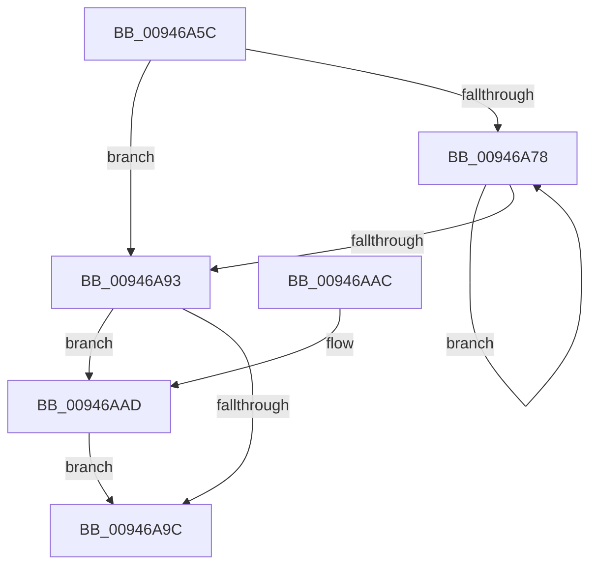

# CmpCleanupKeyNodeStack

- RVA: `0x00946A5C`–`0x00946AB4` (길이 `88` bytes)
- VA: `0x0000000140946A5C`
- 실행 섹션: `PAGE`
- PDB 이름 있음: `예`; PDB Function 태그: `아니요`
- unwind 정보 RVA: `0x0006383C`
- 디코드: `28`개 명령, `88/88` bytes 표시
- 미해석 바이트: `0` (있으면 어셈블리에 `.byte`로 보존)

> 이 문서는 커널 이미지의 기계어와 PDB 기호를 분석해 생성했습니다. 4번과 5번은 함수 원형과 자료형을 바이너리 사용 방식에서 추정한 C 해석이며 원본 소스 복구 결과는 아닙니다.

## 1. Dependencies

- 직접 호출 지점: **3**; 고유 호출 대상: **3**
- 직접 호출자로 확인된 함수: **11**
- RIP 상대 이미지 참조: **0**

### Outgoing calls
- `0x00946A7E` → [CmpKeyNodeStackGetEntryAtLayerHeight](CmpKeyNodeStackGetEntryAtLayerHeight_function_00946ABC.md) (function, `0x00946ABC`)
- `0x00946A86` → [CmpKeyNodeStackEntryCleanup](CmpKeyNodeStackEntryCleanup_function_00946AEC.md) (function, `0x00946AEC`)
- `0x00946AAD` → [CmSiFreeMemory](../../text/47/CmSiFreeMemory_function_00475D80.md) (function, `0x00475D80`)

### Direct callers
- [CmQueryLayeredKey](../../text/46/CmQueryLayeredKey_function_0046A930.md) at `0x0046AAB2`
- [CmSaveKey](../7D/CmSaveKey_function_007DDBDC.md) at `0x007DDF5F`
- [CmSaveKey](../7D/CmSaveKey_function_007DDBDC.md) at `0x007DDFB2`
- [CmpFullPromoteHiveRootFromKcbStack](../7F/CmpFullPromoteHiveRootFromKcbStack_function_007F3F90.md) at `0x007F403E`
- [CmpPromoteSingleKeyFromParentKcbAndChildKeyNode](../7F/CmpPromoteSingleKeyFromParentKcbAndChildKeyNode_function_007F426C.md) at `0x007F4364`
- [CmpGetSubKeyCountForKcbStack](CmpGetSubKeyCountForKcbStack_function_00944628.md) at `0x009446B8`
- [CmpPromoteSingleKeyFromKcbStacks](CmpPromoteSingleKeyFromKcbStacks_function_009446E8.md) at `0x0094490F`
- [CmpPromoteSingleKeyFromKcbStacks](CmpPromoteSingleKeyFromKcbStacks_function_009446E8.md) at `0x00944919`
- [CmpValueEnumStackStartFromKcbStack](CmpValueEnumStackStartFromKcbStack_function_00944AA4.md) at `0x00944B3F`
- [CmpKeyEnumStackStartFromKcbStack](CmpKeyEnumStackStartFromKcbStack_function_00944F18.md) at `0x00945058`
- [CmpGetSubKeyCountForKeyNodeStack](CmpGetSubKeyCountForKeyNodeStack_function_00945624.md) at `0x009456A9`
- [CmpSubtreeEnumeratorCleanup](CmpSubtreeEnumeratorCleanup_function_00945D98.md) at `0x00945DF2`
- [CmpKeyEnumStackCleanup](CmpKeyEnumStackCleanup_function_00946868.md) at `0x0094687E`

### Static image references
- 디코드된 RIP-relative 메모리 참조가 없습니다.

## 2. Other-region calls and transfers

- 다른 실행 섹션으로 향하는 call: **1**
  - `0x00946AAD` → [CmSiFreeMemory](../../text/47/CmSiFreeMemory_function_00475D80.md) (`PAGE` → `.text`)
- 별도 외부 분기/꼬리 이동을 확인하지 못했습니다.

## 3. Assembly (complete function range)

```asm
00946A5C  48 89 5C 24 08                  mov qword ptr [rsp + 8], rbx
00946A61  48 89 74 24 10                  mov qword ptr [rsp + 0x10], rsi
00946A66  57                              push rdi
00946A67  48 83 EC 20                     sub rsp, 0x20
00946A6B  33 F6                           xor esi, esi
00946A6D  48 8B D9                        mov rbx, rcx
00946A70  0F B7 FE                        movzx edi, si
00946A73  66 3B 31                        cmp si, word ptr [rcx]
00946A76  7F 1B                           jg 0x140946a93
00946A78  0F B7 D7                        movzx edx, di
00946A7B  48 8B CB                        mov rcx, rbx
00946A7E  E8 39 00 00 00                  call 0x140946abc
00946A83  48 8B C8                        mov rcx, rax
00946A86  E8 61 00 00 00                  call 0x140946aec
00946A8B  66 FF C7                        inc di
00946A8E  66 3B 3B                        cmp di, word ptr [rbx]
00946A91  7E E5                           jle 0x140946a78
00946A93  48 8B 4B 48                     mov rcx, qword ptr [rbx + 0x48]
00946A97  48 85 C9                        test rcx, rcx
00946A9A  75 11                           jne 0x140946aad
00946A9C  48 8B 5C 24 30                  mov rbx, qword ptr [rsp + 0x30]
00946AA1  48 8B 74 24 38                  mov rsi, qword ptr [rsp + 0x38]
00946AA6  48 83 C4 20                     add rsp, 0x20
00946AAA  5F                              pop rdi
00946AAB  C3                              ret
00946AAC  CC                              int3
00946AAD  E8 CE F2 B2 FF                  call 0x140475d80
00946AB2  EB E8                           jmp 0x140946a9c
```

## 4. C-style interpretation (structured pseudocode)

```c
__int64 __fastcall CmpCleanupKeyNodeStack(__int64 a1)
{
    __int64 result;
    __int64 v_rdi;
    __int64 v_rsi;
    __int64 v_rsp;
    unsigned __int64 v_stack_p10;
    unsigned __int64 v_stack_p8;

    v_stack_p8 = v_rbx;
    v_stack_p10 = v_rsi;
    v_rsp = (v_rsp) - (32);
    v_rsi = 0;
    if (0 > (*(unsigned __int16 *)(a1))) goto loc_00946A93;
loc_00946A78:
    result = CmpKeyNodeStackGetEntryAtLayerHeight(a1, 0, a3, a4);
    result = CmpKeyNodeStackEntryCleanup(result, 0, a3, a4);
    v_rdi = (unsigned __int16)((0) + 1);
    if (((unsigned __int16)(v_rdi)) <= (*(unsigned __int16 *)(a1))) goto loc_00946A78;
loc_00946A93:
    if (*(unsigned __int64 *)(a1 + 72) != 0) goto loc_00946AAD;
loc_00946A9C:
    v_rsp = (v_rsp) + (32);
    return result;
loc_00946AAD:
    result = CmSiFreeMemory(*(unsigned __int64 *)(a1 + 72), 0, a3, a4);
    goto loc_00946A9C;
}
```

## 5. (Beta) C Style

```c
int64_t CmpCleanupKeyNodeStack(void *Arg1)
{
    uint8_t *arg1 = (uint8_t *)Arg1;

    int64_t result;
    int64_t local_rdi;
    int64_t local_rsi;
    int64_t local_rsp;
    uint64_t v_stack_p10;
    uint64_t v_stack_p8;

    v_stack_p8 = local_rbx;
    v_stack_p10 = local_rsi;
    local_rsp = (local_rsp) - (32);
    local_rsi = 0;
    if (0 > (*(uint16_t *)(arg1))) goto loc_00946A93;
loc_00946A78:
    result = CmpKeyNodeStackGetEntryAtLayerHeight(Arg1, 0, a3, a4);
    result = CmpKeyNodeStackEntryCleanup(result, 0, a3, a4);
    local_rdi = (uint16_t)((0) + 1);
    if (((uint16_t)(local_rdi)) <= (*(uint16_t *)(arg1))) goto loc_00946A78;
loc_00946A93:
    if (*(uint64_t *)(arg1 + 0x48) != 0) goto loc_00946AAD;
loc_00946A9C:
    local_rsp = (local_rsp) + (32);
    return result;
loc_00946AAD:
    result = CmSiFreeMemory(*(uint64_t *)(arg1 + 0x48), 0, a3, a4);
    goto loc_00946A9C;
}
```

### 관측된 메모리 오프셋

구조체 형식이 확인되지 않은 접근은 인자 기준의 오프셋으로만 기록했습니다.

| 기준 인자 | 오프셋 표현 | 폭 (bit) | 접근 |
|---|---:|---:|---|
| `Arg1` | `+ 0x0` | `16` | `R` |
| `Arg1` | `+ 0x48` | `64` | `R` |

## 6. Execution-region graph

[열기: 2D/3D 그래프와 함수 탐색 컨트롤 패널](../../../control-panel.html?section=page&rva=0x00946A5C&view=graph)

- 2D 그래프는 위에서 아래로 흐르고, 3D 그래프는 빈 공간을 드래그해 회전합니다. Shift+드래그는 이동, 휠은 확대·축소, 함수 노드 선택은 대상 보고서 이동입니다.

### Static fallback


