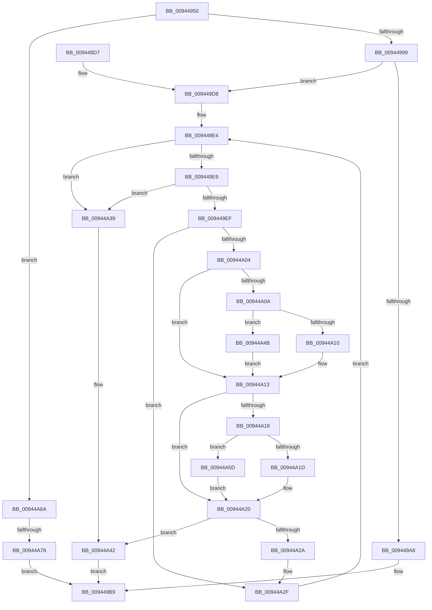

# CmpCompareKeysByName

- RVA: `0x00944950`–`0x00944A9D` (길이 `333` bytes)
- VA: `0x0000000140944950`
- 실행 섹션: `PAGE`
- PDB 이름 있음: `예`; PDB Function 태그: `예`
- unwind 정보 RVA: `0x00090734`
- 디코드: `99`개 명령, `333/333` bytes 표시
- 미해석 바이트: `0` (있으면 어셈블리에 `.byte`로 보존)

> 이 문서는 커널 이미지의 기계어와 PDB 기호를 분석해 생성했습니다. 4번과 5번은 함수 원형과 자료형을 바이너리 사용 방식에서 추정한 C 해석이며 원본 소스 복구 결과는 아닙니다.

## 1. Dependencies

- 직접 호출 지점: **4**; 고유 호출 대상: **3**
- 직접 호출자로 확인된 함수: **4**
- RIP 상대 이미지 참조: **0**

### Outgoing calls
- `0x009449B4` → [CmpCompareTwoCompressedNames](../84/CmpCompareTwoCompressedNames_function_00847610.md) (function, `0x00847610`)
- `0x00944A4E` → [RtlUpcaseUnicodeChar](../85/RtlUpcaseUnicodeChar_function_0085F0F0.md) (function, `0x0085F0F0`)
- `0x00944A60` → [RtlUpcaseUnicodeChar](../85/RtlUpcaseUnicodeChar_function_0085F0F0.md) (function, `0x0085F0F0`)
- `0x00944A93` → [CmpCompareCompressedName](../95/CmpCompareCompressedName_function_00958030.md) (function, `0x00958030`)

### Direct callers
- [CmpKeyEnumStackAdvanceInternal](CmpKeyEnumStackAdvanceInternal_function_009468D4.md) at `0x009469AC`
- [CmpKeyEnumStackAdvanceInternal](CmpKeyEnumStackAdvanceInternal_function_009468D4.md) at `0x00946A1F`
- [CmpKeyEnumStackEntryAdvance](CmpKeyEnumStackEntryAdvance_function_00946BD8.md) at `0x00946D00`
- [CmpKeyEnumStackEntryBegin](CmpKeyEnumStackEntryBegin_function_00946DE4.md) at `0x00946F46`
- [CmpFindSubKeyByNumberFromMergedView](../AB/CmpFindSubKeyByNumberFromMergedView_function_00AB8284.md) at `0x00AB8677`

### Static image references
- 디코드된 RIP-relative 메모리 참조가 없습니다.

## 2. Other-region calls and transfers

- 다른 실행 섹션으로 향하는 call: **0**
- call이 아닌 외부 분기/꼬리 이동: **1**
  - `0x00944A72` → [sub_00B25530](../B2/Unknown_function_00B25530.md) (`tail-transfer`)

## 3. Assembly (complete function range)

```asm
00944950  48 89 5C 24 08                  mov qword ptr [rsp + 8], rbx
00944955  48 89 74 24 10                  mov qword ptr [rsp + 0x10], rsi
0094495A  48 89 7C 24 18                  mov qword ptr [rsp + 0x18], rdi
0094495F  55                              push rbp
00944960  41 54                           push r12
00944962  41 55                           push r13
00944964  41 56                           push r14
00944966  41 57                           push r15
00944968  48 8B EC                        mov rbp, rsp
0094496B  48 83 EC 40                     sub rsp, 0x40
0094496F  44 0F B7 4A 02                  movzx r9d, word ptr [rdx + 2]
00944974  4C 8D 62 4C                     lea r12, [rdx + 0x4c]
00944978  66 41 83 E1 20                  and r9w, 0x20
0094497D  4C 8D 79 4C                     lea r15, [rcx + 0x4c]
00944981  F6 41 02 20                     test byte ptr [rcx + 2], 0x20
00944985  0F 57 C0                        xorps xmm0, xmm0
00944988  0F 57 C9                        xorps xmm1, xmm1
0094498B  0F 11 45 E0                     movups xmmword ptr [rbp - 0x20], xmm0
0094498F  0F 11 4D F0                     movups xmmword ptr [rbp - 0x10], xmm1
00944993  0F 84 D1 00 00 00               je 0x140944a6a
00944999  0F B7 72 48                     movzx esi, word ptr [rdx + 0x48]
0094499D  44 0F B7 71 48                  movzx r14d, word ptr [rcx + 0x48]
009449A2  66 45 85 C9                     test r9w, r9w
009449A6  74 30                           je 0x1409449d8
009449A8  44 8B CE                        mov r9d, esi
009449AB  41 8B D6                        mov edx, r14d
009449AE  4D 8B C4                        mov r8, r12
009449B1  49 8B CF                        mov rcx, r15
009449B4  E8 57 2C F0 FF                  call 0x140847610
009449B9  4C 8D 5C 24 40                  lea r11, [rsp + 0x40]
009449BE  49 8B 5B 30                     mov rbx, qword ptr [r11 + 0x30]
009449C2  49 8B 73 38                     mov rsi, qword ptr [r11 + 0x38]
009449C6  49 8B 7B 40                     mov rdi, qword ptr [r11 + 0x40]
009449CA  49 8B E3                        mov rsp, r11
009449CD  41 5F                           pop r15
009449CF  41 5E                           pop r14
009449D1  41 5D                           pop r13
009449D3  41 5C                           pop r12
009449D5  5D                              pop rbp
009449D6  C3                              ret
009449D7  CC                              int3
009449D8  B8 E0 FF 00 00                  mov eax, 0xffe0
009449DD  66 D1 EE                        shr si, 1
009449E0  44 8D 68 1F                     lea r13d, [rax + 0x1f]
009449E4  66 85 F6                        test si, si
009449E7  74 50                           je 0x140944a39
009449E9  66 45 85 F6                     test r14w, r14w
009449ED  74 4A                           je 0x140944a39
009449EF  41 0F B7 1C 24                  movzx ebx, word ptr [r12]
009449F4  49 83 C4 02                     add r12, 2
009449F8  41 0F B6 3F                     movzx edi, byte ptr [r15]
009449FC  49 FF C7                        inc r15
009449FF  66 3B DF                        cmp bx, di
00944A02  74 2B                           je 0x140944a2f
00944A04  66 83 FB 61                     cmp bx, 0x61
00944A08  72 09                           jb 0x140944a13
00944A0A  66 83 FB 7A                     cmp bx, 0x7a
00944A0E  77 3B                           ja 0x140944a4b
00944A10  66 03 D8                        add bx, ax
00944A13  83 FF 61                        cmp edi, 0x61
00944A16  72 08                           jb 0x140944a20
00944A18  83 FF 7A                        cmp edi, 0x7a
00944A1B  77 40                           ja 0x140944a5d
00944A1D  66 03 F8                        add di, ax
00944A20  0F B7 C7                        movzx eax, di
00944A23  0F B7 D3                        movzx edx, bx
00944A26  2B D0                           sub edx, eax
00944A28  75 18                           jne 0x140944a42
00944A2A  B8 E0 FF 00 00                  mov eax, 0xffe0
00944A2F  66 41 03 F5                     add si, r13w
00944A33  66 45 03 F5                     add r14w, r13w
00944A37  EB AB                           jmp 0x1409449e4
00944A39  41 0F B7 CE                     movzx ecx, r14w
00944A3D  0F B7 D6                        movzx edx, si
00944A40  2B D1                           sub edx, ecx
00944A42  F7 DA                           neg edx
00944A44  8B C2                           mov eax, edx
00944A46  E9 6E FF FF FF                  jmp 0x1409449b9
00944A4B  0F B7 CB                        movzx ecx, bx
00944A4E  E8 9D A6 F1 FF                  call 0x14085f0f0
00944A53  0F B7 D8                        movzx ebx, ax
00944A56  B8 E0 FF 00 00                  mov eax, 0xffe0
00944A5B  EB B6                           jmp 0x140944a13
00944A5D  0F B7 CF                        movzx ecx, di
00944A60  E8 8B A6 F1 FF                  call 0x14085f0f0
00944A65  0F B7 F8                        movzx edi, ax
00944A68  EB B6                           jmp 0x140944a20
00944A6A  4C 89 7D E8                     mov qword ptr [rbp - 0x18], r15
00944A6E  66 45 85 C9                     test r9w, r9w
00944A72  0F 84 B8 0A 1E 00               je 0x140b25530
00944A78  0F B7 41 48                     movzx eax, word ptr [rcx + 0x48]
00944A7C  45 33 C9                        xor r9d, r9d
00944A7F  44 0F B7 42 48                  movzx r8d, word ptr [rdx + 0x48]
00944A84  48 8D 4D E0                     lea rcx, [rbp - 0x20]
00944A88  49 8B D4                        mov rdx, r12
00944A8B  66 89 45 E0                     mov word ptr [rbp - 0x20], ax
00944A8F  66 89 45 E2                     mov word ptr [rbp - 0x1e], ax
00944A93  E8 98 35 01 00                  call 0x140958030
00944A98  E9 1C FF FF FF                  jmp 0x1409449b9
```

## 4. C-style interpretation (structured pseudocode)

```c
__int64 __fastcall CmpCompareKeysByName(__int64 a1, __int64 a2)
{
    __int64 result;
    __int64 v_r12;
    __int64 v_r14;
    __int64 v_r15;
    __int64 v_rbx;
    __int64 v_rdi;
    __int64 v_rsi;
    __int64 v_rsp;
    unsigned __int64 v_stack_m28;
    unsigned __int64 v_stack_m38;
    unsigned __int64 v_stack_m40;
    unsigned __int16 v_stack_m46;
    unsigned __int64 v_stack_m48;
    unsigned __int64 v_stack_p10;
    unsigned __int64 v_stack_p18;
    unsigned __int64 v_stack_p8;

    v_stack_p8 = v_rbx;
    v_stack_p10 = v_rsi;
    v_stack_p18 = v_rdi;
    v_rsp = (v_rsp) - (64);
    a4 = (unsigned __int16)((*(unsigned __int16 *)(a2 + 2)) & (32));
    v_stack_m48 = v_xmm0;
    v_stack_m38 = v_xmm1;
    if (((*(unsigned __int8 *)(a1 + 2)) & (32)) == 0) goto loc_00944A6A;
    if ((unsigned __int16)(a4) == 0) goto loc_009449D8;
    result = CmpCompareTwoCompressedNames(a1 + 76, (unsigned int)((unsigned int)(*(unsigned __int16 *)(a1 + 72))), a2 + 76, (unsigned int)((unsigned int)(*(unsigned __int16 *)(a2 + 72))));
loc_009449B9:
    return result;
loc_009449D8:
    v_rsi = (unsigned __int16)((*(unsigned __int64 *)(v_stack_m28 + 56)) >> (1));
loc_009449E4:
    if ((unsigned __int16)(v_rsi) == 0) goto loc_00944A39;
    if ((unsigned __int16)(*(unsigned __int16 *)(a1 + 72)) == 0) goto loc_00944A39;
    v_r12 = (a2 + 76) + (2);
    v_r15 = (a1 + 76) + 1;
    if (((unsigned __int16)(*(unsigned __int16 *)(a2 + 76))) == ((unsigned __int16)(*(unsigned __int8 *)(a1 + 76)))) goto loc_00944A2F;
    if (((unsigned __int16)(*(unsigned __int16 *)(a2 + 76))) < 97) goto loc_00944A13;
    if (((unsigned __int16)(*(unsigned __int16 *)(a2 + 76))) > 122) goto loc_00944A4B;
    v_rbx = (unsigned __int16)((*(unsigned __int16 *)(a2 + 76)) + ((unsigned __int16)((unsigned int)(0xFFE0ULL))));
loc_00944A13:
    if (((unsigned int)(*(unsigned __int8 *)(a1 + 76))) < 97) goto loc_00944A20;
    if (((unsigned int)(*(unsigned __int8 *)(a1 + 76))) > 122) goto loc_00944A5D;
    v_rdi = (unsigned __int16)((*(unsigned __int8 *)(a1 + 76)) + ((unsigned __int16)((unsigned int)(0xFFE0ULL))));
loc_00944A20:
    a2 = (unsigned int)(((unsigned __int16)(v_rbx)) - ((unsigned int)((unsigned __int16)(v_rdi))));
    if (condition_is_not_equal) goto loc_00944A42;
loc_00944A2F:
    v_rsi = (unsigned __int16)((v_rsi) + ((unsigned __int16)((unsigned int)(0xFFE0ULL) + 31)));
    v_r14 = (unsigned __int16)((*(unsigned __int16 *)(a1 + 72)) + ((unsigned __int16)((unsigned int)(0xFFE0ULL) + 31)));
    goto loc_009449E4;
loc_00944A39:
    a2 = (unsigned int)(((unsigned __int16)(v_rsi)) - ((unsigned int)((unsigned __int16)(v_r14))));
loc_00944A42:
    a2 = (unsigned int)(-(a2));
    goto loc_009449B9;
loc_00944A4B:
    result = RtlUpcaseUnicodeChar((unsigned __int16)(v_rbx), a2, a2 + 76, (unsigned int)((unsigned int)(*(unsigned __int16 *)(a2 + 72))));
    goto loc_00944A13;
loc_00944A5D:
    result = RtlUpcaseUnicodeChar((unsigned __int16)(v_rdi), a2, a2 + 76, (unsigned int)((unsigned int)(*(unsigned __int16 *)(a2 + 72))));
    goto loc_00944A20;
loc_00944A6A:
    v_stack_m40 = v_r15;
    a4 = 0;
    v_stack_m48 = (unsigned __int16)(*(unsigned __int16 *)((unsigned __int16)(v_rdi) + 72));
    v_stack_m46 = (unsigned __int16)(*(unsigned __int16 *)((unsigned __int16)(v_rdi) + 72));
    result = CmpCompareCompressedName(v_stack_m48, v_r12, *(unsigned __int16 *)(a2 + 72), a4);
    goto loc_009449B9;
}
```

## 5. (Beta) C Style

```c
int64_t CmpCompareKeysByName(void *Arg1, void *Arg2)
{
    uint8_t *arg1 = (uint8_t *)Arg1;
    uint8_t *arg2 = (uint8_t *)Arg2;

    int64_t result;
    int64_t local_r12;
    int64_t local_r14;
    int64_t local_r15;
    int64_t local_rbx;
    int64_t local_rdi;
    int64_t local_rsi;
    int64_t local_rsp;
    uint64_t v_stack_m28;
    uint64_t v_stack_m38;
    uint64_t v_stack_m40;
    uint16_t v_stack_m46;
    uint64_t v_stack_m48;
    uint64_t v_stack_p10;
    uint64_t v_stack_p18;
    uint64_t v_stack_p8;

    v_stack_p8 = local_rbx;
    v_stack_p10 = local_rsi;
    v_stack_p18 = local_rdi;
    local_rsp = (local_rsp) - (64);
    a4 = (uint16_t)((*(uint16_t *)(arg2 + 0x2)) & (32));
    v_stack_m48 = v_xmm0;
    v_stack_m38 = v_xmm1;
    if (((*(uint8_t *)(arg1 + 0x2)) & (32)) == 0) goto loc_00944A6A;
    if ((uint16_t)(a4) == 0) goto loc_009449D8;
    result = CmpCompareTwoCompressedNames(Arg1 + 76, (uint32_t)((uint32_t)(*(uint16_t *)(arg1 + 0x48))), Arg2 + 76, (uint32_t)((uint32_t)(*(uint16_t *)(arg2 + 0x48))));
loc_009449B9:
    return result;
loc_009449D8:
    local_rsi = (uint16_t)((*(uint64_t *)(v_stack_m28 + 0x38)) >> (1));
loc_009449E4:
    if ((uint16_t)(local_rsi) == 0) goto loc_00944A39;
    if ((uint16_t)(*(uint16_t *)(arg1 + 0x48)) == 0) goto loc_00944A39;
    local_r12 = (Arg2 + 76) + (2);
    local_r15 = (Arg1 + 76) + 1;
    if (((uint16_t)(*(uint16_t *)(arg2 + 0x4C))) == ((uint16_t)(*(uint8_t *)(arg1 + 0x4C)))) goto loc_00944A2F;
    if (((uint16_t)(*(uint16_t *)(arg2 + 0x4C))) < 97) goto loc_00944A13;
    if (((uint16_t)(*(uint16_t *)(arg2 + 0x4C))) > 122) goto loc_00944A4B;
    local_rbx = (uint16_t)((*(uint16_t *)(arg2 + 0x4C)) + ((uint16_t)((uint32_t)(0xFFE0ULL))));
loc_00944A13:
    if (((uint32_t)(*(uint8_t *)(arg1 + 0x4C))) < 97) goto loc_00944A20;
    if (((uint32_t)(*(uint8_t *)(arg1 + 0x4C))) > 122) goto loc_00944A5D;
    local_rdi = (uint16_t)((*(uint8_t *)(arg1 + 0x4C)) + ((uint16_t)((uint32_t)(0xFFE0ULL))));
loc_00944A20:
    Arg2 = (uint32_t)(((uint16_t)(local_rbx)) - ((uint32_t)((uint16_t)(local_rdi))));
    if (condition_is_not_equal) goto loc_00944A42;
loc_00944A2F:
    local_rsi = (uint16_t)((local_rsi) + ((uint16_t)((uint32_t)(0xFFE0ULL) + 31)));
    local_r14 = (uint16_t)((*(uint16_t *)(arg1 + 0x48)) + ((uint16_t)((uint32_t)(0xFFE0ULL) + 31)));
    goto loc_009449E4;
loc_00944A39:
    Arg2 = (uint32_t)(((uint16_t)(local_rsi)) - ((uint32_t)((uint16_t)(local_r14))));
loc_00944A42:
    Arg2 = (uint32_t)(-(Arg2));
    goto loc_009449B9;
loc_00944A4B:
    result = RtlUpcaseUnicodeChar((uint16_t)(local_rbx), Arg2, Arg2 + 76, (uint32_t)((uint32_t)(*(uint16_t *)(arg2 + 0x48))));
    goto loc_00944A13;
loc_00944A5D:
    result = RtlUpcaseUnicodeChar((uint16_t)(local_rdi), Arg2, Arg2 + 76, (uint32_t)((uint32_t)(*(uint16_t *)(arg2 + 0x48))));
    goto loc_00944A20;
loc_00944A6A:
    v_stack_m40 = local_r15;
    a4 = 0;
    v_stack_m48 = (uint16_t)(*(uint16_t *)((uint16_t)(local_rdi) + 0x48));
    v_stack_m46 = (uint16_t)(*(uint16_t *)((uint16_t)(local_rdi) + 0x48));
    result = CmpCompareCompressedName(v_stack_m48, local_r12, *(uint16_t *)(arg2 + 0x48), a4);
    goto loc_009449B9;
}
```

### 관측된 메모리 오프셋

구조체 형식이 확인되지 않은 접근은 인자 기준의 오프셋으로만 기록했습니다.

| 기준 인자 | 오프셋 표현 | 폭 (bit) | 접근 |
|---|---:|---:|---|
| `Arg1` | `+ 0x2` | `8` | `R` |
| `Arg1` | `+ 0x48` | `16` | `R` |
| `Arg1` | `+ 0x4C` | `64` | `R` |
| `Arg2` | `+ 0x0` | `16` | `R` |
| `Arg2` | `+ 0x2` | `16` | `R` |
| `Arg2` | `+ 0x48` | `16` | `R` |
| `Arg2` | `+ 0x4C` | `64` | `R` |

## 6. Execution-region graph

[열기: 2D/3D 그래프와 함수 탐색 컨트롤 패널](../../../control-panel.html?section=page&rva=0x00944950&view=graph)

- 2D 그래프는 위에서 아래로 흐르고, 3D 그래프는 빈 공간을 드래그해 회전합니다. Shift+드래그는 이동, 휠은 확대·축소, 함수 노드 선택은 대상 보고서 이동입니다.

### Static fallback


