# CmpCopyMergeOfLayeredKeyNode

- RVA: `0x00945A78`–`0x00945D8F` (길이 `791` bytes)
- VA: `0x0000000140945A78`
- 실행 섹션: `PAGE`
- PDB 이름 있음: `예`; PDB Function 태그: `예`
- unwind 정보 RVA: `0x0009093C`
- 디코드: `212`개 명령, `791/791` bytes 표시
- 미해석 바이트: `0` (있으면 어셈블리에 `.byte`로 보존)

> 이 문서는 커널 이미지의 기계어와 PDB 기호를 분석해 생성했습니다. 4번과 5번은 함수 원형과 자료형을 바이너리 사용 방식에서 추정한 C 해석이며 원본 소스 복구 결과는 아닙니다.

## 1. Dependencies

- 직접 호출 지점: **19**; 고유 호출 대상: **15**
- 직접 호출자로 확인된 함수: **2**
- RIP 상대 이미지 참조: **0**

### Outgoing calls
- `0x00945ABE` → [HvpGetCellContextInitialize](../85/HvpGetCellContextInitialize_function_00855F10.md) (function, `0x00855F10`)
- `0x00945AC7` → [HvpGetCellContextInitialize](../85/HvpGetCellContextInitialize_function_00855F10.md) (function, `0x00855F10`)
- `0x00945AEF` → [CmpKeyNodeStackGetEntryAtLayerHeight](CmpKeyNodeStackGetEntryAtLayerHeight_function_00946ABC.md) (function, `0x00946ABC`)
- `0x00945B0C` → [CmpGetSecurityCellForKeyNodeStack](CmpGetSecurityCellForKeyNodeStack_function_009464EC.md) (function, `0x009464EC`)
- `0x00945B58` → [HvAllocateCell](../85/HvAllocateCell_function_00859C94.md) (function, `0x00859C94`)
- `0x00945B76` → [memcpy](../../text/6C/memcpy_function_006C6840.md) (function, `0x006C6840`)
- `0x00945BF1` → [HvpGetCellFlat](../85/HvpGetCellFlat_function_00854C60.md) (function, `0x00854C60`)
- `0x00945BFC` → [CmLockHiveSecurityExclusive](../84/CmLockHiveSecurityExclusive_function_0084B1A8.md) (function, `0x0084B1A8`)
- `0x00945C27` → [CmpGetSecurityDescriptorNodeEx](CmpGetSecurityDescriptorNodeEx_function_00949268.md) (function, `0x00949268`)
- `0x00945C32` → [CmUnlockHiveSecurity](../../pagecmrc/BC/CmUnlockHiveSecurity_function_00BC99C8.md) (function, `0x00BC99C8`)
- `0x00945C4C` → [HvpReleaseCellPaged](../85/HvpReleaseCellPaged_function_00855F40.md) (function, `0x00855F40`)
- `0x00945C89` → [HvpReleaseCellPaged](../85/HvpReleaseCellPaged_function_00855F40.md) (function, `0x00855F40`)
- `0x00945CBB` → [HvpGetCellPaged](../85/HvpGetCellPaged_function_00854CB0.md) (function, `0x00854CB0`)
- `0x00945CCA` → [HvpReleaseCellFlat](../85/HvpReleaseCellFlat_function_0085CC20.md) (function, `0x0085CC20`)
- `0x00945CD1` → [HvpReleaseCellFlat](../85/HvpReleaseCellFlat_function_0085CC20.md) (function, `0x0085CC20`)
- `0x00945CFF` → [CmpKeyNodeStackGetEntryAtLayerHeight](CmpKeyNodeStackGetEntryAtLayerHeight_function_00946ABC.md) (function, `0x00946ABC`)
- `0x00945D15` → [CmpGetEffectiveKeyNodeSemantics](CmpGetEffectiveKeyNodeSemantics_function_00946D18.md) (function, `0x00946D18`)
- `0x00945D5D` → [CmpCopyCell](../85/CmpCopyCell_function_0085A608.md) (function, `0x0085A608`)
- `0x00945D85` → [CmpFreeKeyByCell](../84/CmpFreeKeyByCell_function_0084AD70.md) (function, `0x0084AD70`)

### Direct callers
- [CmSaveKey](../7D/CmSaveKey_function_007DDBDC.md) at `0x007DDE96`
- [CmpPartialPromoteSingleKeyFromKeyNodeStacks](CmpPartialPromoteSingleKeyFromKeyNodeStacks_function_00945808.md) at `0x009458A6`

### Static image references
- 디코드된 RIP-relative 메모리 참조가 없습니다.

## 2. Other-region calls and transfers

- 다른 실행 섹션으로 향하는 call: **2**
  - `0x00945B76` → [memcpy](../../text/6C/memcpy_function_006C6840.md) (`PAGE` → `.text`)
  - `0x00945C32` → [CmUnlockHiveSecurity](../../pagecmrc/BC/CmUnlockHiveSecurity_function_00BC99C8.md) (`PAGE` → `PAGECMRC`)
- call이 아닌 외부 분기/꼬리 이동: **4**
  - `0x00945CDE` → [sub_00B255C0](../B2/Unknown_function_00B255C0.md) (`tail-transfer`)
  - `0x00945D08` → [sub_00B255C0 + 0x8](../B2/Unknown_function_00B255C0.md) (`tail-transfer`)
  - `0x00945D27` → [sub_00B255C0 + 0x10](../B2/Unknown_function_00B255C0.md) (`tail-transfer`)
  - `0x00945D35` → [sub_00B255C0 + 0x8](../B2/Unknown_function_00B255C0.md) (`tail-transfer`)

## 3. Assembly (complete function range)

```asm
00945A78  48 89 5C 24 18                  mov qword ptr [rsp + 0x18], rbx
00945A7D  55                              push rbp
00945A7E  56                              push rsi
00945A7F  57                              push rdi
00945A80  41 54                           push r12
00945A82  41 55                           push r13
00945A84  41 56                           push r14
00945A86  41 57                           push r15
00945A88  48 8B EC                        mov rbp, rsp
00945A8B  48 83 EC 70                     sub rsp, 0x70
00945A8F  48 8B F9                        mov rdi, rcx
00945A92  45 8B F1                        mov r14d, r9d
00945A95  45 8B E0                        mov r12d, r8d
00945A98  48 8D 4D E0                     lea rcx, [rbp - 0x20]
00945A9C  45 33 C0                        xor r8d, r8d
00945A9F  41 83 C9 FF                     or r9d, 0xffffffff
00945AA3  4C 89 45 F0                     mov qword ptr [rbp - 0x10], r8
00945AA7  48 8B F2                        mov rsi, rdx
00945AAA  44 89 45 58                     mov dword ptr [rbp + 0x58], r8d
00945AAE  4C 89 45 D8                     mov qword ptr [rbp - 0x28], r8
00945AB2  4C 89 45 E0                     mov qword ptr [rbp - 0x20], r8
00945AB6  44 89 4D 40                     mov dword ptr [rbp + 0x40], r9d
00945ABA  4C 89 45 E8                     mov qword ptr [rbp - 0x18], r8
00945ABE  E8 4D 04 F1 FF                  call 0x140855f10
00945AC3  48 8D 4D D8                     lea rcx, [rbp - 0x28]
00945AC7  E8 44 04 F1 FF                  call 0x140855f10
00945ACC  44 8B 7D 60                     mov r15d, dword ptr [rbp + 0x60]
00945AD0  44 89 4D D0                     mov dword ptr [rbp - 0x30], r9d
00945AD4  41 83 FF 02                     cmp r15d, 2
00945AD8  0F 84 FD 01 00 00               je 0x140945cdb
00945ADE  0F B7 1F                        movzx ebx, word ptr [rdi]
00945AE1  4D 8B E8                        mov r13, r8
00945AE4  0F B7 D3                        movzx edx, bx
00945AE7  66 85 D2                        test dx, dx
00945AEA  78 15                           js 0x140945b01
00945AEC  48 8B CF                        mov rcx, rdi
00945AEF  E8 C8 0F 00 00                  call 0x140946abc
00945AF4  44 39 48 08                     cmp dword ptr [rax + 8], r9d
00945AF8  0F 84 B5 01 00 00               je 0x140945cb3
00945AFE  4C 8B E8                        mov r13, rax
00945B01  4C 8D 45 58                     lea r8, [rbp + 0x58]
00945B05  48 8B CF                        mov rcx, rdi
00945B08  48 8D 55 F0                     lea rdx, [rbp - 0x10]
00945B0C  E8 DB 09 00 00                  call 0x1409464ec
00945B11  45 33 C9                        xor r9d, r9d
00945B14  41 83 CA FF                     or r10d, 0xffffffff
00945B18  4C 89 4D F8                     mov qword ptr [rbp - 8], r9
00945B1C  44 89 55 48                     mov dword ptr [rbp + 0x48], r10d
00945B20  66 44 89 4D 60                  mov word ptr [rbp + 0x60], r9w
00945B25  41 F6 C6 01                     test r14b, 1
00945B29  0F 85 C1 01 00 00               jne 0x140945cf0
00945B2F  49 8B 45 10                     mov rax, qword ptr [r13 + 0x10]
00945B33  4C 8D 4D 40                     lea r9, [rbp + 0x40]
00945B37  45 8B C7                        mov r8d, r15d
00945B3A  48 8B CE                        mov rcx, rsi
00945B3D  0F B7 78 48                     movzx edi, word ptr [rax + 0x48]
00945B41  48 8D 45 E0                     lea rax, [rbp - 0x20]
00945B45  48 89 44 24 28                  mov qword ptr [rsp + 0x28], rax
00945B4A  83 C7 4C                        add edi, 0x4c
00945B4D  48 8D 45 E8                     lea rax, [rbp - 0x18]
00945B51  8B D7                           mov edx, edi
00945B53  48 89 44 24 20                  mov qword ptr [rsp + 0x20], rax
00945B58  E8 37 41 F1 FF                  call 0x140859c94
00945B5D  48 8B 5D E8                     mov rbx, qword ptr [rbp - 0x18]
00945B61  44 8B F0                        mov r14d, eax
00945B64  85 C0                           test eax, eax
00945B66  0F 88 59 01 00 00               js 0x140945cc5
00945B6C  49 8B 55 10                     mov rdx, qword ptr [r13 + 0x10]
00945B70  48 8B CB                        mov rcx, rbx
00945B73  44 8B C7                        mov r8d, edi
00945B76  E8 C5 0C D8 FF                  call 0x1406c6840
00945B7B  33 C9                           xor ecx, ecx
00945B7D  4C 8D 73 2C                     lea r14, [rbx + 0x2c]
00945B81  88 4B 0C                        mov byte ptr [rbx + 0xc], cl
00945B84  83 CA FF                        or edx, 0xffffffff
00945B87  8A 43 0D                        mov al, byte ptr [rbx + 0xd]
00945B8A  24 FC                           and al, 0xfc
00945B8C  0C 80                           or al, 0x80
00945B8E  88 43 0D                        mov byte ptr [rbx + 0xd], al
00945B91  44 89 63 10                     mov dword ptr [rbx + 0x10], r12d
00945B95  48 89 4B 14                     mov qword ptr [rbx + 0x14], rcx
00945B99  89 53 1C                        mov dword ptr [rbx + 0x1c], edx
00945B9C  89 53 20                        mov dword ptr [rbx + 0x20], edx
00945B9F  89 4B 24                        mov dword ptr [rbx + 0x24], ecx
00945BA2  89 53 28                        mov dword ptr [rbx + 0x28], edx
00945BA5  41 89 16                        mov dword ptr [r14], edx
00945BA8  89 53 30                        mov dword ptr [rbx + 0x30], edx
00945BAB  66 89 4B 34                     mov word ptr [rbx + 0x34], cx
00945BAF  48 89 4B 38                     mov qword ptr [rbx + 0x38], rcx
00945BB3  48 89 4B 40                     mov qword ptr [rbx + 0x40], rcx
00945BB7  66 89 4B 4A                     mov word ptr [rbx + 0x4a], cx
00945BBB  B9 BF FF 00 00                  mov ecx, 0xffbf
00945BC0  49 8B 45 10                     mov rax, qword ptr [r13 + 0x10]
00945BC4  66 23 48 02                     and cx, word ptr [rax + 2]
00945BC8  66 89 4B 02                     mov word ptr [rbx + 2], cx
00945BCC  44 3B E2                        cmp r12d, edx
00945BCF  0F 84 65 01 00 00               je 0x140945d3a
00945BD5  4C 8B 6D F0                     mov r13, qword ptr [rbp - 0x10]
00945BD9  4C 8D 45 D8                     lea r8, [rbp - 0x28]
00945BDD  8B 55 58                        mov edx, dword ptr [rbp + 0x58]
00945BE0  49 8B CD                        mov rcx, r13
00945BE3  41 F6 85 8C 00 00 00 01         test byte ptr [r13 + 0x8c], 1
00945BEB  0F 84 CA 00 00 00               je 0x140945cbb
00945BF1  E8 6A F0 F0 FF                  call 0x140854c60
00945BF6  48 8B CE                        mov rcx, rsi
00945BF9  48 8B F8                        mov rdi, rax
00945BFC  E8 A7 55 F0 FF                  call 0x14084b1a8
00945C01  48 8D 47 14                     lea rax, [rdi + 0x14]
00945C05  4C 89 74 24 30                  mov qword ptr [rsp + 0x30], r14
00945C0A  8B 7D 40                        mov edi, dword ptr [rbp + 0x40]
00945C0D  33 C9                           xor ecx, ecx
00945C0F  88 4C 24 28                     mov byte ptr [rsp + 0x28], cl
00945C13  44 8B CF                        mov r9d, edi
00945C16  41 C1 E9 1F                     shr r9d, 0x1f
00945C1A  4C 8B C3                        mov r8, rbx
00945C1D  8B D7                           mov edx, edi
00945C1F  48 89 44 24 20                  mov qword ptr [rsp + 0x20], rax
00945C24  48 8B CE                        mov rcx, rsi
00945C27  E8 3C 36 00 00                  call 0x140949268
00945C2C  48 8B CE                        mov rcx, rsi
00945C2F  44 8B F0                        mov r14d, eax
00945C32  E8 91 3D 28 00                  call 0x140bc99c8
00945C37  41 F6 85 8C 00 00 00 01         test byte ptr [r13 + 0x8c], 1
00945C3F  48 8D 55 D8                     lea rdx, [rbp - 0x28]
00945C43  49 8B CD                        mov rcx, r13
00945C46  0F 85 85 00 00 00               jne 0x140945cd1
00945C4C  E8 EF 02 F1 FF                  call 0x140855f40
00945C51  45 33 ED                        xor r13d, r13d
00945C54  45 85 F6                        test r14d, r14d
00945C57  78 1B                           js 0x140945c74
00945C59  44 0F B7 65 60                  movzx r12d, word ptr [rbp + 0x60]
00945C5E  66 45 85 E4                     test r12w, r12w
00945C62  0F 85 DF 00 00 00               jne 0x140945d47
00945C68  48 8B 45 68                     mov rax, qword ptr [rbp + 0x68]
00945C6C  45 8B F5                        mov r14d, r13d
00945C6F  89 38                           mov dword ptr [rax], edi
00945C71  83 CF FF                        or edi, 0xffffffff
00945C74  48 85 DB                        test rbx, rbx
00945C77  74 15                           je 0x140945c8e
00945C79  F6 86 8C 00 00 00 01            test byte ptr [rsi + 0x8c], 1
00945C80  48 8D 55 E0                     lea rdx, [rbp - 0x20]
00945C84  48 8B CE                        mov rcx, rsi
00945C87  75 41                           jne 0x140945cca
00945C89  E8 B2 02 F1 FF                  call 0x140855f40
00945C8E  83 FF FF                        cmp edi, -1
00945C91  0F 85 E6 00 00 00               jne 0x140945d7d
00945C97  48 8B 9C 24 C0 00 00 00         mov rbx, qword ptr [rsp + 0xc0]
00945C9F  41 8B C6                        mov eax, r14d
00945CA2  48 83 C4 70                     add rsp, 0x70
00945CA6  41 5F                           pop r15
00945CA8  41 5E                           pop r14
00945CAA  41 5D                           pop r13
00945CAC  41 5C                           pop r12
00945CAE  5F                              pop rdi
00945CAF  5E                              pop rsi
00945CB0  5D                              pop rbp
00945CB1  C3                              ret
00945CB2  CC                              int3
00945CB3  66 FF CA                        dec dx
00945CB6  E9 2C FE FF FF                  jmp 0x140945ae7
00945CBB  E8 F0 EF F0 FF                  call 0x140854cb0
00945CC0  E9 31 FF FF FF                  jmp 0x140945bf6
00945CC5  8B 7D 40                        mov edi, dword ptr [rbp + 0x40]
00945CC8  EB AA                           jmp 0x140945c74
00945CCA  E8 51 6F F1 FF                  call 0x14085cc20
00945CCF  EB BD                           jmp 0x140945c8e
00945CD1  E8 4A 6F F1 FF                  call 0x14085cc20
00945CD6  E9 76 FF FF FF                  jmp 0x140945c51
00945CDB  45 3B E1                        cmp r12d, r9d
00945CDE  0F 84 DC F8 1D 00               je 0x140b255c0
00945CE4  45 8B FC                        mov r15d, r12d
00945CE7  41 C1 EF 1F                     shr r15d, 0x1f
00945CEB  E9 EE FD FF FF                  jmp 0x140945ade
00945CF0  66 85 DB                        test bx, bx
00945CF3  0F 88 36 FE FF FF               js 0x140945b2f
00945CF9  0F B7 D3                        movzx edx, bx
00945CFC  48 8B CF                        mov rcx, rdi
00945CFF  E8 B8 0D 00 00                  call 0x140946abc
00945D04  44 39 50 08                     cmp dword ptr [rax + 8], r10d
00945D08  0F 84 BA F8 1D 00               je 0x140b255c8
00945D0E  48 8B 50 10                     mov rdx, qword ptr [rax + 0x10]
00945D12  48 8B 08                        mov rcx, qword ptr [rax]
00945D15  E8 FE 0F 00 00                  call 0x140946d18
00945D1A  83 F8 01                        cmp eax, 1
00945D1D  0F 84 0C FE FF FF               je 0x140945b2f
00945D23  44 38 4A 0D                     cmp byte ptr [rdx + 0xd], r9b
00945D27  0F 8D A3 F8 1D 00               jge 0x140b255d0
00945D2D  85 C0                           test eax, eax
00945D2F  0F 85 FA FD FF FF               jne 0x140945b2f
00945D35  E9 8E F8 1D 00                  jmp 0x140b255c8
00945D3A  66 83 C9 0C                     or cx, 0xc
00945D3E  66 89 4B 02                     mov word ptr [rbx + 2], cx
00945D42  E9 8E FE FF FF                  jmp 0x140945bd5
00945D47  8B 55 48                        mov edx, dword ptr [rbp + 0x48]
00945D4A  48 8D 45 D0                     lea rax, [rbp - 0x30]
00945D4E  48 8B 4D F8                     mov rcx, qword ptr [rbp - 8]
00945D52  45 8B CF                        mov r9d, r15d
00945D55  4C 8B C6                        mov r8, rsi
00945D58  48 89 44 24 20                  mov qword ptr [rsp + 0x20], rax
00945D5D  E8 A6 48 F1 FF                  call 0x14085a608
00945D62  44 8B F0                        mov r14d, eax
00945D65  85 C0                           test eax, eax
00945D67  0F 88 07 FF FF FF               js 0x140945c74
00945D6D  8B 45 D0                        mov eax, dword ptr [rbp - 0x30]
00945D70  89 43 30                        mov dword ptr [rbx + 0x30], eax
00945D73  66 44 89 63 4A                  mov word ptr [rbx + 0x4a], r12w
00945D78  E9 EB FE FF FF                  jmp 0x140945c68
00945D7D  45 33 C0                        xor r8d, r8d
00945D80  8B D7                           mov edx, edi
00945D82  48 8B CE                        mov rcx, rsi
00945D85  E8 E6 4F F0 FF                  call 0x14084ad70
00945D8A  E9 08 FF FF FF                  jmp 0x140945c97
```

## 4. C-style interpretation (structured pseudocode)

```c
__int64 __fastcall CmpCopyMergeOfLayeredKeyNode(__int64 a1, __int64 a2, int a3, int a4, unsigned __int16 a5, __int64 a6)
{
    __int64 result;
    __int64 v_r10;
    __int64 v_r13;
    __int64 v_r15;
    __int64 v_rdi;
    __int64 v_rsp;
    unsigned __int64 v_stack_m40;
    unsigned __int64 v_stack_m48;
    unsigned __int64 v_stack_m50;
    unsigned __int64 v_stack_m58;
    unsigned __int64 v_stack_m60;
    unsigned int v_stack_m68;
    unsigned __int64 v_stack_m78;
    unsigned __int64 v_stack_m80;
    unsigned __int64 v_stack_m88;
    unsigned int v_stack_p10;
    unsigned __int64 v_stack_p18;
    unsigned int v_stack_p20;
    unsigned __int16 v_stack_p28;
    unsigned int v_stack_p8;

    v_stack_p18 = v_rbx;
    v_rsp = (v_rsp) - (112);
    a3 = 0;
    a4 = (unsigned int)((a4) | (0xFFFFFFFFULL));
    v_stack_m48 = 0;
    v_stack_p20 = 0;
    v_stack_m60 = 0;
    v_stack_m58 = 0;
    v_stack_p8 = a4;
    v_stack_m50 = 0;
    result = HvpGetCellContextInitialize(v_stack_m58, a2, a3, a4);
    result = HvpGetCellContextInitialize(v_stack_m60, a2, a3, a4);
    v_stack_m68 = a4;
    if (((unsigned int)((unsigned int)(a5))) == 2) goto loc_00945CDB;
loc_00945ADE:
loc_00945AE7:
    if (sign_flag) goto loc_00945B01;
    result = CmpKeyNodeStackGetEntryAtLayerHeight(a1, (unsigned __int16)(*(unsigned __int16 *)(a1)), a3, a4);
    if ((*(unsigned int *)(result + 8)) == a4) goto loc_00945CB3;
loc_00945B01:
    result = CmpGetSecurityCellForKeyNodeStack(a1, v_stack_m48, v_stack_p20, a4);
    a4 = 0;
    v_r10 = (unsigned int)((v_r10) | (0xFFFFFFFFULL));
    v_stack_m40 = 0;
    v_stack_p10 = (unsigned int)(v_r10);
    v_stack_p28 = 0;
    if ((((unsigned __int8)((unsigned int)(a4))) & (1)) != 0) goto loc_00945CF0;
loc_00945B2F:
    v_stack_m80 = v_stack_m58;
    v_rdi = (unsigned int)((*(unsigned __int16 *)(*(unsigned __int64 *)(result + 16) + 72)) + (76));
    v_stack_m88 = v_stack_m50;
    result = HvAllocateCell(a2, (unsigned int)((unsigned int)(v_rdi)), (unsigned int)((unsigned int)((unsigned int)(a5))), v_stack_p8);
    if (sign_flag) goto loc_00945CC5;
    result = memcpy(v_stack_m50, *(unsigned __int64 *)(result + 16), (unsigned int)((unsigned int)(v_rdi)), v_stack_p8);
    a1 = 0;
    *(unsigned __int8 *)(v_stack_m50 + 12) = 0;
    a2 = (unsigned int)((*(unsigned __int64 *)(result + 16)) | (0xFFFFFFFFULL));
    result = (unsigned __int8)((*(unsigned __int8 *)(v_stack_m50 + 13)) & (252));
    result = (unsigned __int8)((result) | (128));
    *(unsigned __int8 *)(v_stack_m50 + 13) = (unsigned __int8)(result);
    *(unsigned int *)(v_stack_m50 + 16) = (unsigned int)((unsigned int)(a3));
    *(unsigned __int64 *)(v_stack_m50 + 20) = 0;
    *(unsigned int *)(v_stack_m50 + 28) = (unsigned int)(a2);
    *(unsigned int *)(v_stack_m50 + 32) = (unsigned int)(a2);
    *(unsigned int *)(v_stack_m50 + 36) = 0;
    *(unsigned int *)(v_stack_m50 + 40) = (unsigned int)(a2);
    *(unsigned int *)(v_stack_m50 + 44) = (unsigned int)(a2);
    *(unsigned int *)(v_stack_m50 + 48) = (unsigned int)(a2);
    *(unsigned __int16 *)(v_stack_m50 + 52) = 0;
    *(unsigned __int64 *)(v_stack_m50 + 56) = 0;
    *(unsigned __int64 *)(v_stack_m50 + 64) = 0;
    *(unsigned __int16 *)(v_stack_m50 + 74) = 0;
    a1 = (unsigned __int16)(((unsigned int)(0xFFBFULL)) & (*(unsigned __int16 *)(*(unsigned __int64 *)(result + 16) + 2)));
    *(unsigned __int16 *)(v_stack_m50 + 2) = (unsigned __int16)(a1);
    if (((unsigned int)((unsigned int)(a3))) == ((unsigned int)(a2))) goto loc_00945D3A;
loc_00945BD5:
    if (((*(unsigned __int8 *)(v_stack_m48 + 140)) & (1)) == 0) goto loc_00945CBB;
    result = HvpGetCellFlat(v_stack_m48, (unsigned int)(v_stack_p20), v_stack_m60, v_stack_p8);
loc_00945BF6:
    result = CmLockHiveSecurityExclusive(a2, (unsigned int)(v_stack_p20), v_stack_m60, v_stack_p8);
    v_stack_m78 = v_stack_m50 + 44;
    a1 = 0;
    v_stack_m80 = 0;
    a4 = (unsigned int)(((unsigned int)((unsigned int)((unsigned int)(v_stack_p8)))) >> (31));
    v_stack_m88 = result + 20;
    result = CmpGetSecurityDescriptorNodeEx(a2, (unsigned int)((unsigned int)((unsigned int)(v_stack_p8))), v_stack_m50, a4);
    result = CmUnlockHiveSecurity(a2, (unsigned int)((unsigned int)((unsigned int)(v_stack_p8))), v_stack_m50, a4);
    if (((*(unsigned __int8 *)(v_stack_m48 + 140)) & (1)) != 0) goto loc_00945CD1;
    result = HvpReleaseCellPaged(v_stack_m48, v_stack_m60, v_stack_m50, a4);
loc_00945C51:
    v_r13 = 0;
    if (sign_flag) goto loc_00945C74;
    if (a5 != 0) goto loc_00945D47;
loc_00945C68:
    *(unsigned int *)(a6) = (unsigned int)((unsigned int)(v_stack_p8));
    v_rdi = (unsigned int)(((unsigned int)(v_stack_p8)) | (0xFFFFFFFFULL));
loc_00945C74:
    if (v_stack_m50 == 0) goto loc_00945C8E;
    if (((*(unsigned __int8 *)(a2 + 140)) & (1)) != 0) goto loc_00945CCA;
    result = HvpReleaseCellPaged(a2, v_stack_m58, v_stack_m50, a4);
loc_00945C8E:
    if (((unsigned int)(v_rdi)) != -1) goto loc_00945D7D;
loc_00945C97:
    v_rsp = (v_rsp) + (112);
    return 0;
loc_00945CB3:
    a2 = (unsigned __int16)((v_stack_m58) - 1);
    goto loc_00945AE7;
loc_00945CBB:
    result = HvpGetCellPaged(a2, a2, v_stack_m50, a4);
    goto loc_00945BF6;
loc_00945CC5:
    goto loc_00945C74;
loc_00945CCA:
    result = HvpReleaseCellFlat(a2, a2, v_stack_m50, a4);
    goto loc_00945C8E;
loc_00945CD1:
    result = HvpReleaseCellFlat(a2, a2, v_stack_m50, a4);
    goto loc_00945C51;
loc_00945CDB:
    v_r15 = (unsigned int)(((unsigned int)(a5)) >> (31));
    goto loc_00945ADE;
loc_00945CF0:
    if (sign_flag) goto loc_00945B2F;
    result = CmpKeyNodeStackGetEntryAtLayerHeight((unsigned int)(v_stack_p8), (unsigned __int16)(v_stack_p18), v_stack_m50, a4);
    result = CmpGetEffectiveKeyNodeSemantics(*(unsigned __int64 *)(result), *(unsigned __int64 *)(result + 16), v_stack_m50, a4);
    if (((unsigned int)(result)) == 1) goto loc_00945B2F;
    if ((unsigned int)(result) != 0) goto loc_00945B2F;
loc_00945D3A:
    a1 = (unsigned __int16)((*(unsigned __int64 *)(result)) | (12));
    *(unsigned __int16 *)(v_stack_p18 + 2) = (unsigned __int16)(a1);
    goto loc_00945BD5;
loc_00945D47:
    v_stack_p20 = v_stack_m68;
    result = CmpCopyCell(v_stack_m40, (unsigned int)(v_stack_p10), a2, (unsigned int)((unsigned int)(v_r15)));
    if (sign_flag) goto loc_00945C74;
    *(unsigned int *)(v_stack_p18 + 48) = (unsigned int)((unsigned int)(v_stack_m68));
    *(unsigned __int16 *)(v_stack_p18 + 74) = a5;
    goto loc_00945C68;
loc_00945D7D:
    a3 = 0;
    result = CmpFreeKeyByCell(a2, (unsigned int)((unsigned int)((unsigned int)(v_stack_p8))), a3, (unsigned int)((unsigned int)(v_r15)));
    goto loc_00945C97;
}
```

## 5. (Beta) C Style

```c
int64_t CmpCopyMergeOfLayeredKeyNode(void *Arg1, void *Arg2, int32_t Arg3, int32_t Arg4, uint16_t Arg5, void *Arg6)
{
    uint8_t *arg1 = (uint8_t *)Arg1;
    uint8_t *arg2 = (uint8_t *)Arg2;
    uint8_t *arg6 = (uint8_t *)Arg6;

    int64_t result;
    int64_t local_r10;
    int64_t local_r13;
    int64_t local_r15;
    int64_t local_rdi;
    int64_t local_rsp;
    uint64_t v_stack_m40;
    uint64_t v_stack_m48;
    uint64_t v_stack_m50;
    uint64_t v_stack_m58;
    uint64_t v_stack_m60;
    uint32_t v_stack_m68;
    uint64_t v_stack_m78;
    uint64_t v_stack_m80;
    uint64_t v_stack_m88;
    uint32_t v_stack_p10;
    uint64_t v_stack_p18;
    uint32_t v_stack_p20;
    uint16_t v_stack_p28;
    uint32_t v_stack_p8;

    v_stack_p18 = local_rbx;
    local_rsp = (local_rsp) - (112);
    Arg3 = 0;
    Arg4 = (uint32_t)((Arg4) | (0xFFFFFFFFULL));
    v_stack_m48 = 0;
    v_stack_p20 = 0;
    v_stack_m60 = 0;
    v_stack_m58 = 0;
    v_stack_p8 = Arg4;
    v_stack_m50 = 0;
    result = HvpGetCellContextInitialize(v_stack_m58, Arg2, Arg3, Arg4);
    result = HvpGetCellContextInitialize(v_stack_m60, Arg2, Arg3, Arg4);
    v_stack_m68 = Arg4;
    if (((uint32_t)((uint32_t)(Arg5))) == 2) goto loc_00945CDB;
loc_00945ADE:
loc_00945AE7:
    if (sign_flag) goto loc_00945B01;
    result = CmpKeyNodeStackGetEntryAtLayerHeight(Arg1, (uint16_t)(*(uint16_t *)(arg1)), Arg3, Arg4);
    if ((*(uint32_t *)(result + 0x8)) == Arg4) goto loc_00945CB3;
loc_00945B01:
    result = CmpGetSecurityCellForKeyNodeStack(Arg1, v_stack_m48, v_stack_p20, Arg4);
    Arg4 = 0;
    local_r10 = (uint32_t)((local_r10) | (0xFFFFFFFFULL));
    v_stack_m40 = 0;
    v_stack_p10 = (uint32_t)(local_r10);
    v_stack_p28 = 0;
    if ((((uint8_t)((uint32_t)(Arg4))) & (1)) != 0) goto loc_00945CF0;
loc_00945B2F:
    v_stack_m80 = v_stack_m58;
    local_rdi = (uint32_t)((*(uint16_t *)(*(uint64_t *)(result + 0x10) + 0x48)) + (76));
    v_stack_m88 = v_stack_m50;
    result = HvAllocateCell(Arg2, (uint32_t)((uint32_t)(local_rdi)), (uint32_t)((uint32_t)((uint32_t)(Arg5))), v_stack_p8);
    if (sign_flag) goto loc_00945CC5;
    result = memcpy(v_stack_m50, *(uint64_t *)(result + 0x10), (uint32_t)((uint32_t)(local_rdi)), v_stack_p8);
    Arg1 = 0;
    *(uint8_t *)(v_stack_m50 + 0xC) = 0;
    Arg2 = (uint32_t)((*(uint64_t *)(result + 0x10)) | (0xFFFFFFFFULL));
    result = (uint8_t)((*(uint8_t *)(v_stack_m50 + 0xD)) & (252));
    result = (uint8_t)((result) | (128));
    *(uint8_t *)(v_stack_m50 + 0xD) = (uint8_t)(result);
    *(uint32_t *)(v_stack_m50 + 0x10) = (uint32_t)((uint32_t)(Arg3));
    *(uint64_t *)(v_stack_m50 + 0x14) = 0;
    *(uint32_t *)(v_stack_m50 + 0x1C) = (uint32_t)(Arg2);
    *(uint32_t *)(v_stack_m50 + 0x20) = (uint32_t)(Arg2);
    *(uint32_t *)(v_stack_m50 + 0x24) = 0;
    *(uint32_t *)(v_stack_m50 + 0x28) = (uint32_t)(Arg2);
    *(uint32_t *)(v_stack_m50 + 0x2C) = (uint32_t)(Arg2);
    *(uint32_t *)(v_stack_m50 + 0x30) = (uint32_t)(Arg2);
    *(uint16_t *)(v_stack_m50 + 0x34) = 0;
    *(uint64_t *)(v_stack_m50 + 0x38) = 0;
    *(uint64_t *)(v_stack_m50 + 0x40) = 0;
    *(uint16_t *)(v_stack_m50 + 0x4A) = 0;
    Arg1 = (uint16_t)(((uint32_t)(0xFFBFULL)) & (*(uint16_t *)(*(uint64_t *)(result + 0x10) + 0x2)));
    *(uint16_t *)(v_stack_m50 + 0x2) = (uint16_t)(Arg1);
    if (((uint32_t)((uint32_t)(Arg3))) == ((uint32_t)(Arg2))) goto loc_00945D3A;
loc_00945BD5:
    if (((*(uint8_t *)(v_stack_m48 + 0x8C)) & (1)) == 0) goto loc_00945CBB;
    result = HvpGetCellFlat(v_stack_m48, (uint32_t)(v_stack_p20), v_stack_m60, v_stack_p8);
loc_00945BF6:
    result = CmLockHiveSecurityExclusive(Arg2, (uint32_t)(v_stack_p20), v_stack_m60, v_stack_p8);
    v_stack_m78 = v_stack_m50 + 44;
    Arg1 = 0;
    v_stack_m80 = 0;
    Arg4 = (uint32_t)(((uint32_t)((uint32_t)((uint32_t)(v_stack_p8)))) >> (31));
    v_stack_m88 = result + 20;
    result = CmpGetSecurityDescriptorNodeEx(Arg2, (uint32_t)((uint32_t)((uint32_t)(v_stack_p8))), v_stack_m50, Arg4);
    result = CmUnlockHiveSecurity(Arg2, (uint32_t)((uint32_t)((uint32_t)(v_stack_p8))), v_stack_m50, Arg4);
    if (((*(uint8_t *)(v_stack_m48 + 0x8C)) & (1)) != 0) goto loc_00945CD1;
    result = HvpReleaseCellPaged(v_stack_m48, v_stack_m60, v_stack_m50, Arg4);
loc_00945C51:
    local_r13 = 0;
    if (sign_flag) goto loc_00945C74;
    if (Arg5 != 0) goto loc_00945D47;
loc_00945C68:
    *(uint32_t *)(arg6) = (uint32_t)((uint32_t)(v_stack_p8));
    local_rdi = (uint32_t)(((uint32_t)(v_stack_p8)) | (0xFFFFFFFFULL));
loc_00945C74:
    if (v_stack_m50 == 0) goto loc_00945C8E;
    if (((*(uint8_t *)(arg2 + 0x8C)) & (1)) != 0) goto loc_00945CCA;
    result = HvpReleaseCellPaged(Arg2, v_stack_m58, v_stack_m50, Arg4);
loc_00945C8E:
    if (((uint32_t)(local_rdi)) != -1) goto loc_00945D7D;
loc_00945C97:
    local_rsp = (local_rsp) + (112);
    return 0;
loc_00945CB3:
    Arg2 = (uint16_t)((v_stack_m58) - 1);
    goto loc_00945AE7;
loc_00945CBB:
    result = HvpGetCellPaged(Arg2, Arg2, v_stack_m50, Arg4);
    goto loc_00945BF6;
loc_00945CC5:
    goto loc_00945C74;
loc_00945CCA:
    result = HvpReleaseCellFlat(Arg2, Arg2, v_stack_m50, Arg4);
    goto loc_00945C8E;
loc_00945CD1:
    result = HvpReleaseCellFlat(Arg2, Arg2, v_stack_m50, Arg4);
    goto loc_00945C51;
loc_00945CDB:
    local_r15 = (uint32_t)(((uint32_t)(Arg5)) >> (31));
    goto loc_00945ADE;
loc_00945CF0:
    if (sign_flag) goto loc_00945B2F;
    result = CmpKeyNodeStackGetEntryAtLayerHeight((uint32_t)(v_stack_p8), (uint16_t)(v_stack_p18), v_stack_m50, Arg4);
    result = CmpGetEffectiveKeyNodeSemantics(*(uint64_t *)(result), *(uint64_t *)(result + 0x10), v_stack_m50, Arg4);
    if (((uint32_t)(result)) == 1) goto loc_00945B2F;
    if ((uint32_t)(result) != 0) goto loc_00945B2F;
loc_00945D3A:
    Arg1 = (uint16_t)((*(uint64_t *)(result)) | (12));
    *(uint16_t *)(v_stack_p18 + 0x2) = (uint16_t)(Arg1);
    goto loc_00945BD5;
loc_00945D47:
    v_stack_p20 = v_stack_m68;
    result = CmpCopyCell(v_stack_m40, (uint32_t)(v_stack_p10), Arg2, (uint32_t)((uint32_t)(local_r15)));
    if (sign_flag) goto loc_00945C74;
    *(uint32_t *)(v_stack_p18 + 0x30) = (uint32_t)((uint32_t)(v_stack_m68));
    *(uint16_t *)(v_stack_p18 + 0x4A) = Arg5;
    goto loc_00945C68;
loc_00945D7D:
    Arg3 = 0;
    result = CmpFreeKeyByCell(Arg2, (uint32_t)((uint32_t)((uint32_t)(v_stack_p8))), Arg3, (uint32_t)((uint32_t)(local_r15)));
    goto loc_00945C97;
}
```

### 관측된 메모리 오프셋

구조체 형식이 확인되지 않은 접근은 인자 기준의 오프셋으로만 기록했습니다.

| 기준 인자 | 오프셋 표현 | 폭 (bit) | 접근 |
|---|---:|---:|---|
| `Arg1` | `+ 0x0` | `16` | `R` |
| `Arg2` | `+ 0x8C` | `8` | `R` |
| `Arg6` | `+ 0x0` | `32` | `W` |

## 6. Execution-region graph

[열기: 2D/3D 그래프와 함수 탐색 컨트롤 패널](../../../control-panel.html?section=page&rva=0x00945A78&view=graph)

- 2D 그래프는 위에서 아래로 흐르고, 3D 그래프는 빈 공간을 드래그해 회전합니다. Shift+드래그는 이동, 휠은 확대·축소, 함수 노드 선택은 대상 보고서 이동입니다.

### Static fallback

```mermaid
flowchart TD
  bb_00945A78[BB_00945A78]
  bb_00945ADE[BB_00945ADE]
  bb_00945AE7[BB_00945AE7]
  bb_00945AEC[BB_00945AEC]
  bb_00945AFE[BB_00945AFE]
  bb_00945B01[BB_00945B01]
  bb_00945B2F[BB_00945B2F]
  bb_00945B6C[BB_00945B6C]
  bb_00945BD5[BB_00945BD5]
  bb_00945BF1[BB_00945BF1]
  bb_00945BF6[BB_00945BF6]
  bb_00945C4C[BB_00945C4C]
  bb_00945C51[BB_00945C51]
  bb_00945C59[BB_00945C59]
  bb_00945C68[BB_00945C68]
  bb_00945C74[BB_00945C74]
  bb_00945C79[BB_00945C79]
  bb_00945C89[BB_00945C89]
  bb_00945C8E[BB_00945C8E]
  bb_00945C97[BB_00945C97]
  bb_00945CB2[BB_00945CB2]
  bb_00945CB3[BB_00945CB3]
  bb_00945CBB[BB_00945CBB]
  bb_00945CC5[BB_00945CC5]
  bb_00945CCA[BB_00945CCA]
  bb_00945CD1[BB_00945CD1]
  bb_00945CDB[BB_00945CDB]
  bb_00945CE4[BB_00945CE4]
  bb_00945CF0[BB_00945CF0]
  bb_00945CF9[BB_00945CF9]
  bb_00945D0E[BB_00945D0E]
  bb_00945D23[BB_00945D23]
  bb_00945D2D[BB_00945D2D]
  bb_00945D35[BB_00945D35]
  bb_00945D3A[BB_00945D3A]
  bb_00945D47[BB_00945D47]
  bb_00945D6D[BB_00945D6D]
  bb_00945D7D[BB_00945D7D]
  bb_00945A78 -->|branch| bb_00945CDB
  bb_00945A78 -->|fallthrough| bb_00945ADE
  bb_00945ADE -->|flow| bb_00945AE7
  bb_00945AE7 -->|branch| bb_00945B01
  bb_00945AE7 -->|fallthrough| bb_00945AEC
  bb_00945AEC -->|branch| bb_00945CB3
  bb_00945AEC -->|fallthrough| bb_00945AFE
  bb_00945AFE -->|flow| bb_00945B01
  bb_00945B01 -->|branch| bb_00945CF0
  bb_00945B01 -->|fallthrough| bb_00945B2F
  bb_00945B2F -->|branch| bb_00945CC5
  bb_00945B2F -->|fallthrough| bb_00945B6C
  bb_00945B6C -->|branch| bb_00945D3A
  bb_00945B6C -->|fallthrough| bb_00945BD5
  bb_00945BD5 -->|branch| bb_00945CBB
  bb_00945BD5 -->|fallthrough| bb_00945BF1
  bb_00945BF1 -->|flow| bb_00945BF6
  bb_00945BF6 -->|branch| bb_00945CD1
  bb_00945BF6 -->|fallthrough| bb_00945C4C
  bb_00945C4C -->|flow| bb_00945C51
  bb_00945C51 -->|branch| bb_00945C74
  bb_00945C51 -->|fallthrough| bb_00945C59
  bb_00945C59 -->|branch| bb_00945D47
  bb_00945C59 -->|fallthrough| bb_00945C68
  bb_00945C68 -->|flow| bb_00945C74
  bb_00945C74 -->|branch| bb_00945C8E
  bb_00945C74 -->|fallthrough| bb_00945C79
  bb_00945C79 -->|branch| bb_00945CCA
  bb_00945C79 -->|fallthrough| bb_00945C89
  bb_00945C89 -->|flow| bb_00945C8E
  bb_00945C8E -->|branch| bb_00945D7D
  bb_00945C8E -->|fallthrough| bb_00945C97
  bb_00945CB2 -->|flow| bb_00945CB3
  bb_00945CB3 -->|branch| bb_00945AE7
  bb_00945CBB -->|branch| bb_00945BF6
  bb_00945CC5 -->|branch| bb_00945C74
  bb_00945CCA -->|branch| bb_00945C8E
  bb_00945CD1 -->|branch| bb_00945C51
  bb_00945CDB -->|fallthrough| bb_00945CE4
  bb_00945CE4 -->|branch| bb_00945ADE
  bb_00945CF0 -->|branch| bb_00945B2F
  bb_00945CF0 -->|fallthrough| bb_00945CF9
  bb_00945CF9 -->|fallthrough| bb_00945D0E
  bb_00945D0E -->|branch| bb_00945B2F
  bb_00945D0E -->|fallthrough| bb_00945D23
  bb_00945D23 -->|fallthrough| bb_00945D2D
  bb_00945D2D -->|branch| bb_00945B2F
  bb_00945D2D -->|fallthrough| bb_00945D35
  bb_00945D3A -->|branch| bb_00945BD5
  bb_00945D47 -->|branch| bb_00945C74
  bb_00945D47 -->|fallthrough| bb_00945D6D
  bb_00945D6D -->|branch| bb_00945C68
  bb_00945D7D -->|branch| bb_00945C97
```


