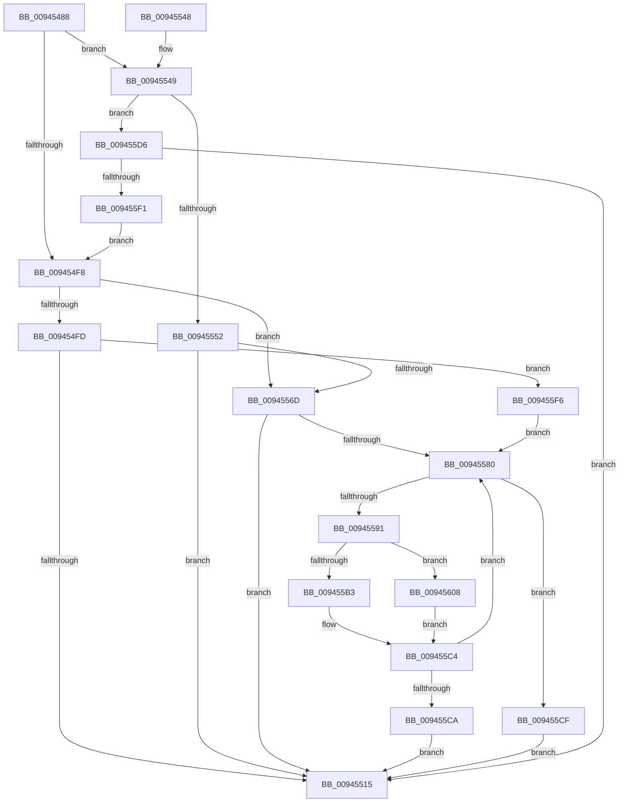

# CmpDoAccessCheckOnLayeredSubtree

- RVA: `0x00945488`–`0x0094561C` (길이 `404` bytes)
- VA: `0x0000000140945488`
- 실행 섹션: `PAGE`
- PDB 이름 있음: `예`; PDB Function 태그: `아니요`
- unwind 정보 RVA: `0x000908B4`
- 디코드: `108`개 명령, `404/404` bytes 표시
- 미해석 바이트: `0` (있으면 어셈블리에 `.byte`로 보존)

> 이 문서는 커널 이미지의 기계어와 PDB 기호를 분석해 생성했습니다. 4번과 5번은 함수 원형과 자료형을 바이너리 사용 방식에서 추정한 C 해석이며 원본 소스 복구 결과는 아닙니다.

## 1. Dependencies

- 직접 호출 지점: **12**; 고유 호출 대상: **10**
- 직접 호출자로 확인된 함수: **2**
- RIP 상대 이미지 참조: **1**

### Outgoing calls
- `0x009454C1` → [memset](../../text/6C/memset_function_006C6C40.md) (function, `0x006C6C40`)
- `0x009454D5` → [CmpInitializeKeyNodeStack](CmpInitializeKeyNodeStack_function_00946804.md) (function, `0x00946804`)
- `0x00945506` → [CmpSubtreeEnumeratorStart](CmpSubtreeEnumeratorStart_function_009450E0.md) (function, `0x009450E0`)
- `0x0094551A` → [CmpSubtreeEnumeratorCleanup](CmpSubtreeEnumeratorCleanup_function_00945D98.md) (function, `0x00945D98`)
- `0x0094552C` → [_security_check_cookie](../../text/6A/_security_check_cookie_function_006AC640.md) (function, `0x006AC640`)
- `0x00945562` → [CmpCheckKcbStackAccess](../70/CmpCheckKcbStackAccess_function_00701174.md) (function, `0x00701174`)
- `0x00945575` → [CmpSubtreeEnumeratorStartForKcbStack](CmpSubtreeEnumeratorStartForKcbStack_function_009445EC.md) (function, `0x009445EC`)
- `0x00945585` → [CmpSubtreeEnumeratorAdvance](CmpSubtreeEnumeratorAdvance_function_00946590.md) (function, `0x00946590`)
- `0x009455BF` → [CmpCheckKeyNodeStackAccess](CmpCheckKeyNodeStackAccess_function_009459AC.md) (function, `0x009459AC`)
- `0x009455E2` → [CmpCheckKeyNodeStackAccess](CmpCheckKeyNodeStackAccess_function_009459AC.md) (function, `0x009459AC`)
- `0x009455FE` → [CmpSubtreeEnumeratorBeginForKeyNodeStack](../7F/CmpSubtreeEnumeratorBeginForKeyNodeStack_function_007F192C.md) (function, `0x007F192C`)
- `0x00945615` → [CmpCheckKcbStackAccess](../70/CmpCheckKcbStackAccess_function_00701174.md) (function, `0x00701174`)

### Direct callers
- [CmSaveKey](../7D/CmSaveKey_function_007DDBDC.md) at `0x007DDD79`
- [CmRenameKey](../7E/CmRenameKey_function_007E8F48.md) at `0x007E91DC`

### Static image references
- `0x0094549B` → RVA `0x00E0A740` (`.data`; read)

## 2. Other-region calls and transfers

- 다른 실행 섹션으로 향하는 call: **2**
  - `0x009454C1` → [memset](../../text/6C/memset_function_006C6C40.md) (`PAGE` → `.text`)
  - `0x0094552C` → [_security_check_cookie](../../text/6A/_security_check_cookie_function_006AC640.md) (`PAGE` → `.text`)
- 별도 외부 분기/꼬리 이동을 확인하지 못했습니다.

## 3. Assembly (complete function range)

```asm
00945488  48 89 5C 24 10                  mov qword ptr [rsp + 0x10], rbx
0094548D  55                              push rbp
0094548E  56                              push rsi
0094548F  57                              push rdi
00945490  41 56                           push r14
00945492  41 57                           push r15
00945494  48 81 EC B0 00 00 00            sub rsp, 0xb0
0094549B  48 8B 05 9E 52 4C 00            mov rax, qword ptr [rip + 0x4c529e]
009454A2  48 33 C4                        xor rax, rsp
009454A5  48 89 84 24 A0 00 00 00         mov qword ptr [rsp + 0xa0], rax
009454AD  33 D2                           xor edx, edx
009454AF  4D 8B F8                        mov r15, r8
009454B2  48 8B F9                        mov rdi, rcx
009454B5  45 8A F1                        mov r14b, r9b
009454B8  48 8D 4C 24 32                  lea rcx, [rsp + 0x32]
009454BD  44 8D 42 66                     lea r8d, [rdx + 0x66]
009454C1  E8 7A 17 D8 FF                  call 0x1406c6c40
009454C6  B8 FE FF FF FF                  mov eax, 0xfffffffe
009454CB  48 8D 4C 24 40                  lea rcx, [rsp + 0x40]
009454D0  66 89 44 24 30                  mov word ptr [rsp + 0x30], ax
009454D5  E8 2A 13 00 00                  call 0x140946804
009454DA  8B B4 24 08 01 00 00            mov esi, dword ptr [rsp + 0x108]
009454E1  8B AC 24 00 01 00 00            mov ebp, dword ptr [rsp + 0x100]
009454E8  D1 EE                           shr esi, 1
009454EA  40 80 E6 01                     and sil, 1
009454EE  F6 84 24 08 01 00 00 01         test byte ptr [rsp + 0x108], 1
009454F6  75 51                           jne 0x140945549
009454F8  48 85 FF                        test rdi, rdi
009454FB  75 70                           jne 0x14094556d
009454FD  41 0F B7 17                     movzx edx, word ptr [r15]
00945501  48 8D 4C 24 30                  lea rcx, [rsp + 0x30]
00945506  E8 D5 FB FF FF                  call 0x1409450e0
0094550B  8B D8                           mov ebx, eax
0094550D  85 C0                           test eax, eax
0094550F  0F 89 E1 00 00 00               jns 0x1409455f6
00945515  48 8D 4C 24 30                  lea rcx, [rsp + 0x30]
0094551A  E8 79 08 00 00                  call 0x140945d98
0094551F  8B C3                           mov eax, ebx
00945521  48 8B 8C 24 A0 00 00 00         mov rcx, qword ptr [rsp + 0xa0]
00945529  48 33 CC                        xor rcx, rsp
0094552C  E8 0F 71 D6 FF                  call 0x1406ac640
00945531  48 8B 9C 24 E8 00 00 00         mov rbx, qword ptr [rsp + 0xe8]
00945539  48 81 C4 B0 00 00 00            add rsp, 0xb0
00945540  41 5F                           pop r15
00945542  41 5E                           pop r14
00945544  5F                              pop rdi
00945545  5E                              pop rsi
00945546  5D                              pop rbp
00945547  C3                              ret
00945548  CC                              int3
00945549  48 85 FF                        test rdi, rdi
0094554C  0F 84 84 00 00 00               je 0x1409455d6
00945552  40 88 74 24 20                  mov byte ptr [rsp + 0x20], sil
00945557  44 8B CD                        mov r9d, ebp
0094555A  45 8A C6                        mov r8b, r14b
0094555D  33 D2                           xor edx, edx
0094555F  48 8B CF                        mov rcx, rdi
00945562  E8 0D BC DB FF                  call 0x140701174
00945567  8B D8                           mov ebx, eax
00945569  85 C0                           test eax, eax
0094556B  78 A8                           js 0x140945515
0094556D  48 8B D7                        mov rdx, rdi
00945570  48 8D 4C 24 30                  lea rcx, [rsp + 0x30]
00945575  E8 72 F0 FF FF                  call 0x1409445ec
0094557A  8B D8                           mov ebx, eax
0094557C  85 C0                           test eax, eax
0094557E  78 95                           js 0x140945515
00945580  48 8D 4C 24 30                  lea rcx, [rsp + 0x30]
00945585  E8 06 10 00 00                  call 0x140946590
0094558A  3D 1A 00 00 80                  cmp eax, 0x8000001a
0094558F  74 3E                           je 0x1409455cf
00945591  48 0F BF 44 24 30               movsx rax, word ptr [rsp + 0x30]
00945597  48 69 D0 98 01 00 00            imul rdx, rax, 0x198
0094559E  48 03 94 24 90 00 00 00         add rdx, qword ptr [rsp + 0x90]
009455A6  48 8B 4A 08                     mov rcx, qword ptr [rdx + 8]
009455AA  48 8B 42 10                     mov rax, qword ptr [rdx + 0x10]
009455AE  48 85 C9                        test rcx, rcx
009455B1  75 55                           jne 0x140945608
009455B3  44 8A CE                        mov r9b, sil
009455B6  44 8B C5                        mov r8d, ebp
009455B9  41 8A D6                        mov dl, r14b
009455BC  48 8B C8                        mov rcx, rax
009455BF  E8 E8 03 00 00                  call 0x1409459ac
009455C4  8B D8                           mov ebx, eax
009455C6  85 C0                           test eax, eax
009455C8  79 B6                           jns 0x140945580
009455CA  E9 46 FF FF FF                  jmp 0x140945515
009455CF  33 DB                           xor ebx, ebx
009455D1  E9 3F FF FF FF                  jmp 0x140945515
009455D6  44 8A CE                        mov r9b, sil
009455D9  44 8B C5                        mov r8d, ebp
009455DC  41 8A D6                        mov dl, r14b
009455DF  49 8B CF                        mov rcx, r15
009455E2  E8 C5 03 00 00                  call 0x1409459ac
009455E7  8B D8                           mov ebx, eax
009455E9  85 C0                           test eax, eax
009455EB  0F 88 24 FF FF FF               js 0x140945515
009455F1  E9 02 FF FF FF                  jmp 0x1409454f8
009455F6  49 8B D7                        mov rdx, r15
009455F9  48 8D 4C 24 30                  lea rcx, [rsp + 0x30]
009455FE  E8 29 C3 EA FF                  call 0x1407f192c
00945603  E9 78 FF FF FF                  jmp 0x140945580
00945608  44 8B CD                        mov r9d, ebp
0094560B  40 88 74 24 20                  mov byte ptr [rsp + 0x20], sil
00945610  45 8A C6                        mov r8b, r14b
00945613  33 D2                           xor edx, edx
00945615  E8 5A BB DB FF                  call 0x140701174
0094561A  EB A8                           jmp 0x1409455c4
```

## 4. C-style interpretation (structured pseudocode)

```c
__int64 __fastcall CmpDoAccessCheckOnLayeredSubtree(__int64 a1, int a2, __int64 a3, unsigned __int8 a4, unsigned int a5, unsigned __int8 a6)
{
    __int64 result;
    __int64 v_rbx;
    __int64 v_rsi;
    __int64 v_rsp;
    unsigned __int64 v_stack_m38;
    unsigned __int64 v_stack_m98;
    unsigned __int64 v_stack_mA6;
    unsigned __int16 v_stack_mA8;
    unsigned __int64 v_stack_p10;
    unsigned __int8 v_stack_p20;
    unsigned __int64 v_stack_p30;
    unsigned __int64 v_stack_p90;

    v_stack_p10 = v_rbx;
    v_rsp = (v_rsp) - (176);
    result = (*(unsigned __int64 *)(v_rip + 5001886)) ^ (v_rsp);
    v_stack_m38 = result;
    a2 = 0;
    result = memset(v_stack_mA6, a2, a2 + 102, a4);
    v_stack_mA8 = (unsigned __int16)((unsigned int)(0xFFFFFFFEULL));
    result = CmpInitializeKeyNodeStack(v_stack_m98, a2, a2 + 102, a4);
    v_rsi = (unsigned int)(((unsigned int)(a6)) >> (1));
    v_rsi = (unsigned __int8)((v_rsi) & (1));
    if (((a6) & (1)) != 0) goto loc_00945549;
loc_009454F8:
    if (a1 != 0) goto loc_0094556D;
    result = CmpSubtreeEnumeratorStart(v_stack_mA8, *(unsigned __int16 *)(a3), a2 + 102, a4);
    if (!sign_flag) goto loc_009455F6;
loc_00945515:
    result = CmpSubtreeEnumeratorCleanup(v_stack_mA8, *(unsigned __int16 *)(a3), a2 + 102, a4);
    a1 = (v_stack_m38) ^ (v_rsp);
    result = _security_check_cookie(a1, *(unsigned __int16 *)(a3), a2 + 102, a4);
    v_rsp = (v_rsp) + (176);
    return result;
loc_00945549:
    if (a1 == 0) goto loc_009455D6;
    v_stack_p20 = (unsigned __int8)(v_rsi);
    a2 = 0;
    result = CmpCheckKcbStackAccess(a1, a2, a4, (unsigned int)((unsigned int)((unsigned int)(a5))));
    if (sign_flag) goto loc_00945515;
loc_0094556D:
    result = CmpSubtreeEnumeratorStartForKcbStack(v_stack_p30, a1, a4, (unsigned int)((unsigned int)((unsigned int)(a5))));
    if (sign_flag) goto loc_00945515;
loc_00945580:
    result = CmpSubtreeEnumeratorAdvance(v_stack_p30, a1, a4, (unsigned int)((unsigned int)((unsigned int)(a5))));
    if (((unsigned int)(result)) == 0x8000001AULL) goto loc_009455CF;
    a2 = (a1) * ((__int16)(v_stack_p30));
    a2 = (a2) + (v_stack_p90);
    if (*(unsigned __int64 *)(a2 + 8) != 0) goto loc_00945608;
    result = CmpCheckKeyNodeStackAccess(*(unsigned __int64 *)(a2 + 16), a4, (unsigned int)((unsigned int)((unsigned int)(a5))), (unsigned __int8)(v_rsi));
loc_009455C4:
    if (!sign_flag) goto loc_00945580;
    goto loc_00945515;
loc_009455CF:
    v_rbx = 0;
    goto loc_00945515;
loc_009455D6:
    result = CmpCheckKeyNodeStackAccess(a3, a4, (unsigned int)((unsigned int)((unsigned int)(a5))), (unsigned __int8)(v_rsi));
    if (sign_flag) goto loc_00945515;
    goto loc_009454F8;
loc_009455F6:
    result = CmpSubtreeEnumeratorBeginForKeyNodeStack(v_stack_p30, a3, (unsigned int)((unsigned int)((unsigned int)(a5))), (unsigned __int8)(v_rsi));
    goto loc_00945580;
loc_00945608:
    v_stack_p20 = (unsigned __int8)(v_rsi);
    a2 = 0;
    result = CmpCheckKcbStackAccess(v_stack_p30, a2, a4, (unsigned int)((unsigned int)((unsigned int)(a5))));
    goto loc_009455C4;
}
```

## 5. (Beta) C Style

```c
int64_t CmpDoAccessCheckOnLayeredSubtree(int64_t Arg1, int32_t Arg2, void *Arg3, uint8_t Arg4, uint32_t Arg5, uint8_t Arg6)
{
    uint8_t *arg3 = (uint8_t *)Arg3;

    int64_t result;
    int64_t local_rbx;
    int64_t local_rsi;
    int64_t local_rsp;
    uint64_t v_stack_m38;
    uint64_t v_stack_m98;
    uint64_t v_stack_mA6;
    uint16_t v_stack_mA8;
    uint64_t v_stack_p10;
    uint8_t v_stack_p20;
    uint64_t v_stack_p30;
    uint64_t v_stack_p90;

    v_stack_p10 = local_rbx;
    local_rsp = (local_rsp) - (176);
    result = (*(uint64_t *)(v_rip + 0x4C529E)) ^ (local_rsp);
    v_stack_m38 = result;
    Arg2 = 0;
    result = memset(v_stack_mA6, Arg2, Arg2 + 102, Arg4);
    v_stack_mA8 = (uint16_t)((uint32_t)(0xFFFFFFFEULL));
    result = CmpInitializeKeyNodeStack(v_stack_m98, Arg2, Arg2 + 102, Arg4);
    local_rsi = (uint32_t)(((uint32_t)(Arg6)) >> (1));
    local_rsi = (uint8_t)((local_rsi) & (1));
    if (((Arg6) & (1)) != 0) goto loc_00945549;
loc_009454F8:
    if (Arg1 != 0) goto loc_0094556D;
    result = CmpSubtreeEnumeratorStart(v_stack_mA8, *(uint16_t *)(arg3), Arg2 + 102, Arg4);
    if (!sign_flag) goto loc_009455F6;
loc_00945515:
    result = CmpSubtreeEnumeratorCleanup(v_stack_mA8, *(uint16_t *)(arg3), Arg2 + 102, Arg4);
    Arg1 = (v_stack_m38) ^ (local_rsp);
    result = _security_check_cookie(Arg1, *(uint16_t *)(arg3), Arg2 + 102, Arg4);
    local_rsp = (local_rsp) + (176);
    return result;
loc_00945549:
    if (Arg1 == 0) goto loc_009455D6;
    v_stack_p20 = (uint8_t)(local_rsi);
    Arg2 = 0;
    result = CmpCheckKcbStackAccess(Arg1, Arg2, Arg4, (uint32_t)((uint32_t)((uint32_t)(Arg5))));
    if (sign_flag) goto loc_00945515;
loc_0094556D:
    result = CmpSubtreeEnumeratorStartForKcbStack(v_stack_p30, Arg1, Arg4, (uint32_t)((uint32_t)((uint32_t)(Arg5))));
    if (sign_flag) goto loc_00945515;
loc_00945580:
    result = CmpSubtreeEnumeratorAdvance(v_stack_p30, Arg1, Arg4, (uint32_t)((uint32_t)((uint32_t)(Arg5))));
    if (((uint32_t)(result)) == 0x8000001AULL) goto loc_009455CF;
    Arg2 = (Arg1) * ((int16_t)(v_stack_p30));
    Arg2 = (Arg2) + (v_stack_p90);
    if (*(uint64_t *)(Arg2 + 0x8) != 0) goto loc_00945608;
    result = CmpCheckKeyNodeStackAccess(*(uint64_t *)(Arg2 + 0x10), Arg4, (uint32_t)((uint32_t)((uint32_t)(Arg5))), (uint8_t)(local_rsi));
loc_009455C4:
    if (!sign_flag) goto loc_00945580;
    goto loc_00945515;
loc_009455CF:
    local_rbx = 0;
    goto loc_00945515;
loc_009455D6:
    result = CmpCheckKeyNodeStackAccess(Arg3, Arg4, (uint32_t)((uint32_t)((uint32_t)(Arg5))), (uint8_t)(local_rsi));
    if (sign_flag) goto loc_00945515;
    goto loc_009454F8;
loc_009455F6:
    result = CmpSubtreeEnumeratorBeginForKeyNodeStack(v_stack_p30, Arg3, (uint32_t)((uint32_t)((uint32_t)(Arg5))), (uint8_t)(local_rsi));
    goto loc_00945580;
loc_00945608:
    v_stack_p20 = (uint8_t)(local_rsi);
    Arg2 = 0;
    result = CmpCheckKcbStackAccess(v_stack_p30, Arg2, Arg4, (uint32_t)((uint32_t)((uint32_t)(Arg5))));
    goto loc_009455C4;
}
```

### 관측된 메모리 오프셋

구조체 형식이 확인되지 않은 접근은 인자 기준의 오프셋으로만 기록했습니다.

| 기준 인자 | 오프셋 표현 | 폭 (bit) | 접근 |
|---|---:|---:|---|
| `Arg3` | `+ 0x0` | `16` | `R` |

## 6. Execution-region graph

[열기: 2D/3D 그래프와 함수 탐색 컨트롤 패널](../../../control-panel.html?section=page&rva=0x00945488&view=graph)

- 2D 그래프는 위에서 아래로 흐르고, 3D 그래프는 빈 공간을 드래그해 회전합니다. Shift+드래그는 이동, 휠은 확대·축소, 함수 노드 선택은 대상 보고서 이동입니다.

### Static fallback


