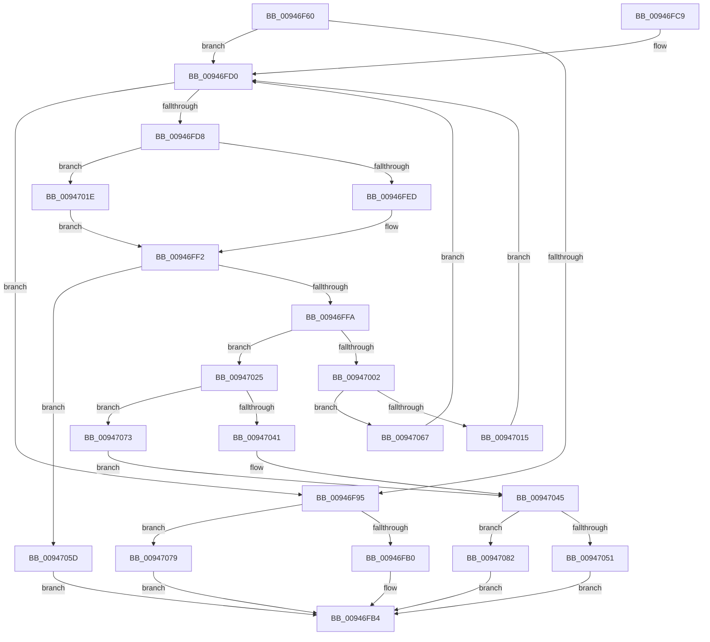

# CmpDoFindSubKeyByNumber

- RVA: `0x00946F60`–`0x0094708E` (길이 `302` bytes)
- VA: `0x0000000140946F60`
- 실행 섹션: `PAGE`
- PDB 이름 있음: `예`; PDB Function 태그: `아니요`
- unwind 정보 RVA: `0x00090A50`
- 디코드: `82`개 명령, `302/302` bytes 표시
- 미해석 바이트: `0` (있으면 어셈블리에 `.byte`로 보존)

> 이 문서는 커널 이미지의 기계어와 PDB 기호를 분석해 생성했습니다. 4번과 5번은 함수 원형과 자료형을 바이너리 사용 방식에서 추정한 C 해석이며 원본 소스 복구 결과는 아닙니다.

## 1. Dependencies

- 직접 호출 지점: **6**; 고유 호출 대상: **4**
- 직접 호출자로 확인된 함수: **4**
- RIP 상대 이미지 참조: **0**

### Outgoing calls
- `0x00946FED` → [HvpGetCellFlat](../85/HvpGetCellFlat_function_00854C60.md) (function, `0x00854C60`)
- `0x00947015` → [HvpReleaseCellPaged](../85/HvpReleaseCellPaged_function_00855F40.md) (function, `0x00855F40`)
- `0x0094701E` → [HvpGetCellPaged](../85/HvpGetCellPaged_function_00854CB0.md) (function, `0x00854CB0`)
- `0x00947051` → [HvpReleaseCellPaged](../85/HvpReleaseCellPaged_function_00855F40.md) (function, `0x00855F40`)
- `0x00947067` → [HvpReleaseCellFlat](../85/HvpReleaseCellFlat_function_0085CC20.md) (function, `0x0085CC20`)
- `0x00947082` → [HvpReleaseCellFlat](../85/HvpReleaseCellFlat_function_0085CC20.md) (function, `0x0085CC20`)

### Direct callers
- [CmpFindSubKeyByNumberEx](../84/CmpFindSubKeyByNumberEx_function_0084F1A0.md) at `0x0084F647`
- [CmpFindSubKeyByNumberEx](../84/CmpFindSubKeyByNumberEx_function_0084F1A0.md) at `0x0084F86E`
- [CmpKeyEnumStackEntryNotifyPromotion](CmpKeyEnumStackEntryNotifyPromotion_function_00944B74.md) at `0x00944C43`
- [CmpKeyEnumStackEntryAdvance](CmpKeyEnumStackEntryAdvance_function_00946BD8.md) at `0x00946CB7`
- [CmpKeyEnumStackEntryBegin](CmpKeyEnumStackEntryBegin_function_00946DE4.md) at `0x00946EEC`

### Static image references
- 디코드된 RIP-relative 메모리 참조가 없습니다.

## 2. Other-region calls and transfers

- 다른 실행 섹션으로 향하는 call: **0**
- 별도 외부 분기/꼬리 이동을 확인하지 못했습니다.

## 3. Assembly (complete function range)

```asm
00946F60  48 89 5C 24 08                  mov qword ptr [rsp + 8], rbx
00946F65  48 89 6C 24 18                  mov qword ptr [rsp + 0x18], rbp
00946F6A  48 89 74 24 20                  mov qword ptr [rsp + 0x20], rsi
00946F6F  57                              push rdi
00946F70  48 83 EC 20                     sub rsp, 0x20
00946F74  33 FF                           xor edi, edi
00946F76  C7 44 24 38 FF FF FF FF         mov dword ptr [rsp + 0x38], 0xffffffff
00946F7E  B8 72 69 00 00                  mov eax, 0x6972
00946F83  89 7C 24 3C                     mov dword ptr [rsp + 0x3c], edi
00946F87  41 8B F0                        mov esi, r8d
00946F8A  48 8B DA                        mov rbx, rdx
00946F8D  48 8B E9                        mov rbp, rcx
00946F90  66 39 02                        cmp word ptr [rdx], ax
00946F93  74 3B                           je 0x140946fd0
00946F95  0F B7 03                        movzx eax, word ptr [rbx]
00946F98  BA 6C 66 00 00                  mov edx, 0x666c
00946F9D  66 2B C2                        sub ax, dx
00946FA0  BA FF FD 00 00                  mov edx, 0xfdff
00946FA5  66 85 C2                        test dx, ax
00946FA8  8B C6                           mov eax, esi
00946FAA  0F 85 C9 00 00 00               jne 0x140947079
00946FB0  8B 44 C3 04                     mov eax, dword ptr [rbx + rax*8 + 4]
00946FB4  48 8B 5C 24 30                  mov rbx, qword ptr [rsp + 0x30]
00946FB9  48 8B 6C 24 40                  mov rbp, qword ptr [rsp + 0x40]
00946FBE  48 8B 74 24 48                  mov rsi, qword ptr [rsp + 0x48]
00946FC3  48 83 C4 20                     add rsp, 0x20
00946FC7  5F                              pop rdi
00946FC8  C3                              ret
00946FC9  CC                              int3
00946FCA  66 0F 1F 44 00 00               nop word ptr [rax + rax]
00946FD0  0F B7 43 02                     movzx eax, word ptr [rbx + 2]
00946FD4  3B F8                           cmp edi, eax
00946FD6  73 BD                           jae 0x140946f95
00946FD8  F6 85 8C 00 00 00 01            test byte ptr [rbp + 0x8c], 1
00946FDF  4C 8D 44 24 38                  lea r8, [rsp + 0x38]
00946FE4  8B 54 BB 04                     mov edx, dword ptr [rbx + rdi*4 + 4]
00946FE8  48 8B CD                        mov rcx, rbp
00946FEB  74 31                           je 0x14094701e
00946FED  E8 6E DC F0 FF                  call 0x140854c60
00946FF2  48 8B C8                        mov rcx, rax
00946FF5  48 85 C0                        test rax, rax
00946FF8  74 63                           je 0x14094705d
00946FFA  0F B7 40 02                     movzx eax, word ptr [rax + 2]
00946FFE  3B F0                           cmp esi, eax
00947000  72 23                           jb 0x140947025
00947002  2B F0                           sub esi, eax
00947004  48 8D 54 24 38                  lea rdx, [rsp + 0x38]
00947009  F6 85 8C 00 00 00 01            test byte ptr [rbp + 0x8c], 1
00947010  48 8B CD                        mov rcx, rbp
00947013  75 52                           jne 0x140947067
00947015  E8 26 EF F0 FF                  call 0x140855f40
0094701A  FF C7                           inc edi
0094701C  EB B2                           jmp 0x140946fd0
0094701E  E8 8D DC F0 FF                  call 0x140854cb0
00947023  EB CD                           jmp 0x140946ff2
00947025  0F B7 01                        movzx eax, word ptr [rcx]
00947028  BA 6C 66 00 00                  mov edx, 0x666c
0094702D  66 2B C2                        sub ax, dx
00947030  BA FF FD 00 00                  mov edx, 0xfdff
00947035  66 85 C2                        test dx, ax
00947038  8B C6                           mov eax, esi
0094703A  48 8D 54 24 38                  lea rdx, [rsp + 0x38]
0094703F  75 32                           jne 0x140947073
00947041  8B 5C C1 04                     mov ebx, dword ptr [rcx + rax*8 + 4]
00947045  F6 85 8C 00 00 00 01            test byte ptr [rbp + 0x8c], 1
0094704C  48 8B CD                        mov rcx, rbp
0094704F  75 31                           jne 0x140947082
00947051  E8 EA EE F0 FF                  call 0x140855f40
00947056  8B C3                           mov eax, ebx
00947058  E9 57 FF FF FF                  jmp 0x140946fb4
0094705D  B8 FF FF FF FF                  mov eax, 0xffffffff
00947062  E9 4D FF FF FF                  jmp 0x140946fb4
00947067  E8 B4 5B F1 FF                  call 0x14085cc20
0094706C  FF C7                           inc edi
0094706E  E9 5D FF FF FF                  jmp 0x140946fd0
00947073  8B 5C 81 04                     mov ebx, dword ptr [rcx + rax*4 + 4]
00947077  EB CC                           jmp 0x140947045
00947079  8B 44 83 04                     mov eax, dword ptr [rbx + rax*4 + 4]
0094707D  E9 32 FF FF FF                  jmp 0x140946fb4
00947082  E8 99 5B F1 FF                  call 0x14085cc20
00947087  8B C3                           mov eax, ebx
00947089  E9 26 FF FF FF                  jmp 0x140946fb4
```

## 4. C-style interpretation (structured pseudocode)

```c
__int64 __fastcall CmpDoFindSubKeyByNumber(__int64 a1, __int64 a2, int a3)
{
    __int64 result;
    __int64 v_rdi;
    __int64 v_rsi;
    __int64 v_rsp;
    unsigned int v_stack_p10;
    unsigned int v_stack_p14;
    unsigned __int64 v_stack_p18;
    unsigned __int64 v_stack_p20;
    unsigned __int64 v_stack_p38;
    unsigned __int64 v_stack_p8;

    v_stack_p8 = v_rbx;
    v_stack_p18 = v_rbp;
    v_stack_p20 = v_rsi;
    v_rsp = (v_rsp) - (32);
    v_rdi = 0;
    v_stack_p10 = 0xFFFFFFFFULL;
    v_stack_p14 = 0;
    if ((*(unsigned __int16 *)(a2)) == ((unsigned __int16)((unsigned int)(0x6972ULL)))) goto loc_00946FD0;
loc_00946F95:
    result = (unsigned __int16)((*(unsigned __int16 *)(a2)) - ((unsigned __int16)((unsigned int)(0x666CULL))));
    if ((((unsigned __int16)((unsigned int)(0xFDFFULL))) & ((unsigned __int16)(result))) != 0) goto loc_00947079;
loc_00946FB4:
    v_rsp = (v_rsp) + (32);
    return (unsigned int)(*(unsigned int *)(a2 + (unsigned int)((unsigned int)((unsigned int)(a3))) * 8 + 4));
loc_00946FD0:
    if (0 >= ((unsigned int)(*(unsigned __int16 *)(v_stack_p8 + 2)))) goto loc_00946F95;
    if (((*(unsigned __int8 *)(v_stack_p18 + 140)) & (1)) == 0) goto loc_0094701E;
    result = HvpGetCellFlat(v_stack_p18, (unsigned int)(*(unsigned int *)(v_stack_p8 + v_rdi * 4 + 4)), v_stack_p38, a4);
loc_00946FF2:
    if (result == 0) goto loc_0094705D;
    if (((unsigned int)(v_stack_p20)) < ((unsigned int)(*(unsigned __int16 *)(result + 2)))) goto loc_00947025;
    v_rsi = (unsigned int)((v_stack_p20) - ((unsigned int)(*(unsigned __int16 *)(result + 2))));
    if (((*(unsigned __int8 *)(v_stack_p18 + 140)) & (1)) != 0) goto loc_00947067;
    result = HvpReleaseCellPaged(v_stack_p18, v_stack_p38, v_stack_p38, a4);
    v_rdi = (unsigned int)((v_rdi) + 1);
    goto loc_00946FD0;
loc_0094701E:
    result = HvpGetCellPaged(v_stack_p18, v_stack_p38, v_stack_p38, a4);
    goto loc_00946FF2;
loc_00947025:
    result = (unsigned __int16)((*(unsigned __int16 *)(v_stack_p18)) - ((unsigned __int16)((unsigned int)(0x666CULL))));
    if ((((unsigned __int16)((unsigned int)(0xFDFFULL))) & ((unsigned __int16)(result))) != 0) goto loc_00947073;
loc_00947045:
    if (((*(unsigned __int8 *)(v_stack_p18 + 140)) & (1)) != 0) goto loc_00947082;
    result = HvpReleaseCellPaged(v_stack_p18, v_stack_p38, v_stack_p38, a4);
    goto loc_00946FB4;
loc_0094705D:
    goto loc_00946FB4;
loc_00947067:
    result = HvpReleaseCellFlat(v_stack_p18, v_stack_p38, v_stack_p38, a4);
    v_rdi = (unsigned int)((v_rdi) + 1);
    goto loc_00946FD0;
loc_00947073:
    goto loc_00947045;
loc_00947079:
    goto loc_00946FB4;
loc_00947082:
    result = HvpReleaseCellFlat(v_stack_p18, v_stack_p38, v_stack_p38, a4);
    goto loc_00946FB4;
}
```

## 5. (Beta) C Style

```c
int64_t CmpDoFindSubKeyByNumber(void *Arg1, void *Arg2, int32_t Arg3)
{
    uint8_t *arg1 = (uint8_t *)Arg1;
    uint8_t *arg2 = (uint8_t *)Arg2;

    int64_t result;
    int64_t local_rdi;
    int64_t local_rsi;
    int64_t local_rsp;
    uint32_t v_stack_p10;
    uint32_t v_stack_p14;
    uint64_t v_stack_p18;
    uint64_t v_stack_p20;
    uint64_t v_stack_p38;
    uint64_t v_stack_p8;

    v_stack_p8 = local_rbx;
    v_stack_p18 = local_rbp;
    v_stack_p20 = local_rsi;
    local_rsp = (local_rsp) - (32);
    local_rdi = 0;
    v_stack_p10 = 0xFFFFFFFFULL;
    v_stack_p14 = 0;
    if ((*(uint16_t *)(arg2)) == ((uint16_t)((uint32_t)(0x6972ULL)))) goto loc_00946FD0;
loc_00946F95:
    result = (uint16_t)((*(uint16_t *)(arg2)) - ((uint16_t)((uint32_t)(0x666CULL))));
    if ((((uint16_t)((uint32_t)(0xFDFFULL))) & ((uint16_t)(result))) != 0) goto loc_00947079;
loc_00946FB4:
    local_rsp = (local_rsp) + (32);
    return (uint32_t)(*(uint32_t *)(arg2 + (uint32_t)((uint32_t)((uint32_t)(Arg3))) * 8 + 0x4));
loc_00946FD0:
    if (0 >= ((uint32_t)(*(uint16_t *)(v_stack_p8 + 0x2)))) goto loc_00946F95;
    if (((*(uint8_t *)(v_stack_p18 + 0x8C)) & (1)) == 0) goto loc_0094701E;
    result = HvpGetCellFlat(v_stack_p18, (uint32_t)(*(uint32_t *)(v_stack_p8 + local_rdi * 4 + 0x4)), v_stack_p38, a4);
loc_00946FF2:
    if (result == 0) goto loc_0094705D;
    if (((uint32_t)(v_stack_p20)) < ((uint32_t)(*(uint16_t *)(result + 0x2)))) goto loc_00947025;
    local_rsi = (uint32_t)((v_stack_p20) - ((uint32_t)(*(uint16_t *)(result + 0x2))));
    if (((*(uint8_t *)(v_stack_p18 + 0x8C)) & (1)) != 0) goto loc_00947067;
    result = HvpReleaseCellPaged(v_stack_p18, v_stack_p38, v_stack_p38, a4);
    local_rdi = (uint32_t)((local_rdi) + 1);
    goto loc_00946FD0;
loc_0094701E:
    result = HvpGetCellPaged(v_stack_p18, v_stack_p38, v_stack_p38, a4);
    goto loc_00946FF2;
loc_00947025:
    result = (uint16_t)((*(uint16_t *)(v_stack_p18)) - ((uint16_t)((uint32_t)(0x666CULL))));
    if ((((uint16_t)((uint32_t)(0xFDFFULL))) & ((uint16_t)(result))) != 0) goto loc_00947073;
loc_00947045:
    if (((*(uint8_t *)(v_stack_p18 + 0x8C)) & (1)) != 0) goto loc_00947082;
    result = HvpReleaseCellPaged(v_stack_p18, v_stack_p38, v_stack_p38, a4);
    goto loc_00946FB4;
loc_0094705D:
    goto loc_00946FB4;
loc_00947067:
    result = HvpReleaseCellFlat(v_stack_p18, v_stack_p38, v_stack_p38, a4);
    local_rdi = (uint32_t)((local_rdi) + 1);
    goto loc_00946FD0;
loc_00947073:
    goto loc_00947045;
loc_00947079:
    goto loc_00946FB4;
loc_00947082:
    result = HvpReleaseCellFlat(v_stack_p18, v_stack_p38, v_stack_p38, a4);
    goto loc_00946FB4;
}
```

### 관측된 메모리 오프셋

구조체 형식이 확인되지 않은 접근은 인자 기준의 오프셋으로만 기록했습니다.

| 기준 인자 | 오프셋 표현 | 폭 (bit) | 접근 |
|---|---:|---:|---|
| `Arg1` | `+ 0x8C` | `8` | `R` |
| `Arg2` | `+ 0x0` | `16` | `R` |
| `Arg2` | `+ 0x2` | `16` | `R` |
| `Arg2` | `+ 0x4 + rax*4` | `32` | `R` |
| `Arg2` | `+ 0x4 + rax*8` | `32` | `R` |
| `Arg2` | `+ 0x4 + rdi*4` | `32` | `R` |

## 6. Execution-region graph

[열기: 2D/3D 그래프와 함수 탐색 컨트롤 패널](../../../control-panel.html?section=page&rva=0x00946F60&view=graph)

- 2D 그래프는 위에서 아래로 흐르고, 3D 그래프는 빈 공간을 드래그해 회전합니다. Shift+드래그는 이동, 휠은 확대·축소, 함수 노드 선택은 대상 보고서 이동입니다.

### Static fallback


