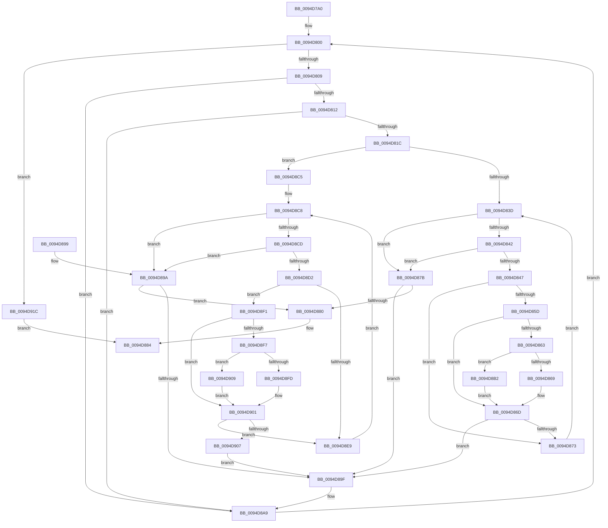

# CmpFindKcbInHashEntryByName

- RVA: `0x0094D7A0`–`0x0094D923` (길이 `387` bytes)
- VA: `0x000000014094D7A0`
- 실행 섹션: `PAGE`
- PDB 이름 있음: `예`; PDB Function 태그: `아니요`
- unwind 정보 RVA: `0x00091930`
- 디코드: `118`개 명령, `387/387` bytes 표시
- 미해석 바이트: `0` (있으면 어셈블리에 `.byte`로 보존)

> 이 문서는 커널 이미지의 기계어와 PDB 기호를 분석해 생성했습니다. 4번과 5번은 함수 원형과 자료형을 바이너리 사용 방식에서 추정한 C 해석이며 원본 소스 복구 결과는 아닙니다.

## 1. Dependencies

- 직접 호출 지점: **2**; 고유 호출 대상: **1**
- 직접 호출자로 확인된 함수: **4**
- RIP 상대 이미지 참조: **0**

### Outgoing calls
- `0x0094D8B2` → [RtlUpcaseUnicodeChar](../85/RtlUpcaseUnicodeChar_function_0085F0F0.md) (function, `0x0085F0F0`)
- `0x0094D909` → [RtlUpcaseUnicodeChar](../85/RtlUpcaseUnicodeChar_function_0085F0F0.md) (function, `0x0085F0F0`)

### Direct callers
- [CmRenameKey](../7E/CmRenameKey_function_007E8F48.md) at `0x007E929A`
- [CmRenameKey](../7E/CmRenameKey_function_007E8F48.md) at `0x007E97D5`
- [CmpPartialPromoteSubkeys](../7F/CmpPartialPromoteSubkeys_function_007F4070.md) at `0x007F41CA`
- [CmpWalkOneLevel](../85/CmpWalkOneLevel_function_00852BA0.md) at `0x00853325`
- [sub_00B255E8](../B2/Unknown_function_00B255E8.md) at `0x00B2566D`

### Static image references
- 디코드된 RIP-relative 메모리 참조가 없습니다.

## 2. Other-region calls and transfers

- 다른 실행 섹션으로 향하는 call: **0**
- 별도 외부 분기/꼬리 이동을 확인하지 못했습니다.

## 3. Assembly (complete function range)

```asm
0094D7A0  4C 89 4C 24 20                  mov qword ptr [rsp + 0x20], r9
0094D7A5  4C 89 44 24 18                  mov qword ptr [rsp + 0x18], r8
0094D7AA  53                              push rbx
0094D7AB  55                              push rbp
0094D7AC  57                              push rdi
0094D7AD  41 54                           push r12
0094D7AF  41 55                           push r13
0094D7B1  41 56                           push r14
0094D7B3  41 57                           push r15
0094D7B5  48 83 EC 20                     sub rsp, 0x20
0094D7B9  8B C2                           mov eax, edx
0094D7BB  48 89 74 24 60                  mov qword ptr [rsp + 0x60], rsi
0094D7C0  C1 E8 09                        shr eax, 9
0094D7C3  4C 8B D9                        mov r11, rcx
0094D7C6  8B 89 78 06 00 00               mov ecx, dword ptr [rcx + 0x678]
0094D7CC  33 C2                           xor eax, edx
0094D7CE  69 C0 A3 8A 01 00               imul eax, eax, 0x18aa3
0094D7D4  8B DA                           mov ebx, edx
0094D7D6  FF C9                           dec ecx
0094D7D8  8B D0                           mov edx, eax
0094D7DA  44 8B D0                        mov r10d, eax
0094D7DD  49 8B 83 70 06 00 00            mov rax, qword ptr [r11 + 0x670]
0094D7E4  49 C1 EA 09                     shr r10, 9
0094D7E8  4C 33 D2                        xor r10, rdx
0094D7EB  BA FF FF 00 00                  mov edx, 0xffff
0094D7F0  4C 23 D1                        and r10, rcx
0094D7F3  4B 8D 0C 52                     lea rcx, [r10 + r10*2]
0094D7F7  4C 8B 74 C8 10                  mov r14, qword ptr [rax + rcx*8 + 0x10]
0094D7FC  44 8D 52 E1                     lea r10d, [rdx - 0x1f]
0094D800  4D 85 F6                        test r14, r14
0094D803  0F 84 13 01 00 00               je 0x14094d91c
0094D809  41 39 1E                        cmp dword ptr [r14], ebx
0094D80C  0F 85 97 00 00 00               jne 0x14094d8a9
0094D812  4D 39 46 38                     cmp qword ptr [r14 + 0x38], r8
0094D816  0F 85 8D 00 00 00               jne 0x14094d8a9
0094D81C  49 8B 4E 40                     mov rcx, qword ptr [r14 + 0x40]
0094D820  41 0F B7 39                     movzx edi, word ptr [r9]
0094D824  4D 8B 61 08                     mov r12, qword ptr [r9 + 8]
0094D828  66 D1 EF                        shr di, 1
0094D82B  8B 01                           mov eax, dword ptr [rcx]
0094D82D  4C 8D 79 1A                     lea r15, [rcx + 0x1a]
0094D831  0F B7 69 18                     movzx ebp, word ptr [rcx + 0x18]
0094D835  A8 01                           test al, 1
0094D837  0F 84 88 00 00 00               je 0x14094d8c5
0094D83D  66 85 FF                        test di, di
0094D840  74 39                           je 0x14094d87b
0094D842  66 85 ED                        test bp, bp
0094D845  74 34                           je 0x14094d87b
0094D847  41 0F B7 0C 24                  movzx ecx, word ptr [r12]
0094D84C  49 83 C4 02                     add r12, 2
0094D850  45 0F B6 2F                     movzx r13d, byte ptr [r15]
0094D854  49 FF C7                        inc r15
0094D857  66 41 3B CD                     cmp cx, r13w
0094D85B  74 16                           je 0x14094d873
0094D85D  66 83 F9 61                     cmp cx, 0x61
0094D861  72 0A                           jb 0x14094d86d
0094D863  66 83 F9 7A                     cmp cx, 0x7a
0094D867  77 49                           ja 0x14094d8b2
0094D869  66 41 03 CA                     add cx, r10w
0094D86D  66 41 3B CD                     cmp cx, r13w
0094D871  75 2C                           jne 0x14094d89f
0094D873  66 03 FA                        add di, dx
0094D876  66 03 EA                        add bp, dx
0094D879  EB C2                           jmp 0x14094d83d
0094D87B  66 3B FD                        cmp di, bp
0094D87E  75 1F                           jne 0x14094d89f
0094D880  49 8D 46 F0                     lea rax, [r14 - 0x10]
0094D884  48 8B 74 24 60                  mov rsi, qword ptr [rsp + 0x60]
0094D889  48 83 C4 20                     add rsp, 0x20
0094D88D  41 5F                           pop r15
0094D88F  41 5E                           pop r14
0094D891  41 5D                           pop r13
0094D893  41 5C                           pop r12
0094D895  5F                              pop rdi
0094D896  5D                              pop rbp
0094D897  5B                              pop rbx
0094D898  C3                              ret
0094D899  CC                              int3
0094D89A  66 3B FD                        cmp di, bp
0094D89D  74 E1                           je 0x14094d880
0094D89F  4C 8B 44 24 70                  mov r8, qword ptr [rsp + 0x70]
0094D8A4  4C 8B 4C 24 78                  mov r9, qword ptr [rsp + 0x78]
0094D8A9  4D 8B 76 08                     mov r14, qword ptr [r14 + 8]
0094D8AD  E9 4E FF FF FF                  jmp 0x14094d800
0094D8B2  E8 39 18 F1 FF                  call 0x14085f0f0
0094D8B7  BA FF FF 00 00                  mov edx, 0xffff
0094D8BC  0F B7 C8                        movzx ecx, ax
0094D8BF  44 8D 52 E1                     lea r10d, [rdx - 0x1f]
0094D8C3  EB A8                           jmp 0x14094d86d
0094D8C5  66 D1 ED                        shr bp, 1
0094D8C8  66 85 FF                        test di, di
0094D8CB  74 CD                           je 0x14094d89a
0094D8CD  66 85 ED                        test bp, bp
0094D8D0  74 C8                           je 0x14094d89a
0094D8D2  41 0F B7 0C 24                  movzx ecx, word ptr [r12]
0094D8D7  49 83 C4 02                     add r12, 2
0094D8DB  45 0F B7 2F                     movzx r13d, word ptr [r15]
0094D8DF  49 83 C7 02                     add r15, 2
0094D8E3  66 41 3B CD                     cmp cx, r13w
0094D8E7  75 08                           jne 0x14094d8f1
0094D8E9  66 03 FA                        add di, dx
0094D8EC  66 03 EA                        add bp, dx
0094D8EF  EB D7                           jmp 0x14094d8c8
0094D8F1  66 83 F9 61                     cmp cx, 0x61
0094D8F5  72 0A                           jb 0x14094d901
0094D8F7  66 83 F9 7A                     cmp cx, 0x7a
0094D8FB  77 0C                           ja 0x14094d909
0094D8FD  66 41 03 CA                     add cx, r10w
0094D901  66 41 3B CD                     cmp cx, r13w
0094D905  74 E2                           je 0x14094d8e9
0094D907  EB 96                           jmp 0x14094d89f
0094D909  E8 E2 17 F1 FF                  call 0x14085f0f0
0094D90E  BA FF FF 00 00                  mov edx, 0xffff
0094D913  0F B7 C8                        movzx ecx, ax
0094D916  44 8D 52 E1                     lea r10d, [rdx - 0x1f]
0094D91A  EB E5                           jmp 0x14094d901
0094D91C  33 C0                           xor eax, eax
0094D91E  E9 61 FF FF FF                  jmp 0x14094d884
```

## 4. C-style interpretation (structured pseudocode)

```c
__int64 __fastcall CmpFindKcbInHashEntryByName(__int64 a1, int a2, __int64 a3, __int64 a4)
{
    __int64 result;
    __int64 v_r10;
    __int64 v_r12;
    __int64 v_r15;
    __int64 v_rbp;
    __int64 v_rdi;
    __int64 v_rsp;
    unsigned __int64 v_stack_p18;
    unsigned __int64 v_stack_p20;
    unsigned __int64 v_stack_p70;
    unsigned __int64 v_stack_p78;
    unsigned __int64 v_stack_p8;

    v_stack_p20 = a4;
    v_stack_p18 = a3;
    v_rsp = (v_rsp) - (32);
    v_stack_p8 = v_rsi;
    result = (unsigned int)(((unsigned int)(a2)) >> (9));
    result = (unsigned int)((result) ^ (a2));
    result = (unsigned int)((result) * ((unsigned int)(result)));
    a1 = (unsigned int)(((unsigned int)(*(unsigned int *)(a1 + 1656))) - 1);
    v_r10 = ((unsigned int)((unsigned int)(result))) >> (9);
    v_r10 = (v_r10) ^ ((unsigned int)((unsigned int)(result)));
    v_r10 = (v_r10) & (a1);
loc_0094D800:
    if (*(unsigned __int64 *)(*(unsigned __int64 *)(a1 + 1648) + v_r10 + v_r10 * 2 * 8 + 16) == 0) goto loc_0094D91C;
    if ((*(unsigned int *)(*(unsigned __int64 *)(*(unsigned __int64 *)(a1 + 1648) + v_r10 + v_r10 * 2 * 8 + 16))) != ((unsigned int)((unsigned int)(a2)))) goto loc_0094D8A9;
    if ((*(unsigned __int64 *)(*(unsigned __int64 *)(*(unsigned __int64 *)(a1 + 1648) + v_r10 + v_r10 * 2 * 8 + 16) + 56)) != a3) goto loc_0094D8A9;
    v_rdi = (unsigned __int16)((*(unsigned __int16 *)(a4)) >> (1));
    if ((((unsigned __int8)((unsigned int)(*(unsigned int *)(*(unsigned __int64 *)(*(unsigned __int64 *)(*(unsigned __int64 *)(a1 + 1648) + v_r10 + v_r10 * 2 * 8 + 16) + 64))))) & (1)) == 0) goto loc_0094D8C5;
loc_0094D83D:
    if ((unsigned __int16)(v_rdi) == 0) goto loc_0094D87B;
    if ((unsigned __int16)(*(unsigned __int16 *)(*(unsigned __int64 *)(*(unsigned __int64 *)(*(unsigned __int64 *)(a1 + 1648) + v_r10 + v_r10 * 2 * 8 + 16) + 64) + 24)) == 0) goto loc_0094D87B;
    v_r12 = (*(unsigned __int64 *)(a4 + 8)) + (2);
    v_r15 = (*(unsigned __int64 *)(*(unsigned __int64 *)(*(unsigned __int64 *)(a1 + 1648) + v_r10 + v_r10 * 2 * 8 + 16) + 64) + 26) + 1;
    if (((unsigned __int16)(*(unsigned __int16 *)(*(unsigned __int64 *)(a4 + 8)))) == ((unsigned __int16)(*(unsigned __int8 *)(*(unsigned __int64 *)(*(unsigned __int64 *)(*(unsigned __int64 *)(a1 + 1648) + v_r10 + v_r10 * 2 * 8 + 16) + 64) + 26)))) goto loc_0094D873;
    if (((unsigned __int16)(*(unsigned __int16 *)(*(unsigned __int64 *)(a4 + 8)))) < 97) goto loc_0094D86D;
    if (((unsigned __int16)(*(unsigned __int16 *)(*(unsigned __int64 *)(a4 + 8)))) > 122) goto loc_0094D8B2;
    a1 = (unsigned __int16)((*(unsigned __int16 *)(*(unsigned __int64 *)(a4 + 8))) + ((unsigned __int16)((unsigned int)(0xFFFFULL) - 31)));
loc_0094D86D:
    if (((unsigned __int16)(a1)) != ((unsigned __int16)(*(unsigned __int8 *)(*(unsigned __int64 *)(*(unsigned __int64 *)(*(unsigned __int64 *)(a1 + 1648) + v_r10 + v_r10 * 2 * 8 + 16) + 64) + 26)))) goto loc_0094D89F;
loc_0094D873:
    v_rdi = (unsigned __int16)((v_rdi) + ((unsigned __int16)((unsigned int)(0xFFFFULL))));
    v_rbp = (unsigned __int16)((*(unsigned __int16 *)(*(unsigned __int64 *)(*(unsigned __int64 *)(*(unsigned __int64 *)(a1 + 1648) + v_r10 + v_r10 * 2 * 8 + 16) + 64) + 24)) + ((unsigned __int16)((unsigned int)(0xFFFFULL))));
    goto loc_0094D83D;
loc_0094D87B:
    if (((unsigned __int16)(v_rdi)) != ((unsigned __int16)(v_rbp))) goto loc_0094D89F;
loc_0094D880:
loc_0094D884:
    v_rsp = (v_rsp) + (32);
    return *(unsigned __int64 *)(*(unsigned __int64 *)(a1 + 1648) + v_r10 + v_r10 * 2 * 8 + 16) - 16;
loc_0094D89A:
    if (((unsigned __int16)(v_rdi)) == ((unsigned __int16)(v_rbp))) goto loc_0094D880;
loc_0094D89F:
loc_0094D8A9:
    goto loc_0094D800;
loc_0094D8B2:
    result = RtlUpcaseUnicodeChar(a1, (unsigned int)(0xFFFFULL), v_stack_p70, v_stack_p78);
    goto loc_0094D86D;
loc_0094D8C5:
    v_rbp = (unsigned __int16)((v_rbp) >> (1));
loc_0094D8C8:
    if ((unsigned __int16)(v_rdi) == 0) goto loc_0094D89A;
    if ((unsigned __int16)(v_rbp) == 0) goto loc_0094D89A;
    v_r12 = (v_r12) + (2);
    v_r15 = (v_r15) + (2);
    if (((unsigned __int16)(*(unsigned __int16 *)(v_r12))) != ((unsigned __int16)(*(unsigned __int16 *)(v_r15)))) goto loc_0094D8F1;
loc_0094D8E9:
    v_rdi = (unsigned __int16)((v_rdi) + ((unsigned __int16)((unsigned int)(0xFFFFULL))));
    v_rbp = (unsigned __int16)((v_rbp) + ((unsigned __int16)((unsigned int)(0xFFFFULL))));
    goto loc_0094D8C8;
loc_0094D8F1:
    if (((unsigned __int16)(*(unsigned __int16 *)(v_r12))) < 97) goto loc_0094D901;
    if (((unsigned __int16)(*(unsigned __int16 *)(v_r12))) > 122) goto loc_0094D909;
    a1 = (unsigned __int16)((*(unsigned __int16 *)(v_r12)) + ((unsigned __int16)((unsigned int)(0xFFFFULL) - 31)));
loc_0094D901:
    if (((unsigned __int16)(a1)) == ((unsigned __int16)(*(unsigned __int16 *)(v_r15)))) goto loc_0094D8E9;
    goto loc_0094D89F;
loc_0094D909:
    result = RtlUpcaseUnicodeChar(a1, (unsigned int)(0xFFFFULL), v_stack_p70, v_stack_p78);
    goto loc_0094D901;
loc_0094D91C:
    result = 0;
    goto loc_0094D884;
}
```

## 5. (Beta) C Style

```c
int64_t CmpFindKcbInHashEntryByName(void *Arg1, int32_t Arg2, int64_t Arg3, int64_t Arg4)
{
    uint8_t *arg1 = (uint8_t *)Arg1;

    int64_t result;
    int64_t local_r10;
    int64_t local_r12;
    int64_t local_r15;
    int64_t local_rbp;
    int64_t local_rdi;
    int64_t local_rsp;
    uint64_t v_stack_p18;
    uint64_t v_stack_p20;
    uint64_t v_stack_p70;
    uint64_t v_stack_p78;
    uint64_t v_stack_p8;

    v_stack_p20 = Arg4;
    v_stack_p18 = Arg3;
    local_rsp = (local_rsp) - (32);
    v_stack_p8 = local_rsi;
    result = (uint32_t)(((uint32_t)(Arg2)) >> (9));
    result = (uint32_t)((result) ^ (Arg2));
    result = (uint32_t)((result) * ((uint32_t)(result)));
    Arg1 = (uint32_t)(((uint32_t)(*(uint32_t *)(arg1 + 0x678))) - 1);
    local_r10 = ((uint32_t)((uint32_t)(result))) >> (9);
    local_r10 = (local_r10) ^ ((uint32_t)((uint32_t)(result)));
    local_r10 = (local_r10) & (Arg1);
loc_0094D800:
    if (*(uint64_t *)(*(uint64_t *)(arg1 + 0x670) + local_r10 + local_r10 * 2 * 8 + 0x10) == 0) goto loc_0094D91C;
    if ((*(uint32_t *)(*(uint64_t *)(*(uint64_t *)(arg1 + 0x670) + local_r10 + local_r10 * 2 * 8 + 0x10))) != ((uint32_t)((uint32_t)(Arg2)))) goto loc_0094D8A9;
    if ((*(uint64_t *)(*(uint64_t *)(*(uint64_t *)(arg1 + 0x670) + local_r10 + local_r10 * 2 * 8 + 0x10) + 0x38)) != Arg3) goto loc_0094D8A9;
    local_rdi = (uint16_t)((*(uint16_t *)(Arg4)) >> (1));
    if ((((uint8_t)((uint32_t)(*(uint32_t *)(*(uint64_t *)(*(uint64_t *)(*(uint64_t *)(arg1 + 0x670) + local_r10 + local_r10 * 2 * 8 + 0x10) + 0x40))))) & (1)) == 0) goto loc_0094D8C5;
loc_0094D83D:
    if ((uint16_t)(local_rdi) == 0) goto loc_0094D87B;
    if ((uint16_t)(*(uint16_t *)(*(uint64_t *)(*(uint64_t *)(*(uint64_t *)(arg1 + 0x670) + local_r10 + local_r10 * 2 * 8 + 0x10) + 0x40) + 0x18)) == 0) goto loc_0094D87B;
    local_r12 = (*(uint64_t *)(Arg4 + 0x8)) + (2);
    local_r15 = (*(uint64_t *)(*(uint64_t *)(*(uint64_t *)(arg1 + 0x670) + local_r10 + local_r10 * 2 * 8 + 0x10) + 0x40) + 26) + 1;
    if (((uint16_t)(*(uint16_t *)(*(uint64_t *)(Arg4 + 0x8)))) == ((uint16_t)(*(uint8_t *)(*(uint64_t *)(*(uint64_t *)(*(uint64_t *)(arg1 + 0x670) + local_r10 + local_r10 * 2 * 8 + 0x10) + 0x40) + 0x1A)))) goto loc_0094D873;
    if (((uint16_t)(*(uint16_t *)(*(uint64_t *)(Arg4 + 0x8)))) < 97) goto loc_0094D86D;
    if (((uint16_t)(*(uint16_t *)(*(uint64_t *)(Arg4 + 0x8)))) > 122) goto loc_0094D8B2;
    Arg1 = (uint16_t)((*(uint16_t *)(*(uint64_t *)(Arg4 + 0x8))) + ((uint16_t)((uint32_t)(0xFFFFULL) - 31)));
loc_0094D86D:
    if (((uint16_t)(Arg1)) != ((uint16_t)(*(uint8_t *)(*(uint64_t *)(*(uint64_t *)(*(uint64_t *)(arg1 + 0x670) + local_r10 + local_r10 * 2 * 8 + 0x10) + 0x40) + 0x1A)))) goto loc_0094D89F;
loc_0094D873:
    local_rdi = (uint16_t)((local_rdi) + ((uint16_t)((uint32_t)(0xFFFFULL))));
    local_rbp = (uint16_t)((*(uint16_t *)(*(uint64_t *)(*(uint64_t *)(*(uint64_t *)(arg1 + 0x670) + local_r10 + local_r10 * 2 * 8 + 0x10) + 0x40) + 0x18)) + ((uint16_t)((uint32_t)(0xFFFFULL))));
    goto loc_0094D83D;
loc_0094D87B:
    if (((uint16_t)(local_rdi)) != ((uint16_t)(local_rbp))) goto loc_0094D89F;
loc_0094D880:
loc_0094D884:
    local_rsp = (local_rsp) + (32);
    return *(uint64_t *)(*(uint64_t *)(arg1 + 0x670) + local_r10 + local_r10 * 2 * 8 + 0x10) - 16;
loc_0094D89A:
    if (((uint16_t)(local_rdi)) == ((uint16_t)(local_rbp))) goto loc_0094D880;
loc_0094D89F:
loc_0094D8A9:
    goto loc_0094D800;
loc_0094D8B2:
    result = RtlUpcaseUnicodeChar(Arg1, (uint32_t)(0xFFFFULL), v_stack_p70, v_stack_p78);
    goto loc_0094D86D;
loc_0094D8C5:
    local_rbp = (uint16_t)((local_rbp) >> (1));
loc_0094D8C8:
    if ((uint16_t)(local_rdi) == 0) goto loc_0094D89A;
    if ((uint16_t)(local_rbp) == 0) goto loc_0094D89A;
    local_r12 = (local_r12) + (2);
    local_r15 = (local_r15) + (2);
    if (((uint16_t)(*(uint16_t *)(local_r12))) != ((uint16_t)(*(uint16_t *)(local_r15)))) goto loc_0094D8F1;
loc_0094D8E9:
    local_rdi = (uint16_t)((local_rdi) + ((uint16_t)((uint32_t)(0xFFFFULL))));
    local_rbp = (uint16_t)((local_rbp) + ((uint16_t)((uint32_t)(0xFFFFULL))));
    goto loc_0094D8C8;
loc_0094D8F1:
    if (((uint16_t)(*(uint16_t *)(local_r12))) < 97) goto loc_0094D901;
    if (((uint16_t)(*(uint16_t *)(local_r12))) > 122) goto loc_0094D909;
    Arg1 = (uint16_t)((*(uint16_t *)(local_r12)) + ((uint16_t)((uint32_t)(0xFFFFULL) - 31)));
loc_0094D901:
    if (((uint16_t)(Arg1)) == ((uint16_t)(*(uint16_t *)(local_r15)))) goto loc_0094D8E9;
    goto loc_0094D89F;
loc_0094D909:
    result = RtlUpcaseUnicodeChar(Arg1, (uint32_t)(0xFFFFULL), v_stack_p70, v_stack_p78);
    goto loc_0094D901;
loc_0094D91C:
    result = 0;
    goto loc_0094D884;
}
```

### 관측된 메모리 오프셋

구조체 형식이 확인되지 않은 접근은 인자 기준의 오프셋으로만 기록했습니다.

| 기준 인자 | 오프셋 표현 | 폭 (bit) | 접근 |
|---|---:|---:|---|
| `Arg1` | `+ 0x670` | `64` | `R` |
| `Arg1` | `+ 0x678` | `32` | `R` |

## 6. Execution-region graph

[열기: 2D/3D 그래프와 함수 탐색 컨트롤 패널](../../../control-panel.html?section=page&rva=0x0094D7A0&view=graph)

- 2D 그래프는 위에서 아래로 흐르고, 3D 그래프는 빈 공간을 드래그해 회전합니다. Shift+드래그는 이동, 휠은 확대·축소, 함수 노드 선택은 대상 보고서 이동입니다.

### Static fallback


