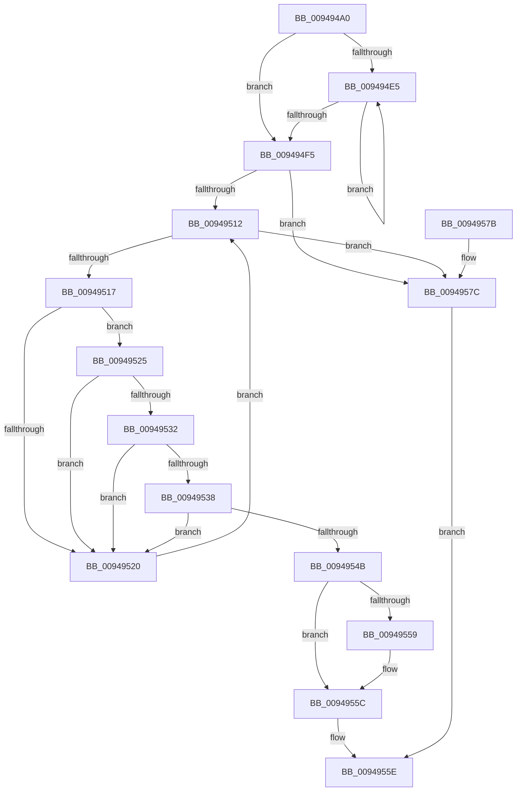

# CmpFindMatchingDescriptorCell

- RVA: `0x009494A0`–`0x00949580` (길이 `224` bytes)
- VA: `0x00000001409494A0`
- 실행 섹션: `PAGE`
- PDB 이름 있음: `예`; PDB Function 태그: `아니요`
- unwind 정보 RVA: `0x00090D08`
- 디코드: `75`개 명령, `224/224` bytes 표시
- 미해석 바이트: `0` (있으면 어셈블리에 `.byte`로 보존)

> 이 문서는 커널 이미지의 기계어와 PDB 기호를 분석해 생성했습니다. 4번과 5번은 함수 원형과 자료형을 바이너리 사용 방식에서 추정한 C 해석이며 원본 소스 복구 결과는 아닙니다.

## 1. Dependencies

- 직접 호출 지점: **2**; 고유 호출 대상: **2**
- 직접 호출자로 확인된 함수: **2**
- RIP 상대 이미지 참조: **0**

### Outgoing calls
- `0x009494CC` → [RtlLengthSecurityDescriptorStrict](../../text/48/RtlLengthSecurityDescriptorStrict_function_0048B770.md) (function, `0x0048B770`)
- `0x00949542` → [memcmp](../../text/6C/memcmp_function_006C6B10.md) (function, `0x006C6B10`)

### Direct callers
- [CmpGetSecurityDescriptorNodeEx](CmpGetSecurityDescriptorNodeEx_function_00949268.md) at `0x009492E7`
- [CmpSetSecurityDescriptorInfo](CmpSetSecurityDescriptorInfo_function_00949688.md) at `0x0094989F`

### Static image references
- 디코드된 RIP-relative 메모리 참조가 없습니다.

## 2. Other-region calls and transfers

- 다른 실행 섹션으로 향하는 call: **2**
  - `0x009494CC` → [RtlLengthSecurityDescriptorStrict](../../text/48/RtlLengthSecurityDescriptorStrict_function_0048B770.md) (`PAGE` → `.text`)
  - `0x00949542` → [memcmp](../../text/6C/memcmp_function_006C6B10.md) (`PAGE` → `.text`)
- 별도 외부 분기/꼬리 이동을 확인하지 못했습니다.

## 3. Assembly (complete function range)

```asm
009494A0  48 8B C4                        mov rax, rsp
009494A3  48 89 58 08                     mov qword ptr [rax + 8], rbx
009494A7  48 89 68 10                     mov qword ptr [rax + 0x10], rbp
009494AB  48 89 70 20                     mov qword ptr [rax + 0x20], rsi
009494AF  44 89 40 18                     mov dword ptr [rax + 0x18], r8d
009494B3  57                              push rdi
009494B4  41 54                           push r12
009494B6  41 55                           push r13
009494B8  41 56                           push r14
009494BA  41 57                           push r15
009494BC  48 83 EC 20                     sub rsp, 0x20
009494C0  48 8B D9                        mov rbx, rcx
009494C3  4D 8B E1                        mov r12, r9
009494C6  48 8B CA                        mov rcx, rdx
009494C9  4C 8B EA                        mov r13, rdx
009494CC  E8 9F 22 B4 FF                  call 0x14048b770
009494D1  44 8B D0                        mov r10d, eax
009494D4  44 8B F8                        mov r15d, eax
009494D7  41 C1 EA 02                     shr r10d, 2
009494DB  33 FF                           xor edi, edi
009494DD  4C 8B D9                        mov r11, rcx
009494E0  45 85 D2                        test r10d, r10d
009494E3  74 10                           je 0x1409494f5
009494E5  C1 CF 1D                        ror edi, 0x1d
009494E8  41 03 3B                        add edi, dword ptr [r11]
009494EB  4D 8D 5B 04                     lea r11, [r11 + 4]
009494EF  41 83 C2 FF                     add r10d, -1
009494F3  75 F0                           jne 0x1409494e5
009494F5  44 8B F7                        mov r14d, edi
009494F8  41 83 E6 3F                     and r14d, 0x3f
009494FC  49 C1 E6 04                     shl r14, 4
00949500  49 81 C6 68 07 00 00            add r14, 0x768
00949507  4C 03 F3                        add r14, rbx
0094950A  49 8B 36                        mov rsi, qword ptr [r14]
0094950D  49 3B F6                        cmp rsi, r14
00949510  74 6A                           je 0x14094957c
00949512  49 3B F6                        cmp rsi, r14
00949515  74 65                           je 0x14094957c
00949517  48 8D 5E F8                     lea rbx, [rsi - 8]
0094951B  39 7B 04                        cmp dword ptr [rbx + 4], edi
0094951E  74 05                           je 0x140949525
00949520  48 8B 36                        mov rsi, qword ptr [rsi]
00949523  EB ED                           jmp 0x140949512
00949525  8B 2B                           mov ebp, dword ptr [rbx]
00949527  8B C5                           mov eax, ebp
00949529  C1 E8 1F                        shr eax, 0x1f
0094952C  39 44 24 60                     cmp dword ptr [rsp + 0x60], eax
00949530  75 EE                           jne 0x140949520
00949532  44 3B 7B 18                     cmp r15d, dword ptr [rbx + 0x18]
00949536  75 E8                           jne 0x140949520
00949538  4D 8B C7                        mov r8, r15
0094953B  48 8D 53 20                     lea rdx, [rbx + 0x20]
0094953F  49 8B CD                        mov rcx, r13
00949542  E8 C9 D5 D7 FF                  call 0x1406c6b10
00949547  85 C0                           test eax, eax
00949549  75 D5                           jne 0x140949520
0094954B  48 8B 44 24 70                  mov rax, qword ptr [rsp + 0x70]
00949550  41 89 2C 24                     mov dword ptr [r12], ebp
00949554  48 85 C0                        test rax, rax
00949557  74 03                           je 0x14094955c
00949559  48 89 18                        mov qword ptr [rax], rbx
0094955C  B0 01                           mov al, 1
0094955E  48 8B 5C 24 50                  mov rbx, qword ptr [rsp + 0x50]
00949563  48 8B 6C 24 58                  mov rbp, qword ptr [rsp + 0x58]
00949568  48 8B 74 24 68                  mov rsi, qword ptr [rsp + 0x68]
0094956D  48 83 C4 20                     add rsp, 0x20
00949571  41 5F                           pop r15
00949573  41 5E                           pop r14
00949575  41 5D                           pop r13
00949577  41 5C                           pop r12
00949579  5F                              pop rdi
0094957A  C3                              ret
0094957B  CC                              int3
0094957C  32 C0                           xor al, al
0094957E  EB DE                           jmp 0x14094955e
```

## 4. C-style interpretation (structured pseudocode)

```c
__int64 __fastcall CmpFindMatchingDescriptorCell(__int64 a1, __int64 a2, int a3, __int64 a4, __int64 a5)
{
    __int64 result;
    __int64 v_r10;
    __int64 v_r14;
    __int64 v_rdi;
    __int64 v_rsp;
    unsigned __int64 v_stack_p10;
    unsigned int v_stack_p18;
    unsigned __int64 v_stack_p20;
    unsigned __int64 v_stack_p8;

    *(unsigned __int64 *)(v_rsp + 8) = v_rbx;
    *(unsigned __int64 *)(v_rsp + 16) = v_rbp;
    *(unsigned __int64 *)(v_rsp + 32) = v_rsi;
    *(unsigned int *)(v_rsp + 24) = a3;
    v_rsp = (v_rsp) - (32);
    result = RtlLengthSecurityDescriptorStrict(a2, a2, a3, a4);
    v_r10 = (unsigned int)(((unsigned int)((unsigned int)(result))) >> (2));
    v_rdi = 0;
    if ((unsigned int)(v_r10) == 0) goto loc_009494F5;
loc_009494E5:
    v_rdi = (unsigned int)((v_rdi) + (*(unsigned int *)(a2)));
    v_r10 = (unsigned int)((v_r10) + (-1));
    if (condition_is_not_equal) goto loc_009494E5;
loc_009494F5:
    v_r14 = (unsigned int)(((unsigned int)((unsigned int)(v_rdi))) & (63));
    v_r14 = (v_r14) << (4);
    v_r14 = (v_r14) + (0x768ULL);
    v_r14 = (v_r14) + (a1);
    if ((*(unsigned __int64 *)(v_r14)) == v_r14) goto loc_0094957C;
loc_00949512:
    if ((*(unsigned __int64 *)(v_r14)) == v_r14) goto loc_0094957C;
    if ((*(unsigned int *)(*(unsigned __int64 *)(v_r14) - 8 + 4)) == ((unsigned int)(v_rdi))) goto loc_00949525;
loc_00949520:
    goto loc_00949512;
loc_00949525:
    result = (unsigned int)(((unsigned int)((unsigned int)((unsigned int)(*(unsigned int *)(*(unsigned __int64 *)(v_r14) - 8))))) >> (31));
    if (v_stack_p18 != ((unsigned int)(result))) goto loc_00949520;
    if (((unsigned int)((unsigned int)((unsigned int)(result)))) != (*(unsigned int *)(*(unsigned __int64 *)(v_r14) - 8 + 24))) goto loc_00949520;
    result = memcmp(a2, *(unsigned __int64 *)(v_r14) - 8 + 32, (unsigned int)((unsigned int)(result)), a4);
    if ((unsigned int)(result) != 0) goto loc_00949520;
    *(unsigned int *)(a4) = (unsigned int)((unsigned int)(*(unsigned int *)(*(unsigned __int64 *)(v_r14) - 8)));
    if (a5 != 0) {
        *(unsigned __int64 *)(a5) = *(unsigned __int64 *)(v_r14) - 8;
    }
loc_0094955E:
    v_rsp = (v_rsp) + (32);
    return 1;
loc_0094957C:
    result = 0;
    goto loc_0094955E;
}
```

## 5. (Beta) C Style

```c
int64_t CmpFindMatchingDescriptorCell(int64_t Arg1, int64_t Arg2, int32_t Arg3, void *Arg4, int64_t Arg5)
{
    uint8_t *arg4 = (uint8_t *)Arg4;

    int64_t result;
    int64_t local_r10;
    int64_t local_r14;
    int64_t local_rdi;
    int64_t local_rsp;
    uint64_t v_stack_p10;
    uint32_t v_stack_p18;
    uint64_t v_stack_p20;
    uint64_t v_stack_p8;

    *(uint64_t *)(local_rsp + 0x8) = local_rbx;
    *(uint64_t *)(local_rsp + 0x10) = local_rbp;
    *(uint64_t *)(local_rsp + 0x20) = local_rsi;
    *(uint32_t *)(local_rsp + 0x18) = Arg3;
    local_rsp = (local_rsp) - (32);
    result = RtlLengthSecurityDescriptorStrict(Arg2, Arg2, Arg3, Arg4);
    local_r10 = (uint32_t)(((uint32_t)((uint32_t)(result))) >> (2));
    local_rdi = 0;
    if ((uint32_t)(local_r10) == 0) goto loc_009494F5;
loc_009494E5:
    local_rdi = (uint32_t)((local_rdi) + (*(uint32_t *)(Arg2)));
    local_r10 = (uint32_t)((local_r10) + (-1));
    if (condition_is_not_equal) goto loc_009494E5;
loc_009494F5:
    local_r14 = (uint32_t)(((uint32_t)((uint32_t)(local_rdi))) & (63));
    local_r14 = (local_r14) << (4);
    local_r14 = (local_r14) + (0x768ULL);
    local_r14 = (local_r14) + (Arg1);
    if ((*(uint64_t *)(local_r14)) == local_r14) goto loc_0094957C;
loc_00949512:
    if ((*(uint64_t *)(local_r14)) == local_r14) goto loc_0094957C;
    if ((*(uint32_t *)(*(uint64_t *)(local_r14) - 0x8 + 0x4)) == ((uint32_t)(local_rdi))) goto loc_00949525;
loc_00949520:
    goto loc_00949512;
loc_00949525:
    result = (uint32_t)(((uint32_t)((uint32_t)((uint32_t)(*(uint32_t *)(*(uint64_t *)(local_r14) - 0x8))))) >> (31));
    if (v_stack_p18 != ((uint32_t)(result))) goto loc_00949520;
    if (((uint32_t)((uint32_t)((uint32_t)(result)))) != (*(uint32_t *)(*(uint64_t *)(local_r14) - 0x8 + 0x18))) goto loc_00949520;
    result = memcmp(Arg2, *(uint64_t *)(local_r14) - 8 + 32, (uint32_t)((uint32_t)(result)), Arg4);
    if ((uint32_t)(result) != 0) goto loc_00949520;
    *(uint32_t *)(arg4) = (uint32_t)((uint32_t)(*(uint32_t *)(*(uint64_t *)(local_r14) - 0x8)));
    if (Arg5 != 0) {
        *(uint64_t *)(Arg5) = *(uint64_t *)(local_r14) - 8;
    }
loc_0094955E:
    local_rsp = (local_rsp) + (32);
    return 1;
loc_0094957C:
    result = 0;
    goto loc_0094955E;
}
```

### 관측된 메모리 오프셋

구조체 형식이 확인되지 않은 접근은 인자 기준의 오프셋으로만 기록했습니다.

| 기준 인자 | 오프셋 표현 | 폭 (bit) | 접근 |
|---|---:|---:|---|
| `Arg4` | `+ 0x0` | `32` | `W` |

## 6. Execution-region graph

[열기: 2D/3D 그래프와 함수 탐색 컨트롤 패널](../../../control-panel.html?section=page&rva=0x009494A0&view=graph)

- 2D 그래프는 위에서 아래로 흐르고, 3D 그래프는 빈 공간을 드래그해 회전합니다. Shift+드래그는 이동, 휠은 확대·축소, 함수 노드 선택은 대상 보고서 이동입니다.

### Static fallback


