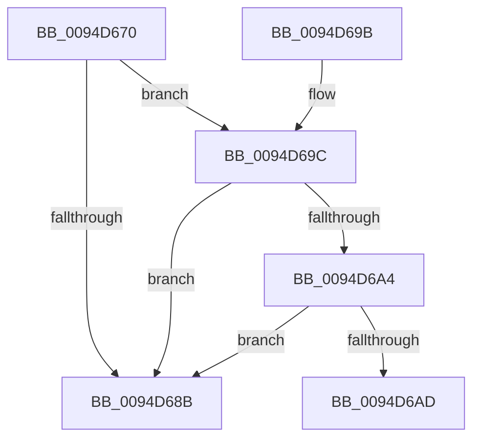

# CmpGetCallbackObjectContext

- RVA: `0x0094D670`–`0x0094D6C0` (길이 `80` bytes)
- VA: `0x000000014094D670`
- 실행 섹션: `PAGE`
- PDB 이름 있음: `예`; PDB Function 태그: `아니요`
- unwind 정보 RVA: `0x000917A8`
- 디코드: `26`개 명령, `80/80` bytes 표시
- 미해석 바이트: `0` (있으면 어셈블리에 `.byte`로 보존)

> 이 문서는 커널 이미지의 기계어와 PDB 기호를 분석해 생성했습니다. 4번과 5번은 함수 원형과 자료형을 바이너리 사용 방식에서 추정한 C 해석이며 원본 소스 복구 결과는 아닙니다.

## 1. Dependencies

- 직접 호출 지점: **0**; 고유 호출 대상: **0**
- 직접 호출자로 확인된 함수: **1**
- RIP 상대 이미지 참조: **1**

### Outgoing calls
- 직접 디코드된 call 명령이 없습니다.

### Direct callers
- [CmpCallbackFillObjectContext](../86/CmpCallbackFillObjectContext_function_00866A10.md) at `0x00867321`
- [CmpCallbackFillObjectContext](../86/CmpCallbackFillObjectContext_function_00866A10.md) at `0x00867357`
- [CmpCallbackFillObjectContext](../86/CmpCallbackFillObjectContext_function_00866A10.md) at `0x0086736B`
- [CmpCallbackFillObjectContext](../86/CmpCallbackFillObjectContext_function_00866A10.md) at `0x0086737F`
- [CmpCallbackFillObjectContext](../86/CmpCallbackFillObjectContext_function_00866A10.md) at `0x00867393`
- [CmpCallbackFillObjectContext](../86/CmpCallbackFillObjectContext_function_00866A10.md) at `0x008673A7`
- [CmpCallbackFillObjectContext](../86/CmpCallbackFillObjectContext_function_00866A10.md) at `0x008673BB`

### Static image references
- `0x0094D6B6` → RVA `0x00EF7BC8` (`.data`; read)

## 2. Other-region calls and transfers

- 다른 실행 섹션으로 향하는 call: **0**
- 별도 외부 분기/꼬리 이동을 확인하지 못했습니다.

## 3. Assembly (complete function range)

```asm
0094D670  48 89 5C 24 18                  mov qword ptr [rsp + 0x18], rbx
0094D675  56                              push rsi
0094D676  57                              push rdi
0094D677  41 56                           push r14
0094D679  48 83 EC 20                     sub rsp, 0x20
0094D67D  45 33 F6                        xor r14d, r14d
0094D680  48 8B FA                        mov rdi, rdx
0094D683  41 8B DE                        mov ebx, r14d
0094D686  48 85 C9                        test rcx, rcx
0094D689  75 11                           jne 0x14094d69c
0094D68B  33 C0                           xor eax, eax
0094D68D  48 8B 5C 24 50                  mov rbx, qword ptr [rsp + 0x50]
0094D692  48 83 C4 20                     add rsp, 0x20
0094D696  41 5E                           pop r14
0094D698  5F                              pop rdi
0094D699  5E                              pop rsi
0094D69A  C3                              ret
0094D69B  CC                              int3
0094D69C  81 39 32 30 79 6B               cmp dword ptr [rcx], 0x6b793032
0094D6A2  75 E7                           jne 0x14094d68b
0094D6A4  48 8D 71 48                     lea rsi, [rcx + 0x48]
0094D6A8  48 39 36                        cmp qword ptr [rsi], rsi
0094D6AB  74 DE                           je 0x14094d68b
0094D6AD  65 48 8B 04 25 88 01 00 00      mov rax, qword ptr gs:[0x188]
0094D6B6  48 8D 0D 0B A5 5A 00            lea rcx, [rip + 0x5aa50b]
0094D6BD  45 33 C0                        xor r8d, r8d
```

## 4. C-style interpretation (structured pseudocode)

```c
__int64 __fastcall CmpGetCallbackObjectContext(__int64 a1, __int64 a2, int a3)
{
    __int64 result;
    __int64 v_r14;
    __int64 v_rsp;
    unsigned __int64 v_stack_p18;

    v_stack_p18 = v_rbx;
    v_rsp = (v_rsp) - (32);
    v_r14 = 0;
    if (a1 != 0) goto loc_0094D69C;
loc_0094D68B:
    result = 0;
    v_rsp = (v_rsp) + (32);
    return result;
loc_0094D69C:
    if ((*(unsigned int *)(a1)) != 0x6B793032ULL) goto loc_0094D68B;
    if ((*(unsigned __int64 *)(a1 + 72)) == (a1 + 72)) goto loc_0094D68B;
    a3 = 0;
    return *(unsigned __int64 *)(gs_base + (0 + 392));
}
```

## 5. (Beta) C Style

```c
int64_t CmpGetCallbackObjectContext(int64_t Arg1, int64_t Arg2, int32_t Arg3)
{
    int64_t result;
    int64_t local_r14;
    int64_t local_rsp;
    uint64_t v_stack_p18;

    v_stack_p18 = local_rbx;
    local_rsp = (local_rsp) - (32);
    local_r14 = 0;
    if (Arg1 != 0) goto loc_0094D69C;
loc_0094D68B:
    result = 0;
    local_rsp = (local_rsp) + (32);
    return result;
loc_0094D69C:
    if ((*(uint32_t *)(Arg1)) != 0x6B793032ULL) goto loc_0094D68B;
    if ((*(uint64_t *)(Arg1 + 0x48)) == (Arg1 + 72)) goto loc_0094D68B;
    Arg3 = 0;
    return *(uint64_t *)(gs_base + (0 + 0x188));
}
```

## 6. Execution-region graph

[열기: 2D/3D 그래프와 함수 탐색 컨트롤 패널](../../../control-panel.html?section=page&rva=0x0094D670&view=graph)

- 2D 그래프는 위에서 아래로 흐르고, 3D 그래프는 빈 공간을 드래그해 회전합니다. Shift+드래그는 이동, 휠은 확대·축소, 함수 노드 선택은 대상 보고서 이동입니다.

### Static fallback


