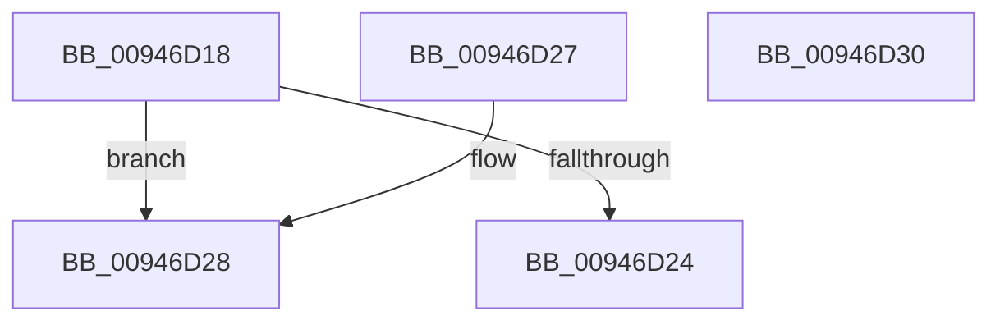

# CmpGetEffectiveKeyNodeSemantics

- RVA: `0x00946D18`–`0x00946D31` (길이 `25` bytes)
- VA: `0x0000000140946D18`
- 실행 섹션: `PAGE`
- PDB 이름 있음: `예`; PDB Function 태그: `아니요`
- unwind 정보 RVA: `0x000DB714`
- 디코드: `9`개 명령, `25/25` bytes 표시
- 미해석 바이트: `0` (있으면 어셈블리에 `.byte`로 보존)

> 이 문서는 커널 이미지의 기계어와 PDB 기호를 분석해 생성했습니다. 4번과 5번은 함수 원형과 자료형을 바이너리 사용 방식에서 추정한 C 해석이며 원본 소스 복구 결과는 아닙니다.

## 1. Dependencies

- 직접 호출 지점: **0**; 고유 호출 대상: **0**
- 직접 호출자로 확인된 함수: **10**
- RIP 상대 이미지 참조: **0**

### Outgoing calls
- 직접 디코드된 call 명령이 없습니다.

### Direct callers
- [CmpQueryKeyDataFromKeyNodeStack](../../text/46/CmpQueryKeyDataFromKeyNodeStack_function_0046AC40.md) at `0x0046AE95`
- [CmpQueryKeyDataFromKeyNodeStack](../../text/46/CmpQueryKeyDataFromKeyNodeStack_function_0046AC40.md) at `0x0046AEEC`
- [CmpGetValueCountForKeyNodeStack](../../text/46/CmpGetValueCountForKeyNodeStack_function_0046B118.md) at `0x0046B1F0`
- [CmpValueEnumStackStartFromKeyNodeStack](../../text/46/CmpValueEnumStackStartFromKeyNodeStack_function_0046B2E0.md) at `0x0046B340`
- [CmpValueEnumStackStartFromKeyNodeStack](../../text/46/CmpValueEnumStackStartFromKeyNodeStack_function_0046B2E0.md) at `0x0046B35E`
- [CmRenameKey](../7E/CmRenameKey_function_007E8F48.md) at `0x007E9532`
- [CmpGetSubKeyCountForKeyNodeStack](CmpGetSubKeyCountForKeyNodeStack_function_00945624.md) at `0x00945791`
- [CmpCopyMergeOfLayeredKeyNode](CmpCopyMergeOfLayeredKeyNode_function_00945A78.md) at `0x00945D15`
- [CmpGetSecurityCellForKeyNodeStack](CmpGetSecurityCellForKeyNodeStack_function_009464EC.md) at `0x0094653C`
- [CmpKeyEnumStackAdvance](CmpKeyEnumStackAdvance_function_0094668C.md) at `0x009466EB`
- [CmpKeyEnumStackAdvance](CmpKeyEnumStackAdvance_function_0094668C.md) at `0x00946706`
- [CmpKeyEnumStackBeginEnumerationForKeyNodeStack](CmpKeyEnumStackBeginEnumerationForKeyNodeStack_function_00946718.md) at `0x0094677A`
- [CmpSortedValueEnumStackStartFromKeyNodeStack](../A3/CmpSortedValueEnumStackStartFromKeyNodeStack_function_00A30CF0.md) at `0x00A30D51`
- [CmpSortedValueEnumStackStartFromKeyNodeStack](../A3/CmpSortedValueEnumStackStartFromKeyNodeStack_function_00A30CF0.md) at `0x00A30D74`

### Static image references
- 디코드된 RIP-relative 메모리 참조가 없습니다.

## 2. Other-region calls and transfers

- 다른 실행 섹션으로 향하는 call: **0**
- 별도 외부 분기/꼬리 이동을 확인하지 못했습니다.

## 3. Assembly (complete function range)

```asm
00946D18  F7 81 A0 00 00 00 00 00 08 00   test dword ptr [rcx + 0xa0], 0x80000
00946D22  75 04                           jne 0x140946d28
00946D24  33 C0                           xor eax, eax
00946D26  C3                              ret
00946D27  CC                              int3
00946D28  0F B6 42 0D                     movzx eax, byte ptr [rdx + 0xd]
00946D2C  83 E0 03                        and eax, 3
00946D2F  C3                              ret
00946D30  CC                              int3
```

## 4. C-style interpretation (structured pseudocode)

```c
__int64 __fastcall CmpGetEffectiveKeyNodeSemantics(__int64 a1, __int64 a2)
{
    __int64 result;

    if (((*(unsigned int *)(a1 + 160)) & (0x80000ULL)) != 0) goto loc_00946D28;
    result = 0;
    return result;
loc_00946D28:
    result = (unsigned int)((*(unsigned __int8 *)(a2 + 13)) & (3));
    return result;
}
```

## 5. (Beta) C Style

```c
int64_t CmpGetEffectiveKeyNodeSemantics(void *Arg1, void *Arg2)
{
    uint8_t *arg1 = (uint8_t *)Arg1;
    uint8_t *arg2 = (uint8_t *)Arg2;

    int64_t result;

    if (((*(uint32_t *)(arg1 + 0xA0)) & (0x80000ULL)) != 0) goto loc_00946D28;
    result = 0;
    return result;
loc_00946D28:
    result = (uint32_t)((*(uint8_t *)(arg2 + 0xD)) & (3));
    return result;
}
```

### 관측된 메모리 오프셋

구조체 형식이 확인되지 않은 접근은 인자 기준의 오프셋으로만 기록했습니다.

| 기준 인자 | 오프셋 표현 | 폭 (bit) | 접근 |
|---|---:|---:|---|
| `Arg1` | `+ 0xA0` | `32` | `R` |
| `Arg2` | `+ 0xD` | `8` | `R` |

## 6. Execution-region graph

[열기: 2D/3D 그래프와 함수 탐색 컨트롤 패널](../../../control-panel.html?section=page&rva=0x00946D18&view=graph)

- 2D 그래프는 위에서 아래로 흐르고, 3D 그래프는 빈 공간을 드래그해 회전합니다. Shift+드래그는 이동, 휠은 확대·축소, 함수 노드 선택은 대상 보고서 이동입니다.

### Static fallback


