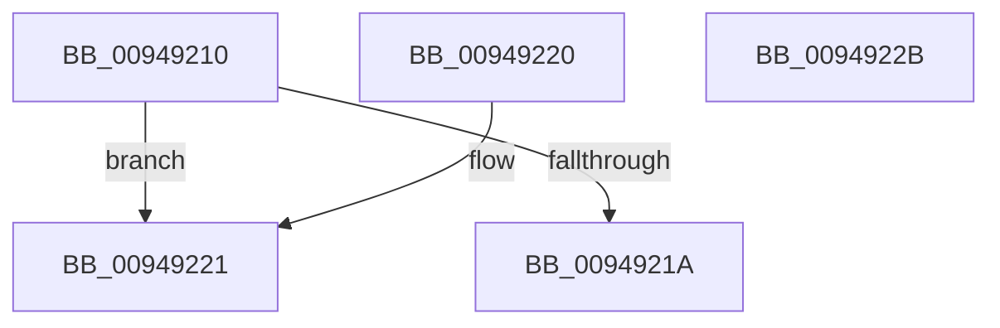

# CmpGetKcbAtLayerHeight

- RVA: `0x00949210`–`0x0094922C` (길이 `28` bytes)
- VA: `0x0000000140949210`
- 실행 섹션: `PAGE`
- PDB 이름 있음: `예`; PDB Function 태그: `아니요`
- unwind 정보 RVA: `0x000DB714`
- 디코드: `10`개 명령, `28/28` bytes 표시
- 미해석 바이트: `0` (있으면 어셈블리에 `.byte`로 보존)

> 이 문서는 커널 이미지의 기계어와 PDB 기호를 분석해 생성했습니다. 4번과 5번은 함수 원형과 자료형을 바이너리 사용 방식에서 추정한 C 해석이며 원본 소스 복구 결과는 아닙니다.

## 1. Dependencies

- 직접 호출 지점: **0**; 고유 호출 대상: **0**
- 직접 호출자로 확인된 함수: **20**
- RIP 상대 이미지 참조: **0**

### Outgoing calls
- 직접 디코드된 call 명령이 없습니다.

### Direct callers
- [CmQueryLayeredKey](../../text/46/CmQueryLayeredKey_function_0046A930.md) at `0x0046AB3C`
- [CmpUnlockKcbStackFlusherLocksExclusive](../../text/4D/CmpUnlockKcbStackFlusherLocksExclusive_function_004D07E4.md) at `0x004D0800`
- [CmpLockKcbStackFlusherLocksExclusive](../../text/66/CmpLockKcbStackFlusherLocksExclusive_function_0066AC00.md) at `0x0066AC3A`
- [CmpCreateTombstone](../../text/66/CmpCreateTombstone_function_0066AF50.md) at `0x0066AF9B`
- [CmpCreateTombstone](../../text/66/CmpCreateTombstone_function_0066AF50.md) at `0x0066AFB7`
- [CmRenameKey](../7E/CmRenameKey_function_007E8F48.md) at `0x007E930D`
- [CmRenameKey](../7E/CmRenameKey_function_007E8F48.md) at `0x007E9412`
- [CmRenameKey](../7E/CmRenameKey_function_007E8F48.md) at `0x007E97BE`
- [CmpFullPromoteHiveRootFromKcbStack](../7F/CmpFullPromoteHiveRootFromKcbStack_function_007F3F90.md) at `0x007F3FE0`
- [CmpPartialPromoteSubkeys](../7F/CmpPartialPromoteSubkeys_function_007F4070.md) at `0x007F40E7`
- [CmpPromoteSingleKeyFromParentKcbAndChildKeyNode](../7F/CmpPromoteSingleKeyFromParentKcbAndChildKeyNode_function_007F426C.md) at `0x007F42D1`
- [CmpPromoteKey](../84/CmpPromoteKey_function_00844388.md) at `0x008443C9`
- [CmpLockKcbStackTopExclusiveRestShared](../84/CmpLockKcbStackTopExclusiveRestShared_function_00846B04.md) at `0x00846B59`
- [CmpGetSymbolicLinkTarget](../85/CmpGetSymbolicLinkTarget_function_008570A0.md) at `0x00857691`
- [CmpPromoteSingleKeyFromKcbStacks](CmpPromoteSingleKeyFromKcbStacks_function_009446E8.md) at `0x0094478F`
- [CmpPromoteSingleKeyFromKcbStacks](CmpPromoteSingleKeyFromKcbStacks_function_009446E8.md) at `0x0094479F`
- [CmpPromoteSingleKeyFromKcbStacks](CmpPromoteSingleKeyFromKcbStacks_function_009446E8.md) at `0x00944803`
- [CmpKeyEnumStackStartFromKcbStack](CmpKeyEnumStackStartFromKcbStack_function_00944F18.md) at `0x00944FE3`
- [CmpPopulateKeyNodeStackFromKcbStack](CmpPopulateKeyNodeStackFromKcbStack_function_009453CC.md) at `0x0094542C`
- [CmpSubtreeEnumeratorAdvance](CmpSubtreeEnumeratorAdvance_function_00946590.md) at `0x0094665F`
- [CmpKeyEnumStackCreateResumeContext](CmpKeyEnumStackCreateResumeContext_function_00948050.md) at `0x009480E4`
- [CmpCreateChild](CmpCreateChild_function_0094817C.md) at `0x00948250`
- [CmpCreateChild](CmpCreateChild_function_0094817C.md) at `0x00948265`
- [CmpLockKcbStackExclusive](CmpLockKcbStackExclusive_function_009491C0.md) at `0x009491DB`
- [CmpKeyEnumStackVerifyResumeContext](CmpKeyEnumStackVerifyResumeContext_function_0094962C.md) at `0x0094964B`
- [sub_0094AF2A](Unknown_function_0094AF2A.md) at `0x0094AF3D`

### Static image references
- 디코드된 RIP-relative 메모리 참조가 없습니다.

## 2. Other-region calls and transfers

- 다른 실행 섹션으로 향하는 call: **0**
- 별도 외부 분기/꼬리 이동을 확인하지 못했습니다.

## 3. Assembly (complete function range)

```asm
00949210  48 0F BF C2                     movsx rax, dx
00949214  66 83 FA 02                     cmp dx, 2
00949218  7D 07                           jge 0x140949221
0094921A  48 8B 44 C1 08                  mov rax, qword ptr [rcx + rax*8 + 8]
0094921F  C3                              ret
00949220  CC                              int3
00949221  48 8B 49 18                     mov rcx, qword ptr [rcx + 0x18]
00949225  48 8B 44 C1 F0                  mov rax, qword ptr [rcx + rax*8 - 0x10]
0094922A  C3                              ret
0094922B  CC                              int3
```

## 4. C-style interpretation (structured pseudocode)

```c
__int64 __fastcall CmpGetKcbAtLayerHeight(__int64 a1, unsigned __int16 a2)
{
    if (a2 >= 2) goto loc_00949221;
    return *(unsigned __int64 *)(a1 + (__int16)(a2) * 8 + 8);
loc_00949221:
    return *(unsigned __int64 *)(*(unsigned __int64 *)(a1 + 24) + *(unsigned __int64 *)(a1 + (__int16)(a2) * 8 + 8) * 8 - 16);
}
```

## 5. (Beta) C Style

```c
int64_t CmpGetKcbAtLayerHeight(void *Arg1, uint16_t Arg2)
{
    uint8_t *arg1 = (uint8_t *)Arg1;

    if (Arg2 >= 2) goto loc_00949221;
    return *(uint64_t *)(arg1 + (int16_t)(Arg2) * 8 + 0x8);
loc_00949221:
    return *(uint64_t *)(*(uint64_t *)(arg1 + 0x18) + *(uint64_t *)(arg1 + (int16_t)(Arg2) * 8 + 0x8) * 8 - 0x10);
}
```

### 관측된 메모리 오프셋

구조체 형식이 확인되지 않은 접근은 인자 기준의 오프셋으로만 기록했습니다.

| 기준 인자 | 오프셋 표현 | 폭 (bit) | 접근 |
|---|---:|---:|---|
| `Arg1` | `+ 0x8 + rax*8` | `64` | `R` |
| `Arg1` | `+ 0x18` | `64` | `R` |

## 6. Execution-region graph

[열기: 2D/3D 그래프와 함수 탐색 컨트롤 패널](../../../control-panel.html?section=page&rva=0x00949210&view=graph)

- 2D 그래프는 위에서 아래로 흐르고, 3D 그래프는 빈 공간을 드래그해 회전합니다. Shift+드래그는 이동, 휠은 확대·축소, 함수 노드 선택은 대상 보고서 이동입니다.

### Static fallback


