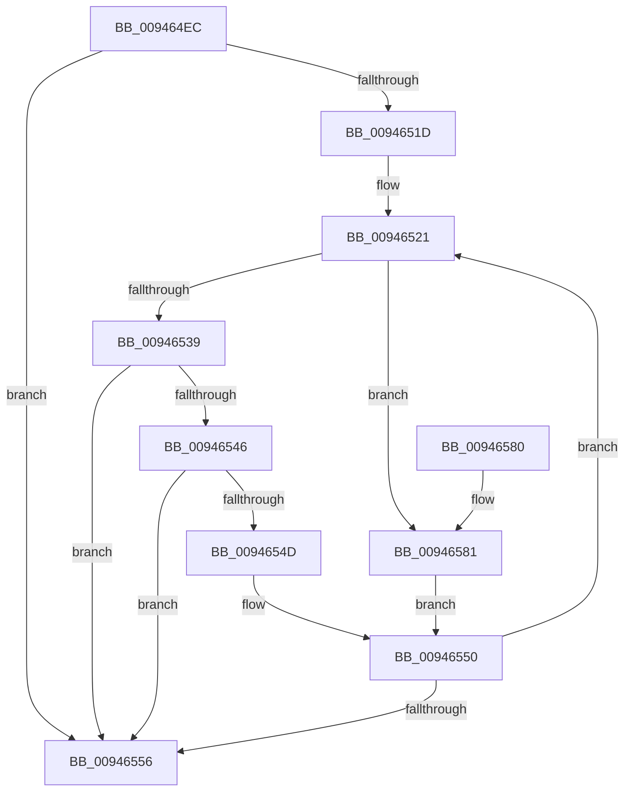

# CmpGetSecurityCellForKeyNodeStack

- RVA: `0x009464EC`–`0x00946587` (길이 `155` bytes)
- VA: `0x00000001409464EC`
- 실행 섹션: `PAGE`
- PDB 이름 있음: `예`; PDB Function 태그: `아니요`
- unwind 정보 RVA: `0x00090990`
- 디코드: `48`개 명령, `155/155` bytes 표시
- 미해석 바이트: `0` (있으면 어셈블리에 `.byte`로 보존)

> 이 문서는 커널 이미지의 기계어와 PDB 기호를 분석해 생성했습니다. 4번과 5번은 함수 원형과 자료형을 바이너리 사용 방식에서 추정한 C 해석이며 원본 소스 복구 결과는 아닙니다.

## 1. Dependencies

- 직접 호출 지점: **2**; 고유 호출 대상: **2**
- 직접 호출자로 확인된 함수: **2**
- RIP 상대 이미지 참조: **0**

### Outgoing calls
- `0x00946528` → [CmpKeyNodeStackGetEntryAtLayerHeight](CmpKeyNodeStackGetEntryAtLayerHeight_function_00946ABC.md) (function, `0x00946ABC`)
- `0x0094653C` → [CmpGetEffectiveKeyNodeSemantics](CmpGetEffectiveKeyNodeSemantics_function_00946D18.md) (function, `0x00946D18`)

### Direct callers
- [CmpCheckKeyNodeStackAccess](CmpCheckKeyNodeStackAccess_function_009459AC.md) at `0x009459F5`
- [CmpCopyMergeOfLayeredKeyNode](CmpCopyMergeOfLayeredKeyNode_function_00945A78.md) at `0x00945B0C`

### Static image references
- 디코드된 RIP-relative 메모리 참조가 없습니다.

## 2. Other-region calls and transfers

- 다른 실행 섹션으로 향하는 call: **0**
- 별도 외부 분기/꼬리 이동을 확인하지 못했습니다.

## 3. Assembly (complete function range)

```asm
009464EC  48 8B C4                        mov rax, rsp
009464EF  48 89 58 08                     mov qword ptr [rax + 8], rbx
009464F3  48 89 68 10                     mov qword ptr [rax + 0x10], rbp
009464F7  48 89 70 18                     mov qword ptr [rax + 0x18], rsi
009464FB  48 89 78 20                     mov qword ptr [rax + 0x20], rdi
009464FF  41 56                           push r14
00946501  48 83 EC 20                     sub rsp, 0x20
00946505  44 0F B7 09                     movzx r9d, word ptr [rcx]
00946509  33 ED                           xor ebp, ebp
0094650B  49 8B F8                        mov rdi, r8
0094650E  48 8B F2                        mov rsi, rdx
00946511  48 8B D9                        mov rbx, rcx
00946514  44 8B D5                        mov r10d, ebp
00946517  66 45 85 C9                     test r9w, r9w
0094651B  78 39                           js 0x140946556
0094651D  41 83 CE FF                     or r14d, 0xffffffff
00946521  41 0F B7 D1                     movzx edx, r9w
00946525  48 8B CB                        mov rcx, rbx
00946528  E8 8F 05 00 00                  call 0x140946abc
0094652D  4C 8B D8                        mov r11, rax
00946530  48 8B 50 10                     mov rdx, qword ptr [rax + 0x10]
00946534  48 85 D2                        test rdx, rdx
00946537  74 48                           je 0x140946581
00946539  48 8B 08                        mov rcx, qword ptr [rax]
0094653C  E8 D7 07 00 00                  call 0x140946d18
00946541  83 F8 01                        cmp eax, 1
00946544  74 10                           je 0x140946556
00946546  4D 8B D3                        mov r10, r11
00946549  85 C0                           test eax, eax
0094654B  75 09                           jne 0x140946556
0094654D  41 8B C6                        mov eax, r14d
00946550  66 44 03 C8                     add r9w, ax
00946554  79 CB                           jns 0x140946521
00946556  49 8B 02                        mov rax, qword ptr [r10]
00946559  48 8B 5C 24 30                  mov rbx, qword ptr [rsp + 0x30]
0094655E  48 8B 6C 24 38                  mov rbp, qword ptr [rsp + 0x38]
00946563  48 89 06                        mov qword ptr [rsi], rax
00946566  49 8B 42 10                     mov rax, qword ptr [r10 + 0x10]
0094656A  48 8B 74 24 40                  mov rsi, qword ptr [rsp + 0x40]
0094656F  8B 48 2C                        mov ecx, dword ptr [rax + 0x2c]
00946572  89 0F                           mov dword ptr [rdi], ecx
00946574  48 8B 7C 24 48                  mov rdi, qword ptr [rsp + 0x48]
00946579  48 83 C4 20                     add rsp, 0x20
0094657D  41 5E                           pop r14
0094657F  C3                              ret
00946580  CC                              int3
00946581  41 0F B7 C6                     movzx eax, r14w
00946585  EB C9                           jmp 0x140946550
```

## 4. C-style interpretation (structured pseudocode)

```c
__int64 __fastcall CmpGetSecurityCellForKeyNodeStack(__int64 a1, __int64 a2, __int64 a3)
{
    __int64 result;
    __int64 v_r14;
    __int64 v_rbp;
    __int64 v_rsp;
    unsigned __int64 v_stack_p10;
    unsigned __int64 v_stack_p18;
    unsigned __int64 v_stack_p20;
    unsigned __int64 v_stack_p8;

    *(unsigned __int64 *)(v_rsp + 8) = v_rbx;
    *(unsigned __int64 *)(v_rsp + 16) = v_rbp;
    *(unsigned __int64 *)(v_rsp + 24) = v_rsi;
    *(unsigned __int64 *)(v_rsp + 32) = v_rdi;
    v_rsp = (v_rsp) - (32);
    v_rbp = 0;
    if (sign_flag) goto loc_00946556;
    v_r14 = (unsigned int)((v_r14) | (0xFFFFFFFFULL));
loc_00946521:
    result = CmpKeyNodeStackGetEntryAtLayerHeight(a1, (unsigned __int16)(*(unsigned __int16 *)(a1)), a3, *(unsigned __int16 *)(a1));
    if (*(unsigned __int64 *)(result + 16) == 0) goto loc_00946581;
    result = CmpGetEffectiveKeyNodeSemantics(*(unsigned __int64 *)(result), *(unsigned __int64 *)(result + 16), a3, *(unsigned __int16 *)(a1));
    if (((unsigned int)(result)) == 1) goto loc_00946556;
    if ((unsigned int)(result) != 0) goto loc_00946556;
loc_00946550:
    a4 = (unsigned __int16)((*(unsigned __int16 *)(a1)) + ((unsigned __int16)((unsigned int)((unsigned int)(v_r14)))));
    if (!sign_flag) goto loc_00946521;
loc_00946556:
    *(unsigned __int64 *)(a2) = *(unsigned __int64 *)(result);
    *(unsigned int *)(a3) = (unsigned int)((unsigned int)(*(unsigned int *)(*(unsigned __int64 *)(result + 16) + 44)));
    v_rsp = (v_rsp) + (32);
    return *(unsigned __int64 *)(result + 16);
loc_00946581:
    goto loc_00946550;
}
```

## 5. (Beta) C Style

```c
int64_t CmpGetSecurityCellForKeyNodeStack(void *Arg1, void *Arg2, void *Arg3)
{
    uint8_t *arg1 = (uint8_t *)Arg1;
    uint8_t *arg2 = (uint8_t *)Arg2;
    uint8_t *arg3 = (uint8_t *)Arg3;

    int64_t result;
    int64_t local_r14;
    int64_t local_rbp;
    int64_t local_rsp;
    uint64_t v_stack_p10;
    uint64_t v_stack_p18;
    uint64_t v_stack_p20;
    uint64_t v_stack_p8;

    *(uint64_t *)(local_rsp + 0x8) = local_rbx;
    *(uint64_t *)(local_rsp + 0x10) = local_rbp;
    *(uint64_t *)(local_rsp + 0x18) = local_rsi;
    *(uint64_t *)(local_rsp + 0x20) = local_rdi;
    local_rsp = (local_rsp) - (32);
    local_rbp = 0;
    if (sign_flag) goto loc_00946556;
    local_r14 = (uint32_t)((local_r14) | (0xFFFFFFFFULL));
loc_00946521:
    result = CmpKeyNodeStackGetEntryAtLayerHeight(Arg1, (uint16_t)(*(uint16_t *)(arg1)), Arg3, *(uint16_t *)(arg1));
    if (*(uint64_t *)(result + 0x10) == 0) goto loc_00946581;
    result = CmpGetEffectiveKeyNodeSemantics(*(uint64_t *)(result), *(uint64_t *)(result + 0x10), Arg3, *(uint16_t *)(arg1));
    if (((uint32_t)(result)) == 1) goto loc_00946556;
    if ((uint32_t)(result) != 0) goto loc_00946556;
loc_00946550:
    a4 = (uint16_t)((*(uint16_t *)(arg1)) + ((uint16_t)((uint32_t)((uint32_t)(local_r14)))));
    if (!sign_flag) goto loc_00946521;
loc_00946556:
    *(uint64_t *)(arg2) = *(uint64_t *)(result);
    *(uint32_t *)(arg3) = (uint32_t)((uint32_t)(*(uint32_t *)(*(uint64_t *)(result + 0x10) + 0x2C)));
    local_rsp = (local_rsp) + (32);
    return *(uint64_t *)(result + 0x10);
loc_00946581:
    goto loc_00946550;
}
```

### 관측된 메모리 오프셋

구조체 형식이 확인되지 않은 접근은 인자 기준의 오프셋으로만 기록했습니다.

| 기준 인자 | 오프셋 표현 | 폭 (bit) | 접근 |
|---|---:|---:|---|
| `Arg1` | `+ 0x0` | `16` | `R` |
| `Arg2` | `+ 0x0` | `64` | `W` |
| `Arg3` | `+ 0x0` | `32` | `W` |

## 6. Execution-region graph

[열기: 2D/3D 그래프와 함수 탐색 컨트롤 패널](../../../control-panel.html?section=page&rva=0x009464EC&view=graph)

- 2D 그래프는 위에서 아래로 흐르고, 3D 그래프는 빈 공간을 드래그해 회전합니다. Shift+드래그는 이동, 휠은 확대·축소, 함수 노드 선택은 대상 보고서 이동입니다.

### Static fallback


