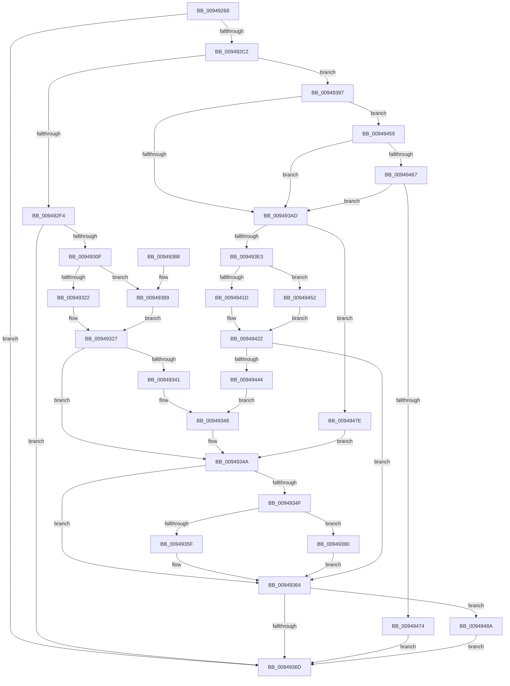

# CmpGetSecurityDescriptorNodeEx

- RVA: `0x00949268`–`0x00949499` (길이 `561` bytes)
- VA: `0x0000000140949268`
- 실행 섹션: `PAGE`
- PDB 이름 있음: `예`; PDB Function 태그: `아니요`
- unwind 정보 RVA: `0x00090CEC`
- 디코드: `154`개 명령, `561/561` bytes 표시
- 미해석 바이트: `0` (있으면 어셈블리에 `.byte`로 보존)

> 이 문서는 커널 이미지의 기계어와 PDB 기호를 분석해 생성했습니다. 4번과 5번은 함수 원형과 자료형을 바이너리 사용 방식에서 추정한 C 해석이며 원본 소스 복구 결과는 아닙니다.

## 1. Dependencies

- 직접 호출 지점: **18**; 고유 호출 대상: **14**
- 직접 호출자로 확인된 함수: **10**
- RIP 상대 이미지 참조: **0**

### Outgoing calls
- `0x009492A5` → [HvpGetCellContextInitialize](../85/HvpGetCellContextInitialize_function_00855F10.md) (function, `0x00855F10`)
- `0x009492B3` → [HvpMarkCellDirty](../85/HvpMarkCellDirty_function_00858080.md) (function, `0x00858080`)
- `0x009492CB` → [CmpUpdateKeyNodeAccessBits](../84/CmpUpdateKeyNodeAccessBits_function_0084864C.md) (function, `0x0084864C`)
- `0x009492E7` → [CmpFindMatchingDescriptorCell](CmpFindMatchingDescriptorCell_function_009494A0.md) (function, `0x009494A0`)
- `0x00949304` → [HvpMarkCellDirty](../85/HvpMarkCellDirty_function_00858080.md) (function, `0x00858080`)
- `0x00949322` → [HvpGetCellFlat](../85/HvpGetCellFlat_function_00854C60.md) (function, `0x00854C60`)
- `0x00949336` → [CmpKeySecurityIncrementReferenceCount](../../text/49/CmpKeySecurityIncrementReferenceCount_function_0049FC64.md) (function, `0x0049FC64`)
- `0x0094935F` → [HvpReleaseCellPaged](../85/HvpReleaseCellPaged_function_00855F40.md) (function, `0x00855F40`)
- `0x00949389` → [HvpGetCellPaged](../85/HvpGetCellPaged_function_00854CB0.md) (function, `0x00854CB0`)
- `0x00949390` → [HvpReleaseCellFlat](../85/HvpReleaseCellFlat_function_0085CC20.md) (function, `0x0085CC20`)
- `0x009493B0` → [RtlLengthSecurityDescriptorStrict](../../text/48/RtlLengthSecurityDescriptorStrict_function_0048B770.md) (function, `0x0048B770`)
- `0x009493D4` → [HvAllocateCell](../85/HvAllocateCell_function_00859C94.md) (function, `0x00859C94`)
- `0x009493E6` → [RtlLengthSecurityDescriptorStrict](../../text/48/RtlLengthSecurityDescriptorStrict_function_0048B770.md) (function, `0x0048B770`)
- `0x00949408` → [memcpy](../../text/6C/memcpy_function_006C6840.md) (function, `0x006C6840`)
- `0x0094941D` → [HvpReleaseCellPaged](../85/HvpReleaseCellPaged_function_00855F40.md) (function, `0x00855F40`)
- `0x00949435` → [CmpInsertSecurityCellList](../96/CmpInsertSecurityCellList_function_0096DF40.md) (function, `0x0096DF40`)
- `0x00949452` → [HvpReleaseCellFlat](../85/HvpReleaseCellFlat_function_0085CC20.md) (function, `0x0085CC20`)
- `0x0094948F` → [HvFreeCell](../85/HvFreeCell_function_0085A72C.md) (function, `0x0085A72C`)

### Direct callers
- [CmpAssignKeySecurity](../7E/CmpAssignKeySecurity_function_007EC8B0.md) at `0x007EC9CC`
- [CmpCopySaclToVirtualKey](../7E/CmpCopySaclToVirtualKey_function_007ECA6C.md) at `0x007ECCE9`
- [CmpSyncKeyValues](../7F/CmpSyncKeyValues_function_007F2DF4.md) at `0x007F2F0F`
- [CmpCopyKeyPartial](../85/CmpCopyKeyPartial_function_0085AFF4.md) at `0x0085B1D3`
- [CmpCopyMergeOfLayeredKeyNode](CmpCopyMergeOfLayeredKeyNode_function_00945A78.md) at `0x00945C27`
- [CmpCreateChild](CmpCreateChild_function_0094817C.md) at `0x009485A5`
- [CmpCreateChild](CmpCreateChild_function_0094817C.md) at `0x00948D09`
- [CmpAssignSecurityDescriptor](CmpAssignSecurityDescriptor_function_00949234.md) at `0x00949255`
- [CmpUndoDeleteKeyForTrans](CmpUndoDeleteKeyForTrans_function_0094A728.md) at `0x0094A9EA`
- [CmpLightWeightPrepareSetSecDescUoW](CmpLightWeightPrepareSetSecDescUoW_function_0094B098.md) at `0x0094B21C`
- [CmpCreateHiveRootCell](../AB/CmpCreateHiveRootCell_function_00ABF568.md) at `0x00ABF71D`

### Static image references
- 디코드된 RIP-relative 메모리 참조가 없습니다.

## 2. Other-region calls and transfers

- 다른 실행 섹션으로 향하는 call: **4**
  - `0x00949336` → [CmpKeySecurityIncrementReferenceCount](../../text/49/CmpKeySecurityIncrementReferenceCount_function_0049FC64.md) (`PAGE` → `.text`)
  - `0x009493B0` → [RtlLengthSecurityDescriptorStrict](../../text/48/RtlLengthSecurityDescriptorStrict_function_0048B770.md) (`PAGE` → `.text`)
  - `0x009493E6` → [RtlLengthSecurityDescriptorStrict](../../text/48/RtlLengthSecurityDescriptorStrict_function_0048B770.md) (`PAGE` → `.text`)
  - `0x00949408` → [memcpy](../../text/6C/memcpy_function_006C6840.md) (`PAGE` → `.text`)
- 별도 외부 분기/꼬리 이동을 확인하지 못했습니다.

## 3. Assembly (complete function range)

```asm
00949268  48 89 5C 24 10                  mov qword ptr [rsp + 0x10], rbx
0094926D  48 89 74 24 18                  mov qword ptr [rsp + 0x18], rsi
00949272  55                              push rbp
00949273  57                              push rdi
00949274  41 54                           push r12
00949276  41 56                           push r14
00949278  41 57                           push r15
0094927A  48 8B EC                        mov rbp, rsp
0094927D  48 83 EC 50                     sub rsp, 0x50
00949281  83 65 E0 00                     and dword ptr [rbp - 0x20], 0
00949285  48 8B D9                        mov rbx, rcx
00949288  48 83 65 E8 00                  and qword ptr [rbp - 0x18], 0
0094928D  48 8D 4D E8                     lea rcx, [rbp - 0x18]
00949291  48 83 65 F0 00                  and qword ptr [rbp - 0x10], 0
00949296  83 CE FF                        or esi, 0xffffffff
00949299  89 75 30                        mov dword ptr [rbp + 0x30], esi
0094929C  45 8B E1                        mov r12d, r9d
0094929F  4D 8B F0                        mov r14, r8
009492A2  44 8B FA                        mov r15d, edx
009492A5  E8 66 CC F0 FF                  call 0x140855f10
009492AA  48 8B CB                        mov rcx, rbx
009492AD  45 33 C9                        xor r9d, r9d
009492B0  45 33 C0                        xor r8d, r8d
009492B3  E8 C8 ED F0 FF                  call 0x140858080
009492B8  8B F8                           mov edi, eax
009492BA  85 C0                           test eax, eax
009492BC  0F 88 AB 00 00 00               js 0x14094936d
009492C2  45 8B C7                        mov r8d, r15d
009492C5  49 8B D6                        mov rdx, r14
009492C8  48 8B CB                        mov rcx, rbx
009492CB  E8 7C F3 EF FF                  call 0x14084864c
009492D0  4C 8B 75 50                     mov r14, qword ptr [rbp + 0x50]
009492D4  4C 8D 4D E0                     lea r9, [rbp - 0x20]
009492D8  48 83 64 24 20 00               and qword ptr [rsp + 0x20], 0
009492DE  49 8B D6                        mov rdx, r14
009492E1  45 8B C4                        mov r8d, r12d
009492E4  48 8B CB                        mov rcx, rbx
009492E7  E8 B4 01 00 00                  call 0x1409494a0
009492EC  84 C0                           test al, al
009492EE  0F 84 A3 00 00 00               je 0x140949397
009492F4  44 8B 7D E0                     mov r15d, dword ptr [rbp - 0x20]
009492F8  45 33 C9                        xor r9d, r9d
009492FB  41 8B D7                        mov edx, r15d
009492FE  45 33 C0                        xor r8d, r8d
00949301  48 8B CB                        mov rcx, rbx
00949304  E8 77 ED F0 FF                  call 0x140858080
00949309  8B F8                           mov edi, eax
0094930B  85 C0                           test eax, eax
0094930D  78 5E                           js 0x14094936d
0094930F  F6 83 8C 00 00 00 01            test byte ptr [rbx + 0x8c], 1
00949316  4C 8D 45 E8                     lea r8, [rbp - 0x18]
0094931A  41 8B D7                        mov edx, r15d
0094931D  48 8B CB                        mov rcx, rbx
00949320  74 67                           je 0x140949389
00949322  E8 39 B9 F0 FF                  call 0x140854c60
00949327  45 33 C9                        xor r9d, r9d
0094932A  45 8B C7                        mov r8d, r15d
0094932D  48 8B D3                        mov rdx, rbx
00949330  48 8B C8                        mov rcx, rax
00949333  4C 8B F0                        mov r14, rax
00949336  E8 29 69 B5 FF                  call 0x14049fc64
0094933B  8B F8                           mov edi, eax
0094933D  85 C0                           test eax, eax
0094933F  78 09                           js 0x14094934a
00949341  48 8B 45 60                     mov rax, qword ptr [rbp + 0x60]
00949345  44 89 38                        mov dword ptr [rax], r15d
00949348  33 FF                           xor edi, edi
0094934A  4D 85 F6                        test r14, r14
0094934D  74 15                           je 0x140949364
0094934F  F6 83 8C 00 00 00 01            test byte ptr [rbx + 0x8c], 1
00949356  48 8D 55 E8                     lea rdx, [rbp - 0x18]
0094935A  48 8B CB                        mov rcx, rbx
0094935D  75 31                           jne 0x140949390
0094935F  E8 DC CB F0 FF                  call 0x140855f40
00949364  83 FE FF                        cmp esi, -1
00949367  0F 85 1D 01 00 00               jne 0x14094948a
0094936D  4C 8D 5C 24 50                  lea r11, [rsp + 0x50]
00949372  8B C7                           mov eax, edi
00949374  49 8B 5B 38                     mov rbx, qword ptr [r11 + 0x38]
00949378  49 8B 73 40                     mov rsi, qword ptr [r11 + 0x40]
0094937C  49 8B E3                        mov rsp, r11
0094937F  41 5F                           pop r15
00949381  41 5E                           pop r14
00949383  41 5C                           pop r12
00949385  5F                              pop rdi
00949386  5D                              pop rbp
00949387  C3                              ret
00949388  CC                              int3
00949389  E8 22 B9 F0 FF                  call 0x140854cb0
0094938E  EB 97                           jmp 0x140949327
00949390  E8 8B 38 F1 FF                  call 0x14085cc20
00949395  EB CD                           jmp 0x140949364
00949397  65 48 8B 04 25 88 01 00 00      mov rax, qword ptr gs:[0x188]
009493A0  80 B8 32 02 00 00 00            cmp byte ptr [rax + 0x232], 0
009493A7  0F 85 AC 00 00 00               jne 0x140949459
009493AD  49 8B CE                        mov rcx, r14
009493B0  E8 BB 23 B4 FF                  call 0x14048b770
009493B5  48 8D 4D E8                     lea rcx, [rbp - 0x18]
009493B9  45 8B C4                        mov r8d, r12d
009493BC  48 89 4C 24 28                  mov qword ptr [rsp + 0x28], rcx
009493C1  4C 8D 4D 30                     lea r9, [rbp + 0x30]
009493C5  48 8D 4D F0                     lea rcx, [rbp - 0x10]
009493C9  48 89 4C 24 20                  mov qword ptr [rsp + 0x20], rcx
009493CE  8D 50 14                        lea edx, [rax + 0x14]
009493D1  48 8B CB                        mov rcx, rbx
009493D4  E8 BB 08 F1 FF                  call 0x140859c94
009493D9  8B F8                           mov edi, eax
009493DB  85 C0                           test eax, eax
009493DD  0F 88 9B 00 00 00               js 0x14094947e
009493E3  49 8B CE                        mov rcx, r14
009493E6  E8 85 23 B4 FF                  call 0x14048b770
009493EB  48 8B 4D F0                     mov rcx, qword ptr [rbp - 0x10]
009493EF  49 8B D6                        mov rdx, r14
009493F2  44 8B C0                        mov r8d, eax
009493F5  66 C7 01 73 6B                  mov word ptr [rcx], 0x6b73
009493FA  C7 41 0C 01 00 00 00            mov dword ptr [rcx + 0xc], 1
00949401  89 41 10                        mov dword ptr [rcx + 0x10], eax
00949404  48 83 C1 14                     add rcx, 0x14
00949408  E8 33 D4 D7 FF                  call 0x1406c6840
0094940D  F6 83 8C 00 00 00 01            test byte ptr [rbx + 0x8c], 1
00949414  48 8D 55 E8                     lea rdx, [rbp - 0x18]
00949418  48 8B CB                        mov rcx, rbx
0094941B  75 35                           jne 0x140949452
0094941D  E8 1E CB F0 FF                  call 0x140855f40
00949422  8B 75 30                        mov esi, dword ptr [rbp + 0x30]
00949425  41 8B D7                        mov edx, r15d
00949428  44 8A 4D 58                     mov r9b, byte ptr [rbp + 0x58]
0094942C  44 8B C6                        mov r8d, esi
0094942F  48 8B CB                        mov rcx, rbx
00949432  45 33 F6                        xor r14d, r14d
00949435  E8 06 4B 02 00                  call 0x14096df40
0094943A  8B F8                           mov edi, eax
0094943C  85 C0                           test eax, eax
0094943E  0F 88 20 FF FF FF               js 0x140949364
00949444  48 8B 45 60                     mov rax, qword ptr [rbp + 0x60]
00949448  89 30                           mov dword ptr [rax], esi
0094944A  83 CE FF                        or esi, 0xffffffff
0094944D  E9 F6 FE FF FF                  jmp 0x140949348
00949452  E8 C9 37 F1 FF                  call 0x14085cc20
00949457  EB C9                           jmp 0x140949422
00949459  8B 83 10 10 00 00               mov eax, dword ptr [rbx + 0x1010]
0094945F  A8 20                           test al, 0x20
00949461  0F 84 46 FF FF FF               je 0x1409493ad
00949467  83 BB 50 07 00 00 01            cmp dword ptr [rbx + 0x750], 1
0094946E  0F 86 39 FF FF FF               jbe 0x1409493ad
00949474  BF 22 00 00 C0                  mov edi, 0xc0000022
00949479  E9 EF FE FF FF                  jmp 0x14094936d
0094947E  8B 75 30                        mov esi, dword ptr [rbp + 0x30]
00949481  4C 8B 75 F0                     mov r14, qword ptr [rbp - 0x10]
00949485  E9 C0 FE FF FF                  jmp 0x14094934a
0094948A  8B D6                           mov edx, esi
0094948C  48 8B CB                        mov rcx, rbx
0094948F  E8 98 12 F1 FF                  call 0x14085a72c
00949494  E9 D4 FE FF FF                  jmp 0x14094936d
```

## 4. C-style interpretation (structured pseudocode)

```c
__int64 __fastcall CmpGetSecurityDescriptorNodeEx(__int64 a1, int a2, __int64 a3, int a4, __int64 a5, unsigned __int8 a6, __int64 a7)
{
    __int64 result;
    __int64 v_r14;
    __int64 v_rdi;
    __int64 v_rsi;
    __int64 v_rsp;
    unsigned __int64 v_stack_m28;
    unsigned __int64 v_stack_m30;
    unsigned __int64 v_stack_m38;
    unsigned __int64 v_stack_m40;
    unsigned int v_stack_m48;
    unsigned __int64 v_stack_m58;
    unsigned __int64 v_stack_p10;
    unsigned __int64 v_stack_p18;
    unsigned int v_stack_p8;

    v_stack_p10 = v_rbx;
    v_stack_p18 = v_rsi;
    v_rsp = (v_rsp) - (80);
    v_rsi = (unsigned int)((v_rsi) | (0xFFFFFFFFULL));
    v_stack_p8 = (unsigned int)(v_rsi);
    result = HvpGetCellContextInitialize(v_stack_m40, a2, a3, a4);
    a4 = 0;
    a3 = 0;
    result = HvpMarkCellDirty(a1, a2, a3, a4);
    if (sign_flag) goto loc_0094936D;
    result = CmpUpdateKeyNodeAccessBits(a1, 0, (unsigned int)((unsigned int)((unsigned int)(a2))), a4);
    result = CmpFindMatchingDescriptorCell(a1, a5, (unsigned int)((unsigned int)((unsigned int)(a4))), v_stack_m48);
    if ((unsigned __int8)(result) == 0) goto loc_00949397;
    a4 = 0;
    a3 = 0;
    result = HvpMarkCellDirty(a1, (unsigned int)((unsigned int)((unsigned int)(v_stack_m48))), a3, a4);
    if (sign_flag) goto loc_0094936D;
    if (((*(unsigned __int8 *)(a1 + 140)) & (1)) == 0) goto loc_00949389;
    result = HvpGetCellFlat(a1, (unsigned int)((unsigned int)((unsigned int)(v_stack_m48))), v_stack_m40, a4);
loc_00949327:
    a4 = 0;
    result = CmpKeySecurityIncrementReferenceCount(result, a1, (unsigned int)((unsigned int)((unsigned int)(v_stack_m48))), a4);
    if (sign_flag) goto loc_0094934A;
    *(unsigned int *)(a7) = (unsigned int)((unsigned int)(v_stack_m48));
loc_00949348:
    v_rdi = 0;
loc_0094934A:
    if (result == 0) goto loc_00949364;
    if (((*(unsigned __int8 *)(a1 + 140)) & (1)) != 0) goto loc_00949390;
    result = HvpReleaseCellPaged(a1, v_stack_m40, (unsigned int)((unsigned int)((unsigned int)(v_stack_m48))), a4);
loc_00949364:
    if (((unsigned int)(v_rsi)) != -1) goto loc_0094948A;
loc_0094936D:
    return 0;
loc_00949389:
    result = HvpGetCellPaged(a1, v_stack_m40, (unsigned int)((unsigned int)((unsigned int)(v_stack_m48))), a4);
    goto loc_00949327;
loc_00949390:
    result = HvpReleaseCellFlat(a1, v_stack_m40, (unsigned int)((unsigned int)((unsigned int)(v_stack_m48))), a4);
    goto loc_00949364;
loc_00949397:
    if ((*(unsigned __int8 *)(*(unsigned __int64 *)(gs_base + (0 + 392)) + 562)) != 0) goto loc_00949459;
loc_009493AD:
    result = RtlLengthSecurityDescriptorStrict(result, v_stack_m40, (unsigned int)((unsigned int)((unsigned int)(v_stack_m48))), a4);
    v_stack_m28 = v_stack_m40;
    v_stack_m30 = v_stack_m38;
    result = HvAllocateCell(*(unsigned __int64 *)(v_stack_m28 + 56), result + 20, (unsigned int)((unsigned int)((unsigned int)(a4))), v_stack_p8);
    if (sign_flag) goto loc_0094947E;
    result = RtlLengthSecurityDescriptorStrict(result, result + 20, (unsigned int)((unsigned int)((unsigned int)(a4))), v_stack_p8);
    *(unsigned __int16 *)(v_stack_m38) = 0x6B73ULL;
    *(unsigned int *)(v_stack_m38 + 12) = 1;
    *(unsigned int *)(v_stack_m38 + 16) = (unsigned int)(result);
    a1 = (v_stack_m38) + (20);
    result = memcpy(a1, result, (unsigned int)((unsigned int)(result)), v_stack_p8);
    if (((*(unsigned __int8 *)(*(unsigned __int64 *)(v_stack_m28 + 56) + 140)) & (1)) != 0) goto loc_00949452;
    result = HvpReleaseCellPaged(*(unsigned __int64 *)(v_stack_m28 + 56), v_stack_m40, (unsigned int)((unsigned int)(result)), v_stack_p8);
loc_00949422:
    v_r14 = 0;
    result = CmpInsertSecurityCellList(*(unsigned __int64 *)(v_stack_m28 + 56), (unsigned int)((unsigned int)((unsigned int)(v_stack_m48))), (unsigned int)((unsigned int)((unsigned int)(v_stack_p8))), a6);
    if (sign_flag) goto loc_00949364;
    *(unsigned int *)(a7) = (unsigned int)((unsigned int)(v_stack_p8));
    v_rsi = (unsigned int)(((unsigned int)(v_stack_p8)) | (0xFFFFFFFFULL));
    goto loc_00949348;
loc_00949452:
    result = HvpReleaseCellFlat(*(unsigned __int64 *)(v_stack_m28 + 56), (unsigned int)((unsigned int)((unsigned int)(v_stack_m48))), (unsigned int)((unsigned int)((unsigned int)(v_stack_p8))), a6);
    goto loc_00949422;
loc_00949459:
    if ((((unsigned __int8)((unsigned int)(*(unsigned int *)(*(unsigned __int64 *)(v_stack_m28 + 56) + 4112)))) & (32)) == 0) goto loc_009493AD;
    if ((*(unsigned int *)(*(unsigned __int64 *)(v_stack_m28 + 56) + 1872)) <= 1) goto loc_009493AD;
    goto loc_0094936D;
loc_0094947E:
    goto loc_0094934A;
loc_0094948A:
    result = HvFreeCell(*(unsigned __int64 *)(v_stack_m28 + 56), (unsigned int)((unsigned int)((unsigned int)(v_stack_p8))), (unsigned int)((unsigned int)((unsigned int)(v_stack_p8))), a6);
    goto loc_0094936D;
}
```

## 5. (Beta) C Style

```c
int64_t CmpGetSecurityDescriptorNodeEx(void *Arg1, int32_t Arg2, int64_t Arg3, int32_t Arg4, int64_t Arg5, uint8_t Arg6, void *Arg7)
{
    uint8_t *arg1 = (uint8_t *)Arg1;
    uint8_t *arg7 = (uint8_t *)Arg7;

    int64_t result;
    int64_t local_r14;
    int64_t local_rdi;
    int64_t local_rsi;
    int64_t local_rsp;
    uint64_t v_stack_m28;
    uint64_t v_stack_m30;
    uint64_t v_stack_m38;
    uint64_t v_stack_m40;
    uint32_t v_stack_m48;
    uint64_t v_stack_m58;
    uint64_t v_stack_p10;
    uint64_t v_stack_p18;
    uint32_t v_stack_p8;

    v_stack_p10 = local_rbx;
    v_stack_p18 = local_rsi;
    local_rsp = (local_rsp) - (80);
    local_rsi = (uint32_t)((local_rsi) | (0xFFFFFFFFULL));
    v_stack_p8 = (uint32_t)(local_rsi);
    result = HvpGetCellContextInitialize(v_stack_m40, Arg2, Arg3, Arg4);
    Arg4 = 0;
    Arg3 = 0;
    result = HvpMarkCellDirty(Arg1, Arg2, Arg3, Arg4);
    if (sign_flag) goto loc_0094936D;
    result = CmpUpdateKeyNodeAccessBits(Arg1, 0, (uint32_t)((uint32_t)((uint32_t)(Arg2))), Arg4);
    result = CmpFindMatchingDescriptorCell(Arg1, Arg5, (uint32_t)((uint32_t)((uint32_t)(Arg4))), v_stack_m48);
    if ((uint8_t)(result) == 0) goto loc_00949397;
    Arg4 = 0;
    Arg3 = 0;
    result = HvpMarkCellDirty(Arg1, (uint32_t)((uint32_t)((uint32_t)(v_stack_m48))), Arg3, Arg4);
    if (sign_flag) goto loc_0094936D;
    if (((*(uint8_t *)(arg1 + 0x8C)) & (1)) == 0) goto loc_00949389;
    result = HvpGetCellFlat(Arg1, (uint32_t)((uint32_t)((uint32_t)(v_stack_m48))), v_stack_m40, Arg4);
loc_00949327:
    Arg4 = 0;
    result = CmpKeySecurityIncrementReferenceCount(result, Arg1, (uint32_t)((uint32_t)((uint32_t)(v_stack_m48))), Arg4);
    if (sign_flag) goto loc_0094934A;
    *(uint32_t *)(arg7) = (uint32_t)((uint32_t)(v_stack_m48));
loc_00949348:
    local_rdi = 0;
loc_0094934A:
    if (result == 0) goto loc_00949364;
    if (((*(uint8_t *)(arg1 + 0x8C)) & (1)) != 0) goto loc_00949390;
    result = HvpReleaseCellPaged(Arg1, v_stack_m40, (uint32_t)((uint32_t)((uint32_t)(v_stack_m48))), Arg4);
loc_00949364:
    if (((uint32_t)(local_rsi)) != -1) goto loc_0094948A;
loc_0094936D:
    return 0;
loc_00949389:
    result = HvpGetCellPaged(Arg1, v_stack_m40, (uint32_t)((uint32_t)((uint32_t)(v_stack_m48))), Arg4);
    goto loc_00949327;
loc_00949390:
    result = HvpReleaseCellFlat(Arg1, v_stack_m40, (uint32_t)((uint32_t)((uint32_t)(v_stack_m48))), Arg4);
    goto loc_00949364;
loc_00949397:
    if ((*(uint8_t *)(*(uint64_t *)(gs_base + (0 + 0x188)) + 0x232)) != 0) goto loc_00949459;
loc_009493AD:
    result = RtlLengthSecurityDescriptorStrict(result, v_stack_m40, (uint32_t)((uint32_t)((uint32_t)(v_stack_m48))), Arg4);
    v_stack_m28 = v_stack_m40;
    v_stack_m30 = v_stack_m38;
    result = HvAllocateCell(*(uint64_t *)(v_stack_m28 + 0x38), result + 20, (uint32_t)((uint32_t)((uint32_t)(Arg4))), v_stack_p8);
    if (sign_flag) goto loc_0094947E;
    result = RtlLengthSecurityDescriptorStrict(result, result + 20, (uint32_t)((uint32_t)((uint32_t)(Arg4))), v_stack_p8);
    *(uint16_t *)(v_stack_m38) = 0x6B73ULL;
    *(uint32_t *)(v_stack_m38 + 0xC) = 1;
    *(uint32_t *)(v_stack_m38 + 0x10) = (uint32_t)(result);
    Arg1 = (v_stack_m38) + (20);
    result = memcpy(Arg1, result, (uint32_t)((uint32_t)(result)), v_stack_p8);
    if (((*(uint8_t *)(*(uint64_t *)(v_stack_m28 + 0x38) + 0x8C)) & (1)) != 0) goto loc_00949452;
    result = HvpReleaseCellPaged(*(uint64_t *)(v_stack_m28 + 0x38), v_stack_m40, (uint32_t)((uint32_t)(result)), v_stack_p8);
loc_00949422:
    local_r14 = 0;
    result = CmpInsertSecurityCellList(*(uint64_t *)(v_stack_m28 + 0x38), (uint32_t)((uint32_t)((uint32_t)(v_stack_m48))), (uint32_t)((uint32_t)((uint32_t)(v_stack_p8))), Arg6);
    if (sign_flag) goto loc_00949364;
    *(uint32_t *)(arg7) = (uint32_t)((uint32_t)(v_stack_p8));
    local_rsi = (uint32_t)(((uint32_t)(v_stack_p8)) | (0xFFFFFFFFULL));
    goto loc_00949348;
loc_00949452:
    result = HvpReleaseCellFlat(*(uint64_t *)(v_stack_m28 + 0x38), (uint32_t)((uint32_t)((uint32_t)(v_stack_m48))), (uint32_t)((uint32_t)((uint32_t)(v_stack_p8))), Arg6);
    goto loc_00949422;
loc_00949459:
    if ((((uint8_t)((uint32_t)(*(uint32_t *)(*(uint64_t *)(v_stack_m28 + 0x38) + 0x1010)))) & (32)) == 0) goto loc_009493AD;
    if ((*(uint32_t *)(*(uint64_t *)(v_stack_m28 + 0x38) + 0x750)) <= 1) goto loc_009493AD;
    goto loc_0094936D;
loc_0094947E:
    goto loc_0094934A;
loc_0094948A:
    result = HvFreeCell(*(uint64_t *)(v_stack_m28 + 0x38), (uint32_t)((uint32_t)((uint32_t)(v_stack_p8))), (uint32_t)((uint32_t)((uint32_t)(v_stack_p8))), Arg6);
    goto loc_0094936D;
}
```

### 관측된 메모리 오프셋

구조체 형식이 확인되지 않은 접근은 인자 기준의 오프셋으로만 기록했습니다.

| 기준 인자 | 오프셋 표현 | 폭 (bit) | 접근 |
|---|---:|---:|---|
| `Arg1` | `+ 0x8C` | `8` | `R` |
| `Arg1` | `+ 0x750` | `32` | `R` |
| `Arg1` | `+ 0x1010` | `32` | `R` |
| `Arg7` | `+ 0x0` | `32` | `W` |

## 6. Execution-region graph

[열기: 2D/3D 그래프와 함수 탐색 컨트롤 패널](../../../control-panel.html?section=page&rva=0x00949268&view=graph)

- 2D 그래프는 위에서 아래로 흐르고, 3D 그래프는 빈 공간을 드래그해 회전합니다. Shift+드래그는 이동, 휠은 확대·축소, 함수 노드 선택은 대상 보고서 이동입니다.

### Static fallback


