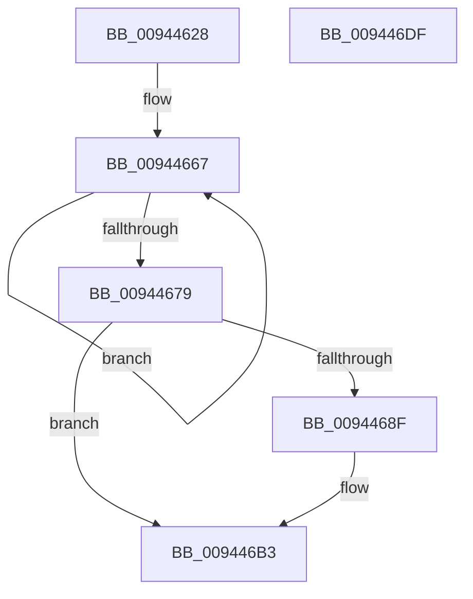

# CmpGetSubKeyCountForKcbStack

- RVA: `0x00944628`–`0x009446E0` (길이 `184` bytes)
- VA: `0x0000000140944628`
- 실행 섹션: `PAGE`
- PDB 이름 있음: `예`; PDB Function 태그: `아니요`
- unwind 정보 RVA: `0x00090718`
- 디코드: `51`개 명령, `184/184` bytes 표시
- 미해석 바이트: `0` (있으면 어셈블리에 `.byte`로 보존)

> 이 문서는 커널 이미지의 기계어와 PDB 기호를 분석해 생성했습니다. 4번과 5번은 함수 원형과 자료형을 바이너리 사용 방식에서 추정한 C 해석이며 원본 소스 복구 결과는 아닙니다.

## 1. Dependencies

- 직접 호출 지점: **7**; 고유 호출 대상: **7**
- 직접 호출자로 확인된 함수: **1**
- RIP 상대 이미지 참조: **1**

### Outgoing calls
- `0x00944657` → [memset](../../text/6C/memset_function_006C6C40.md) (function, `0x006C6C40`)
- `0x0094466A` → [CmpKeyNodeStackEntryInitialize](CmpKeyNodeStackEntryInitialize_function_00946840.md) (function, `0x00946840`)
- `0x00944682` → [CmpStartKeyNodeStack](CmpStartKeyNodeStack_function_00945338.md) (function, `0x00945338`)
- `0x0094469A` → [CmpPopulateKeyNodeStackFromKcbStack](CmpPopulateKeyNodeStackFromKcbStack_function_009453CC.md) (function, `0x009453CC`)
- `0x009446A7` → [CmpGetSubKeyCountForKeyNodeStack](CmpGetSubKeyCountForKeyNodeStack_function_00945624.md) (function, `0x00945624`)
- `0x009446B8` → [CmpCleanupKeyNodeStack](CmpCleanupKeyNodeStack_function_00946A5C.md) (function, `0x00946A5C`)
- `0x009446C7` → [_security_check_cookie](../../text/6A/_security_check_cookie_function_006AC640.md) (function, `0x006AC640`)

### Direct callers
- [CmDeleteLayeredKey](../../text/41/CmDeleteLayeredKey_function_0041B598.md) at `0x0041B69E`

### Static image references
- `0x00944637` → RVA `0x00E0A740` (`.data`; read)

## 2. Other-region calls and transfers

- 다른 실행 섹션으로 향하는 call: **2**
  - `0x00944657` → [memset](../../text/6C/memset_function_006C6C40.md) (`PAGE` → `.text`)
  - `0x009446C7` → [_security_check_cookie](../../text/6A/_security_check_cookie_function_006AC640.md) (`PAGE` → `.text`)
- 별도 외부 분기/꼬리 이동을 확인하지 못했습니다.

## 3. Assembly (complete function range)

```asm
00944628  48 89 5C 24 10                  mov qword ptr [rsp + 0x10], rbx
0094462D  55                              push rbp
0094462E  56                              push rsi
0094462F  57                              push rdi
00944630  48 81 EC 80 00 00 00            sub rsp, 0x80
00944637  48 8B 05 02 61 4C 00            mov rax, qword ptr [rip + 0x4c6102]
0094463E  48 33 C4                        xor rax, rsp
00944641  48 89 44 24 70                  mov qword ptr [rsp + 0x70], rax
00944646  33 D2                           xor edx, edx
00944648  49 8B F0                        mov rsi, r8
0094464B  48 8B F9                        mov rdi, rcx
0094464E  48 8D 4C 24 20                  lea rcx, [rsp + 0x20]
00944653  44 8D 42 50                     lea r8d, [rdx + 0x50]
00944657  E8 E4 25 D8 FF                  call 0x1406c6c40
0094465C  4C 8D 44 24 28                  lea r8, [rsp + 0x28]
00944661  41 B9 02 00 00 00               mov r9d, 2
00944667  49 8B C8                        mov rcx, r8
0094466A  E8 D1 21 00 00                  call 0x140946840
0094466F  49 83 C0 20                     add r8, 0x20
00944673  49 83 E9 01                     sub r9, 1
00944677  75 EE                           jne 0x140944667
00944679  0F B7 57 02                     movzx edx, word ptr [rdi + 2]
0094467D  48 8D 4C 24 20                  lea rcx, [rsp + 0x20]
00944682  E8 B1 0C 00 00                  call 0x140945338
00944687  33 ED                           xor ebp, ebp
00944689  8B D8                           mov ebx, eax
0094468B  85 C0                           test eax, eax
0094468D  78 24                           js 0x1409446b3
0094468F  45 33 C0                        xor r8d, r8d
00944692  48 8D 4C 24 20                  lea rcx, [rsp + 0x20]
00944697  48 8B D7                        mov rdx, rdi
0094469A  E8 2D 0D 00 00                  call 0x1409453cc
0094469F  48 8B D6                        mov rdx, rsi
009446A2  48 8D 4C 24 20                  lea rcx, [rsp + 0x20]
009446A7  E8 78 0F 00 00                  call 0x140945624
009446AC  85 C0                           test eax, eax
009446AE  8B D8                           mov ebx, eax
009446B0  0F 49 DD                        cmovns ebx, ebp
009446B3  48 8D 4C 24 20                  lea rcx, [rsp + 0x20]
009446B8  E8 9F 23 00 00                  call 0x140946a5c
009446BD  8B C3                           mov eax, ebx
009446BF  48 8B 4C 24 70                  mov rcx, qword ptr [rsp + 0x70]
009446C4  48 33 CC                        xor rcx, rsp
009446C7  E8 74 7F D6 FF                  call 0x1406ac640
009446CC  48 8B 9C 24 A8 00 00 00         mov rbx, qword ptr [rsp + 0xa8]
009446D4  48 81 C4 80 00 00 00            add rsp, 0x80
009446DB  5F                              pop rdi
009446DC  5E                              pop rsi
009446DD  5D                              pop rbp
009446DE  C3                              ret
009446DF  CC                              int3
```

## 4. C-style interpretation (structured pseudocode)

```c
__int64 __fastcall CmpGetSubKeyCountForKcbStack(__int64 a1, int a2, __int64 a3)
{
    __int64 result;
    __int64 v_rbp;
    __int64 v_rbx;
    __int64 v_rsp;
    unsigned __int64 v_stack_m28;
    unsigned __int64 v_stack_m70;
    unsigned __int64 v_stack_m78;
    unsigned __int64 v_stack_p10;

    v_stack_p10 = v_rbx;
    v_rsp = (v_rsp) - (128);
    result = (*(unsigned __int64 *)(v_rip + 5005570)) ^ (v_rsp);
    v_stack_m28 = result;
    a2 = 0;
    result = memset(v_stack_m78, a2, a2 + 80, a4);
loc_00944667:
    result = CmpKeyNodeStackEntryInitialize(v_stack_m70, a2, v_stack_m70, 2);
    a3 = (v_stack_m70) + (32);
    a4 = (2) - (1);
    if (condition_is_not_equal) goto loc_00944667;
    result = CmpStartKeyNodeStack(v_stack_m78, *(unsigned __int16 *)(a1 + 2), a3, a4);
    v_rbp = 0;
    v_rbx = (unsigned int)((unsigned int)(result));
    if (!(sign_flag)) {
        a3 = 0;
        a1 = v_stack_m78;
        a2 = a1;
        result = CmpPopulateKeyNodeStackFromKcbStack(a1, a2, a3, a4);
        a2 = 0;
        a1 = v_stack_m78;
        result = CmpGetSubKeyCountForKeyNodeStack(a1, a2, a3, a4);
        v_rbx = (unsigned int)(result);
        if (!sign_flag) { v_rbx = 0; }
    }
    result = CmpCleanupKeyNodeStack(v_stack_m78, a2, a3, a4);
    a1 = (v_stack_m28) ^ (v_rsp);
    result = _security_check_cookie(a1, a2, a3, a4);
    v_rsp = (v_rsp) + (128);
    return result;
}
```

## 5. (Beta) C Style

```c
int64_t CmpGetSubKeyCountForKcbStack(void *Arg1, int32_t Arg2, int64_t Arg3)
{
    uint8_t *arg1 = (uint8_t *)Arg1;

    int64_t result;
    int64_t local_rbp;
    int64_t local_rbx;
    int64_t local_rsp;
    uint64_t v_stack_m28;
    uint64_t v_stack_m70;
    uint64_t v_stack_m78;
    uint64_t v_stack_p10;

    v_stack_p10 = local_rbx;
    local_rsp = (local_rsp) - (128);
    result = (*(uint64_t *)(v_rip + 0x4C6102)) ^ (local_rsp);
    v_stack_m28 = result;
    Arg2 = 0;
    result = memset(v_stack_m78, Arg2, Arg2 + 80, a4);
loc_00944667:
    result = CmpKeyNodeStackEntryInitialize(v_stack_m70, Arg2, v_stack_m70, 2);
    Arg3 = (v_stack_m70) + (32);
    a4 = (2) - (1);
    if (condition_is_not_equal) goto loc_00944667;
    result = CmpStartKeyNodeStack(v_stack_m78, *(uint16_t *)(arg1 + 0x2), Arg3, a4);
    local_rbp = 0;
    local_rbx = (uint32_t)((uint32_t)(result));
    if (!(sign_flag)) {
        Arg3 = 0;
        Arg1 = v_stack_m78;
        Arg2 = Arg1;
        result = CmpPopulateKeyNodeStackFromKcbStack(Arg1, Arg2, Arg3, a4);
        Arg2 = 0;
        Arg1 = v_stack_m78;
        result = CmpGetSubKeyCountForKeyNodeStack(Arg1, Arg2, Arg3, a4);
        local_rbx = (uint32_t)(result);
        if (!sign_flag) { local_rbx = 0; }
    }
    result = CmpCleanupKeyNodeStack(v_stack_m78, Arg2, Arg3, a4);
    Arg1 = (v_stack_m28) ^ (local_rsp);
    result = _security_check_cookie(Arg1, Arg2, Arg3, a4);
    local_rsp = (local_rsp) + (128);
    return result;
}
```

### 관측된 메모리 오프셋

구조체 형식이 확인되지 않은 접근은 인자 기준의 오프셋으로만 기록했습니다.

| 기준 인자 | 오프셋 표현 | 폭 (bit) | 접근 |
|---|---:|---:|---|
| `Arg1` | `+ 0x2` | `16` | `R` |

## 6. Execution-region graph

[열기: 2D/3D 그래프와 함수 탐색 컨트롤 패널](../../../control-panel.html?section=page&rva=0x00944628&view=graph)

- 2D 그래프는 위에서 아래로 흐르고, 3D 그래프는 빈 공간을 드래그해 회전합니다. Shift+드래그는 이동, 휠은 확대·축소, 함수 노드 선택은 대상 보고서 이동입니다.

### Static fallback


