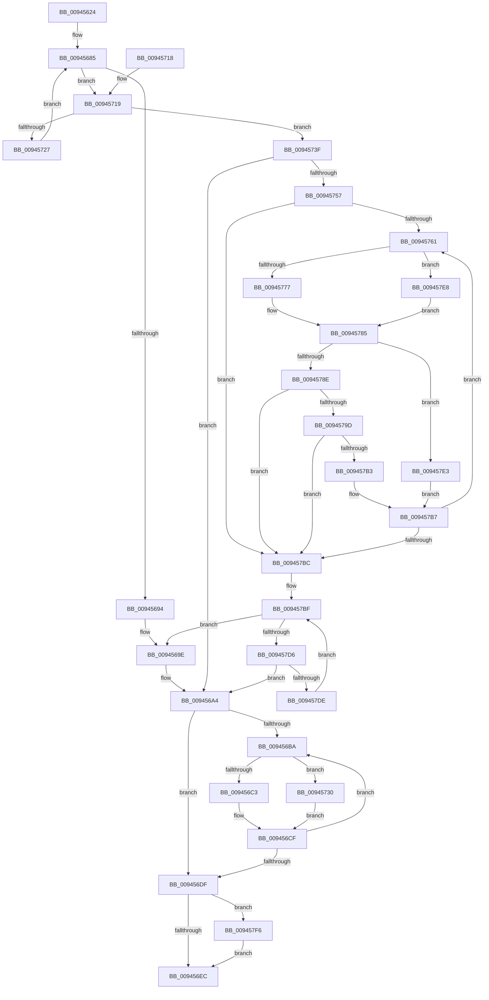

# CmpGetSubKeyCountForKeyNodeStack

- RVA: `0x00945624`–`0x00945800` (길이 `476` bytes)
- VA: `0x0000000140945624`
- 실행 섹션: `PAGE`
- PDB 이름 있음: `예`; PDB Function 태그: `아니요`
- unwind 정보 RVA: `0x000908D8`
- 디코드: `132`개 명령, `476/476` bytes 표시
- 미해석 바이트: `0` (있으면 어셈블리에 `.byte`로 보존)

> 이 문서는 커널 이미지의 기계어와 PDB 기호를 분석해 생성했습니다. 4번과 5번은 함수 원형과 자료형을 바이너리 사용 방식에서 추정한 C 해석이며 원본 소스 복구 결과는 아닙니다.

## 1. Dependencies

- 직접 호출 지점: **12**; 고유 호출 대상: **11**
- 직접 호출자로 확인된 함수: **2**
- RIP 상대 이미지 참조: **1**

### Outgoing calls
- `0x00945667` → [memset](../../text/6C/memset_function_006C6C40.md) (function, `0x006C6C40`)
- `0x00945671` → [CmpKeyEnumStackInitialize](CmpKeyEnumStackInitialize_function_00946D38.md) (function, `0x00946D38`)
- `0x009456A9` → [CmpCleanupKeyNodeStack](CmpCleanupKeyNodeStack_function_00946A5C.md) (function, `0x00946A5C`)
- `0x009456CF` → [CmpKeyEnumStackEntryCleanup](CmpKeyEnumStackEntryCleanup_function_00946B20.md) (function, `0x00946B20`)
- `0x009456F8` → [_security_check_cookie](../../text/6A/_security_check_cookie_function_006AC640.md) (function, `0x006AC640`)
- `0x0094571C` → [CmpKeyNodeStackGetEntryAtLayerHeight](CmpKeyNodeStackGetEntryAtLayerHeight_function_00946ABC.md) (function, `0x00946ABC`)
- `0x00945748` → [CmpKeyEnumStackStart](CmpKeyEnumStackStart_function_009452A0.md) (function, `0x009452A0`)
- `0x0094576A` → [CmpKeyNodeStackGetEntryAtLayerHeight](CmpKeyNodeStackGetEntryAtLayerHeight_function_00946ABC.md) (function, `0x00946ABC`)
- `0x00945791` → [CmpGetEffectiveKeyNodeSemantics](CmpGetEffectiveKeyNodeSemantics_function_00946D18.md) (function, `0x00946D18`)
- `0x009457A6` → [CmpKeyEnumStackEntryBegin](CmpKeyEnumStackEntryBegin_function_00946DE4.md) (function, `0x00946DE4`)
- `0x009457C4` → [CmpKeyEnumStackAdvance](CmpKeyEnumStackAdvance_function_0094668C.md) (function, `0x0094668C`)
- `0x009457F6` → [CmSiFreeMemory](../../text/47/CmSiFreeMemory_function_00475D80.md) (function, `0x00475D80`)

### Direct callers
- [CmpQueryKeyDataFromKeyNodeStack](../../text/46/CmpQueryKeyDataFromKeyNodeStack_function_0046AC40.md) at `0x0046AD75`
- [CmpGetSubKeyCountForKcbStack](CmpGetSubKeyCountForKcbStack_function_00944628.md) at `0x009446A7`

### Static image references
- `0x00945643` → RVA `0x00E0A740` (`.data`; read)

## 2. Other-region calls and transfers

- 다른 실행 섹션으로 향하는 call: **3**
  - `0x00945667` → [memset](../../text/6C/memset_function_006C6C40.md) (`PAGE` → `.text`)
  - `0x009456F8` → [_security_check_cookie](../../text/6A/_security_check_cookie_function_006AC640.md) (`PAGE` → `.text`)
  - `0x009457F6` → [CmSiFreeMemory](../../text/47/CmSiFreeMemory_function_00475D80.md) (`PAGE` → `.text`)
- 별도 외부 분기/꼬리 이동을 확인하지 못했습니다.

## 3. Assembly (complete function range)

```asm
00945624  48 89 5C 24 18                  mov qword ptr [rsp + 0x18], rbx
00945629  55                              push rbp
0094562A  56                              push rsi
0094562B  57                              push rdi
0094562C  41 54                           push r12
0094562E  41 55                           push r13
00945630  41 56                           push r14
00945632  41 57                           push r15
00945634  48 8D AC 24 70 FF FF FF         lea rbp, [rsp - 0x90]
0094563C  48 81 EC 90 01 00 00            sub rsp, 0x190
00945643  48 8B 05 F6 50 4C 00            mov rax, qword ptr [rip + 0x4c50f6]
0094564A  48 33 C4                        xor rax, rsp
0094564D  48 89 85 80 00 00 00            mov qword ptr [rbp + 0x80], rax
00945654  4C 8B F2                        mov r14, rdx
00945657  48 8B F1                        mov rsi, rcx
0094565A  33 D2                           xor edx, edx
0094565C  48 8D 4C 24 20                  lea rcx, [rsp + 0x20]
00945661  41 B8 60 01 00 00               mov r8d, 0x160
00945667  E8 D4 15 D8 FF                  call 0x1406c6c40
0094566C  48 8D 4C 24 20                  lea rcx, [rsp + 0x20]
00945671  E8 C2 16 00 00                  call 0x140946d38
00945676  44 0F B7 0E                     movzx r9d, word ptr [rsi]
0094567A  45 33 FF                        xor r15d, r15d
0094567D  41 0F B7 D1                     movzx edx, r9w
00945681  41 83 CC FF                     or r12d, 0xffffffff
00945685  41 BD 01 00 00 00               mov r13d, 1
0094568B  66 85 D2                        test dx, dx
0094568E  0F 8F 85 00 00 00               jg 0x140945719
00945694  48 8B 46 18                     mov rax, qword ptr [rsi + 0x18]
00945698  8B 58 18                        mov ebx, dword ptr [rax + 0x18]
0094569B  03 58 14                        add ebx, dword ptr [rax + 0x14]
0094569E  41 89 1E                        mov dword ptr [r14], ebx
009456A1  41 8B FF                        mov edi, r15d
009456A4  48 8D 4C 24 28                  lea rcx, [rsp + 0x28]
009456A9  E8 AE 13 00 00                  call 0x140946a5c
009456AE  41 0F B7 DF                     movzx ebx, r15w
009456B2  66 44 3B 7C 24 20               cmp r15w, word ptr [rsp + 0x20]
009456B8  7F 25                           jg 0x1409456df
009456BA  0F BF C3                        movsx eax, bx
009456BD  66 83 FB 02                     cmp bx, 2
009456C1  7D 6D                           jge 0x140945730
009456C3  48 C1 E0 07                     shl rax, 7
009456C7  48 8D 4C 24 78                  lea rcx, [rsp + 0x78]
009456CC  48 03 C8                        add rcx, rax
009456CF  E8 4C 14 00 00                  call 0x140946b20
009456D4  66 41 03 DD                     add bx, r13w
009456D8  66 3B 5C 24 20                  cmp bx, word ptr [rsp + 0x20]
009456DD  7E DB                           jle 0x1409456ba
009456DF  48 8B 4D 78                     mov rcx, qword ptr [rbp + 0x78]
009456E3  48 85 C9                        test rcx, rcx
009456E6  0F 85 0A 01 00 00               jne 0x1409457f6
009456EC  8B C7                           mov eax, edi
009456EE  48 8B 8D 80 00 00 00            mov rcx, qword ptr [rbp + 0x80]
009456F5  48 33 CC                        xor rcx, rsp
009456F8  E8 43 6F D6 FF                  call 0x1406ac640
009456FD  48 8B 9C 24 E0 01 00 00         mov rbx, qword ptr [rsp + 0x1e0]
00945705  48 81 C4 90 01 00 00            add rsp, 0x190
0094570C  41 5F                           pop r15
0094570E  41 5E                           pop r14
00945710  41 5D                           pop r13
00945712  41 5C                           pop r12
00945714  5F                              pop rdi
00945715  5E                              pop rsi
00945716  5D                              pop rbp
00945717  C3                              ret
00945718  CC                              int3
00945719  48 8B CE                        mov rcx, rsi
0094571C  E8 9B 13 00 00                  call 0x140946abc
00945721  4C 39 78 10                     cmp qword ptr [rax + 0x10], r15
00945725  75 18                           jne 0x14094573f
00945727  66 41 03 D4                     add dx, r12w
0094572B  E9 55 FF FF FF                  jmp 0x140945685
00945730  83 C0 FE                        add eax, -2
00945733  8B C8                           mov ecx, eax
00945735  48 C1 E1 07                     shl rcx, 7
00945739  48 03 4D 78                     add rcx, qword ptr [rbp + 0x78]
0094573D  EB 90                           jmp 0x1409456cf
0094573F  41 0F B7 D1                     movzx edx, r9w
00945743  48 8D 4C 24 20                  lea rcx, [rsp + 0x20]
00945748  E8 53 FB FF FF                  call 0x1409452a0
0094574D  8B F8                           mov edi, eax
0094574F  85 C0                           test eax, eax
00945751  0F 88 4D FF FF FF               js 0x1409456a4
00945757  0F B7 44 24 20                  movzx eax, word ptr [rsp + 0x20]
0094575C  66 85 C0                        test ax, ax
0094575F  78 5B                           js 0x1409457bc
00945761  0F B7 D0                        movzx edx, ax
00945764  0F B7 D8                        movzx ebx, ax
00945767  48 8B CE                        mov rcx, rsi
0094576A  E8 4D 13 00 00                  call 0x140946abc
0094576F  4C 8B D0                        mov r10, rax
00945772  83 FB 02                        cmp ebx, 2
00945775  73 71                           jae 0x1409457e8
00945777  8B CB                           mov ecx, ebx
00945779  4C 8D 4C 24 78                  lea r9, [rsp + 0x78]
0094577E  48 C1 E1 07                     shl rcx, 7
00945782  4C 03 C9                        add r9, rcx
00945785  48 8B 50 10                     mov rdx, qword ptr [rax + 0x10]
00945789  48 85 D2                        test rdx, rdx
0094578C  74 55                           je 0x1409457e3
0094578E  48 8B 08                        mov rcx, qword ptr [rax]
00945791  E8 82 15 00 00                  call 0x140946d18
00945796  8B F8                           mov edi, eax
00945798  41 3B C5                        cmp eax, r13d
0094579B  74 1F                           je 0x1409457bc
0094579D  45 33 C0                        xor r8d, r8d
009457A0  49 8B D2                        mov rdx, r10
009457A3  49 8B C9                        mov rcx, r9
009457A6  E8 39 16 00 00                  call 0x140946de4
009457AB  F7 C7 FD FF FF FF               test edi, 0xfffffffd
009457B1  75 09                           jne 0x1409457bc
009457B3  41 0F B7 C4                     movzx eax, r12w
009457B7  66 03 C3                        add ax, bx
009457BA  79 A5                           jns 0x140945761
009457BC  41 8B DF                        mov ebx, r15d
009457BF  48 8D 4C 24 20                  lea rcx, [rsp + 0x20]
009457C4  E8 C3 0E 00 00                  call 0x14094668c
009457C9  8B F8                           mov edi, eax
009457CB  3D 1A 00 00 80                  cmp eax, 0x8000001a
009457D0  0F 84 C8 FE FF FF               je 0x14094569e
009457D6  85 C0                           test eax, eax
009457D8  0F 88 C6 FE FF FF               js 0x1409456a4
009457DE  41 03 DD                        add ebx, r13d
009457E1  EB DC                           jmp 0x1409457bf
009457E3  41 8B C4                        mov eax, r12d
009457E6  EB CF                           jmp 0x1409457b7
009457E8  44 8D 4B FE                     lea r9d, [rbx - 2]
009457EC  49 C1 E1 07                     shl r9, 7
009457F0  4C 03 4D 78                     add r9, qword ptr [rbp + 0x78]
009457F4  EB 8F                           jmp 0x140945785
009457F6  E8 85 05 B3 FF                  call 0x140475d80
009457FB  E9 EC FE FF FF                  jmp 0x1409456ec
```

## 4. C-style interpretation (structured pseudocode)

```c
__int64 __fastcall CmpGetSubKeyCountForKeyNodeStack(__int64 a1, __int64 a2)
{
    __int64 result;
    __int64 v_r12;
    __int64 v_r15;
    __int64 v_rbx;
    __int64 v_rsp;
    unsigned __int64 v_stack_m150;
    unsigned __int64 v_stack_m1A0;
    unsigned __int64 v_stack_m1A8;
    unsigned __int64 v_stack_m48;
    unsigned __int64 v_stack_m50;
    unsigned __int64 v_stack_mC8;
    unsigned __int64 v_stack_p18;
    unsigned __int64 v_stack_p20;
    unsigned __int64 v_stack_p78;

    v_stack_p18 = v_rbx;
    v_rsp = (v_rsp) - (400);
    result = (*(unsigned __int64 *)(v_rip + 5001462)) ^ (v_rsp);
    v_stack_m48 = result;
    a2 = 0;
    result = memset(v_stack_m1A8, a2, 352, a4);
    result = CmpKeyEnumStackInitialize(v_stack_m1A8, a2, 352, a4);
    v_r15 = 0;
    v_r12 = (unsigned int)((v_r12) | (0xFFFFFFFFULL));
loc_00945685:
    if (condition_is_greater) goto loc_00945719;
    v_rbx = (unsigned int)(((unsigned int)(*(unsigned int *)(*(unsigned __int64 *)(a1 + 24) + 24))) + (*(unsigned int *)(*(unsigned __int64 *)(a1 + 24) + 20)));
loc_0094569E:
    *(unsigned int *)(a2) = (unsigned int)(v_rbx);
loc_009456A4:
    result = CmpCleanupKeyNodeStack(v_stack_m1A0, (unsigned __int16)(*(unsigned __int16 *)(a1)), 352, *(unsigned __int16 *)(a1));
    if (0 > v_stack_m1A8) goto loc_009456DF;
loc_009456BA:
    if (0 >= 2) goto loc_00945730;
    result = ((__int16)(0)) << (7);
    a1 = (v_stack_m150) + (result);
loc_009456CF:
    result = CmpKeyEnumStackEntryCleanup(a1, (unsigned __int16)(*(unsigned __int16 *)(a1)), 352, *(unsigned __int16 *)(a1));
    v_rbx = (unsigned __int16)((0) + (1));
    if (((unsigned __int16)(v_rbx)) <= v_stack_m1A8) goto loc_009456BA;
loc_009456DF:
    if (v_stack_m50 != 0) goto loc_009457F6;
loc_009456EC:
    a1 = (v_stack_m48) ^ (v_rsp);
    result = _security_check_cookie(a1, (unsigned __int16)(*(unsigned __int16 *)(a1)), 352, *(unsigned __int16 *)(a1));
    v_rsp = (v_rsp) + (400);
    return result;
loc_00945719:
    result = CmpKeyNodeStackGetEntryAtLayerHeight(a1, (unsigned __int16)(*(unsigned __int16 *)(a1)), 352, *(unsigned __int16 *)(a1));
    if ((*(unsigned __int64 *)(result + 16)) != 0) goto loc_0094573F;
    a2 = (unsigned __int16)(((unsigned __int16)(*(unsigned __int16 *)(a1))) + ((unsigned __int16)(v_r12)));
    goto loc_00945685;
loc_00945730:
    result = (unsigned int)((result) + (-2));
    a1 = ((unsigned int)((unsigned int)(result))) << (7);
    a1 = (a1) + (v_stack_m50);
    goto loc_009456CF;
loc_0094573F:
    result = CmpKeyEnumStackStart(v_stack_p20, (unsigned __int16)(*(unsigned __int16 *)(a1)), 352, *(unsigned __int16 *)(a1));
    if (sign_flag) goto loc_009456A4;
    if (sign_flag) goto loc_009457BC;
loc_00945761:
    result = CmpKeyNodeStackGetEntryAtLayerHeight(a1, (unsigned __int16)(v_stack_p20), 352, *(unsigned __int16 *)(a1));
    if (((unsigned int)((unsigned __int16)(v_stack_p20))) >= 2) goto loc_009457E8;
    a1 = ((unsigned int)((unsigned int)((unsigned __int16)(v_stack_p20)))) << (7);
    a4 = (v_stack_p78) + (a1);
loc_00945785:
    if (*(unsigned __int64 *)(result + 16) == 0) goto loc_009457E3;
    result = CmpGetEffectiveKeyNodeSemantics(*(unsigned __int64 *)(result), *(unsigned __int64 *)(result + 16), 352, a4);
    if (((unsigned int)(result)) == 1) goto loc_009457BC;
    a3 = 0;
    result = CmpKeyEnumStackEntryBegin(a4, result, a3, a4);
    if ((((unsigned int)((unsigned int)((unsigned int)(result)))) & (0xFFFFFFFDULL)) != 0) goto loc_009457BC;
loc_009457B7:
    result = (unsigned __int16)(((unsigned __int16)(v_r12)) + ((unsigned __int16)((unsigned __int16)(v_stack_p20))));
    if (!sign_flag) goto loc_00945761;
loc_009457BC:
loc_009457BF:
    result = CmpKeyEnumStackAdvance(v_stack_p20, result, a3, a4);
    if (((unsigned int)(result)) == 0x8000001AULL) goto loc_0094569E;
    if (sign_flag) goto loc_009456A4;
    v_rbx = (unsigned int)((0) + (1));
    goto loc_009457BF;
loc_009457E3:
    goto loc_009457B7;
loc_009457E8:
    a4 = (v_rbx - 2) << (7);
    a4 = (a4) + (v_stack_m50);
    goto loc_00945785;
loc_009457F6:
    result = CmSiFreeMemory(v_stack_p20, result, a3, a4);
    goto loc_009456EC;
}
```

## 5. (Beta) C Style

```c
int64_t CmpGetSubKeyCountForKeyNodeStack(void *Arg1, void *Arg2)
{
    uint8_t *arg1 = (uint8_t *)Arg1;
    uint8_t *arg2 = (uint8_t *)Arg2;

    int64_t result;
    int64_t local_r12;
    int64_t local_r15;
    int64_t local_rbx;
    int64_t local_rsp;
    uint64_t v_stack_m150;
    uint64_t v_stack_m1A0;
    uint64_t v_stack_m1A8;
    uint64_t v_stack_m48;
    uint64_t v_stack_m50;
    uint64_t v_stack_mC8;
    uint64_t v_stack_p18;
    uint64_t v_stack_p20;
    uint64_t v_stack_p78;

    v_stack_p18 = local_rbx;
    local_rsp = (local_rsp) - (400);
    result = (*(uint64_t *)(v_rip + 0x4C50F6)) ^ (local_rsp);
    v_stack_m48 = result;
    Arg2 = 0;
    result = memset(v_stack_m1A8, Arg2, 352, a4);
    result = CmpKeyEnumStackInitialize(v_stack_m1A8, Arg2, 352, a4);
    local_r15 = 0;
    local_r12 = (uint32_t)((local_r12) | (0xFFFFFFFFULL));
loc_00945685:
    if (condition_is_greater) goto loc_00945719;
    local_rbx = (uint32_t)(((uint32_t)(*(uint32_t *)(*(uint64_t *)(arg1 + 0x18) + 0x18))) + (*(uint32_t *)(*(uint64_t *)(arg1 + 0x18) + 0x14)));
loc_0094569E:
    *(uint32_t *)(arg2) = (uint32_t)(local_rbx);
loc_009456A4:
    result = CmpCleanupKeyNodeStack(v_stack_m1A0, (uint16_t)(*(uint16_t *)(arg1)), 352, *(uint16_t *)(arg1));
    if (0 > v_stack_m1A8) goto loc_009456DF;
loc_009456BA:
    if (0 >= 2) goto loc_00945730;
    result = ((int16_t)(0)) << (7);
    Arg1 = (v_stack_m150) + (result);
loc_009456CF:
    result = CmpKeyEnumStackEntryCleanup(Arg1, (uint16_t)(*(uint16_t *)(arg1)), 352, *(uint16_t *)(arg1));
    local_rbx = (uint16_t)((0) + (1));
    if (((uint16_t)(local_rbx)) <= v_stack_m1A8) goto loc_009456BA;
loc_009456DF:
    if (v_stack_m50 != 0) goto loc_009457F6;
loc_009456EC:
    Arg1 = (v_stack_m48) ^ (local_rsp);
    result = _security_check_cookie(Arg1, (uint16_t)(*(uint16_t *)(arg1)), 352, *(uint16_t *)(arg1));
    local_rsp = (local_rsp) + (400);
    return result;
loc_00945719:
    result = CmpKeyNodeStackGetEntryAtLayerHeight(Arg1, (uint16_t)(*(uint16_t *)(arg1)), 352, *(uint16_t *)(arg1));
    if ((*(uint64_t *)(result + 0x10)) != 0) goto loc_0094573F;
    Arg2 = (uint16_t)(((uint16_t)(*(uint16_t *)(arg1))) + ((uint16_t)(local_r12)));
    goto loc_00945685;
loc_00945730:
    result = (uint32_t)((result) + (-2));
    Arg1 = ((uint32_t)((uint32_t)(result))) << (7);
    Arg1 = (Arg1) + (v_stack_m50);
    goto loc_009456CF;
loc_0094573F:
    result = CmpKeyEnumStackStart(v_stack_p20, (uint16_t)(*(uint16_t *)(arg1)), 352, *(uint16_t *)(arg1));
    if (sign_flag) goto loc_009456A4;
    if (sign_flag) goto loc_009457BC;
loc_00945761:
    result = CmpKeyNodeStackGetEntryAtLayerHeight(Arg1, (uint16_t)(v_stack_p20), 352, *(uint16_t *)(arg1));
    if (((uint32_t)((uint16_t)(v_stack_p20))) >= 2) goto loc_009457E8;
    Arg1 = ((uint32_t)((uint32_t)((uint16_t)(v_stack_p20)))) << (7);
    a4 = (v_stack_p78) + (Arg1);
loc_00945785:
    if (*(uint64_t *)(result + 0x10) == 0) goto loc_009457E3;
    result = CmpGetEffectiveKeyNodeSemantics(*(uint64_t *)(result), *(uint64_t *)(result + 0x10), 352, a4);
    if (((uint32_t)(result)) == 1) goto loc_009457BC;
    a3 = 0;
    result = CmpKeyEnumStackEntryBegin(a4, result, a3, a4);
    if ((((uint32_t)((uint32_t)((uint32_t)(result)))) & (0xFFFFFFFDULL)) != 0) goto loc_009457BC;
loc_009457B7:
    result = (uint16_t)(((uint16_t)(local_r12)) + ((uint16_t)((uint16_t)(v_stack_p20))));
    if (!sign_flag) goto loc_00945761;
loc_009457BC:
loc_009457BF:
    result = CmpKeyEnumStackAdvance(v_stack_p20, result, a3, a4);
    if (((uint32_t)(result)) == 0x8000001AULL) goto loc_0094569E;
    if (sign_flag) goto loc_009456A4;
    local_rbx = (uint32_t)((0) + (1));
    goto loc_009457BF;
loc_009457E3:
    goto loc_009457B7;
loc_009457E8:
    a4 = (local_rbx - 2) << (7);
    a4 = (a4) + (v_stack_m50);
    goto loc_00945785;
loc_009457F6:
    result = CmSiFreeMemory(v_stack_p20, result, a3, a4);
    goto loc_009456EC;
}
```

### 관측된 메모리 오프셋

구조체 형식이 확인되지 않은 접근은 인자 기준의 오프셋으로만 기록했습니다.

| 기준 인자 | 오프셋 표현 | 폭 (bit) | 접근 |
|---|---:|---:|---|
| `Arg1` | `+ 0x0` | `16` | `R` |
| `Arg1` | `+ 0x18` | `64` | `R` |
| `Arg2` | `+ 0x0` | `32` | `W` |

## 6. Execution-region graph

[열기: 2D/3D 그래프와 함수 탐색 컨트롤 패널](../../../control-panel.html?section=page&rva=0x00945624&view=graph)

- 2D 그래프는 위에서 아래로 흐르고, 3D 그래프는 빈 공간을 드래그해 회전합니다. Shift+드래그는 이동, 휠은 확대·축소, 함수 노드 선택은 대상 보고서 이동입니다.

### Static fallback


