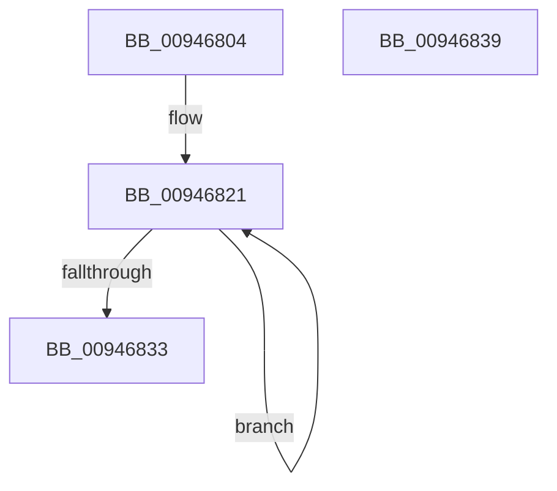

# CmpInitializeKeyNodeStack

- RVA: `0x00946804`–`0x0094683A` (길이 `54` bytes)
- VA: `0x0000000140946804`
- 실행 섹션: `PAGE`
- PDB 이름 있음: `예`; PDB Function 태그: `아니요`
- unwind 정보 RVA: `0x0005CF00`
- 디코드: `17`개 명령, `54/54` bytes 표시
- 미해석 바이트: `0` (있으면 어셈블리에 `.byte`로 보존)

> 이 문서는 커널 이미지의 기계어와 PDB 기호를 분석해 생성했습니다. 4번과 5번은 함수 원형과 자료형을 바이너리 사용 방식에서 추정한 C 해석이며 원본 소스 복구 결과는 아닙니다.

## 1. Dependencies

- 직접 호출 지점: **2**; 고유 호출 대상: **2**
- 직접 호출자로 확인된 함수: **8**
- RIP 상대 이미지 참조: **0**

### Outgoing calls
- `0x00946813` → [memset](../../text/6C/memset_function_006C6C40.md) (function, `0x006C6C40`)
- `0x00946824` → [CmpKeyNodeStackEntryInitialize](CmpKeyNodeStackEntryInitialize_function_00946840.md) (function, `0x00946840`)

### Direct callers
- [CmQueryLayeredKey](../../text/46/CmQueryLayeredKey_function_0046A930.md) at `0x0046A9C5`
- [CmSaveKey](../7D/CmSaveKey_function_007DDBDC.md) at `0x007DDC56`
- [CmSaveKey](../7D/CmSaveKey_function_007DDBDC.md) at `0x007DDF68`
- [CmpFullPromoteHiveRootFromKcbStack](../7F/CmpFullPromoteHiveRootFromKcbStack_function_007F3F90.md) at `0x007F3FD4`
- [CmpPromoteSingleKeyFromParentKcbAndChildKeyNode](../7F/CmpPromoteSingleKeyFromParentKcbAndChildKeyNode_function_007F426C.md) at `0x007F42C0`
- [CmpPromoteSubtree](CmpPromoteSubtree_function_00944D60.md) at `0x00944DA8`
- [CmpDoAccessCheckOnLayeredSubtree](CmpDoAccessCheckOnLayeredSubtree_function_00945488.md) at `0x009454D5`
- [CmpKeyEnumStackInitialize](CmpKeyEnumStackInitialize_function_00946D38.md) at `0x00946D56`
- [CmpSubtreeEnumeratorInitialize](../AD/CmpSubtreeEnumeratorInitialize_function_00AD4CF8.md) at `0x00AD4D19`

### Static image references
- 디코드된 RIP-relative 메모리 참조가 없습니다.

## 2. Other-region calls and transfers

- 다른 실행 섹션으로 향하는 call: **1**
  - `0x00946813` → [memset](../../text/6C/memset_function_006C6C40.md) (`PAGE` → `.text`)
- 별도 외부 분기/꼬리 이동을 확인하지 못했습니다.

## 3. Assembly (complete function range)

```asm
00946804  40 53                           push rbx
00946806  48 83 EC 20                     sub rsp, 0x20
0094680A  33 D2                           xor edx, edx
0094680C  48 8B D9                        mov rbx, rcx
0094680F  44 8D 42 50                     lea r8d, [rdx + 0x50]
00946813  E8 28 04 D8 FF                  call 0x1406c6c40
00946818  48 83 C3 08                     add rbx, 8
0094681C  BA 02 00 00 00                  mov edx, 2
00946821  48 8B CB                        mov rcx, rbx
00946824  E8 17 00 00 00                  call 0x140946840
00946829  48 83 C3 20                     add rbx, 0x20
0094682D  48 83 EA 01                     sub rdx, 1
00946831  75 EE                           jne 0x140946821
00946833  48 83 C4 20                     add rsp, 0x20
00946837  5B                              pop rbx
00946838  C3                              ret
00946839  CC                              int3
```

## 4. C-style interpretation (structured pseudocode)

```c
__int64 __fastcall CmpInitializeKeyNodeStack(__int64 a1, int a2)
{
    __int64 result;
    __int64 v_rbx;
    __int64 v_rsp;

    v_rsp = (v_rsp) - (32);
    a2 = 0;
    result = memset(a1, a2, a2 + 80, a4);
    v_rbx = (a1) + (8);
loc_00946821:
    result = CmpKeyNodeStackEntryInitialize(v_rbx, 2, a2 + 80, a4);
    v_rbx = (v_rbx) + (32);
    a2 = (2) - (1);
    if (condition_is_not_equal) goto loc_00946821;
    v_rsp = (v_rsp) + (32);
    return result;
}
```

## 5. (Beta) C Style

```c
int64_t CmpInitializeKeyNodeStack(int64_t Arg1, int32_t Arg2)
{
    int64_t result;
    int64_t local_rbx;
    int64_t local_rsp;

    local_rsp = (local_rsp) - (32);
    Arg2 = 0;
    result = memset(Arg1, Arg2, Arg2 + 80, a4);
    local_rbx = (Arg1) + (8);
loc_00946821:
    result = CmpKeyNodeStackEntryInitialize(local_rbx, 2, Arg2 + 80, a4);
    local_rbx = (local_rbx) + (32);
    Arg2 = (2) - (1);
    if (condition_is_not_equal) goto loc_00946821;
    local_rsp = (local_rsp) + (32);
    return result;
}
```

## 6. Execution-region graph

[열기: 2D/3D 그래프와 함수 탐색 컨트롤 패널](../../../control-panel.html?section=page&rva=0x00946804&view=graph)

- 2D 그래프는 위에서 아래로 흐르고, 3D 그래프는 빈 공간을 드래그해 회전합니다. Shift+드래그는 이동, 휠은 확대·축소, 함수 노드 선택은 대상 보고서 이동입니다.

### Static fallback


