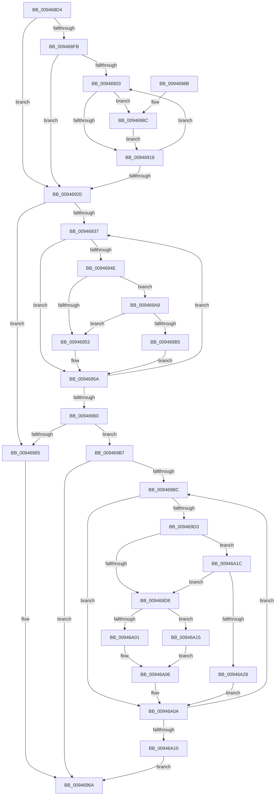

# CmpKeyEnumStackAdvanceInternal

- RVA: `0x009468D4`–`0x00946A2A` (길이 `342` bytes)
- VA: `0x00000001409468D4`
- 실행 섹션: `PAGE`
- PDB 이름 있음: `예`; PDB Function 태그: `아니요`
- unwind 정보 RVA: `0x000909FC`
- 디코드: `105`개 명령, `342/342` bytes 표시
- 미해석 바이트: `0` (있으면 어셈블리에 `.byte`로 보존)

> 이 문서는 커널 이미지의 기계어와 PDB 기호를 분석해 생성했습니다. 4번과 5번은 함수 원형과 자료형을 바이너리 사용 방식에서 추정한 C 해석이며 원본 소스 복구 결과는 아닙니다.

## 1. Dependencies

- 직접 호출 지점: **11**; 고유 호출 대상: **7**
- 직접 호출자로 확인된 함수: **1**
- RIP 상대 이미지 참조: **0**

### Outgoing calls
- `0x0094690A` → [CmpKeyNodeStackGetEntryAtLayerHeight](CmpKeyNodeStackGetEntryAtLayerHeight_function_00946ABC.md) (function, `0x00946ABC`)
- `0x0094693D` → [CmpKeyEnumStackGetEntryAtLayerHeight](CmpKeyEnumStackGetEntryAtLayerHeight_function_00946A30.md) (function, `0x00946A30`)
- `0x0094698F` → [CmpKeyEnumStackGetEntryAtLayerHeight](CmpKeyEnumStackGetEntryAtLayerHeight_function_00946A30.md) (function, `0x00946A30`)
- `0x00946997` → [CmpKeyEnumStackEntryAdvance](CmpKeyEnumStackEntryAdvance_function_00946BD8.md) (function, `0x00946BD8`)
- `0x0094699F` → [CmpKeyNodeStackEntryReset](CmpKeyNodeStackEntryReset_function_009467E0.md) (function, `0x009467E0`)
- `0x009469AC` → [CmpCompareKeysByName](CmpCompareKeysByName_function_00944950.md) (function, `0x00944950`)
- `0x009469C2` → [CmpKeyEnumStackGetEntryAtLayerHeight](CmpKeyEnumStackGetEntryAtLayerHeight_function_00946A30.md) (function, `0x00946A30`)
- `0x009469DF` → [CmpKeyNodeStackGetEntryAtLayerHeight](CmpKeyNodeStackGetEntryAtLayerHeight_function_00946ABC.md) (function, `0x00946ABC`)
- `0x00946A01` → [HvpGetCellFlat](../85/HvpGetCellFlat_function_00854C60.md) (function, `0x00854C60`)
- `0x00946A15` → [HvpGetCellPaged](../85/HvpGetCellPaged_function_00854CB0.md) (function, `0x00854CB0`)
- `0x00946A1F` → [CmpCompareKeysByName](CmpCompareKeysByName_function_00944950.md) (function, `0x00944950`)

### Direct callers
- [CmpKeyEnumStackAdvance](CmpKeyEnumStackAdvance_function_0094668C.md) at `0x0094669E`

### Static image references
- 디코드된 RIP-relative 메모리 참조가 없습니다.

## 2. Other-region calls and transfers

- 다른 실행 섹션으로 향하는 call: **0**
- 별도 외부 분기/꼬리 이동을 확인하지 못했습니다.

## 3. Assembly (complete function range)

```asm
009468D4  48 8B C4                        mov rax, rsp
009468D7  48 89 58 08                     mov qword ptr [rax + 8], rbx
009468DB  48 89 68 10                     mov qword ptr [rax + 0x10], rbp
009468DF  48 89 70 18                     mov qword ptr [rax + 0x18], rsi
009468E3  48 89 78 20                     mov qword ptr [rax + 0x20], rdi
009468E7  41 54                           push r12
009468E9  41 56                           push r14
009468EB  41 57                           push r15
009468ED  48 83 EC 20                     sub rsp, 0x20
009468F1  33 DB                           xor ebx, ebx
009468F3  48 8B F9                        mov rdi, rcx
009468F6  38 59 04                        cmp byte ptr [rcx + 4], bl
009468F9  74 25                           je 0x140946920
009468FB  0F B7 F3                        movzx esi, bx
009468FE  66 3B 19                        cmp bx, word ptr [rcx]
00946901  7F 1D                           jg 0x140946920
00946903  0F B7 D6                        movzx edx, si
00946906  48 8D 4F 08                     lea rcx, [rdi + 8]
0094690A  E8 AD 01 00 00                  call 0x140946abc
0094690F  48 8B E8                        mov rbp, rax
00946912  48 39 58 10                     cmp qword ptr [rax + 0x10], rbx
00946916  75 74                           jne 0x14094698c
00946918  66 FF C6                        inc si
0094691B  66 3B 37                        cmp si, word ptr [rdi]
0094691E  7E E3                           jle 0x140946903
00946920  0F B7 37                        movzx esi, word ptr [rdi]
00946923  41 83 CC FF                     or r12d, 0xffffffff
00946927  C6 47 04 01                     mov byte ptr [rdi + 4], 1
0094692B  4C 8B F3                        mov r14, rbx
0094692E  41 0F B7 EC                     movzx ebp, r12w
00946932  66 85 F6                        test si, si
00946935  78 2E                           js 0x140946965
00946937  0F B7 D6                        movzx edx, si
0094693A  48 8B CF                        mov rcx, rdi
0094693D  E8 EE 00 00 00                  call 0x140946a30
00946942  4C 8B F8                        mov r15, rax
00946945  48 8B 48 78                     mov rcx, qword ptr [rax + 0x78]
00946949  48 85 C9                        test rcx, rcx
0094694C  74 0C                           je 0x14094695a
0094694E  4D 85 F6                        test r14, r14
00946951  75 56                           jne 0x1409469a9
00946953  4D 8B 77 78                     mov r14, qword ptr [r15 + 0x78]
00946957  0F B7 EE                        movzx ebp, si
0094695A  66 41 03 F4                     add si, r12w
0094695E  79 D7                           jns 0x140946937
00946960  4D 85 F6                        test r14, r14
00946963  75 52                           jne 0x1409469b7
00946965  BB 1A 00 00 80                  mov ebx, 0x8000001a
0094696A  48 8B 6C 24 48                  mov rbp, qword ptr [rsp + 0x48]
0094696F  8B C3                           mov eax, ebx
00946971  48 8B 5C 24 40                  mov rbx, qword ptr [rsp + 0x40]
00946976  48 8B 74 24 50                  mov rsi, qword ptr [rsp + 0x50]
0094697B  48 8B 7C 24 58                  mov rdi, qword ptr [rsp + 0x58]
00946980  48 83 C4 20                     add rsp, 0x20
00946984  41 5F                           pop r15
00946986  41 5E                           pop r14
00946988  41 5C                           pop r12
0094698A  C3                              ret
0094698B  CC                              int3
0094698C  48 8B CF                        mov rcx, rdi
0094698F  E8 9C 00 00 00                  call 0x140946a30
00946994  48 8B C8                        mov rcx, rax
00946997  E8 3C 02 00 00                  call 0x140946bd8
0094699C  48 8B CD                        mov rcx, rbp
0094699F  E8 3C FE FF FF                  call 0x1409467e0
009469A4  E9 6F FF FF FF                  jmp 0x140946918
009469A9  49 8B D6                        mov rdx, r14
009469AC  E8 9F DF FF FF                  call 0x140944950
009469B1  85 C0                           test eax, eax
009469B3  78 9E                           js 0x140946953
009469B5  EB A3                           jmp 0x14094695a
009469B7  66 85 ED                        test bp, bp
009469BA  78 AE                           js 0x14094696a
009469BC  0F B7 D5                        movzx edx, bp
009469BF  48 8B CF                        mov rcx, rdi
009469C2  E8 69 00 00 00                  call 0x140946a30
009469C7  4C 8B F8                        mov r15, rax
009469CA  48 8B 48 78                     mov rcx, qword ptr [rax + 0x78]
009469CE  48 85 C9                        test rcx, rcx
009469D1  74 37                           je 0x140946a0a
009469D3  49 3B CE                        cmp rcx, r14
009469D6  75 44                           jne 0x140946a1c
009469D8  48 8D 4F 08                     lea rcx, [rdi + 8]
009469DC  0F B7 D5                        movzx edx, bp
009469DF  E8 D8 00 00 00                  call 0x140946abc
009469E4  49 8B 0F                        mov rcx, qword ptr [r15]
009469E7  48 8B F0                        mov rsi, rax
009469EA  41 8B 57 70                     mov edx, dword ptr [r15 + 0x70]
009469EE  48 89 08                        mov qword ptr [rax], rcx
009469F1  4C 8D 40 18                     lea r8, [rax + 0x18]
009469F5  89 50 08                        mov dword ptr [rax + 8], edx
009469F8  F6 81 8C 00 00 00 01            test byte ptr [rcx + 0x8c], 1
009469FF  74 14                           je 0x140946a15
00946A01  E8 5A E2 F0 FF                  call 0x140854c60
00946A06  48 89 46 10                     mov qword ptr [rsi + 0x10], rax
00946A0A  66 41 03 EC                     add bp, r12w
00946A0E  79 AC                           jns 0x1409469bc
00946A10  E9 55 FF FF FF                  jmp 0x14094696a
00946A15  E8 96 E2 F0 FF                  call 0x140854cb0
00946A1A  EB EA                           jmp 0x140946a06
00946A1C  49 8B D6                        mov rdx, r14
00946A1F  E8 2C DF FF FF                  call 0x140944950
00946A24  85 C0                           test eax, eax
00946A26  74 B0                           je 0x1409469d8
00946A28  EB E0                           jmp 0x140946a0a
```

## 4. C-style interpretation (structured pseudocode)

```c
__int64 __fastcall CmpKeyEnumStackAdvanceInternal(__int64 a1)
{
    __int64 result;
    __int64 v_r12;
    __int64 v_rbp;
    __int64 v_rbx;
    __int64 v_rsi;
    __int64 v_rsp;
    unsigned __int64 v_stack_p10;
    unsigned __int64 v_stack_p18;
    unsigned __int64 v_stack_p20;
    unsigned __int64 v_stack_p8;

    *(unsigned __int64 *)(v_rsp + 8) = v_rbx;
    *(unsigned __int64 *)(v_rsp + 16) = v_rbp;
    *(unsigned __int64 *)(v_rsp + 24) = v_rsi;
    *(unsigned __int64 *)(v_rsp + 32) = v_rdi;
    v_rsp = (v_rsp) - (32);
    v_rbx = 0;
    if ((*(unsigned __int8 *)(a1 + 4)) == 0) goto loc_00946920;
    if (0 > (*(unsigned __int16 *)(a1))) goto loc_00946920;
loc_00946903:
    result = CmpKeyNodeStackGetEntryAtLayerHeight(a1 + 8, 0, a3, a4);
    if ((*(unsigned __int64 *)(result + 16)) != 0) goto loc_0094698C;
loc_00946918:
    v_rsi = (unsigned __int16)((0) + 1);
    if (((unsigned __int16)(v_rsi)) <= (*(unsigned __int16 *)(a1))) goto loc_00946903;
loc_00946920:
    v_r12 = (unsigned int)((v_r12) | (0xFFFFFFFFULL));
    *(unsigned __int8 *)(a1 + 4) = 1;
    if (sign_flag) goto loc_00946965;
loc_00946937:
    result = CmpKeyEnumStackGetEntryAtLayerHeight(a1, (unsigned __int16)(*(unsigned __int16 *)(a1)), a3, a4);
    if (*(unsigned __int64 *)(result + 120) == 0) goto loc_0094695A;
    if (0 != 0) goto loc_009469A9;
loc_00946953:
loc_0094695A:
    v_rsi = (unsigned __int16)((*(unsigned __int16 *)(a1)) + ((unsigned __int16)(v_r12)));
    if (!sign_flag) goto loc_00946937;
    if (*(unsigned __int64 *)(result + 120) != 0) goto loc_009469B7;
loc_00946965:
loc_0094696A:
    v_rsp = (v_rsp) + (32);
    return (unsigned int)((unsigned int)((unsigned int)(0x8000001AULL)));
loc_0094698C:
    result = CmpKeyEnumStackGetEntryAtLayerHeight(v_stack_p20, (unsigned __int16)(*(unsigned __int16 *)(a1)), a3, a4);
    result = CmpKeyEnumStackEntryAdvance(result, (unsigned __int16)(*(unsigned __int16 *)(a1)), a3, a4);
    result = CmpKeyNodeStackEntryReset(v_stack_p10, (unsigned __int16)(*(unsigned __int16 *)(a1)), a3, a4);
    goto loc_00946918;
loc_009469A9:
    result = CmpCompareKeysByName(v_stack_p10, *(unsigned __int64 *)(result + 120), a3, a4);
    if (sign_flag) goto loc_00946953;
    goto loc_0094695A;
loc_009469B7:
    if (sign_flag) goto loc_0094696A;
loc_009469BC:
    result = CmpKeyEnumStackGetEntryAtLayerHeight(v_stack_p20, (unsigned __int16)(v_stack_p10), a3, a4);
    if (*(unsigned __int64 *)(result + 120) == 0) goto loc_00946A0A;
    if ((*(unsigned __int64 *)(result + 120)) != (*(unsigned __int64 *)(result + 120))) goto loc_00946A1C;
loc_009469D8:
    result = CmpKeyNodeStackGetEntryAtLayerHeight(v_stack_p20 + 8, (unsigned __int16)(v_stack_p10), a3, a4);
    *(unsigned __int64 *)(result) = *(unsigned __int64 *)(result);
    *(unsigned int *)(result + 8) = (unsigned int)((unsigned int)(*(unsigned int *)(result + 112)));
    if (((*(unsigned __int8 *)(*(unsigned __int64 *)(result) + 140)) & (1)) == 0) goto loc_00946A15;
    result = HvpGetCellFlat(*(unsigned __int64 *)(result), (unsigned int)(*(unsigned int *)(result + 112)), result + 24, a4);
loc_00946A06:
    *(unsigned __int64 *)(result + 16) = result;
loc_00946A0A:
    v_rbp = (unsigned __int16)((v_stack_p10) + ((unsigned __int16)(v_r12)));
    if (!sign_flag) goto loc_009469BC;
    goto loc_0094696A;
loc_00946A15:
    result = HvpGetCellPaged(*(unsigned __int64 *)(result), (unsigned int)(*(unsigned int *)(result + 112)), result + 24, a4);
    goto loc_00946A06;
loc_00946A1C:
    result = CmpCompareKeysByName(*(unsigned __int64 *)(result), *(unsigned __int64 *)(result + 120), result + 24, a4);
    if ((unsigned int)(result) == 0) goto loc_009469D8;
    goto loc_00946A0A;
}
```

## 5. (Beta) C Style

```c
int64_t CmpKeyEnumStackAdvanceInternal(void *Arg1)
{
    uint8_t *arg1 = (uint8_t *)Arg1;

    int64_t result;
    int64_t local_r12;
    int64_t local_rbp;
    int64_t local_rbx;
    int64_t local_rsi;
    int64_t local_rsp;
    uint64_t v_stack_p10;
    uint64_t v_stack_p18;
    uint64_t v_stack_p20;
    uint64_t v_stack_p8;

    *(uint64_t *)(local_rsp + 0x8) = local_rbx;
    *(uint64_t *)(local_rsp + 0x10) = local_rbp;
    *(uint64_t *)(local_rsp + 0x18) = local_rsi;
    *(uint64_t *)(local_rsp + 0x20) = local_rdi;
    local_rsp = (local_rsp) - (32);
    local_rbx = 0;
    if ((*(uint8_t *)(arg1 + 0x4)) == 0) goto loc_00946920;
    if (0 > (*(uint16_t *)(arg1))) goto loc_00946920;
loc_00946903:
    result = CmpKeyNodeStackGetEntryAtLayerHeight(Arg1 + 8, 0, a3, a4);
    if ((*(uint64_t *)(result + 0x10)) != 0) goto loc_0094698C;
loc_00946918:
    local_rsi = (uint16_t)((0) + 1);
    if (((uint16_t)(local_rsi)) <= (*(uint16_t *)(arg1))) goto loc_00946903;
loc_00946920:
    local_r12 = (uint32_t)((local_r12) | (0xFFFFFFFFULL));
    *(uint8_t *)(arg1 + 0x4) = 1;
    if (sign_flag) goto loc_00946965;
loc_00946937:
    result = CmpKeyEnumStackGetEntryAtLayerHeight(Arg1, (uint16_t)(*(uint16_t *)(arg1)), a3, a4);
    if (*(uint64_t *)(result + 0x78) == 0) goto loc_0094695A;
    if (0 != 0) goto loc_009469A9;
loc_00946953:
loc_0094695A:
    local_rsi = (uint16_t)((*(uint16_t *)(arg1)) + ((uint16_t)(local_r12)));
    if (!sign_flag) goto loc_00946937;
    if (*(uint64_t *)(result + 0x78) != 0) goto loc_009469B7;
loc_00946965:
loc_0094696A:
    local_rsp = (local_rsp) + (32);
    return (uint32_t)((uint32_t)((uint32_t)(0x8000001AULL)));
loc_0094698C:
    result = CmpKeyEnumStackGetEntryAtLayerHeight(v_stack_p20, (uint16_t)(*(uint16_t *)(arg1)), a3, a4);
    result = CmpKeyEnumStackEntryAdvance(result, (uint16_t)(*(uint16_t *)(arg1)), a3, a4);
    result = CmpKeyNodeStackEntryReset(v_stack_p10, (uint16_t)(*(uint16_t *)(arg1)), a3, a4);
    goto loc_00946918;
loc_009469A9:
    result = CmpCompareKeysByName(v_stack_p10, *(uint64_t *)(result + 0x78), a3, a4);
    if (sign_flag) goto loc_00946953;
    goto loc_0094695A;
loc_009469B7:
    if (sign_flag) goto loc_0094696A;
loc_009469BC:
    result = CmpKeyEnumStackGetEntryAtLayerHeight(v_stack_p20, (uint16_t)(v_stack_p10), a3, a4);
    if (*(uint64_t *)(result + 0x78) == 0) goto loc_00946A0A;
    if ((*(uint64_t *)(result + 0x78)) != (*(uint64_t *)(result + 0x78))) goto loc_00946A1C;
loc_009469D8:
    result = CmpKeyNodeStackGetEntryAtLayerHeight(v_stack_p20 + 8, (uint16_t)(v_stack_p10), a3, a4);
    *(uint64_t *)(result) = *(uint64_t *)(result);
    *(uint32_t *)(result + 0x8) = (uint32_t)((uint32_t)(*(uint32_t *)(result + 0x70)));
    if (((*(uint8_t *)(*(uint64_t *)(result) + 0x8C)) & (1)) == 0) goto loc_00946A15;
    result = HvpGetCellFlat(*(uint64_t *)(result), (uint32_t)(*(uint32_t *)(result + 0x70)), result + 24, a4);
loc_00946A06:
    *(uint64_t *)(result + 0x10) = result;
loc_00946A0A:
    local_rbp = (uint16_t)((v_stack_p10) + ((uint16_t)(local_r12)));
    if (!sign_flag) goto loc_009469BC;
    goto loc_0094696A;
loc_00946A15:
    result = HvpGetCellPaged(*(uint64_t *)(result), (uint32_t)(*(uint32_t *)(result + 0x70)), result + 24, a4);
    goto loc_00946A06;
loc_00946A1C:
    result = CmpCompareKeysByName(*(uint64_t *)(result), *(uint64_t *)(result + 0x78), result + 24, a4);
    if ((uint32_t)(result) == 0) goto loc_009469D8;
    goto loc_00946A0A;
}
```

### 관측된 메모리 오프셋

구조체 형식이 확인되지 않은 접근은 인자 기준의 오프셋으로만 기록했습니다.

| 기준 인자 | 오프셋 표현 | 폭 (bit) | 접근 |
|---|---:|---:|---|
| `Arg1` | `+ 0x0` | `16` | `R` |
| `Arg1` | `+ 0x4` | `8` | `R` |
| `Arg1` | `+ 0x4` | `8` | `W` |
| `Arg1` | `+ 0x8` | `64` | `R` |

## 6. Execution-region graph

[열기: 2D/3D 그래프와 함수 탐색 컨트롤 패널](../../../control-panel.html?section=page&rva=0x009468D4&view=graph)

- 2D 그래프는 위에서 아래로 흐르고, 3D 그래프는 빈 공간을 드래그해 회전합니다. Shift+드래그는 이동, 휠은 확대·축소, 함수 노드 선택은 대상 보고서 이동입니다.

### Static fallback


