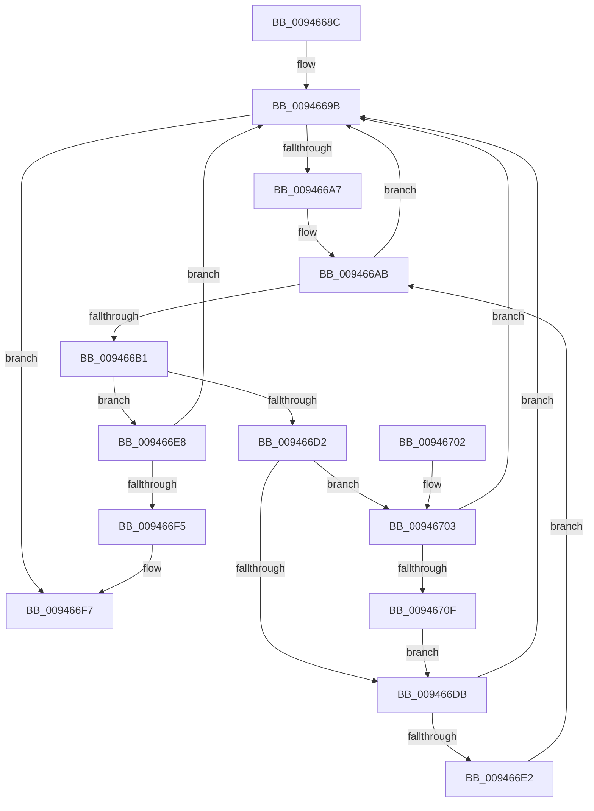

# CmpKeyEnumStackAdvance

- RVA: `0x0094668C`–`0x00946711` (길이 `133` bytes)
- VA: `0x000000014094668C`
- 실행 섹션: `PAGE`
- PDB 이름 있음: `예`; PDB Function 태그: `아니요`
- unwind 정보 RVA: `0x0008A6D8`
- 디코드: `43`개 명령, `133/133` bytes 표시
- 미해석 바이트: `0` (있으면 어셈블리에 `.byte`로 보존)

> 이 문서는 커널 이미지의 기계어와 PDB 기호를 분석해 생성했습니다. 4번과 5번은 함수 원형과 자료형을 바이너리 사용 방식에서 추정한 C 해석이며 원본 소스 복구 결과는 아닙니다.

## 1. Dependencies

- 직접 호출 지점: **5**; 고유 호출 대상: **4**
- 직접 호출자로 확인된 함수: **4**
- RIP 상대 이미지 참조: **0**

### Outgoing calls
- `0x0094669E` → [CmpKeyEnumStackAdvanceInternal](CmpKeyEnumStackAdvanceInternal_function_009468D4.md) (function, `0x009468D4`)
- `0x009466B9` → [CmpKeyNodeStackGetEntryAtLayerHeight](CmpKeyNodeStackGetEntryAtLayerHeight_function_00946ABC.md) (function, `0x00946ABC`)
- `0x009466C4` → [CmpKeyEnumStackGetEntryAtLayerHeight](CmpKeyEnumStackGetEntryAtLayerHeight_function_00946A30.md) (function, `0x00946A30`)
- `0x009466EB` → [CmpGetEffectiveKeyNodeSemantics](CmpGetEffectiveKeyNodeSemantics_function_00946D18.md) (function, `0x00946D18`)
- `0x00946706` → [CmpGetEffectiveKeyNodeSemantics](CmpGetEffectiveKeyNodeSemantics_function_00946D18.md) (function, `0x00946D18`)

### Direct callers
- [CmpPartialPromoteSubkeys](../7F/CmpPartialPromoteSubkeys_function_007F4070.md) at `0x007F4128`
- [CmpGetSubKeyCountForKeyNodeStack](CmpGetSubKeyCountForKeyNodeStack_function_00945624.md) at `0x009457C4`
- [CmpEnumerateLayeredKey](CmpEnumerateLayeredKey_function_00945E58.md) at `0x00946038`
- [CmpEnumerateLayeredKey](CmpEnumerateLayeredKey_function_00945E58.md) at `0x00946062`
- [CmpSubtreeEnumeratorAdvance](CmpSubtreeEnumeratorAdvance_function_00946590.md) at `0x009465F4`

### Static image references
- 디코드된 RIP-relative 메모리 참조가 없습니다.

## 2. Other-region calls and transfers

- 다른 실행 섹션으로 향하는 call: **0**
- 별도 외부 분기/꼬리 이동을 확인하지 못했습니다.

## 3. Assembly (complete function range)

```asm
0094668C  48 89 5C 24 08                  mov qword ptr [rsp + 8], rbx
00946691  57                              push rdi
00946692  48 83 EC 20                     sub rsp, 0x20
00946696  48 8B D9                        mov rbx, rcx
00946699  33 FF                           xor edi, edi
0094669B  48 8B CB                        mov rcx, rbx
0094669E  E8 31 02 00 00                  call 0x1409468d4
009466A3  85 C0                           test eax, eax
009466A5  78 50                           js 0x1409466f7
009466A7  44 0F B7 0B                     movzx r9d, word ptr [rbx]
009466AB  66 45 85 C9                     test r9w, r9w
009466AF  78 EA                           js 0x14094669b
009466B1  48 8D 4B 08                     lea rcx, [rbx + 8]
009466B5  41 0F B7 D1                     movzx edx, r9w
009466B9  E8 FE 03 00 00                  call 0x140946abc
009466BE  48 8B CB                        mov rcx, rbx
009466C1  4C 8B D0                        mov r10, rax
009466C4  E8 67 03 00 00                  call 0x140946a30
009466C9  49 8B 52 10                     mov rdx, qword ptr [r10 + 0x10]
009466CD  48 85 D2                        test rdx, rdx
009466D0  75 16                           jne 0x1409466e8
009466D2  48 8B 50 08                     mov rdx, qword ptr [rax + 8]
009466D6  48 85 D2                        test rdx, rdx
009466D9  75 28                           jne 0x140946703
009466DB  66 44 3B 4B 02                  cmp r9w, word ptr [rbx + 2]
009466E0  74 B9                           je 0x14094669b
009466E2  66 41 FF C9                     dec r9w
009466E6  EB C3                           jmp 0x1409466ab
009466E8  49 8B 0A                        mov rcx, qword ptr [r10]
009466EB  E8 28 06 00 00                  call 0x140946d18
009466F0  83 F8 01                        cmp eax, 1
009466F3  74 A6                           je 0x14094669b
009466F5  8B C7                           mov eax, edi
009466F7  48 8B 5C 24 30                  mov rbx, qword ptr [rsp + 0x30]
009466FC  48 83 C4 20                     add rsp, 0x20
00946700  5F                              pop rdi
00946701  C3                              ret
00946702  CC                              int3
00946703  48 8B 08                        mov rcx, qword ptr [rax]
00946706  E8 0D 06 00 00                  call 0x140946d18
0094670B  85 C0                           test eax, eax
0094670D  75 8C                           jne 0x14094669b
0094670F  EB CA                           jmp 0x1409466db
```

## 4. C-style interpretation (structured pseudocode)

```c
__int64 __fastcall CmpKeyEnumStackAdvance(__int64 a1)
{
    __int64 result;
    __int64 v_rdi;
    __int64 v_rsp;
    unsigned __int64 v_stack_p8;

    v_stack_p8 = v_rbx;
    v_rsp = (v_rsp) - (32);
    v_rdi = 0;
loc_0094669B:
    result = CmpKeyEnumStackAdvanceInternal(a1, a2, a3, a4);
    if (sign_flag) goto loc_009466F7;
loc_009466AB:
    if (sign_flag) goto loc_0094669B;
    result = CmpKeyNodeStackGetEntryAtLayerHeight(a1 + 8, (unsigned __int16)(*(unsigned __int16 *)(a1)), a3, *(unsigned __int16 *)(a1));
    result = CmpKeyEnumStackGetEntryAtLayerHeight(a1, (unsigned __int16)(*(unsigned __int16 *)(a1)), a3, *(unsigned __int16 *)(a1));
    if (*(unsigned __int64 *)(result + 16) != 0) goto loc_009466E8;
    if (*(unsigned __int64 *)(result + 8) != 0) goto loc_00946703;
loc_009466DB:
    if (((unsigned __int16)(*(unsigned __int16 *)(a1))) == (*(unsigned __int16 *)(a1 + 2))) goto loc_0094669B;
    a4 = (unsigned __int16)((*(unsigned __int16 *)(a1)) - 1);
    goto loc_009466AB;
loc_009466E8:
    result = CmpGetEffectiveKeyNodeSemantics(*(unsigned __int64 *)(result), *(unsigned __int64 *)(result + 8), a3, a4);
    if (((unsigned int)(result)) == 1) goto loc_0094669B;
loc_009466F7:
    v_rsp = (v_rsp) + (32);
    return 0;
loc_00946703:
    result = CmpGetEffectiveKeyNodeSemantics(*(unsigned __int64 *)(0), *(unsigned __int64 *)(result + 8), a3, a4);
    if ((unsigned int)(result) != 0) goto loc_0094669B;
    goto loc_009466DB;
}
```

## 5. (Beta) C Style

```c
int64_t CmpKeyEnumStackAdvance(void *Arg1)
{
    uint8_t *arg1 = (uint8_t *)Arg1;

    int64_t result;
    int64_t local_rdi;
    int64_t local_rsp;
    uint64_t v_stack_p8;

    v_stack_p8 = local_rbx;
    local_rsp = (local_rsp) - (32);
    local_rdi = 0;
loc_0094669B:
    result = CmpKeyEnumStackAdvanceInternal(Arg1, a2, a3, a4);
    if (sign_flag) goto loc_009466F7;
loc_009466AB:
    if (sign_flag) goto loc_0094669B;
    result = CmpKeyNodeStackGetEntryAtLayerHeight(Arg1 + 8, (uint16_t)(*(uint16_t *)(arg1)), a3, *(uint16_t *)(arg1));
    result = CmpKeyEnumStackGetEntryAtLayerHeight(Arg1, (uint16_t)(*(uint16_t *)(arg1)), a3, *(uint16_t *)(arg1));
    if (*(uint64_t *)(result + 0x10) != 0) goto loc_009466E8;
    if (*(uint64_t *)(result + 0x8) != 0) goto loc_00946703;
loc_009466DB:
    if (((uint16_t)(*(uint16_t *)(arg1))) == (*(uint16_t *)(arg1 + 0x2))) goto loc_0094669B;
    a4 = (uint16_t)((*(uint16_t *)(arg1)) - 1);
    goto loc_009466AB;
loc_009466E8:
    result = CmpGetEffectiveKeyNodeSemantics(*(uint64_t *)(result), *(uint64_t *)(result + 0x8), a3, a4);
    if (((uint32_t)(result)) == 1) goto loc_0094669B;
loc_009466F7:
    local_rsp = (local_rsp) + (32);
    return 0;
loc_00946703:
    result = CmpGetEffectiveKeyNodeSemantics(*(uint64_t *)(0), *(uint64_t *)(result + 0x8), a3, a4);
    if ((uint32_t)(result) != 0) goto loc_0094669B;
    goto loc_009466DB;
}
```

### 관측된 메모리 오프셋

구조체 형식이 확인되지 않은 접근은 인자 기준의 오프셋으로만 기록했습니다.

| 기준 인자 | 오프셋 표현 | 폭 (bit) | 접근 |
|---|---:|---:|---|
| `Arg1` | `+ 0x0` | `16` | `R` |
| `Arg1` | `+ 0x2` | `16` | `R` |
| `Arg1` | `+ 0x8` | `64` | `R` |

## 6. Execution-region graph

[열기: 2D/3D 그래프와 함수 탐색 컨트롤 패널](../../../control-panel.html?section=page&rva=0x0094668C&view=graph)

- 2D 그래프는 위에서 아래로 흐르고, 3D 그래프는 빈 공간을 드래그해 회전합니다. Shift+드래그는 이동, 휠은 확대·축소, 함수 노드 선택은 대상 보고서 이동입니다.

### Static fallback


