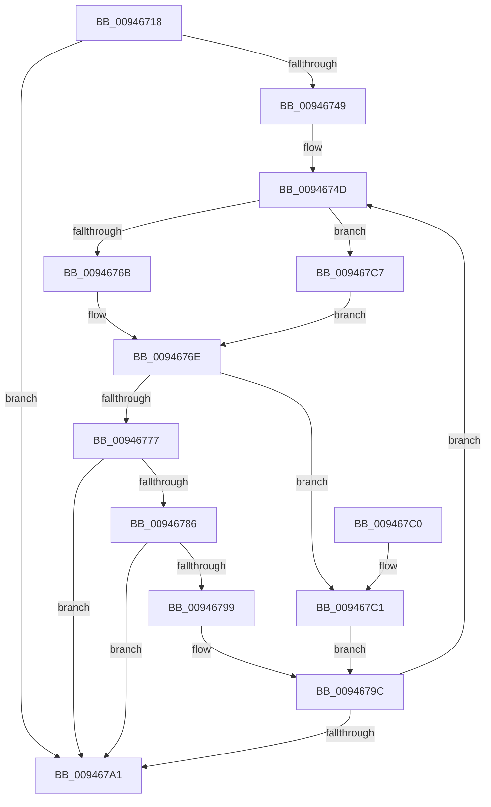

# CmpKeyEnumStackBeginEnumerationForKeyNodeStack

- RVA: `0x00946718`–`0x009467D8` (길이 `192` bytes)
- VA: `0x0000000140946718`
- 실행 섹션: `PAGE`
- PDB 이름 있음: `예`; PDB Function 태그: `아니요`
- unwind 정보 RVA: `0x000909DC`
- 디코드: `60`개 명령, `192/192` bytes 표시
- 미해석 바이트: `0` (있으면 어셈블리에 `.byte`로 보존)

> 이 문서는 커널 이미지의 기계어와 PDB 기호를 분석해 생성했습니다. 4번과 5번은 함수 원형과 자료형을 바이너리 사용 방식에서 추정한 C 해석이며 원본 소스 복구 결과는 아닙니다.

## 1. Dependencies

- 직접 호출 지점: **4**; 고유 호출 대상: **4**
- 직접 호출자로 확인된 함수: **2**
- RIP 상대 이미지 참조: **0**

### Outgoing calls
- `0x00946753` → [CmpKeyNodeStackGetEntryAtLayerHeight](CmpKeyNodeStackGetEntryAtLayerHeight_function_00946ABC.md) (function, `0x00946ABC`)
- `0x0094675E` → [CmpKeyEnumStackGetEntryAtLayerHeight](CmpKeyEnumStackGetEntryAtLayerHeight_function_00946A30.md) (function, `0x00946A30`)
- `0x0094677A` → [CmpGetEffectiveKeyNodeSemantics](CmpGetEffectiveKeyNodeSemantics_function_00946D18.md) (function, `0x00946D18`)
- `0x0094678C` → [CmpKeyEnumStackEntryBegin](CmpKeyEnumStackEntryBegin_function_00946DE4.md) (function, `0x00946DE4`)

### Direct callers
- [CmpKeyEnumStackStartFromKeyNodeStack](CmpKeyEnumStackStartFromKeyNodeStack_function_00945094.md) at `0x009450C1`
- [CmpSubtreeEnumeratorAdvance](CmpSubtreeEnumeratorAdvance_function_00946590.md) at `0x009465E9`

### Static image references
- 디코드된 RIP-relative 메모리 참조가 없습니다.

## 2. Other-region calls and transfers

- 다른 실행 섹션으로 향하는 call: **0**
- 별도 외부 분기/꼬리 이동을 확인하지 못했습니다.

## 3. Assembly (complete function range)

```asm
00946718  48 8B C4                        mov rax, rsp
0094671B  48 89 58 08                     mov qword ptr [rax + 8], rbx
0094671F  48 89 68 10                     mov qword ptr [rax + 0x10], rbp
00946723  48 89 70 18                     mov qword ptr [rax + 0x18], rsi
00946727  48 89 78 20                     mov qword ptr [rax + 0x20], rdi
0094672B  41 54                           push r12
0094672D  41 56                           push r14
0094672F  41 57                           push r15
00946731  48 83 EC 20                     sub rsp, 0x20
00946735  0F B7 19                        movzx ebx, word ptr [rcx]
00946738  45 33 FF                        xor r15d, r15d
0094673B  49 8B E8                        mov rbp, r8
0094673E  4C 8B F2                        mov r14, rdx
00946741  48 8B F1                        mov rsi, rcx
00946744  66 85 DB                        test bx, bx
00946747  78 58                           js 0x1409467a1
00946749  41 83 CC FF                     or r12d, 0xffffffff
0094674D  0F B7 D3                        movzx edx, bx
00946750  49 8B CE                        mov rcx, r14
00946753  E8 64 03 00 00                  call 0x140946abc
00946758  48 8B CE                        mov rcx, rsi
0094675B  4C 8B C8                        mov r9, rax
0094675E  E8 CD 02 00 00                  call 0x140946a30
00946763  4C 8B D0                        mov r10, rax
00946766  48 85 ED                        test rbp, rbp
00946769  75 5C                           jne 0x1409467c7
0094676B  4D 8B C7                        mov r8, r15
0094676E  49 8B 51 10                     mov rdx, qword ptr [r9 + 0x10]
00946772  48 85 D2                        test rdx, rdx
00946775  74 4A                           je 0x1409467c1
00946777  49 8B 09                        mov rcx, qword ptr [r9]
0094677A  E8 99 05 00 00                  call 0x140946d18
0094677F  8B F8                           mov edi, eax
00946781  83 F8 01                        cmp eax, 1
00946784  74 1B                           je 0x1409467a1
00946786  49 8B D1                        mov rdx, r9
00946789  49 8B CA                        mov rcx, r10
0094678C  E8 53 06 00 00                  call 0x140946de4
00946791  F7 C7 FD FF FF FF               test edi, 0xfffffffd
00946797  75 08                           jne 0x1409467a1
00946799  41 8B C4                        mov eax, r12d
0094679C  66 03 D8                        add bx, ax
0094679F  79 AC                           jns 0x14094674d
009467A1  48 8B 5C 24 40                  mov rbx, qword ptr [rsp + 0x40]
009467A6  48 8B 6C 24 48                  mov rbp, qword ptr [rsp + 0x48]
009467AB  48 8B 74 24 50                  mov rsi, qword ptr [rsp + 0x50]
009467B0  48 8B 7C 24 58                  mov rdi, qword ptr [rsp + 0x58]
009467B5  48 83 C4 20                     add rsp, 0x20
009467B9  41 5F                           pop r15
009467BB  41 5E                           pop r14
009467BD  41 5C                           pop r12
009467BF  C3                              ret
009467C0  CC                              int3
009467C1  41 0F B7 C4                     movzx eax, r12w
009467C5  EB D5                           jmp 0x14094679c
009467C7  0F B7 CB                        movzx ecx, bx
009467CA  4C 8D 45 08                     lea r8, [rbp + 8]
009467CE  48 8D 14 49                     lea rdx, [rcx + rcx*2]
009467D2  4D 8D 04 D0                     lea r8, [r8 + rdx*8]
009467D6  EB 96                           jmp 0x14094676e
```

## 4. C-style interpretation (structured pseudocode)

```c
__int64 __fastcall CmpKeyEnumStackBeginEnumerationForKeyNodeStack(__int64 a1, __int64 a2, __int64 a3)
{
    __int64 result;
    __int64 v_r12;
    __int64 v_r15;
    __int64 v_rbx;
    __int64 v_rsp;
    unsigned __int64 v_stack_p10;
    unsigned __int64 v_stack_p18;
    unsigned __int64 v_stack_p20;
    unsigned __int64 v_stack_p8;

    *(unsigned __int64 *)(v_rsp + 8) = v_rbx;
    *(unsigned __int64 *)(v_rsp + 16) = v_rbp;
    *(unsigned __int64 *)(v_rsp + 24) = v_rsi;
    *(unsigned __int64 *)(v_rsp + 32) = v_rdi;
    v_rsp = (v_rsp) - (32);
    v_r15 = 0;
    if (sign_flag) goto loc_009467A1;
    v_r12 = (unsigned int)((v_r12) | (0xFFFFFFFFULL));
loc_0094674D:
    result = CmpKeyNodeStackGetEntryAtLayerHeight(a2, (unsigned __int16)(*(unsigned __int16 *)(a1)), a3, a4);
    result = CmpKeyEnumStackGetEntryAtLayerHeight(a1, (unsigned __int16)(*(unsigned __int16 *)(a1)), a3, result);
    if (a3 != 0) goto loc_009467C7;
loc_0094676E:
    if (*(unsigned __int64 *)(result + 16) == 0) goto loc_009467C1;
    result = CmpGetEffectiveKeyNodeSemantics(*(unsigned __int64 *)(result), *(unsigned __int64 *)(result + 16), 0, result);
    if (((unsigned int)(result)) == 1) goto loc_009467A1;
    result = CmpKeyEnumStackEntryBegin(result, result, 0, result);
    if ((((unsigned int)((unsigned int)((unsigned int)(result)))) & (0xFFFFFFFDULL)) != 0) goto loc_009467A1;
loc_0094679C:
    v_rbx = (unsigned __int16)((*(unsigned __int16 *)(a1)) + ((unsigned __int16)((unsigned int)((unsigned int)(v_r12)))));
    if (!sign_flag) goto loc_0094674D;
loc_009467A1:
    v_rsp = (v_rsp) + (32);
    return (unsigned int)((unsigned int)(v_r12));
loc_009467C1:
    goto loc_0094679C;
loc_009467C7:
    goto loc_0094676E;
}
```

## 5. (Beta) C Style

```c
int64_t CmpKeyEnumStackBeginEnumerationForKeyNodeStack(void *Arg1, int64_t Arg2, int64_t Arg3)
{
    uint8_t *arg1 = (uint8_t *)Arg1;

    int64_t result;
    int64_t local_r12;
    int64_t local_r15;
    int64_t local_rbx;
    int64_t local_rsp;
    uint64_t v_stack_p10;
    uint64_t v_stack_p18;
    uint64_t v_stack_p20;
    uint64_t v_stack_p8;

    *(uint64_t *)(local_rsp + 0x8) = local_rbx;
    *(uint64_t *)(local_rsp + 0x10) = local_rbp;
    *(uint64_t *)(local_rsp + 0x18) = local_rsi;
    *(uint64_t *)(local_rsp + 0x20) = local_rdi;
    local_rsp = (local_rsp) - (32);
    local_r15 = 0;
    if (sign_flag) goto loc_009467A1;
    local_r12 = (uint32_t)((local_r12) | (0xFFFFFFFFULL));
loc_0094674D:
    result = CmpKeyNodeStackGetEntryAtLayerHeight(Arg2, (uint16_t)(*(uint16_t *)(arg1)), Arg3, a4);
    result = CmpKeyEnumStackGetEntryAtLayerHeight(Arg1, (uint16_t)(*(uint16_t *)(arg1)), Arg3, result);
    if (Arg3 != 0) goto loc_009467C7;
loc_0094676E:
    if (*(uint64_t *)(result + 0x10) == 0) goto loc_009467C1;
    result = CmpGetEffectiveKeyNodeSemantics(*(uint64_t *)(result), *(uint64_t *)(result + 0x10), 0, result);
    if (((uint32_t)(result)) == 1) goto loc_009467A1;
    result = CmpKeyEnumStackEntryBegin(result, result, 0, result);
    if ((((uint32_t)((uint32_t)((uint32_t)(result)))) & (0xFFFFFFFDULL)) != 0) goto loc_009467A1;
loc_0094679C:
    local_rbx = (uint16_t)((*(uint16_t *)(arg1)) + ((uint16_t)((uint32_t)((uint32_t)(local_r12)))));
    if (!sign_flag) goto loc_0094674D;
loc_009467A1:
    local_rsp = (local_rsp) + (32);
    return (uint32_t)((uint32_t)(local_r12));
loc_009467C1:
    goto loc_0094679C;
loc_009467C7:
    goto loc_0094676E;
}
```

### 관측된 메모리 오프셋

구조체 형식이 확인되지 않은 접근은 인자 기준의 오프셋으로만 기록했습니다.

| 기준 인자 | 오프셋 표현 | 폭 (bit) | 접근 |
|---|---:|---:|---|
| `Arg1` | `+ 0x0` | `16` | `R` |

## 6. Execution-region graph

[열기: 2D/3D 그래프와 함수 탐색 컨트롤 패널](../../../control-panel.html?section=page&rva=0x00946718&view=graph)

- 2D 그래프는 위에서 아래로 흐르고, 3D 그래프는 빈 공간을 드래그해 회전합니다. Shift+드래그는 이동, 휠은 확대·축소, 함수 노드 선택은 대상 보고서 이동입니다.

### Static fallback


