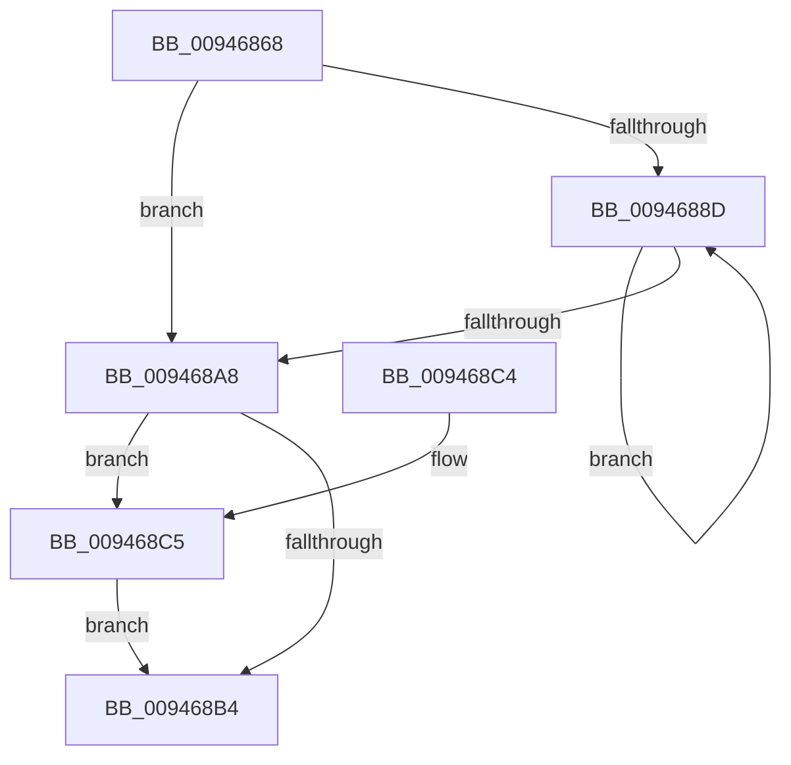

# CmpKeyEnumStackCleanup

- RVA: `0x00946868`–`0x009468CC` (길이 `100` bytes)
- VA: `0x0000000140946868`
- 실행 섹션: `PAGE`
- PDB 이름 있음: `예`; PDB Function 태그: `아니요`
- unwind 정보 RVA: `0x0006383C`
- 디코드: `30`개 명령, `100/100` bytes 표시
- 미해석 바이트: `0` (있으면 어셈블리에 `.byte`로 보존)

> 이 문서는 커널 이미지의 기계어와 PDB 기호를 분석해 생성했습니다. 4번과 5번은 함수 원형과 자료형을 바이너리 사용 방식에서 추정한 C 해석이며 원본 소스 복구 결과는 아닙니다.

## 1. Dependencies

- 직접 호출 지점: **4**; 고유 호출 대상: **4**
- 직접 호출자로 확인된 함수: **3**
- RIP 상대 이미지 참조: **0**

### Outgoing calls
- `0x0094687E` → [CmpCleanupKeyNodeStack](CmpCleanupKeyNodeStack_function_00946A5C.md) (function, `0x00946A5C`)
- `0x00946893` → [CmpKeyEnumStackGetEntryAtLayerHeight](CmpKeyEnumStackGetEntryAtLayerHeight_function_00946A30.md) (function, `0x00946A30`)
- `0x0094689B` → [CmpKeyEnumStackEntryCleanup](CmpKeyEnumStackEntryCleanup_function_00946B20.md) (function, `0x00946B20`)
- `0x009468C5` → [CmSiFreeMemory](../../text/47/CmSiFreeMemory_function_00475D80.md) (function, `0x00475D80`)

### Direct callers
- [CmpPartialPromoteSubkeys](../7F/CmpPartialPromoteSubkeys_function_007F4070.md) at `0x007F4231`
- [CmpSubtreeEnumeratorCleanup](CmpSubtreeEnumeratorCleanup_function_00945D98.md) at `0x00945DD3`
- [CmpEnumerateLayeredKey](CmpEnumerateLayeredKey_function_00945E58.md) at `0x009461A0`

### Static image references
- 디코드된 RIP-relative 메모리 참조가 없습니다.

## 2. Other-region calls and transfers

- 다른 실행 섹션으로 향하는 call: **1**
  - `0x009468C5` → [CmSiFreeMemory](../../text/47/CmSiFreeMemory_function_00475D80.md) (`PAGE` → `.text`)
- 별도 외부 분기/꼬리 이동을 확인하지 못했습니다.

## 3. Assembly (complete function range)

```asm
00946868  48 89 5C 24 08                  mov qword ptr [rsp + 8], rbx
0094686D  48 89 74 24 10                  mov qword ptr [rsp + 0x10], rsi
00946872  57                              push rdi
00946873  48 83 EC 20                     sub rsp, 0x20
00946877  48 8B D9                        mov rbx, rcx
0094687A  48 83 C1 08                     add rcx, 8
0094687E  E8 D9 01 00 00                  call 0x140946a5c
00946883  33 F6                           xor esi, esi
00946885  0F B7 FE                        movzx edi, si
00946888  66 3B 33                        cmp si, word ptr [rbx]
0094688B  7F 1B                           jg 0x1409468a8
0094688D  0F B7 D7                        movzx edx, di
00946890  48 8B CB                        mov rcx, rbx
00946893  E8 98 01 00 00                  call 0x140946a30
00946898  48 8B C8                        mov rcx, rax
0094689B  E8 80 02 00 00                  call 0x140946b20
009468A0  66 FF C7                        inc di
009468A3  66 3B 3B                        cmp di, word ptr [rbx]
009468A6  7E E5                           jle 0x14094688d
009468A8  48 8B 8B 58 01 00 00            mov rcx, qword ptr [rbx + 0x158]
009468AF  48 85 C9                        test rcx, rcx
009468B2  75 11                           jne 0x1409468c5
009468B4  48 8B 5C 24 30                  mov rbx, qword ptr [rsp + 0x30]
009468B9  48 8B 74 24 38                  mov rsi, qword ptr [rsp + 0x38]
009468BE  48 83 C4 20                     add rsp, 0x20
009468C2  5F                              pop rdi
009468C3  C3                              ret
009468C4  CC                              int3
009468C5  E8 B6 F4 B2 FF                  call 0x140475d80
009468CA  EB E8                           jmp 0x1409468b4
```

## 4. C-style interpretation (structured pseudocode)

```c
__int64 __fastcall CmpKeyEnumStackCleanup(__int64 a1)
{
    __int64 result;
    __int64 v_rdi;
    __int64 v_rsi;
    __int64 v_rsp;
    unsigned __int64 v_stack_p10;
    unsigned __int64 v_stack_p8;

    v_stack_p8 = v_rbx;
    v_stack_p10 = v_rsi;
    v_rsp = (v_rsp) - (32);
    a1 = (a1) + (8);
    result = CmpCleanupKeyNodeStack(a1, a2, a3, a4);
    v_rsi = 0;
    if (0 > (*(unsigned __int16 *)(a1))) goto loc_009468A8;
loc_0094688D:
    result = CmpKeyEnumStackGetEntryAtLayerHeight(a1, 0, a3, a4);
    result = CmpKeyEnumStackEntryCleanup(result, 0, a3, a4);
    v_rdi = (unsigned __int16)((0) + 1);
    if (((unsigned __int16)(v_rdi)) <= (*(unsigned __int16 *)(a1))) goto loc_0094688D;
loc_009468A8:
    if (*(unsigned __int64 *)(a1 + 344) != 0) goto loc_009468C5;
loc_009468B4:
    v_rsp = (v_rsp) + (32);
    return result;
loc_009468C5:
    result = CmSiFreeMemory(*(unsigned __int64 *)(a1 + 344), 0, a3, a4);
    goto loc_009468B4;
}
```

## 5. (Beta) C Style

```c
int64_t CmpKeyEnumStackCleanup(void *Arg1)
{
    uint8_t *arg1 = (uint8_t *)Arg1;

    int64_t result;
    int64_t local_rdi;
    int64_t local_rsi;
    int64_t local_rsp;
    uint64_t v_stack_p10;
    uint64_t v_stack_p8;

    v_stack_p8 = local_rbx;
    v_stack_p10 = local_rsi;
    local_rsp = (local_rsp) - (32);
    Arg1 = (Arg1) + (8);
    result = CmpCleanupKeyNodeStack(Arg1, a2, a3, a4);
    local_rsi = 0;
    if (0 > (*(uint16_t *)(arg1))) goto loc_009468A8;
loc_0094688D:
    result = CmpKeyEnumStackGetEntryAtLayerHeight(Arg1, 0, a3, a4);
    result = CmpKeyEnumStackEntryCleanup(result, 0, a3, a4);
    local_rdi = (uint16_t)((0) + 1);
    if (((uint16_t)(local_rdi)) <= (*(uint16_t *)(arg1))) goto loc_0094688D;
loc_009468A8:
    if (*(uint64_t *)(arg1 + 0x158) != 0) goto loc_009468C5;
loc_009468B4:
    local_rsp = (local_rsp) + (32);
    return result;
loc_009468C5:
    result = CmSiFreeMemory(*(uint64_t *)(arg1 + 0x158), 0, a3, a4);
    goto loc_009468B4;
}
```

### 관측된 메모리 오프셋

구조체 형식이 확인되지 않은 접근은 인자 기준의 오프셋으로만 기록했습니다.

| 기준 인자 | 오프셋 표현 | 폭 (bit) | 접근 |
|---|---:|---:|---|
| `Arg1` | `+ 0x0` | `16` | `R` |
| `Arg1` | `+ 0x158` | `64` | `R` |

## 6. Execution-region graph

[열기: 2D/3D 그래프와 함수 탐색 컨트롤 패널](../../../control-panel.html?section=page&rva=0x00946868&view=graph)

- 2D 그래프는 위에서 아래로 흐르고, 3D 그래프는 빈 공간을 드래그해 회전합니다. Shift+드래그는 이동, 휠은 확대·축소, 함수 노드 선택은 대상 보고서 이동입니다.

### Static fallback


