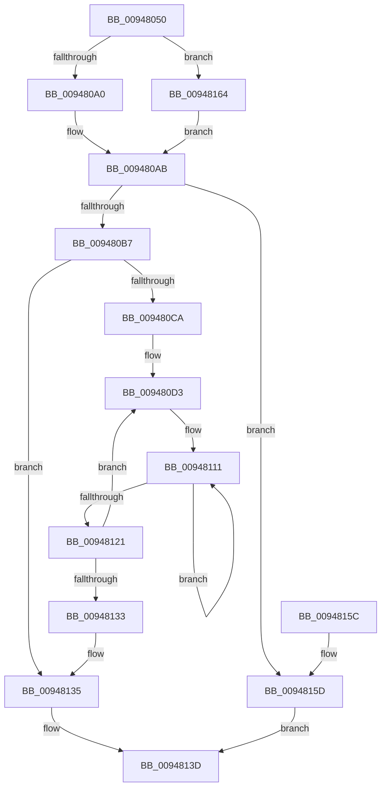

# CmpKeyEnumStackCreateResumeContext

- RVA: `0x00948050`–`0x00948174` (길이 `292` bytes)
- VA: `0x0000000140948050`
- 실행 섹션: `PAGE`
- PDB 이름 있음: `예`; PDB Function 태그: `아니요`
- unwind 정보 RVA: `0x00090C78`
- 디코드: `82`개 명령, `292/292` bytes 표시
- 미해석 바이트: `0` (있으면 어셈블리에 `.byte`로 보존)

> 이 문서는 커널 이미지의 기계어와 PDB 기호를 분석해 생성했습니다. 4번과 5번은 함수 원형과 자료형을 바이너리 사용 방식에서 추정한 C 해석이며 원본 소스 복구 결과는 아닙니다.

## 1. Dependencies

- 직접 호출 지점: **5**; 고유 호출 대상: **4**
- 직접 호출자로 확인된 함수: **1**
- RIP 상대 이미지 참조: **0**

### Outgoing calls
- `0x009480A6` → [CmpAllocatePool](../../text/3C/CmpAllocatePool_function_003CD504.md) (function, `0x003CD504`)
- `0x009480D9` → [CmpKeyEnumStackGetEntryAtLayerHeight](CmpKeyEnumStackGetEntryAtLayerHeight_function_00946A30.md) (function, `0x00946A30`)
- `0x009480E4` → [CmpGetKcbAtLayerHeight](CmpGetKcbAtLayerHeight_function_00949210.md) (function, `0x00949210`)
- `0x009480EF` → [CmpReferenceKeyControlBlockUnsafe](../87/CmpReferenceKeyControlBlockUnsafe_function_00874DA0.md) (function, `0x00874DA0`)
- `0x0094816A` → [CmpAllocatePool](../../text/3C/CmpAllocatePool_function_003CD504.md) (function, `0x003CD504`)

### Direct callers
- [CmpEnumerateLayeredKey](CmpEnumerateLayeredKey_function_00945E58.md) at `0x009463FC`

### Static image references
- 디코드된 RIP-relative 메모리 참조가 없습니다.

## 2. Other-region calls and transfers

- 다른 실행 섹션으로 향하는 call: **2**
  - `0x009480A6` → [CmpAllocatePool](../../text/3C/CmpAllocatePool_function_003CD504.md) (`PAGE` → `.text`)
  - `0x0094816A` → [CmpAllocatePool](../../text/3C/CmpAllocatePool_function_003CD504.md) (`PAGE` → `.text`)
- 별도 외부 분기/꼬리 이동을 확인하지 못했습니다.

## 3. Assembly (complete function range)

```asm
00948050  48 8B C4                        mov rax, rsp
00948053  48 89 58 08                     mov qword ptr [rax + 8], rbx
00948057  48 89 68 18                     mov qword ptr [rax + 0x18], rbp
0094805B  48 89 70 20                     mov qword ptr [rax + 0x20], rsi
0094805F  48 89 50 10                     mov qword ptr [rax + 0x10], rdx
00948063  57                              push rdi
00948064  41 54                           push r12
00948066  41 55                           push r13
00948068  41 56                           push r14
0094806A  41 57                           push r15
0094806C  48 83 EC 20                     sub rsp, 0x20
00948070  44 0F BF 79 02                  movsx r15d, word ptr [rcx + 2]
00948075  33 F6                           xor esi, esi
00948077  4C 8B E9                        mov r13, rcx
0094807A  41 8A D9                        mov bl, r9b
0094807D  41 8B E8                        mov ebp, r8d
00948080  B9 00 01 00 00                  mov ecx, 0x100
00948085  41 8D 47 01                     lea eax, [r15 + 1]
00948089  48 98                           cdqe
0094808B  4C 8D 14 40                     lea r10, [rax + rax*2]
0094808F  4A 8D 14 D5 08 00 00 00         lea rdx, [r10*8 + 8]
00948097  45 84 C9                        test r9b, r9b
0094809A  0F 85 C4 00 00 00               jne 0x140948164
009480A0  41 B8 43 4D 37 37               mov r8d, 0x37374d43
009480A6  E8 59 54 A8 FF                  call 0x1403cd504
009480AB  48 8B F8                        mov rdi, rax
009480AE  48 85 C0                        test rax, rax
009480B1  0F 84 A6 00 00 00               je 0x14094815d
009480B7  89 68 04                        mov dword ptr [rax + 4], ebp
009480BA  0F B7 EE                        movzx ebp, si
009480BD  66 44 89 38                     mov word ptr [rax], r15w
009480C1  88 58 02                        mov byte ptr [rax + 2], bl
009480C4  66 41 3B F7                     cmp si, r15w
009480C8  7F 6B                           jg 0x140948135
009480CA  48 8B 74 24 58                  mov rsi, qword ptr [rsp + 0x58]
009480CF  4C 8D 70 08                     lea r14, [rax + 8]
009480D3  0F B7 D5                        movzx edx, bp
009480D6  48 8B CE                        mov rcx, rsi
009480D9  E8 52 E9 FF FF                  call 0x140946a30
009480DE  49 8B CD                        mov rcx, r13
009480E1  4C 8B E0                        mov r12, rax
009480E4  E8 27 11 00 00                  call 0x140949210
009480E9  48 8B C8                        mov rcx, rax
009480EC  48 8B D8                        mov rbx, rax
009480EF  E8 AC CC F2 FF                  call 0x140874da0
009480F4  49 8D 4E 10                     lea rcx, [r14 + 0x10]
009480F8  BA 02 00 00 00                  mov edx, 2
009480FD  48 89 59 F8                     mov qword ptr [rcx - 8], rbx
00948101  4D 2B E6                        sub r12, r14
00948104  48 8B 83 30 01 00 00            mov rax, qword ptr [rbx + 0x130]
0094810B  49 89 06                        mov qword ptr [r14], rax
0094810E  8D 72 FF                        lea esi, [rdx - 1]
00948111  41 8B 44 0C 08                  mov eax, dword ptr [r12 + rcx + 8]
00948116  89 01                           mov dword ptr [rcx], eax
00948118  48 8D 49 04                     lea rcx, [rcx + 4]
0094811C  48 2B D6                        sub rdx, rsi
0094811F  75 F0                           jne 0x140948111
00948121  66 03 EE                        add bp, si
00948124  49 83 C6 18                     add r14, 0x18
00948128  48 8B 74 24 58                  mov rsi, qword ptr [rsp + 0x58]
0094812D  66 41 3B EF                     cmp bp, r15w
00948131  7E A0                           jle 0x1409480d3
00948133  33 F6                           xor esi, esi
00948135  48 8B 4C 24 70                  mov rcx, qword ptr [rsp + 0x70]
0094813A  48 89 39                        mov qword ptr [rcx], rdi
0094813D  48 8B 5C 24 50                  mov rbx, qword ptr [rsp + 0x50]
00948142  8B C6                           mov eax, esi
00948144  48 8B 74 24 68                  mov rsi, qword ptr [rsp + 0x68]
00948149  48 8B 6C 24 60                  mov rbp, qword ptr [rsp + 0x60]
0094814E  48 83 C4 20                     add rsp, 0x20
00948152  41 5F                           pop r15
00948154  41 5E                           pop r14
00948156  41 5D                           pop r13
00948158  41 5C                           pop r12
0094815A  5F                              pop rdi
0094815B  C3                              ret
0094815C  CC                              int3
0094815D  BE 9A 00 00 C0                  mov esi, 0xc000009a
00948162  EB D9                           jmp 0x14094813d
00948164  41 B8 43 4D 37 36               mov r8d, 0x36374d43
0094816A  E8 95 53 A8 FF                  call 0x1403cd504
0094816F  E9 37 FF FF FF                  jmp 0x1409480ab
```

## 4. C-style interpretation (structured pseudocode)

```c
__int64 __fastcall CmpKeyEnumStackCreateResumeContext(__int64 a1, __int64 a2, int a3, unsigned __int8 a4, __int64 a5)
{
    __int64 result;
    __int64 v_r12;
    __int64 v_r14;
    __int64 v_rbp;
    __int64 v_rsi;
    __int64 v_rsp;
    unsigned __int64 v_stack_p10;
    unsigned __int64 v_stack_p18;
    unsigned __int64 v_stack_p20;
    unsigned __int64 v_stack_p8;

    *(unsigned __int64 *)(v_rsp + 8) = v_rbx;
    *(unsigned __int64 *)(v_rsp + 24) = v_rbp;
    *(unsigned __int64 *)(v_rsp + 32) = v_rsi;
    *(unsigned __int64 *)(v_rsp + 16) = a2;
    v_rsp = (v_rsp) - (32);
    v_rsi = 0;
    if (a4 != 0) goto loc_00948164;
    result = CmpAllocatePool(256, (__int16)(*(unsigned __int16 *)(a1 + 2)) + 1 + (__int16)(*(unsigned __int16 *)(a1 + 2)) + 1 * 2 * 8 + 8, (unsigned int)(0x37374D43ULL), a4);
loc_009480AB:
    if (result == 0) goto loc_0094815D;
    *(unsigned int *)(result + 4) = (unsigned int)((unsigned int)(a3));
    *(unsigned __int16 *)(result) = (unsigned __int16)((__int16)(*(unsigned __int16 *)(a1 + 2)));
    *(unsigned __int8 *)(result + 2) = a4;
    if (0 > ((unsigned __int16)((__int16)(*(unsigned __int16 *)(a1 + 2))))) goto loc_00948135;
loc_009480D3:
    result = CmpKeyEnumStackGetEntryAtLayerHeight(v_stack_p10, 0, (unsigned int)(0x37374D43ULL), a4);
    result = CmpGetKcbAtLayerHeight(a1, 0, (unsigned int)(0x37374D43ULL), a4);
    result = CmpReferenceKeyControlBlockUnsafe(result, 0, (unsigned int)(0x37374D43ULL), a4);
    *(unsigned __int64 *)(result + 8 + 16 - 8) = result;
    v_r12 = (result) - (result + 8);
    *(unsigned __int64 *)(result + 8) = *(unsigned __int64 *)(result + 304);
loc_00948111:
    *(unsigned int *)(result + 8 + 16) = (unsigned int)((unsigned int)(*(unsigned int *)(v_r12 + result + 8 + 16 * 1 + 8)));
    a2 = (2) - (2 - 1);
    if (condition_is_not_equal) goto loc_00948111;
    v_rbp = (unsigned __int16)((0) + ((unsigned __int16)(2 - 1)));
    v_r14 = (result + 8) + (24);
    if (((unsigned __int16)(v_rbp)) <= ((unsigned __int16)((__int16)(*(unsigned __int16 *)(a1 + 2))))) goto loc_009480D3;
    v_rsi = 0;
loc_00948135:
    *(unsigned __int64 *)(a5) = result;
loc_0094813D:
    v_rsp = (v_rsp) + (32);
    return 0;
loc_0094815D:
    goto loc_0094813D;
loc_00948164:
    result = CmpAllocatePool(a5, a2, (unsigned int)(0x36374D43ULL), a4);
    goto loc_009480AB;
}
```

## 5. (Beta) C Style

```c
int64_t CmpKeyEnumStackCreateResumeContext(void *Arg1, int64_t Arg2, int32_t Arg3, uint8_t Arg4, void *Arg5)
{
    uint8_t *arg1 = (uint8_t *)Arg1;
    uint8_t *arg5 = (uint8_t *)Arg5;

    int64_t result;
    int64_t local_r12;
    int64_t local_r14;
    int64_t local_rbp;
    int64_t local_rsi;
    int64_t local_rsp;
    uint64_t v_stack_p10;
    uint64_t v_stack_p18;
    uint64_t v_stack_p20;
    uint64_t v_stack_p8;

    *(uint64_t *)(local_rsp + 0x8) = local_rbx;
    *(uint64_t *)(local_rsp + 0x18) = local_rbp;
    *(uint64_t *)(local_rsp + 0x20) = local_rsi;
    *(uint64_t *)(local_rsp + 0x10) = Arg2;
    local_rsp = (local_rsp) - (32);
    local_rsi = 0;
    if (Arg4 != 0) goto loc_00948164;
    result = CmpAllocatePool(256, (int16_t)(*(uint16_t *)(arg1 + 0x2)) + 1 + (int16_t)(*(uint16_t *)(arg1 + 0x2)) + 1 * 2 * 8 + 8, (uint32_t)(0x37374D43ULL), Arg4);
loc_009480AB:
    if (result == 0) goto loc_0094815D;
    *(uint32_t *)(result + 0x4) = (uint32_t)((uint32_t)(Arg3));
    *(uint16_t *)(result) = (uint16_t)((int16_t)(*(uint16_t *)(arg1 + 0x2)));
    *(uint8_t *)(result + 0x2) = Arg4;
    if (0 > ((uint16_t)((int16_t)(*(uint16_t *)(arg1 + 0x2))))) goto loc_00948135;
loc_009480D3:
    result = CmpKeyEnumStackGetEntryAtLayerHeight(v_stack_p10, 0, (uint32_t)(0x37374D43ULL), Arg4);
    result = CmpGetKcbAtLayerHeight(Arg1, 0, (uint32_t)(0x37374D43ULL), Arg4);
    result = CmpReferenceKeyControlBlockUnsafe(result, 0, (uint32_t)(0x37374D43ULL), Arg4);
    *(uint64_t *)(result + 0x8 + 0x10 - 0x8) = result;
    local_r12 = (result) - (result + 8);
    *(uint64_t *)(result + 0x8) = *(uint64_t *)(result + 0x130);
loc_00948111:
    *(uint32_t *)(result + 0x8 + 0x10) = (uint32_t)((uint32_t)(*(uint32_t *)(local_r12 + result + 0x8 + 0x10 * 1 + 0x8)));
    Arg2 = (2) - (2 - 1);
    if (condition_is_not_equal) goto loc_00948111;
    local_rbp = (uint16_t)((0) + ((uint16_t)(2 - 1)));
    local_r14 = (result + 8) + (24);
    if (((uint16_t)(local_rbp)) <= ((uint16_t)((int16_t)(*(uint16_t *)(arg1 + 0x2))))) goto loc_009480D3;
    local_rsi = 0;
loc_00948135:
    *(uint64_t *)(arg5) = result;
loc_0094813D:
    local_rsp = (local_rsp) + (32);
    return 0;
loc_0094815D:
    goto loc_0094813D;
loc_00948164:
    result = CmpAllocatePool(Arg5, Arg2, (uint32_t)(0x36374D43ULL), Arg4);
    goto loc_009480AB;
}
```

### 관측된 메모리 오프셋

구조체 형식이 확인되지 않은 접근은 인자 기준의 오프셋으로만 기록했습니다.

| 기준 인자 | 오프셋 표현 | 폭 (bit) | 접근 |
|---|---:|---:|---|
| `Arg1` | `+ 0x2` | `16` | `R` |
| `Arg5` | `+ 0x0` | `64` | `W` |

## 6. Execution-region graph

[열기: 2D/3D 그래프와 함수 탐색 컨트롤 패널](../../../control-panel.html?section=page&rva=0x00948050&view=graph)

- 2D 그래프는 위에서 아래로 흐르고, 3D 그래프는 빈 공간을 드래그해 회전합니다. Shift+드래그는 이동, 휠은 확대·축소, 함수 노드 선택은 대상 보고서 이동입니다.

### Static fallback


