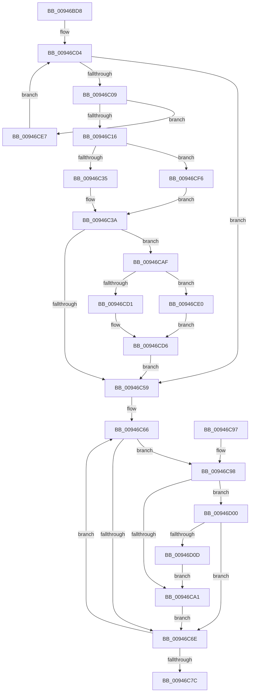

# CmpKeyEnumStackEntryAdvance

- RVA: `0x00946BD8`–`0x00946D0F` (길이 `311` bytes)
- VA: `0x0000000140946BD8`
- 실행 섹션: `PAGE`
- PDB 이름 있음: `예`; PDB Function 태그: `아니요`
- unwind 정보 RVA: `0x0008144C`
- 디코드: `83`개 명령, `311/311` bytes 표시
- 미해석 바이트: `0` (있으면 어셈블리에 `.byte`로 보존)

> 이 문서는 커널 이미지의 기계어와 PDB 기호를 분석해 생성했습니다. 4번과 5번은 함수 원형과 자료형을 바이너리 사용 방식에서 추정한 C 해석이며 원본 소스 복구 결과는 아닙니다.

## 1. Dependencies

- 직접 호출 지점: **6**; 고유 호출 대상: **6**
- 직접 호출자로 확인된 함수: **1**
- RIP 상대 이미지 참조: **0**

### Outgoing calls
- `0x00946C35` → [HvpReleaseCellPaged](../85/HvpReleaseCellPaged_function_00855F40.md) (function, `0x00855F40`)
- `0x00946CB7` → [CmpDoFindSubKeyByNumber](CmpDoFindSubKeyByNumber_function_00946F60.md) (function, `0x00946F60`)
- `0x00946CD1` → [HvpGetCellFlat](../85/HvpGetCellFlat_function_00854C60.md) (function, `0x00854C60`)
- `0x00946CE0` → [HvpGetCellPaged](../85/HvpGetCellPaged_function_00854CB0.md) (function, `0x00854CB0`)
- `0x00946CF6` → [HvpReleaseCellFlat](../85/HvpReleaseCellFlat_function_0085CC20.md) (function, `0x0085CC20`)
- `0x00946D00` → [CmpCompareKeysByName](CmpCompareKeysByName_function_00944950.md) (function, `0x00944950`)

### Direct callers
- [CmpKeyEnumStackAdvanceInternal](CmpKeyEnumStackAdvanceInternal_function_009468D4.md) at `0x00946997`

### Static image references
- 디코드된 RIP-relative 메모리 참조가 없습니다.

## 2. Other-region calls and transfers

- 다른 실행 섹션으로 향하는 call: **0**
- 별도 외부 분기/꼬리 이동을 확인하지 못했습니다.

## 3. Assembly (complete function range)

```asm
00946BD8  48 8B C4                        mov rax, rsp
00946BDB  48 89 58 08                     mov qword ptr [rax + 8], rbx
00946BDF  48 89 68 10                     mov qword ptr [rax + 0x10], rbp
00946BE3  48 89 70 18                     mov qword ptr [rax + 0x18], rsi
00946BE7  48 89 78 20                     mov qword ptr [rax + 0x20], rdi
00946BEB  41 56                           push r14
00946BED  48 83 EC 20                     sub rsp, 0x20
00946BF1  48 8B D9                        mov rbx, rcx
00946BF4  45 33 C0                        xor r8d, r8d
00946BF7  33 C9                           xor ecx, ecx
00946BF9  48 8D 73 50                     lea rsi, [rbx + 0x50]
00946BFD  48 8B D6                        mov rdx, rsi
00946C00  45 8D 70 02                     lea r14d, [r8 + 2]
00946C04  49 3B CE                        cmp rcx, r14
00946C07  7D 50                           jge 0x140946c59
00946C09  48 8B 43 78                     mov rax, qword ptr [rbx + 0x78]
00946C0D  48 39 02                        cmp qword ptr [rdx], rax
00946C10  0F 85 D1 00 00 00               jne 0x140946ce7
00946C16  48 8B 0B                        mov rcx, qword ptr [rbx]
00946C19  48 8D 6B 60                     lea rbp, [rbx + 0x60]
00946C1D  49 63 F8                        movsxd rdi, r8d
00946C20  F6 81 8C 00 00 00 01            test byte ptr [rcx + 0x8c], 1
00946C27  48 8D 6C FD 00                  lea rbp, [rbp + rdi*8]
00946C2C  48 8B D5                        mov rdx, rbp
00946C2F  0F 85 C1 00 00 00               jne 0x140946cf6
00946C35  E8 06 F3 F0 FF                  call 0x140855f40
00946C3A  48 83 64 FB 50 00               and qword ptr [rbx + rdi*8 + 0x50], 0
00946C40  44 8B 44 BB 18                  mov r8d, dword ptr [rbx + rdi*4 + 0x18]
00946C45  83 4C BB 48 FF                  or dword ptr [rbx + rdi*4 + 0x48], 0xffffffff
00946C4A  41 FF C0                        inc r8d
00946C4D  44 89 44 BB 18                  mov dword ptr [rbx + rdi*4 + 0x18], r8d
00946C52  44 3B 44 BB 20                  cmp r8d, dword ptr [rbx + rdi*4 + 0x20]
00946C57  72 56                           jb 0x140946caf
00946C59  48 83 63 78 00                  and qword ptr [rbx + 0x78], 0
00946C5E  48 8D 7B 48                     lea rdi, [rbx + 0x48]
00946C62  83 4B 70 FF                     or dword ptr [rbx + 0x70], 0xffffffff
00946C66  48 8B 0E                        mov rcx, qword ptr [rsi]
00946C69  48 85 C9                        test rcx, rcx
00946C6C  75 2A                           jne 0x140946c98
00946C6E  48 83 C6 08                     add rsi, 8
00946C72  48 83 C7 04                     add rdi, 4
00946C76  49 83 EE 01                     sub r14, 1
00946C7A  75 EA                           jne 0x140946c66
00946C7C  48 8B 5C 24 30                  mov rbx, qword ptr [rsp + 0x30]
00946C81  48 8B 6C 24 38                  mov rbp, qword ptr [rsp + 0x38]
00946C86  48 8B 74 24 40                  mov rsi, qword ptr [rsp + 0x40]
00946C8B  48 8B 7C 24 48                  mov rdi, qword ptr [rsp + 0x48]
00946C90  48 83 C4 20                     add rsp, 0x20
00946C94  41 5E                           pop r14
00946C96  C3                              ret
00946C97  CC                              int3
00946C98  48 8B 53 78                     mov rdx, qword ptr [rbx + 0x78]
00946C9C  48 85 D2                        test rdx, rdx
00946C9F  75 5F                           jne 0x140946d00
00946CA1  48 8B 06                        mov rax, qword ptr [rsi]
00946CA4  48 89 43 78                     mov qword ptr [rbx + 0x78], rax
00946CA8  8B 07                           mov eax, dword ptr [rdi]
00946CAA  89 43 70                        mov dword ptr [rbx + 0x70], eax
00946CAD  EB BF                           jmp 0x140946c6e
00946CAF  48 8B 54 FB 28                  mov rdx, qword ptr [rbx + rdi*8 + 0x28]
00946CB4  48 8B 0B                        mov rcx, qword ptr [rbx]
00946CB7  E8 A4 02 00 00                  call 0x140946f60
00946CBC  89 44 BB 48                     mov dword ptr [rbx + rdi*4 + 0x48], eax
00946CC0  4C 8B C5                        mov r8, rbp
00946CC3  48 8B 0B                        mov rcx, qword ptr [rbx]
00946CC6  8B D0                           mov edx, eax
00946CC8  F6 81 8C 00 00 00 01            test byte ptr [rcx + 0x8c], 1
00946CCF  74 0F                           je 0x140946ce0
00946CD1  E8 8A DF F0 FF                  call 0x140854c60
00946CD6  48 89 44 FB 50                  mov qword ptr [rbx + rdi*8 + 0x50], rax
00946CDB  E9 79 FF FF FF                  jmp 0x140946c59
00946CE0  E8 CB DF F0 FF                  call 0x140854cb0
00946CE5  EB EF                           jmp 0x140946cd6
00946CE7  41 FF C0                        inc r8d
00946CEA  48 FF C1                        inc rcx
00946CED  48 83 C2 08                     add rdx, 8
00946CF1  E9 0E FF FF FF                  jmp 0x140946c04
00946CF6  E8 25 5F F1 FF                  call 0x14085cc20
00946CFB  E9 3A FF FF FF                  jmp 0x140946c3a
00946D00  E8 4B DC FF FF                  call 0x140944950
00946D05  85 C0                           test eax, eax
00946D07  0F 89 61 FF FF FF               jns 0x140946c6e
00946D0D  EB 92                           jmp 0x140946ca1
```

## 4. C-style interpretation (structured pseudocode)

```c
__int64 __fastcall CmpKeyEnumStackEntryAdvance(__int64 a1, __int64 a2, int a3)
{
    __int64 result;
    __int64 v_r14;
    __int64 v_rdi;
    __int64 v_rsi;
    __int64 v_rsp;
    unsigned __int64 v_stack_p10;
    unsigned __int64 v_stack_p18;
    unsigned __int64 v_stack_p20;
    unsigned __int64 v_stack_p8;

    *(unsigned __int64 *)(v_rsp + 8) = v_rbx;
    *(unsigned __int64 *)(v_rsp + 16) = v_rbp;
    *(unsigned __int64 *)(v_rsp + 24) = v_rsi;
    *(unsigned __int64 *)(v_rsp + 32) = v_rdi;
    v_rsp = (v_rsp) - (32);
    a3 = 0;
    a1 = 0;
loc_00946C04:
    if (0 >= (a3 + 2)) goto loc_00946C59;
    if ((*(unsigned __int64 *)(a1 + 80)) != (*(unsigned __int64 *)(a1 + 120))) goto loc_00946CE7;
    if (((*(unsigned __int8 *)(*(unsigned __int64 *)(a1) + 140)) & (1)) != 0) goto loc_00946CF6;
    result = HvpReleaseCellPaged(*(unsigned __int64 *)(a1), a1 + 96 + (int)(0) * 8, a3, a4);
loc_00946C3A:
    a3 = (unsigned int)(((unsigned int)(*(unsigned int *)(a1 + (int)(0) * 4 + 24))) + 1);
    *(unsigned int *)(a1 + (int)(0) * 4 + 24) = a3;
    if (a3 < (*(unsigned int *)(a1 + (int)(0) * 4 + 32))) goto loc_00946CAF;
loc_00946C59:
loc_00946C66:
    if (*(unsigned __int64 *)(a1 + 80) != 0) goto loc_00946C98;
loc_00946C6E:
    v_rsi = (a1 + 80) + (8);
    v_rdi = (a1 + 72) + (4);
    v_r14 = (a3 + 2) - (1);
    if (condition_is_not_equal) goto loc_00946C66;
    v_rsp = (v_rsp) + (32);
    return result;
loc_00946C98:
    if (*(unsigned __int64 *)(v_stack_p8 + 120) != 0) goto loc_00946D00;
loc_00946CA1:
    *(unsigned __int64 *)(v_stack_p8 + 120) = *(unsigned __int64 *)(v_stack_p18);
    *(unsigned int *)(v_stack_p8 + 112) = (unsigned int)((unsigned int)(*(unsigned int *)(v_stack_p20)));
    goto loc_00946C6E;
loc_00946CAF:
    result = CmpDoFindSubKeyByNumber(*(unsigned __int64 *)(v_stack_p8), *(unsigned __int64 *)(v_stack_p8 + v_stack_p20 * 8 + 40), a3, a4);
    *(unsigned int *)(v_stack_p8 + v_stack_p20 * 4 + 72) = (unsigned int)(result);
    if (((*(unsigned __int8 *)(*(unsigned __int64 *)(v_stack_p8) + 140)) & (1)) == 0) goto loc_00946CE0;
    result = HvpGetCellFlat(*(unsigned __int64 *)(v_stack_p8), (unsigned int)((unsigned int)(result)), v_stack_p10, a4);
loc_00946CD6:
    *(unsigned __int64 *)(v_stack_p8 + v_stack_p20 * 8 + 80) = result;
    goto loc_00946C59;
loc_00946CE0:
    result = HvpGetCellPaged(*(unsigned __int64 *)(v_stack_p8), (unsigned int)((unsigned int)(result)), v_stack_p10, a4);
    goto loc_00946CD6;
loc_00946CE7:
    a3 = (unsigned int)((v_stack_p10) + 1);
    a1 = (*(unsigned __int64 *)(v_stack_p8)) + 1;
    a2 = ((unsigned int)((unsigned int)(result))) + (8);
    goto loc_00946C04;
loc_00946CF6:
    result = HvpReleaseCellFlat(a1, a2, a3, a4);
    goto loc_00946C3A;
loc_00946D00:
    result = CmpCompareKeysByName(a1, a2, a3, a4);
    if (!sign_flag) goto loc_00946C6E;
    goto loc_00946CA1;
}
```

## 5. (Beta) C Style

```c
int64_t CmpKeyEnumStackEntryAdvance(void *Arg1, int64_t Arg2, int32_t Arg3)
{
    uint8_t *arg1 = (uint8_t *)Arg1;

    int64_t result;
    int64_t local_r14;
    int64_t local_rdi;
    int64_t local_rsi;
    int64_t local_rsp;
    uint64_t v_stack_p10;
    uint64_t v_stack_p18;
    uint64_t v_stack_p20;
    uint64_t v_stack_p8;

    *(uint64_t *)(local_rsp + 0x8) = local_rbx;
    *(uint64_t *)(local_rsp + 0x10) = local_rbp;
    *(uint64_t *)(local_rsp + 0x18) = local_rsi;
    *(uint64_t *)(local_rsp + 0x20) = local_rdi;
    local_rsp = (local_rsp) - (32);
    Arg3 = 0;
    Arg1 = 0;
loc_00946C04:
    if (0 >= (Arg3 + 2)) goto loc_00946C59;
    if ((*(uint64_t *)(arg1 + 0x50)) != (*(uint64_t *)(arg1 + 0x78))) goto loc_00946CE7;
    if (((*(uint8_t *)(*(uint64_t *)(arg1) + 0x8C)) & (1)) != 0) goto loc_00946CF6;
    result = HvpReleaseCellPaged(*(uint64_t *)(arg1), Arg1 + 96 + (int32_t)(0) * 8, Arg3, a4);
loc_00946C3A:
    Arg3 = (uint32_t)(((uint32_t)(*(uint32_t *)(arg1 + (int32_t)(0) * 4 + 0x18))) + 1);
    *(uint32_t *)(arg1 + (int32_t)(0) * 4 + 0x18) = Arg3;
    if (Arg3 < (*(uint32_t *)(arg1 + (int32_t)(0) * 4 + 0x20))) goto loc_00946CAF;
loc_00946C59:
loc_00946C66:
    if (*(uint64_t *)(arg1 + 0x50) != 0) goto loc_00946C98;
loc_00946C6E:
    local_rsi = (Arg1 + 80) + (8);
    local_rdi = (Arg1 + 72) + (4);
    local_r14 = (Arg3 + 2) - (1);
    if (condition_is_not_equal) goto loc_00946C66;
    local_rsp = (local_rsp) + (32);
    return result;
loc_00946C98:
    if (*(uint64_t *)(v_stack_p8 + 0x78) != 0) goto loc_00946D00;
loc_00946CA1:
    *(uint64_t *)(v_stack_p8 + 0x78) = *(uint64_t *)(v_stack_p18);
    *(uint32_t *)(v_stack_p8 + 0x70) = (uint32_t)((uint32_t)(*(uint32_t *)(v_stack_p20)));
    goto loc_00946C6E;
loc_00946CAF:
    result = CmpDoFindSubKeyByNumber(*(uint64_t *)(v_stack_p8), *(uint64_t *)(v_stack_p8 + v_stack_p20 * 8 + 0x28), Arg3, a4);
    *(uint32_t *)(v_stack_p8 + v_stack_p20 * 4 + 0x48) = (uint32_t)(result);
    if (((*(uint8_t *)(*(uint64_t *)(v_stack_p8) + 0x8C)) & (1)) == 0) goto loc_00946CE0;
    result = HvpGetCellFlat(*(uint64_t *)(v_stack_p8), (uint32_t)((uint32_t)(result)), v_stack_p10, a4);
loc_00946CD6:
    *(uint64_t *)(v_stack_p8 + v_stack_p20 * 8 + 0x50) = result;
    goto loc_00946C59;
loc_00946CE0:
    result = HvpGetCellPaged(*(uint64_t *)(v_stack_p8), (uint32_t)((uint32_t)(result)), v_stack_p10, a4);
    goto loc_00946CD6;
loc_00946CE7:
    Arg3 = (uint32_t)((v_stack_p10) + 1);
    Arg1 = (*(uint64_t *)(v_stack_p8)) + 1;
    Arg2 = ((uint32_t)((uint32_t)(result))) + (8);
    goto loc_00946C04;
loc_00946CF6:
    result = HvpReleaseCellFlat(Arg1, Arg2, Arg3, a4);
    goto loc_00946C3A;
loc_00946D00:
    result = CmpCompareKeysByName(Arg1, Arg2, Arg3, a4);
    if (!sign_flag) goto loc_00946C6E;
    goto loc_00946CA1;
}
```

### 관측된 메모리 오프셋

구조체 형식이 확인되지 않은 접근은 인자 기준의 오프셋으로만 기록했습니다.

| 기준 인자 | 오프셋 표현 | 폭 (bit) | 접근 |
|---|---:|---:|---|
| `Arg1` | `+ 0x0` | `32` | `R` |
| `Arg1` | `+ 0x0` | `64` | `R` |
| `Arg1` | `+ 0x0 + rdi*8` | `64` | `R` |
| `Arg1` | `+ 0x18 + rdi*4` | `32` | `R` |
| `Arg1` | `+ 0x18 + rdi*4` | `32` | `W` |
| `Arg1` | `+ 0x20 + rdi*4` | `32` | `R` |
| `Arg1` | `+ 0x28 + rdi*8` | `64` | `R` |
| `Arg1` | `+ 0x48` | `64` | `R` |
| `Arg1` | `+ 0x48 + rdi*4` | `32` | `R/W` |
| `Arg1` | `+ 0x48 + rdi*4` | `32` | `W` |
| `Arg1` | `+ 0x50` | `64` | `R` |
| `Arg1` | `+ 0x50 + rdi*8` | `64` | `R/W` |
| `Arg1` | `+ 0x50 + rdi*8` | `64` | `W` |
| `Arg1` | `+ 0x60` | `64` | `R` |
| `Arg1` | `+ 0x70` | `32` | `R/W` |
| `Arg1` | `+ 0x70` | `32` | `W` |
| `Arg1` | `+ 0x78` | `64` | `R` |
| `Arg1` | `+ 0x78` | `64` | `R/W` |
| `Arg1` | `+ 0x78` | `64` | `W` |

## 6. Execution-region graph

[열기: 2D/3D 그래프와 함수 탐색 컨트롤 패널](../../../control-panel.html?section=page&rva=0x00946BD8&view=graph)

- 2D 그래프는 위에서 아래로 흐르고, 3D 그래프는 빈 공간을 드래그해 회전합니다. Shift+드래그는 이동, 휠은 확대·축소, 함수 노드 선택은 대상 보고서 이동입니다.

### Static fallback


