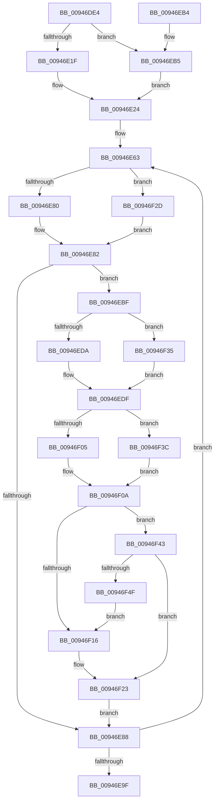

# CmpKeyEnumStackEntryBegin

- RVA: `0x00946DE4`–`0x00946F51` (길이 `365` bytes)
- VA: `0x0000000140946DE4`
- 실행 섹션: `PAGE`
- PDB 이름 있음: `예`; PDB Function 태그: `아니요`
- unwind 정보 RVA: `0x00090A34`
- 디코드: `106`개 명령, `365/365` bytes 표시
- 미해석 바이트: `0` (있으면 어셈블리에 `.byte`로 보존)

> 이 문서는 커널 이미지의 기계어와 PDB 기호를 분석해 생성했습니다. 4번과 5번은 함수 원형과 자료형을 바이너리 사용 방식에서 추정한 C 해석이며 원본 소스 복구 결과는 아닙니다.

## 1. Dependencies

- 직접 호출 지점: **8**; 고유 호출 대상: **4**
- 직접 호출자로 확인된 함수: **2**
- RIP 상대 이미지 참조: **0**

### Outgoing calls
- `0x00946E1F` → [HvpGetCellFlat](../85/HvpGetCellFlat_function_00854C60.md) (function, `0x00854C60`)
- `0x00946EB5` → [HvpGetCellPaged](../85/HvpGetCellPaged_function_00854CB0.md) (function, `0x00854CB0`)
- `0x00946EDA` → [HvpGetCellFlat](../85/HvpGetCellFlat_function_00854C60.md) (function, `0x00854C60`)
- `0x00946EEC` → [CmpDoFindSubKeyByNumber](CmpDoFindSubKeyByNumber_function_00946F60.md) (function, `0x00946F60`)
- `0x00946F05` → [HvpGetCellFlat](../85/HvpGetCellFlat_function_00854C60.md) (function, `0x00854C60`)
- `0x00946F35` → [HvpGetCellPaged](../85/HvpGetCellPaged_function_00854CB0.md) (function, `0x00854CB0`)
- `0x00946F3C` → [HvpGetCellPaged](../85/HvpGetCellPaged_function_00854CB0.md) (function, `0x00854CB0`)
- `0x00946F46` → [CmpCompareKeysByName](CmpCompareKeysByName_function_00944950.md) (function, `0x00944950`)

### Direct callers
- [CmpGetSubKeyCountForKeyNodeStack](CmpGetSubKeyCountForKeyNodeStack_function_00945624.md) at `0x009457A6`
- [CmpKeyEnumStackBeginEnumerationForKeyNodeStack](CmpKeyEnumStackBeginEnumerationForKeyNodeStack_function_00946718.md) at `0x0094678C`

### Static image references
- 디코드된 RIP-relative 메모리 참조가 없습니다.

## 2. Other-region calls and transfers

- 다른 실행 섹션으로 향하는 call: **0**
- 별도 외부 분기/꼬리 이동을 확인하지 못했습니다.

## 3. Assembly (complete function range)

```asm
00946DE4  48 89 5C 24 18                  mov qword ptr [rsp + 0x18], rbx
00946DE9  55                              push rbp
00946DEA  56                              push rsi
00946DEB  57                              push rdi
00946DEC  41 54                           push r12
00946DEE  41 55                           push r13
00946DF0  41 56                           push r14
00946DF2  41 57                           push r15
00946DF4  48 83 EC 20                     sub rsp, 0x20
00946DF8  48 8B 02                        mov rax, qword ptr [rdx]
00946DFB  4D 8B F0                        mov r14, r8
00946DFE  48 89 01                        mov qword ptr [rcx], rax
00946E01  4C 8D 41 10                     lea r8, [rcx + 0x10]
00946E05  44 8B 4A 08                     mov r9d, dword ptr [rdx + 8]
00946E09  48 8B D9                        mov rbx, rcx
00946E0C  48 8B 0A                        mov rcx, qword ptr [rdx]
00946E0F  41 8B D1                        mov edx, r9d
00946E12  F6 81 8C 00 00 00 01            test byte ptr [rcx + 0x8c], 1
00946E19  0F 84 96 00 00 00               je 0x140946eb5
00946E1F  E8 3C DE F0 FF                  call 0x140854c60
00946E24  48 89 43 08                     mov qword ptr [rbx + 8], rax
00946E28  48 8D 73 50                     lea rsi, [rbx + 0x50]
00946E2C  48 C7 C0 FC FF FF FF            mov rax, 0xfffffffffffffffc
00946E33  48 8D 7B 18                     lea rdi, [rbx + 0x18]
00946E37  48 2B C3                        sub rax, rbx
00946E3A  48 8D 6B 60                     lea rbp, [rbx + 0x60]
00946E3E  4C 8B E3                        mov r12, rbx
00946E41  48 89 44 24 68                  mov qword ptr [rsp + 0x68], rax
00946E46  4D 8B EE                        mov r13, r14
00946E49  4D 2B E6                        sub r12, r14
00946E4C  4C 2B EB                        sub r13, rbx
00946E4F  41 B8 04 00 00 00               mov r8d, 4
00946E55  4C 2B C3                        sub r8, rbx
00946E58  41 BF 02 00 00 00               mov r15d, 2
00946E5E  4C 89 44 24 60                  mov qword ptr [rsp + 0x60], r8
00946E63  48 8D 0C 38                     lea rcx, [rax + rdi]
00946E67  48 8B 43 08                     mov rax, qword ptr [rbx + 8]
00946E6B  8B 14 01                        mov edx, dword ptr [rcx + rax]
00946E6E  4A 8D 04 2F                     lea rax, [rdi + r13]
00946E72  42 89 54 20 08                  mov dword ptr [rax + r12 + 8], edx
00946E77  4D 85 F6                        test r14, r14
00946E7A  0F 85 AD 00 00 00               jne 0x140946f2d
00946E80  33 C0                           xor eax, eax
00946E82  89 07                           mov dword ptr [rdi], eax
00946E84  3B D0                           cmp edx, eax
00946E86  77 37                           ja 0x140946ebf
00946E88  48 8B 44 24 68                  mov rax, qword ptr [rsp + 0x68]
00946E8D  48 83 C5 08                     add rbp, 8
00946E91  48 83 C6 08                     add rsi, 8
00946E95  48 83 C7 04                     add rdi, 4
00946E99  49 83 EF 01                     sub r15, 1
00946E9D  75 C4                           jne 0x140946e63
00946E9F  48 8B 5C 24 70                  mov rbx, qword ptr [rsp + 0x70]
00946EA4  48 83 C4 20                     add rsp, 0x20
00946EA8  41 5F                           pop r15
00946EAA  41 5E                           pop r14
00946EAC  41 5D                           pop r13
00946EAE  41 5C                           pop r12
00946EB0  5F                              pop rdi
00946EB1  5E                              pop rsi
00946EB2  5D                              pop rbp
00946EB3  C3                              ret
00946EB4  CC                              int3
00946EB5  E8 F6 DD F0 FF                  call 0x140854cb0
00946EBA  E9 65 FF FF FF                  jmp 0x140946e24
00946EBF  48 8B 43 08                     mov rax, qword ptr [rbx + 8]
00946EC3  49 8D 0C 38                     lea rcx, [r8 + rdi]
00946EC7  4C 8D 45 D8                     lea r8, [rbp - 0x28]
00946ECB  8B 14 01                        mov edx, dword ptr [rcx + rax]
00946ECE  48 8B 0B                        mov rcx, qword ptr [rbx]
00946ED1  F6 81 8C 00 00 00 01            test byte ptr [rcx + 0x8c], 1
00946ED8  74 5B                           je 0x140946f35
00946EDA  E8 81 DD F0 FF                  call 0x140854c60
00946EDF  48 89 46 D8                     mov qword ptr [rsi - 0x28], rax
00946EE3  48 8B D0                        mov rdx, rax
00946EE6  44 8B 07                        mov r8d, dword ptr [rdi]
00946EE9  48 8B 0B                        mov rcx, qword ptr [rbx]
00946EEC  E8 6F 00 00 00                  call 0x140946f60
00946EF1  89 47 30                        mov dword ptr [rdi + 0x30], eax
00946EF4  4C 8B C5                        mov r8, rbp
00946EF7  48 8B 0B                        mov rcx, qword ptr [rbx]
00946EFA  8B D0                           mov edx, eax
00946EFC  F6 81 8C 00 00 00 01            test byte ptr [rcx + 0x8c], 1
00946F03  74 37                           je 0x140946f3c
00946F05  E8 56 DD F0 FF                  call 0x140854c60
00946F0A  48 89 06                        mov qword ptr [rsi], rax
00946F0D  48 8B 53 78                     mov rdx, qword ptr [rbx + 0x78]
00946F11  48 85 D2                        test rdx, rdx
00946F14  75 2D                           jne 0x140946f43
00946F16  48 8B 06                        mov rax, qword ptr [rsi]
00946F19  48 89 43 78                     mov qword ptr [rbx + 0x78], rax
00946F1D  8B 47 30                        mov eax, dword ptr [rdi + 0x30]
00946F20  89 43 70                        mov dword ptr [rbx + 0x70], eax
00946F23  4C 8B 44 24 60                  mov r8, qword ptr [rsp + 0x60]
00946F28  E9 5B FF FF FF                  jmp 0x140946e88
00946F2D  8B 40 F8                        mov eax, dword ptr [rax - 8]
00946F30  E9 4D FF FF FF                  jmp 0x140946e82
00946F35  E8 76 DD F0 FF                  call 0x140854cb0
00946F3A  EB A3                           jmp 0x140946edf
00946F3C  E8 6F DD F0 FF                  call 0x140854cb0
00946F41  EB C7                           jmp 0x140946f0a
00946F43  48 8B C8                        mov rcx, rax
00946F46  E8 05 DA FF FF                  call 0x140944950
00946F4B  85 C0                           test eax, eax
00946F4D  79 D4                           jns 0x140946f23
00946F4F  EB C5                           jmp 0x140946f16
```

## 4. C-style interpretation (structured pseudocode)

```c
__int64 __fastcall CmpKeyEnumStackEntryBegin(__int64 a1, __int64 a2, __int64 a3)
{
    __int64 result;
    __int64 v_r12;
    __int64 v_r13;
    __int64 v_r15;
    __int64 v_rbp;
    __int64 v_rdi;
    __int64 v_rsi;
    __int64 v_rsp;
    unsigned __int64 v_stack_p10;
    unsigned __int64 v_stack_p18;
    unsigned __int64 v_stack_p60;
    unsigned __int64 v_stack_p8;

    v_stack_p18 = v_rbx;
    v_rsp = (v_rsp) - (32);
    *(unsigned __int64 *)(a1) = *(unsigned __int64 *)(a2);
    if (((*(unsigned __int8 *)(*(unsigned __int64 *)(a2) + 140)) & (1)) == 0) goto loc_00946EB5;
    result = HvpGetCellFlat(*(unsigned __int64 *)(a2), (unsigned int)((unsigned int)((unsigned int)(*(unsigned int *)(a2 + 8)))), a1 + 16, (unsigned int)(*(unsigned int *)(a2 + 8)));
loc_00946E24:
    *(unsigned __int64 *)(a1 + 8) = result;
    result = (-4) - (a1);
    v_stack_p10 = result;
    v_r12 = (a1) - (a3);
    v_r13 = (a3) - (a1);
    a3 = (4) - (a1);
    v_stack_p8 = a3;
loc_00946E63:
    *(unsigned int *)(a1 + 24 + v_r13 * 1 + v_r12 * 1 + 8) = (unsigned int)((unsigned int)(*(unsigned int *)(result + a1 + 24 * 1 + *(unsigned __int64 *)(a1 + 8) * 1)));
    if (a3 != 0) goto loc_00946F2D;
    result = 0;
loc_00946E82:
    *(unsigned int *)(a1 + 24) = 0;
    if (((unsigned int)((unsigned int)(*(unsigned int *)(result + a1 + 24 * 1 + *(unsigned __int64 *)(a1 + 8) * 1)))) > 0) goto loc_00946EBF;
loc_00946E88:
    v_rbp = (a1 + 96) + (8);
    v_rsi = (a1 + 80) + (8);
    v_rdi = (a1 + 24) + (4);
    v_r15 = (2) - (1);
    if (condition_is_not_equal) goto loc_00946E63;
    v_rsp = (v_rsp) + (32);
    return v_stack_p10;
loc_00946EB5:
    result = HvpGetCellPaged(result + a1 + 24 * 1, (unsigned int)(*(unsigned int *)(result + a1 + 24 * 1 + *(unsigned __int64 *)(a1 + 8) * 1)), a3, (unsigned int)(*(unsigned int *)(a2 + 8)));
    goto loc_00946E24;
loc_00946EBF:
    if (((*(unsigned __int8 *)(*(unsigned __int64 *)(v_stack_p18) + 140)) & (1)) == 0) goto loc_00946F35;
    result = HvpGetCellFlat(*(unsigned __int64 *)(v_stack_p18), (unsigned int)(*(unsigned int *)(a3 + v_rdi * 1 + *(unsigned __int64 *)(v_stack_p18 + 8) * 1)), v_rbp - 40, (unsigned int)(*(unsigned int *)(a2 + 8)));
loc_00946EDF:
    *(unsigned __int64 *)(v_rsi - 40) = result;
    result = CmpDoFindSubKeyByNumber(*(unsigned __int64 *)(v_stack_p18), result, (unsigned int)(*(unsigned int *)(v_rdi)), (unsigned int)(*(unsigned int *)(a2 + 8)));
    *(unsigned int *)(v_rdi + 48) = (unsigned int)(result);
    if (((*(unsigned __int8 *)(*(unsigned __int64 *)(v_stack_p18) + 140)) & (1)) == 0) goto loc_00946F3C;
    result = HvpGetCellFlat(*(unsigned __int64 *)(v_stack_p18), (unsigned int)((unsigned int)(result)), v_rbp, (unsigned int)(*(unsigned int *)(a2 + 8)));
loc_00946F0A:
    *(unsigned __int64 *)(v_rsi) = result;
    if (*(unsigned __int64 *)(v_stack_p18 + 120) != 0) goto loc_00946F43;
loc_00946F16:
    *(unsigned __int64 *)(v_stack_p18 + 120) = *(unsigned __int64 *)(v_rsi);
    *(unsigned int *)(v_stack_p18 + 112) = (unsigned int)((unsigned int)(*(unsigned int *)(v_rdi + 48)));
loc_00946F23:
    goto loc_00946E88;
loc_00946F2D:
    goto loc_00946E82;
loc_00946F35:
    result = HvpGetCellPaged(*(unsigned __int64 *)(v_stack_p18), *(unsigned __int64 *)(v_stack_p18 + 120), v_stack_p60, (unsigned int)(*(unsigned int *)(a2 + 8)));
    goto loc_00946EDF;
loc_00946F3C:
    result = HvpGetCellPaged(*(unsigned __int64 *)(v_stack_p18), *(unsigned __int64 *)(v_stack_p18 + 120), v_stack_p60, (unsigned int)(*(unsigned int *)(a2 + 8)));
    goto loc_00946F0A;
loc_00946F43:
    result = CmpCompareKeysByName(result, *(unsigned __int64 *)(v_stack_p18 + 120), v_stack_p60, (unsigned int)(*(unsigned int *)(a2 + 8)));
    if (!sign_flag) goto loc_00946F23;
    goto loc_00946F16;
}
```

## 5. (Beta) C Style

```c
int64_t CmpKeyEnumStackEntryBegin(void *Arg1, void *Arg2, int64_t Arg3)
{
    uint8_t *arg1 = (uint8_t *)Arg1;
    uint8_t *arg2 = (uint8_t *)Arg2;

    int64_t result;
    int64_t local_r12;
    int64_t local_r13;
    int64_t local_r15;
    int64_t local_rbp;
    int64_t local_rdi;
    int64_t local_rsi;
    int64_t local_rsp;
    uint64_t v_stack_p10;
    uint64_t v_stack_p18;
    uint64_t v_stack_p60;
    uint64_t v_stack_p8;

    v_stack_p18 = local_rbx;
    local_rsp = (local_rsp) - (32);
    *(uint64_t *)(arg1) = *(uint64_t *)(arg2);
    if (((*(uint8_t *)(*(uint64_t *)(arg2) + 0x8C)) & (1)) == 0) goto loc_00946EB5;
    result = HvpGetCellFlat(*(uint64_t *)(arg2), (uint32_t)((uint32_t)((uint32_t)(*(uint32_t *)(arg2 + 0x8)))), Arg1 + 16, (uint32_t)(*(uint32_t *)(arg2 + 0x8)));
loc_00946E24:
    *(uint64_t *)(arg1 + 0x8) = result;
    result = (-4) - (Arg1);
    v_stack_p10 = result;
    local_r12 = (Arg1) - (Arg3);
    local_r13 = (Arg3) - (Arg1);
    Arg3 = (4) - (Arg1);
    v_stack_p8 = Arg3;
loc_00946E63:
    *(uint32_t *)(arg1 + 0x18 + local_r13 * 1 + local_r12 * 1 + 0x8) = (uint32_t)((uint32_t)(*(uint32_t *)(result + arg1 + 0x18 * 1 + *(uint64_t *)(arg1 + 0x8) * 1)));
    if (Arg3 != 0) goto loc_00946F2D;
    result = 0;
loc_00946E82:
    *(uint32_t *)(arg1 + 0x18) = 0;
    if (((uint32_t)((uint32_t)(*(uint32_t *)(result + arg1 + 0x18 * 1 + *(uint64_t *)(arg1 + 0x8) * 1)))) > 0) goto loc_00946EBF;
loc_00946E88:
    local_rbp = (Arg1 + 96) + (8);
    local_rsi = (Arg1 + 80) + (8);
    local_rdi = (Arg1 + 24) + (4);
    local_r15 = (2) - (1);
    if (condition_is_not_equal) goto loc_00946E63;
    local_rsp = (local_rsp) + (32);
    return v_stack_p10;
loc_00946EB5:
    result = HvpGetCellPaged(result + Arg1 + 24 * 1, (uint32_t)(*(uint32_t *)(result + arg1 + 0x18 * 1 + *(uint64_t *)(arg1 + 0x8) * 1)), Arg3, (uint32_t)(*(uint32_t *)(arg2 + 0x8)));
    goto loc_00946E24;
loc_00946EBF:
    if (((*(uint8_t *)(*(uint64_t *)(v_stack_p18) + 0x8C)) & (1)) == 0) goto loc_00946F35;
    result = HvpGetCellFlat(*(uint64_t *)(v_stack_p18), (uint32_t)(*(uint32_t *)(Arg3 + local_rdi * 1 + *(uint64_t *)(v_stack_p18 + 0x8) * 1)), local_rbp - 40, (uint32_t)(*(uint32_t *)(arg2 + 0x8)));
loc_00946EDF:
    *(uint64_t *)(local_rsi - 0x28) = result;
    result = CmpDoFindSubKeyByNumber(*(uint64_t *)(v_stack_p18), result, (uint32_t)(*(uint32_t *)(local_rdi)), (uint32_t)(*(uint32_t *)(arg2 + 0x8)));
    *(uint32_t *)(local_rdi + 0x30) = (uint32_t)(result);
    if (((*(uint8_t *)(*(uint64_t *)(v_stack_p18) + 0x8C)) & (1)) == 0) goto loc_00946F3C;
    result = HvpGetCellFlat(*(uint64_t *)(v_stack_p18), (uint32_t)((uint32_t)(result)), local_rbp, (uint32_t)(*(uint32_t *)(arg2 + 0x8)));
loc_00946F0A:
    *(uint64_t *)(local_rsi) = result;
    if (*(uint64_t *)(v_stack_p18 + 0x78) != 0) goto loc_00946F43;
loc_00946F16:
    *(uint64_t *)(v_stack_p18 + 0x78) = *(uint64_t *)(local_rsi);
    *(uint32_t *)(v_stack_p18 + 0x70) = (uint32_t)((uint32_t)(*(uint32_t *)(local_rdi + 0x30)));
loc_00946F23:
    goto loc_00946E88;
loc_00946F2D:
    goto loc_00946E82;
loc_00946F35:
    result = HvpGetCellPaged(*(uint64_t *)(v_stack_p18), *(uint64_t *)(v_stack_p18 + 0x78), v_stack_p60, (uint32_t)(*(uint32_t *)(arg2 + 0x8)));
    goto loc_00946EDF;
loc_00946F3C:
    result = HvpGetCellPaged(*(uint64_t *)(v_stack_p18), *(uint64_t *)(v_stack_p18 + 0x78), v_stack_p60, (uint32_t)(*(uint32_t *)(arg2 + 0x8)));
    goto loc_00946F0A;
loc_00946F43:
    result = CmpCompareKeysByName(result, *(uint64_t *)(v_stack_p18 + 0x78), v_stack_p60, (uint32_t)(*(uint32_t *)(arg2 + 0x8)));
    if (!sign_flag) goto loc_00946F23;
    goto loc_00946F16;
}
```

### 관측된 메모리 오프셋

구조체 형식이 확인되지 않은 접근은 인자 기준의 오프셋으로만 기록했습니다.

| 기준 인자 | 오프셋 표현 | 폭 (bit) | 접근 |
|---|---:|---:|---|
| `Arg1` | `- 0x28` | `64` | `R` |
| `Arg1` | `- 0x28` | `64` | `W` |
| `Arg1` | `- 0x8` | `32` | `R` |
| `Arg1` | `+ 0x0` | `32` | `R` |
| `Arg1` | `+ 0x0` | `32` | `W` |
| `Arg1` | `+ 0x0` | `64` | `R` |
| `Arg1` | `+ 0x0` | `64` | `W` |
| `Arg1` | `+ 0x0 + r13*1` | `64` | `R` |
| `Arg1` | `+ 0x8` | `64` | `R` |
| `Arg1` | `+ 0x8` | `64` | `W` |
| `Arg1` | `+ 0x8 + r12*1` | `32` | `W` |
| `Arg1` | `+ 0x10` | `64` | `R` |
| `Arg1` | `+ 0x18` | `64` | `R` |
| `Arg1` | `+ 0x30` | `32` | `R` |
| `Arg1` | `+ 0x30` | `32` | `W` |
| `Arg1` | `+ 0x50` | `64` | `R` |
| `Arg1` | `+ 0x60` | `64` | `R` |
| `Arg1` | `+ 0x70` | `32` | `W` |
| `Arg1` | `+ 0x78` | `64` | `R` |
| `Arg1` | `+ 0x78` | `64` | `W` |
| `Arg2` | `+ 0x0` | `64` | `R` |
| `Arg2` | `+ 0x8` | `32` | `R` |

## 6. Execution-region graph

[열기: 2D/3D 그래프와 함수 탐색 컨트롤 패널](../../../control-panel.html?section=page&rva=0x00946DE4&view=graph)

- 2D 그래프는 위에서 아래로 흐르고, 3D 그래프는 빈 공간을 드래그해 회전합니다. Shift+드래그는 이동, 휠은 확대·축소, 함수 노드 선택은 대상 보고서 이동입니다.

### Static fallback


