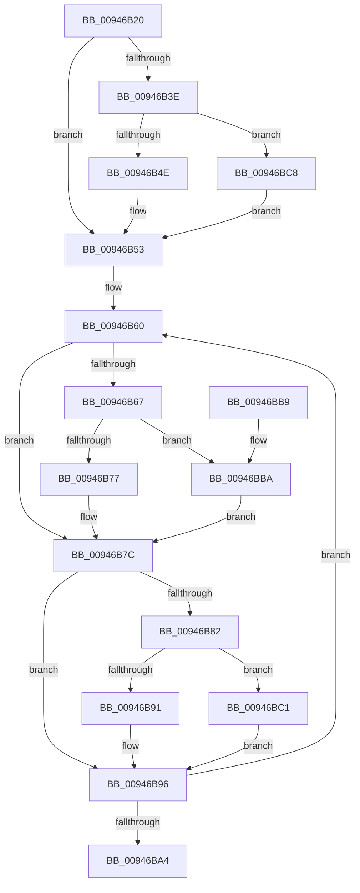

# CmpKeyEnumStackEntryCleanup

- RVA: `0x00946B20`–`0x00946BCF` (길이 `175` bytes)
- VA: `0x0000000140946B20`
- 실행 섹션: `PAGE`
- PDB 이름 있음: `예`; PDB Function 태그: `아니요`
- unwind 정보 RVA: `0x00090A1C`
- 디코드: `47`개 명령, `175/175` bytes 표시
- 미해석 바이트: `0` (있으면 어셈블리에 `.byte`로 보존)

> 이 문서는 커널 이미지의 기계어와 PDB 기호를 분석해 생성했습니다. 4번과 5번은 함수 원형과 자료형을 바이너리 사용 방식에서 추정한 C 해석이며 원본 소스 복구 결과는 아닙니다.

## 1. Dependencies

- 직접 호출 지점: **6**; 고유 호출 대상: **2**
- 직접 호출자로 확인된 함수: **3**
- RIP 상대 이미지 참조: **0**

### Outgoing calls
- `0x00946B4E` → [HvpReleaseCellPaged](../85/HvpReleaseCellPaged_function_00855F40.md) (function, `0x00855F40`)
- `0x00946B77` → [HvpReleaseCellPaged](../85/HvpReleaseCellPaged_function_00855F40.md) (function, `0x00855F40`)
- `0x00946B91` → [HvpReleaseCellPaged](../85/HvpReleaseCellPaged_function_00855F40.md) (function, `0x00855F40`)
- `0x00946BBA` → [HvpReleaseCellFlat](../85/HvpReleaseCellFlat_function_0085CC20.md) (function, `0x0085CC20`)
- `0x00946BC1` → [HvpReleaseCellFlat](../85/HvpReleaseCellFlat_function_0085CC20.md) (function, `0x0085CC20`)
- `0x00946BC8` → [HvpReleaseCellFlat](../85/HvpReleaseCellFlat_function_0085CC20.md) (function, `0x0085CC20`)

### Direct callers
- [CmpGetSubKeyCountForKeyNodeStack](CmpGetSubKeyCountForKeyNodeStack_function_00945624.md) at `0x009456CF`
- [CmpKeyEnumStackReset](CmpKeyEnumStackReset_function_0094648C.md) at `0x009464C0`
- [CmpKeyEnumStackCleanup](CmpKeyEnumStackCleanup_function_00946868.md) at `0x0094689B`

### Static image references
- 디코드된 RIP-relative 메모리 참조가 없습니다.

## 2. Other-region calls and transfers

- 다른 실행 섹션으로 향하는 call: **0**
- 별도 외부 분기/꼬리 이동을 확인하지 못했습니다.

## 3. Assembly (complete function range)

```asm
00946B20  48 89 5C 24 08                  mov qword ptr [rsp + 8], rbx
00946B25  48 89 6C 24 10                  mov qword ptr [rsp + 0x10], rbp
00946B2A  48 89 74 24 18                  mov qword ptr [rsp + 0x18], rsi
00946B2F  57                              push rdi
00946B30  48 83 EC 20                     sub rsp, 0x20
00946B34  48 83 79 08 00                  cmp qword ptr [rcx + 8], 0
00946B39  48 8B D9                        mov rbx, rcx
00946B3C  74 15                           je 0x140946b53
00946B3E  48 8D 51 10                     lea rdx, [rcx + 0x10]
00946B42  48 8B 09                        mov rcx, qword ptr [rcx]
00946B45  F6 81 8C 00 00 00 01            test byte ptr [rcx + 0x8c], 1
00946B4C  75 7A                           jne 0x140946bc8
00946B4E  E8 ED F3 F0 FF                  call 0x140855f40
00946B53  48 8D 73 50                     lea rsi, [rbx + 0x50]
00946B57  BD 02 00 00 00                  mov ebp, 2
00946B5C  48 8D 7B 60                     lea rdi, [rbx + 0x60]
00946B60  48 83 7E D8 00                  cmp qword ptr [rsi - 0x28], 0
00946B65  74 15                           je 0x140946b7c
00946B67  48 8B 0B                        mov rcx, qword ptr [rbx]
00946B6A  48 8D 57 D8                     lea rdx, [rdi - 0x28]
00946B6E  F6 81 8C 00 00 00 01            test byte ptr [rcx + 0x8c], 1
00946B75  75 43                           jne 0x140946bba
00946B77  E8 C4 F3 F0 FF                  call 0x140855f40
00946B7C  48 83 3E 00                     cmp qword ptr [rsi], 0
00946B80  74 14                           je 0x140946b96
00946B82  48 8B 0B                        mov rcx, qword ptr [rbx]
00946B85  48 8B D7                        mov rdx, rdi
00946B88  F6 81 8C 00 00 00 01            test byte ptr [rcx + 0x8c], 1
00946B8F  75 30                           jne 0x140946bc1
00946B91  E8 AA F3 F0 FF                  call 0x140855f40
00946B96  48 83 C7 08                     add rdi, 8
00946B9A  48 83 C6 08                     add rsi, 8
00946B9E  48 83 ED 01                     sub rbp, 1
00946BA2  75 BC                           jne 0x140946b60
00946BA4  48 8B 5C 24 30                  mov rbx, qword ptr [rsp + 0x30]
00946BA9  48 8B 6C 24 38                  mov rbp, qword ptr [rsp + 0x38]
00946BAE  48 8B 74 24 40                  mov rsi, qword ptr [rsp + 0x40]
00946BB3  48 83 C4 20                     add rsp, 0x20
00946BB7  5F                              pop rdi
00946BB8  C3                              ret
00946BB9  CC                              int3
00946BBA  E8 61 60 F1 FF                  call 0x14085cc20
00946BBF  EB BB                           jmp 0x140946b7c
00946BC1  E8 5A 60 F1 FF                  call 0x14085cc20
00946BC6  EB CE                           jmp 0x140946b96
00946BC8  E8 53 60 F1 FF                  call 0x14085cc20
00946BCD  EB 84                           jmp 0x140946b53
```

## 4. C-style interpretation (structured pseudocode)

```c
__int64 __fastcall CmpKeyEnumStackEntryCleanup(__int64 a1)
{
    __int64 result;
    __int64 v_rbp;
    __int64 v_rdi;
    __int64 v_rsi;
    __int64 v_rsp;
    unsigned __int64 v_stack_p10;
    unsigned __int64 v_stack_p18;
    unsigned __int64 v_stack_p8;

    v_stack_p8 = v_rbx;
    v_stack_p10 = v_rbp;
    v_stack_p18 = v_rsi;
    v_rsp = (v_rsp) - (32);
    if ((*(unsigned __int64 *)(a1 + 8)) == 0) goto loc_00946B53;
    if (((*(unsigned __int8 *)(*(unsigned __int64 *)(a1) + 140)) & (1)) != 0) goto loc_00946BC8;
    result = HvpReleaseCellPaged(*(unsigned __int64 *)(a1), a1 + 16, a3, a4);
loc_00946B53:
loc_00946B60:
    if ((*(unsigned __int64 *)(a1 + 80 - 40)) == 0) goto loc_00946B7C;
    if (((*(unsigned __int8 *)(*(unsigned __int64 *)(a1) + 140)) & (1)) != 0) goto loc_00946BBA;
    result = HvpReleaseCellPaged(*(unsigned __int64 *)(a1), a1 + 96 - 40, a3, a4);
loc_00946B7C:
    if ((*(unsigned __int64 *)(a1 + 80)) == 0) goto loc_00946B96;
    if (((*(unsigned __int8 *)(*(unsigned __int64 *)(a1) + 140)) & (1)) != 0) goto loc_00946BC1;
    result = HvpReleaseCellPaged(*(unsigned __int64 *)(a1), a1 + 96, a3, a4);
loc_00946B96:
    v_rdi = (a1 + 96) + (8);
    v_rsi = (a1 + 80) + (8);
    v_rbp = (2) - (1);
    if (condition_is_not_equal) goto loc_00946B60;
    v_rsp = (v_rsp) + (32);
    return result;
loc_00946BBA:
    result = HvpReleaseCellFlat(*(unsigned __int64 *)(a1), a1 + 96, a3, a4);
    goto loc_00946B7C;
loc_00946BC1:
    result = HvpReleaseCellFlat(*(unsigned __int64 *)(a1), a1 + 96, a3, a4);
    goto loc_00946B96;
loc_00946BC8:
    result = HvpReleaseCellFlat(*(unsigned __int64 *)(a1), a1 + 96, a3, a4);
    goto loc_00946B53;
}
```

## 5. (Beta) C Style

```c
int64_t CmpKeyEnumStackEntryCleanup(void *Arg1)
{
    uint8_t *arg1 = (uint8_t *)Arg1;

    int64_t result;
    int64_t local_rbp;
    int64_t local_rdi;
    int64_t local_rsi;
    int64_t local_rsp;
    uint64_t v_stack_p10;
    uint64_t v_stack_p18;
    uint64_t v_stack_p8;

    v_stack_p8 = local_rbx;
    v_stack_p10 = local_rbp;
    v_stack_p18 = local_rsi;
    local_rsp = (local_rsp) - (32);
    if ((*(uint64_t *)(arg1 + 0x8)) == 0) goto loc_00946B53;
    if (((*(uint8_t *)(*(uint64_t *)(arg1) + 0x8C)) & (1)) != 0) goto loc_00946BC8;
    result = HvpReleaseCellPaged(*(uint64_t *)(arg1), Arg1 + 16, a3, a4);
loc_00946B53:
loc_00946B60:
    if ((*(uint64_t *)(arg1 + 0x50 - 0x28)) == 0) goto loc_00946B7C;
    if (((*(uint8_t *)(*(uint64_t *)(arg1) + 0x8C)) & (1)) != 0) goto loc_00946BBA;
    result = HvpReleaseCellPaged(*(uint64_t *)(arg1), Arg1 + 96 - 40, a3, a4);
loc_00946B7C:
    if ((*(uint64_t *)(arg1 + 0x50)) == 0) goto loc_00946B96;
    if (((*(uint8_t *)(*(uint64_t *)(arg1) + 0x8C)) & (1)) != 0) goto loc_00946BC1;
    result = HvpReleaseCellPaged(*(uint64_t *)(arg1), Arg1 + 96, a3, a4);
loc_00946B96:
    local_rdi = (Arg1 + 96) + (8);
    local_rsi = (Arg1 + 80) + (8);
    local_rbp = (2) - (1);
    if (condition_is_not_equal) goto loc_00946B60;
    local_rsp = (local_rsp) + (32);
    return result;
loc_00946BBA:
    result = HvpReleaseCellFlat(*(uint64_t *)(arg1), Arg1 + 96, a3, a4);
    goto loc_00946B7C;
loc_00946BC1:
    result = HvpReleaseCellFlat(*(uint64_t *)(arg1), Arg1 + 96, a3, a4);
    goto loc_00946B96;
loc_00946BC8:
    result = HvpReleaseCellFlat(*(uint64_t *)(arg1), Arg1 + 96, a3, a4);
    goto loc_00946B53;
}
```

### 관측된 메모리 오프셋

구조체 형식이 확인되지 않은 접근은 인자 기준의 오프셋으로만 기록했습니다.

| 기준 인자 | 오프셋 표현 | 폭 (bit) | 접근 |
|---|---:|---:|---|
| `Arg1` | `- 0x28` | `64` | `R` |
| `Arg1` | `+ 0x0` | `64` | `R` |
| `Arg1` | `+ 0x8` | `64` | `R` |
| `Arg1` | `+ 0x10` | `64` | `R` |
| `Arg1` | `+ 0x50` | `64` | `R` |
| `Arg1` | `+ 0x60` | `64` | `R` |

## 6. Execution-region graph

[열기: 2D/3D 그래프와 함수 탐색 컨트롤 패널](../../../control-panel.html?section=page&rva=0x00946B20&view=graph)

- 2D 그래프는 위에서 아래로 흐르고, 3D 그래프는 빈 공간을 드래그해 회전합니다. Shift+드래그는 이동, 휠은 확대·축소, 함수 노드 선택은 대상 보고서 이동입니다.

### Static fallback


