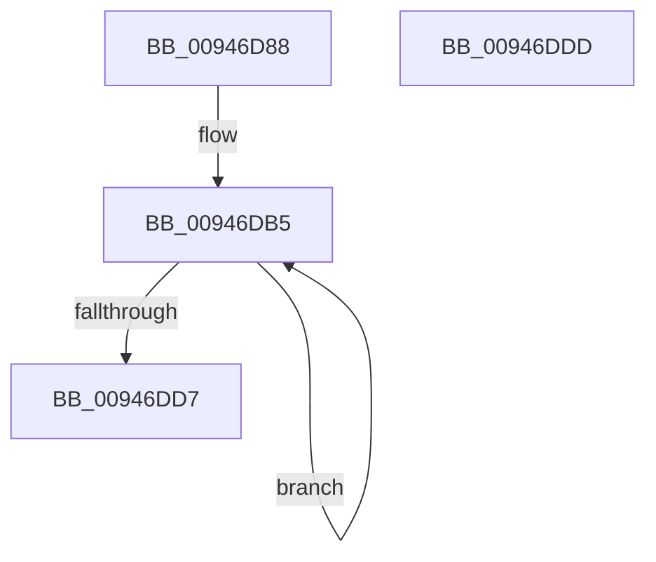

# CmpKeyEnumStackEntryInitialize

- RVA: `0x00946D88`–`0x00946DDE` (길이 `86` bytes)
- VA: `0x0000000140946D88`
- 실행 섹션: `PAGE`
- PDB 이름 있음: `예`; PDB Function 태그: `아니요`
- unwind 정보 RVA: `0x0005CF00`
- 디코드: `24`개 명령, `86/86` bytes 표시
- 미해석 바이트: `0` (있으면 어셈블리에 `.byte`로 보존)

> 이 문서는 커널 이미지의 기계어와 PDB 기호를 분석해 생성했습니다. 4번과 5번은 함수 원형과 자료형을 바이너리 사용 방식에서 추정한 C 해석이며 원본 소스 복구 결과는 아닙니다.

## 1. Dependencies

- 직접 호출 지점: **4**; 고유 호출 대상: **2**
- 직접 호출자로 확인된 함수: **3**
- RIP 상대 이미지 참조: **0**

### Outgoing calls
- `0x00946D99` → [memset](../../text/6C/memset_function_006C6C40.md) (function, `0x006C6C40`)
- `0x00946DA2` → [HvpGetCellContextInitialize](../85/HvpGetCellContextInitialize_function_00855F10.md) (function, `0x00855F10`)
- `0x00946DB9` → [HvpGetCellContextInitialize](../85/HvpGetCellContextInitialize_function_00855F10.md) (function, `0x00855F10`)
- `0x00946DC1` → [HvpGetCellContextInitialize](../85/HvpGetCellContextInitialize_function_00855F10.md) (function, `0x00855F10`)

### Direct callers
- [CmpKeyEnumStackReset](CmpKeyEnumStackReset_function_0094648C.md) at `0x009464C8`
- [CmpKeyEnumStackInitialize](CmpKeyEnumStackInitialize_function_00946D38.md) at `0x00946D67`
- [sub_00B25586](../B2/Unknown_function_00B25586.md) at `0x00B25593`

### Static image references
- 디코드된 RIP-relative 메모리 참조가 없습니다.

## 2. Other-region calls and transfers

- 다른 실행 섹션으로 향하는 call: **1**
  - `0x00946D99` → [memset](../../text/6C/memset_function_006C6C40.md) (`PAGE` → `.text`)
- 별도 외부 분기/꼬리 이동을 확인하지 못했습니다.

## 3. Assembly (complete function range)

```asm
00946D88  40 53                           push rbx
00946D8A  48 83 EC 20                     sub rsp, 0x20
00946D8E  33 D2                           xor edx, edx
00946D90  41 B8 80 00 00 00               mov r8d, 0x80
00946D96  48 8B D9                        mov rbx, rcx
00946D99  E8 A2 FE D7 FF                  call 0x1406c6c40
00946D9E  48 8D 4B 10                     lea rcx, [rbx + 0x10]
00946DA2  E8 69 F1 F0 FF                  call 0x140855f10
00946DA7  48 8D 53 48                     lea rdx, [rbx + 0x48]
00946DAB  41 B8 02 00 00 00               mov r8d, 2
00946DB1  48 83 C3 60                     add rbx, 0x60
00946DB5  48 8D 4B D8                     lea rcx, [rbx - 0x28]
00946DB9  E8 52 F1 F0 FF                  call 0x140855f10
00946DBE  48 8B CB                        mov rcx, rbx
00946DC1  E8 4A F1 F0 FF                  call 0x140855f10
00946DC6  83 0A FF                        or dword ptr [rdx], 0xffffffff
00946DC9  48 83 C3 08                     add rbx, 8
00946DCD  48 8D 52 04                     lea rdx, [rdx + 4]
00946DD1  49 83 E8 01                     sub r8, 1
00946DD5  75 DE                           jne 0x140946db5
00946DD7  48 83 C4 20                     add rsp, 0x20
00946DDB  5B                              pop rbx
00946DDC  C3                              ret
00946DDD  CC                              int3
```

## 4. C-style interpretation (structured pseudocode)

```c
__int64 __fastcall CmpKeyEnumStackEntryInitialize(__int64 a1, int a2)
{
    __int64 result;
    __int64 v_rbx;
    __int64 v_rsp;

    v_rsp = (v_rsp) - (32);
    a2 = 0;
    result = memset(a1, a2, 128, a4);
    result = HvpGetCellContextInitialize(a1 + 16, a2, 128, a4);
    v_rbx = (a1) + (96);
loc_00946DB5:
    result = HvpGetCellContextInitialize(v_rbx - 40, a1 + 72, 2, a4);
    result = HvpGetCellContextInitialize(v_rbx, a1 + 72, 2, a4);
    v_rbx = (v_rbx) + (8);
    a3 = (2) - (1);
    if (condition_is_not_equal) goto loc_00946DB5;
    v_rsp = (v_rsp) + (32);
    return result;
}
```

## 5. (Beta) C Style

```c
int64_t CmpKeyEnumStackEntryInitialize(void *Arg1, int32_t Arg2)
{
    uint8_t *arg1 = (uint8_t *)Arg1;

    int64_t result;
    int64_t local_rbx;
    int64_t local_rsp;

    local_rsp = (local_rsp) - (32);
    Arg2 = 0;
    result = memset(Arg1, Arg2, 128, a4);
    result = HvpGetCellContextInitialize(Arg1 + 16, Arg2, 128, a4);
    local_rbx = (Arg1) + (96);
loc_00946DB5:
    result = HvpGetCellContextInitialize(local_rbx - 40, Arg1 + 72, 2, a4);
    result = HvpGetCellContextInitialize(local_rbx, Arg1 + 72, 2, a4);
    local_rbx = (local_rbx) + (8);
    a3 = (2) - (1);
    if (condition_is_not_equal) goto loc_00946DB5;
    local_rsp = (local_rsp) + (32);
    return result;
}
```

### 관측된 메모리 오프셋

구조체 형식이 확인되지 않은 접근은 인자 기준의 오프셋으로만 기록했습니다.

| 기준 인자 | 오프셋 표현 | 폭 (bit) | 접근 |
|---|---:|---:|---|
| `Arg1` | `- 0x28` | `64` | `R` |
| `Arg1` | `+ 0x10` | `64` | `R` |
| `Arg1` | `+ 0x48` | `64` | `R` |

## 6. Execution-region graph

[열기: 2D/3D 그래프와 함수 탐색 컨트롤 패널](../../../control-panel.html?section=page&rva=0x00946D88&view=graph)

- 2D 그래프는 위에서 아래로 흐르고, 3D 그래프는 빈 공간을 드래그해 회전합니다. Shift+드래그는 이동, 휠은 확대·축소, 함수 노드 선택은 대상 보고서 이동입니다.

### Static fallback


