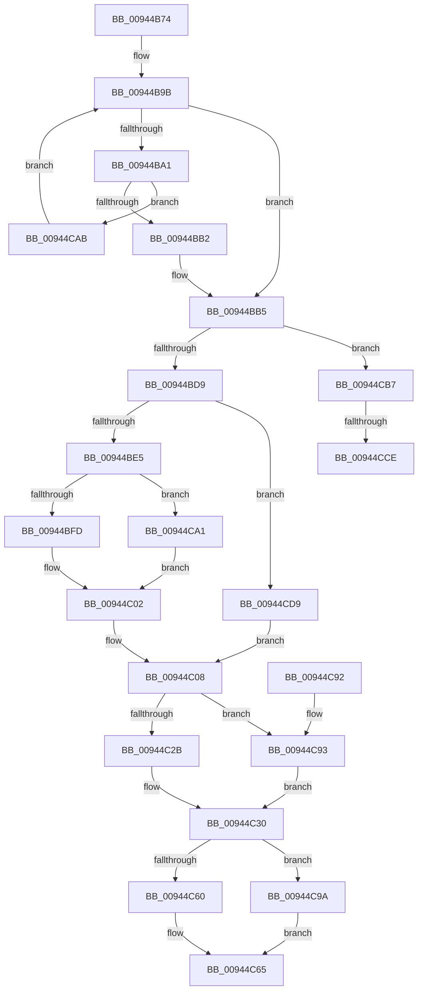

# CmpKeyEnumStackEntryNotifyPromotion

- RVA: `0x00944B74`–`0x00944CE2` (길이 `366` bytes)
- VA: `0x0000000140944B74`
- 실행 섹션: `PAGE`
- PDB 이름 있음: `예`; PDB Function 태그: `예`
- unwind 정보 RVA: `0x00090784`
- 디코드: `90`개 명령, `366/366` bytes 표시
- 미해석 바이트: `0` (있으면 어셈블리에 `.byte`로 보존)

> 이 문서는 커널 이미지의 기계어와 PDB 기호를 분석해 생성했습니다. 4번과 5번은 함수 원형과 자료형을 바이너리 사용 방식에서 추정한 C 해석이며 원본 소스 복구 결과는 아닙니다.

## 1. Dependencies

- 직접 호출 지점: **8**; 고유 호출 대상: **5**
- 직접 호출자로 확인된 함수: **1**
- RIP 상대 이미지 참조: **0**

### Outgoing calls
- `0x00944BFD` → [HvpReleaseCellPaged](../85/HvpReleaseCellPaged_function_00855F40.md) (function, `0x00855F40`)
- `0x00944C2B` → [HvpGetCellFlat](../85/HvpGetCellFlat_function_00854C60.md) (function, `0x00854C60`)
- `0x00944C43` → [CmpDoFindSubKeyByNumber](CmpDoFindSubKeyByNumber_function_00946F60.md) (function, `0x00946F60`)
- `0x00944C60` → [HvpGetCellFlat](../85/HvpGetCellFlat_function_00854C60.md) (function, `0x00854C60`)
- `0x00944C93` → [HvpGetCellPaged](../85/HvpGetCellPaged_function_00854CB0.md) (function, `0x00854CB0`)
- `0x00944C9A` → [HvpGetCellPaged](../85/HvpGetCellPaged_function_00854CB0.md) (function, `0x00854CB0`)
- `0x00944CA1` → [HvpReleaseCellFlat](../85/HvpReleaseCellFlat_function_0085CC20.md) (function, `0x0085CC20`)
- `0x00944CCE` → [HvpReleaseCellFlat](../85/HvpReleaseCellFlat_function_0085CC20.md) (function, `0x0085CC20`)

### Direct callers
- [CmpKeyEnumStackNotifyPromotion](CmpKeyEnumStackNotifyPromotion_function_00944CE8.md) at `0x00944D03`

### Static image references
- 디코드된 RIP-relative 메모리 참조가 없습니다.

## 2. Other-region calls and transfers

- 다른 실행 섹션으로 향하는 call: **0**
- call이 아닌 외부 분기/꼬리 이동: **2**
  - `0x00944CC8` → [sub_00B25562](../B2/Unknown_function_00B25562.md) (`tail-transfer`)
  - `0x00944CD4` → [sub_00B25562 + 0x5](../B2/Unknown_function_00B25562.md) (`tail-transfer`)

## 3. Assembly (complete function range)

```asm
00944B74  48 8B C4                        mov rax, rsp
00944B77  48 89 58 08                     mov qword ptr [rax + 8], rbx
00944B7B  48 89 68 10                     mov qword ptr [rax + 0x10], rbp
00944B7F  48 89 70 18                     mov qword ptr [rax + 0x18], rsi
00944B83  48 89 78 20                     mov qword ptr [rax + 0x20], rdi
00944B87  41 56                           push r14
00944B89  48 83 EC 20                     sub rsp, 0x20
00944B8D  BD 02 00 00 00                  mov ebp, 2
00944B92  48 8B F9                        mov rdi, rcx
00944B95  45 33 C0                        xor r8d, r8d
00944B98  8D 55 12                        lea edx, [rbp + 0x12]
00944B9B  48 83 FA 1C                     cmp rdx, 0x1c
00944B9F  7D 14                           jge 0x140944bb5
00944BA1  48 8B 47 08                     mov rax, qword ptr [rdi + 8]
00944BA5  8B 0C 02                        mov ecx, dword ptr [rdx + rax]
00944BA8  39 4C 17 0C                     cmp dword ptr [rdi + rdx + 0xc], ecx
00944BAC  0F 84 F9 00 00 00               je 0x140944cab
00944BB2  41 8B E8                        mov ebp, r8d
00944BB5  48 83 67 78 00                  and qword ptr [rdi + 0x78], 0
00944BBA  41 83 CE FF                     or r14d, 0xffffffff
00944BBE  48 63 F5                        movsxd rsi, ebp
00944BC1  44 89 77 70                     mov dword ptr [rdi + 0x70], r14d
00944BC5  48 83 7C F7 50 00               cmp qword ptr [rdi + rsi*8 + 0x50], 0
00944BCB  48 8D 1C F5 00 00 00 00         lea rbx, [rsi*8]
00944BD3  0F 85 DE 00 00 00               jne 0x140944cb7
00944BD9  48 83 7C F7 28 00               cmp qword ptr [rdi + rsi*8 + 0x28], 0
00944BDF  0F 84 F4 00 00 00               je 0x140944cd9
00944BE5  48 8B 0F                        mov rcx, qword ptr [rdi]
00944BE8  4C 8D 34 3B                     lea r14, [rbx + rdi]
00944BEC  49 8D 56 38                     lea rdx, [r14 + 0x38]
00944BF0  F6 81 8C 00 00 00 01            test byte ptr [rcx + 0x8c], 1
00944BF7  0F 85 A4 00 00 00               jne 0x140944ca1
00944BFD  E8 3E 13 F1 FF                  call 0x140855f40
00944C02  48 83 64 F7 28 00               and qword ptr [rdi + rsi*8 + 0x28], 0
00944C08  48 8B 57 08                     mov rdx, qword ptr [rdi + 8]
00944C0C  4D 8D 46 38                     lea r8, [r14 + 0x38]
00944C10  48 63 CD                        movsxd rcx, ebp
00944C13  8B 44 B2 14                     mov eax, dword ptr [rdx + rsi*4 + 0x14]
00944C17  89 44 8F 20                     mov dword ptr [rdi + rcx*4 + 0x20], eax
00944C1B  8B 54 8A 1C                     mov edx, dword ptr [rdx + rcx*4 + 0x1c]
00944C1F  48 8B 0F                        mov rcx, qword ptr [rdi]
00944C22  F6 81 8C 00 00 00 01            test byte ptr [rcx + 0x8c], 1
00944C29  74 68                           je 0x140944c93
00944C2B  E8 30 00 F1 FF                  call 0x140854c60
00944C30  48 89 44 F7 28                  mov qword ptr [rdi + rsi*8 + 0x28], rax
00944C35  48 8B D0                        mov rdx, rax
00944C38  48 8B 0F                        mov rcx, qword ptr [rdi]
00944C3B  48 63 DD                        movsxd rbx, ebp
00944C3E  44 8B 44 9F 18                  mov r8d, dword ptr [rdi + rbx*4 + 0x18]
00944C43  E8 18 23 00 00                  call 0x140946f60
00944C48  89 44 9F 48                     mov dword ptr [rdi + rbx*4 + 0x48], eax
00944C4C  4D 8D 46 60                     lea r8, [r14 + 0x60]
00944C50  48 8B 0F                        mov rcx, qword ptr [rdi]
00944C53  8B F0                           mov esi, eax
00944C55  8B D0                           mov edx, eax
00944C57  F6 81 8C 00 00 00 01            test byte ptr [rcx + 0x8c], 1
00944C5E  74 3A                           je 0x140944c9a
00944C60  E8 FB FF F0 FF                  call 0x140854c60
00944C65  48 8B 5C 24 30                  mov rbx, qword ptr [rsp + 0x30]
00944C6A  48 8B C8                        mov rcx, rax
00944C6D  48 63 C5                        movsxd rax, ebp
00944C70  48 8B 6C 24 38                  mov rbp, qword ptr [rsp + 0x38]
00944C75  48 89 4C C7 50                  mov qword ptr [rdi + rax*8 + 0x50], rcx
00944C7A  89 77 70                        mov dword ptr [rdi + 0x70], esi
00944C7D  48 8B 74 24 40                  mov rsi, qword ptr [rsp + 0x40]
00944C82  48 89 4F 78                     mov qword ptr [rdi + 0x78], rcx
00944C86  48 8B 7C 24 48                  mov rdi, qword ptr [rsp + 0x48]
00944C8B  48 83 C4 20                     add rsp, 0x20
00944C8F  41 5E                           pop r14
00944C91  C3                              ret
00944C92  CC                              int3
00944C93  E8 18 00 F1 FF                  call 0x140854cb0
00944C98  EB 96                           jmp 0x140944c30
00944C9A  E8 11 00 F1 FF                  call 0x140854cb0
00944C9F  EB C4                           jmp 0x140944c65
00944CA1  E8 7A 7F F1 FF                  call 0x14085cc20
00944CA6  E9 57 FF FF FF                  jmp 0x140944c02
00944CAB  41 FF C0                        inc r8d
00944CAE  48 83 C2 04                     add rdx, 4
00944CB2  E9 E4 FE FF FF                  jmp 0x140944b9b
00944CB7  48 8B 0F                        mov rcx, qword ptr [rdi]
00944CBA  48 8D 57 60                     lea rdx, [rdi + 0x60]
00944CBE  48 03 D3                        add rdx, rbx
00944CC1  F6 81 8C 00 00 00 01            test byte ptr [rcx + 0x8c], 1
00944CC8  0F 84 94 08 1E 00               je 0x140b25562
00944CCE  E8 4D 7F F1 FF                  call 0x14085cc20
00944CD3  90                              nop
00944CD4  E9 8E 08 1E 00                  jmp 0x140b25567
00944CD9  4C 8D 34 1F                     lea r14, [rdi + rbx]
00944CDD  E9 26 FF FF FF                  jmp 0x140944c08
```

## 4. C-style interpretation (structured pseudocode)

```c
__int64 __fastcall CmpKeyEnumStackEntryNotifyPromotion(__int64 a1, __int64 a2, int a3)
{
    __int64 result;
    __int64 v_r14;
    __int64 v_rsp;
    unsigned __int64 v_stack_p10;
    unsigned __int64 v_stack_p18;
    unsigned __int64 v_stack_p20;
    unsigned __int64 v_stack_p8;

    *(unsigned __int64 *)(v_rsp + 8) = v_rbx;
    *(unsigned __int64 *)(v_rsp + 16) = v_rbp;
    *(unsigned __int64 *)(v_rsp + 24) = v_rsi;
    *(unsigned __int64 *)(v_rsp + 32) = v_rdi;
    v_rsp = (v_rsp) - (32);
    a3 = 0;
loc_00944B9B:
    if ((2 + 18) >= 28) goto loc_00944BB5;
    if ((*(unsigned int *)(a1 + 2 + 18 * 1 + 12)) == ((unsigned int)((unsigned int)(*(unsigned int *)(2 + 18 + *(unsigned __int64 *)(a1 + 8) * 1))))) goto loc_00944CAB;
loc_00944BB5:
    v_r14 = (unsigned int)((v_r14) | (0xFFFFFFFFULL));
    *(unsigned int *)(a1 + 112) = (unsigned int)(v_r14);
    if ((*(unsigned __int64 *)(a1 + (int)(0) * 8 + 80)) != 0) goto loc_00944CB7;
    if ((*(unsigned __int64 *)(a1 + (int)(0) * 8 + 40)) == 0) goto loc_00944CD9;
    if (((*(unsigned __int8 *)(*(unsigned __int64 *)(a1) + 140)) & (1)) != 0) goto loc_00944CA1;
    result = HvpReleaseCellPaged(*(unsigned __int64 *)(a1), (int)(0) * 8 + a1 * 1 + 56, a3, a4);
loc_00944C02:
loc_00944C08:
    *(unsigned int *)(a1 + (int)(0) * 4 + 32) = (unsigned int)((unsigned int)(*(unsigned int *)(*(unsigned __int64 *)(a1 + 8) + (int)(0) * 4 + 20)));
    if (((*(unsigned __int8 *)(*(unsigned __int64 *)(a1) + 140)) & (1)) == 0) goto loc_00944C93;
    result = HvpGetCellFlat(*(unsigned __int64 *)(a1), (unsigned int)(*(unsigned int *)(*(unsigned __int64 *)(a1 + 8) + (int)(0) * 4 + 28)), (int)(0) * 8 + a1 * 1 + 56, a4);
loc_00944C30:
    *(unsigned __int64 *)(a1 + (int)(0) * 8 + 40) = result;
    result = CmpDoFindSubKeyByNumber(*(unsigned __int64 *)(a1), result, (unsigned int)(*(unsigned int *)(a1 + (int)(0) * 4 + 24)), a4);
    *(unsigned int *)(a1 + (int)(0) * 4 + 72) = (unsigned int)(result);
    if (((*(unsigned __int8 *)(*(unsigned __int64 *)(a1) + 140)) & (1)) == 0) goto loc_00944C9A;
    result = HvpGetCellFlat(*(unsigned __int64 *)(a1), (unsigned int)((unsigned int)(result)), (int)(0) * 8 + a1 * 1 + 96, a4);
loc_00944C65:
    *(unsigned __int64 *)(a1 + (int)(0) * 8 + 80) = result;
    *(unsigned int *)(a1 + 112) = (unsigned int)((unsigned int)((unsigned int)(result)));
    *(unsigned __int64 *)(a1 + 120) = result;
    v_rsp = (v_rsp) + (32);
    return (int)(0);
loc_00944C93:
    result = HvpGetCellPaged(result, (unsigned int)((unsigned int)(result)), (int)(0) * 8 + a1 * 1 + 96, a4);
    goto loc_00944C30;
loc_00944C9A:
    result = HvpGetCellPaged(result, (unsigned int)((unsigned int)(result)), (int)(0) * 8 + a1 * 1 + 96, a4);
    goto loc_00944C65;
loc_00944CA1:
    result = HvpReleaseCellFlat(result, (unsigned int)((unsigned int)(result)), (int)(0) * 8 + a1 * 1 + 96, a4);
    goto loc_00944C02;
loc_00944CAB:
    a3 = (unsigned int)(((int)(0) * 8 + a1 * 1 + 96) + 1);
    a2 = ((unsigned int)((unsigned int)(result))) + (4);
    goto loc_00944B9B;
loc_00944CB7:
    a2 = (v_stack_p20 + 96) + (v_stack_p8);
    result = HvpReleaseCellFlat(*(unsigned __int64 *)(v_stack_p20), a2, a3, a4);
loc_00944CD9:
    goto loc_00944C08;
}
```

## 5. (Beta) C Style

```c
int64_t CmpKeyEnumStackEntryNotifyPromotion(void *Arg1, int64_t Arg2, int32_t Arg3)
{
    uint8_t *arg1 = (uint8_t *)Arg1;

    int64_t result;
    int64_t local_r14;
    int64_t local_rsp;
    uint64_t v_stack_p10;
    uint64_t v_stack_p18;
    uint64_t v_stack_p20;
    uint64_t v_stack_p8;

    *(uint64_t *)(local_rsp + 0x8) = local_rbx;
    *(uint64_t *)(local_rsp + 0x10) = local_rbp;
    *(uint64_t *)(local_rsp + 0x18) = local_rsi;
    *(uint64_t *)(local_rsp + 0x20) = local_rdi;
    local_rsp = (local_rsp) - (32);
    Arg3 = 0;
loc_00944B9B:
    if ((2 + 18) >= 28) goto loc_00944BB5;
    if ((*(uint32_t *)(arg1 + 0x2 + 0x12 * 1 + 0xC)) == ((uint32_t)((uint32_t)(*(uint32_t *)(2 + 0x12 + *(uint64_t *)(arg1 + 0x8) * 1))))) goto loc_00944CAB;
loc_00944BB5:
    local_r14 = (uint32_t)((local_r14) | (0xFFFFFFFFULL));
    *(uint32_t *)(arg1 + 0x70) = (uint32_t)(local_r14);
    if ((*(uint64_t *)(arg1 + (int32_t)(0) * 8 + 0x50)) != 0) goto loc_00944CB7;
    if ((*(uint64_t *)(arg1 + (int32_t)(0) * 8 + 0x28)) == 0) goto loc_00944CD9;
    if (((*(uint8_t *)(*(uint64_t *)(arg1) + 0x8C)) & (1)) != 0) goto loc_00944CA1;
    result = HvpReleaseCellPaged(*(uint64_t *)(arg1), (int32_t)(0) * 8 + Arg1 * 1 + 56, Arg3, a4);
loc_00944C02:
loc_00944C08:
    *(uint32_t *)(arg1 + (int32_t)(0) * 4 + 0x20) = (uint32_t)((uint32_t)(*(uint32_t *)(*(uint64_t *)(arg1 + 0x8) + (int32_t)(0) * 4 + 0x14)));
    if (((*(uint8_t *)(*(uint64_t *)(arg1) + 0x8C)) & (1)) == 0) goto loc_00944C93;
    result = HvpGetCellFlat(*(uint64_t *)(arg1), (uint32_t)(*(uint32_t *)(*(uint64_t *)(arg1 + 0x8) + (int32_t)(0) * 4 + 0x1C)), (int32_t)(0) * 8 + Arg1 * 1 + 56, a4);
loc_00944C30:
    *(uint64_t *)(arg1 + (int32_t)(0) * 8 + 0x28) = result;
    result = CmpDoFindSubKeyByNumber(*(uint64_t *)(arg1), result, (uint32_t)(*(uint32_t *)(arg1 + (int32_t)(0) * 4 + 0x18)), a4);
    *(uint32_t *)(arg1 + (int32_t)(0) * 4 + 0x48) = (uint32_t)(result);
    if (((*(uint8_t *)(*(uint64_t *)(arg1) + 0x8C)) & (1)) == 0) goto loc_00944C9A;
    result = HvpGetCellFlat(*(uint64_t *)(arg1), (uint32_t)((uint32_t)(result)), (int32_t)(0) * 8 + Arg1 * 1 + 96, a4);
loc_00944C65:
    *(uint64_t *)(arg1 + (int32_t)(0) * 8 + 0x50) = result;
    *(uint32_t *)(arg1 + 0x70) = (uint32_t)((uint32_t)((uint32_t)(result)));
    *(uint64_t *)(arg1 + 0x78) = result;
    local_rsp = (local_rsp) + (32);
    return (int32_t)(0);
loc_00944C93:
    result = HvpGetCellPaged(result, (uint32_t)((uint32_t)(result)), (int32_t)(0) * 8 + Arg1 * 1 + 96, a4);
    goto loc_00944C30;
loc_00944C9A:
    result = HvpGetCellPaged(result, (uint32_t)((uint32_t)(result)), (int32_t)(0) * 8 + Arg1 * 1 + 96, a4);
    goto loc_00944C65;
loc_00944CA1:
    result = HvpReleaseCellFlat(result, (uint32_t)((uint32_t)(result)), (int32_t)(0) * 8 + Arg1 * 1 + 96, a4);
    goto loc_00944C02;
loc_00944CAB:
    Arg3 = (uint32_t)(((int32_t)(0) * 8 + Arg1 * 1 + 96) + 1);
    Arg2 = ((uint32_t)((uint32_t)(result))) + (4);
    goto loc_00944B9B;
loc_00944CB7:
    Arg2 = (v_stack_p20 + 96) + (v_stack_p8);
    result = HvpReleaseCellFlat(*(uint64_t *)(v_stack_p20), Arg2, Arg3, a4);
loc_00944CD9:
    goto loc_00944C08;
}
```

### 관측된 메모리 오프셋

구조체 형식이 확인되지 않은 접근은 인자 기준의 오프셋으로만 기록했습니다.

| 기준 인자 | 오프셋 표현 | 폭 (bit) | 접근 |
|---|---:|---:|---|
| `Arg1` | `+ 0x0` | `64` | `R` |
| `Arg1` | `+ 0x0 + rbx*1` | `64` | `R` |
| `Arg1` | `+ 0x8` | `64` | `R` |
| `Arg1` | `+ 0xC + rdx*1` | `32` | `R` |
| `Arg1` | `+ 0x18 + rbx*4` | `32` | `R` |
| `Arg1` | `+ 0x20 + rcx*4` | `32` | `W` |
| `Arg1` | `+ 0x28 + rsi*8` | `64` | `R` |
| `Arg1` | `+ 0x28 + rsi*8` | `64` | `R/W` |
| `Arg1` | `+ 0x28 + rsi*8` | `64` | `W` |
| `Arg1` | `+ 0x48 + rbx*4` | `32` | `W` |
| `Arg1` | `+ 0x50 + rax*8` | `64` | `W` |
| `Arg1` | `+ 0x50 + rsi*8` | `64` | `R` |
| `Arg1` | `+ 0x60` | `64` | `R` |
| `Arg1` | `+ 0x70` | `32` | `W` |
| `Arg1` | `+ 0x78` | `64` | `R/W` |
| `Arg1` | `+ 0x78` | `64` | `W` |

## 6. Execution-region graph

[열기: 2D/3D 그래프와 함수 탐색 컨트롤 패널](../../../control-panel.html?section=page&rva=0x00944B74&view=graph)

- 2D 그래프는 위에서 아래로 흐르고, 3D 그래프는 빈 공간을 드래그해 회전합니다. Shift+드래그는 이동, 휠은 확대·축소, 함수 노드 선택은 대상 보고서 이동입니다.

### Static fallback


