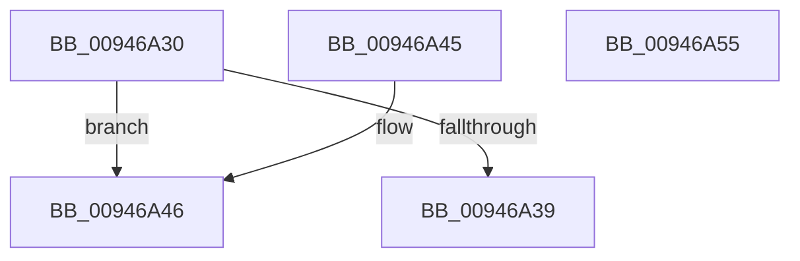

# CmpKeyEnumStackGetEntryAtLayerHeight

- RVA: `0x00946A30`–`0x00946A56` (길이 `38` bytes)
- VA: `0x0000000140946A30`
- 실행 섹션: `PAGE`
- PDB 이름 있음: `예`; PDB Function 태그: `아니요`
- unwind 정보 RVA: `0x000DB714`
- 디코드: `13`개 명령, `38/38` bytes 표시
- 미해석 바이트: `0` (있으면 어셈블리에 `.byte`로 보존)

> 이 문서는 커널 이미지의 기계어와 PDB 기호를 분석해 생성했습니다. 4번과 5번은 함수 원형과 자료형을 바이너리 사용 방식에서 추정한 C 해석이며 원본 소스 복구 결과는 아닙니다.

## 1. Dependencies

- 직접 호출 지점: **0**; 고유 호출 대상: **0**
- 직접 호출자로 확인된 함수: **7**
- RIP 상대 이미지 참조: **0**

### Outgoing calls
- 직접 디코드된 call 명령이 없습니다.

### Direct callers
- [CmpKeyEnumStackNotifyPromotion](CmpKeyEnumStackNotifyPromotion_function_00944CE8.md) at `0x00944CF8`
- [CmpKeyEnumStackReset](CmpKeyEnumStackReset_function_0094648C.md) at `0x009464B5`
- [CmpKeyEnumStackAdvance](CmpKeyEnumStackAdvance_function_0094668C.md) at `0x009466C4`
- [CmpKeyEnumStackBeginEnumerationForKeyNodeStack](CmpKeyEnumStackBeginEnumerationForKeyNodeStack_function_00946718.md) at `0x0094675E`
- [CmpKeyEnumStackCleanup](CmpKeyEnumStackCleanup_function_00946868.md) at `0x00946893`
- [CmpKeyEnumStackAdvanceInternal](CmpKeyEnumStackAdvanceInternal_function_009468D4.md) at `0x0094693D`
- [CmpKeyEnumStackAdvanceInternal](CmpKeyEnumStackAdvanceInternal_function_009468D4.md) at `0x0094698F`
- [CmpKeyEnumStackAdvanceInternal](CmpKeyEnumStackAdvanceInternal_function_009468D4.md) at `0x009469C2`
- [CmpKeyEnumStackCreateResumeContext](CmpKeyEnumStackCreateResumeContext_function_00948050.md) at `0x009480D9`

### Static image references
- 디코드된 RIP-relative 메모리 참조가 없습니다.

## 2. Other-region calls and transfers

- 다른 실행 섹션으로 향하는 call: **0**
- 별도 외부 분기/꼬리 이동을 확인하지 못했습니다.

## 3. Assembly (complete function range)

```asm
00946A30  0F BF C2                        movsx eax, dx
00946A33  66 83 FA 02                     cmp dx, 2
00946A37  7D 0D                           jge 0x140946a46
00946A39  48 C1 E0 07                     shl rax, 7
00946A3D  48 83 C0 58                     add rax, 0x58
00946A41  48 03 C1                        add rax, rcx
00946A44  C3                              ret
00946A45  CC                              int3
00946A46  83 C0 FE                        add eax, -2
00946A49  48 C1 E0 07                     shl rax, 7
00946A4D  48 03 81 58 01 00 00            add rax, qword ptr [rcx + 0x158]
00946A54  C3                              ret
00946A55  CC                              int3
```

## 4. C-style interpretation (structured pseudocode)

```c
__int64 __fastcall CmpKeyEnumStackGetEntryAtLayerHeight(__int64 a1, unsigned __int16 a2)
{
    __int64 result;

    if (a2 >= 2) goto loc_00946A46;
    result = ((__int16)(a2)) << (7);
    result = (result) + (88);
    result = (result) + (a1);
    return result;
loc_00946A46:
    result = (unsigned int)((result) + (-2));
    result = (result) << (7);
    result = (result) + (*(unsigned __int64 *)(a1 + 344));
    return result;
}
```

## 5. (Beta) C Style

```c
int64_t CmpKeyEnumStackGetEntryAtLayerHeight(void *Arg1, uint16_t Arg2)
{
    uint8_t *arg1 = (uint8_t *)Arg1;

    int64_t result;

    if (Arg2 >= 2) goto loc_00946A46;
    result = ((int16_t)(Arg2)) << (7);
    result = (result) + (88);
    result = (result) + (Arg1);
    return result;
loc_00946A46:
    result = (uint32_t)((result) + (-2));
    result = (result) << (7);
    result = (result) + (*(uint64_t *)(arg1 + 0x158));
    return result;
}
```

### 관측된 메모리 오프셋

구조체 형식이 확인되지 않은 접근은 인자 기준의 오프셋으로만 기록했습니다.

| 기준 인자 | 오프셋 표현 | 폭 (bit) | 접근 |
|---|---:|---:|---|
| `Arg1` | `+ 0x158` | `64` | `R` |

## 6. Execution-region graph

[열기: 2D/3D 그래프와 함수 탐색 컨트롤 패널](../../../control-panel.html?section=page&rva=0x00946A30&view=graph)

- 2D 그래프는 위에서 아래로 흐르고, 3D 그래프는 빈 공간을 드래그해 회전합니다. Shift+드래그는 이동, 휠은 확대·축소, 함수 노드 선택은 대상 보고서 이동입니다.

### Static fallback


