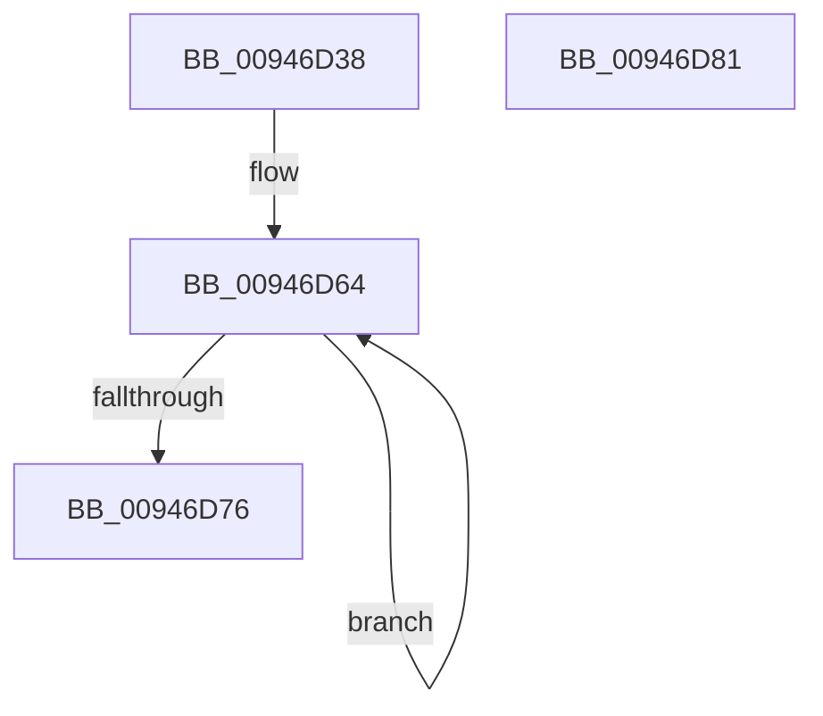

# CmpKeyEnumStackInitialize

- RVA: `0x00946D38`–`0x00946D82` (길이 `74` bytes)
- VA: `0x0000000140946D38`
- 실행 섹션: `PAGE`
- PDB 이름 있음: `예`; PDB Function 태그: `아니요`
- unwind 정보 RVA: `0x0005CAAC`
- 디코드: `21`개 명령, `74/74` bytes 표시
- 미해석 바이트: `0` (있으면 어셈블리에 `.byte`로 보존)

> 이 문서는 커널 이미지의 기계어와 PDB 기호를 분석해 생성했습니다. 4번과 5번은 함수 원형과 자료형을 바이너리 사용 방식에서 추정한 C 해석이며 원본 소스 복구 결과는 아닙니다.

## 1. Dependencies

- 직접 호출 지점: **3**; 고유 호출 대상: **3**
- 직접 호출자로 확인된 함수: **4**
- RIP 상대 이미지 참조: **0**

### Outgoing calls
- `0x00946D4D` → [memset](../../text/6C/memset_function_006C6C40.md) (function, `0x006C6C40`)
- `0x00946D56` → [CmpInitializeKeyNodeStack](CmpInitializeKeyNodeStack_function_00946804.md) (function, `0x00946804`)
- `0x00946D67` → [CmpKeyEnumStackEntryInitialize](CmpKeyEnumStackEntryInitialize_function_00946D88.md) (function, `0x00946D88`)

### Direct callers
- [CmpPartialPromoteSubkeys](../7F/CmpPartialPromoteSubkeys_function_007F4070.md) at `0x007F40C4`
- [CmpSubtreeEnumeratorStart](CmpSubtreeEnumeratorStart_function_009450E0.md) at `0x00945159`
- [CmpGetSubKeyCountForKeyNodeStack](CmpGetSubKeyCountForKeyNodeStack_function_00945624.md) at `0x00945671`
- [CmpEnumerateLayeredKey](CmpEnumerateLayeredKey_function_00945E58.md) at `0x00945EF6`

### Static image references
- 디코드된 RIP-relative 메모리 참조가 없습니다.

## 2. Other-region calls and transfers

- 다른 실행 섹션으로 향하는 call: **1**
  - `0x00946D4D` → [memset](../../text/6C/memset_function_006C6C40.md) (`PAGE` → `.text`)
- 별도 외부 분기/꼬리 이동을 확인하지 못했습니다.

## 3. Assembly (complete function range)

```asm
00946D38  48 89 5C 24 08                  mov qword ptr [rsp + 8], rbx
00946D3D  57                              push rdi
00946D3E  48 83 EC 20                     sub rsp, 0x20
00946D42  33 D2                           xor edx, edx
00946D44  41 B8 60 01 00 00               mov r8d, 0x160
00946D4A  48 8B D9                        mov rbx, rcx
00946D4D  E8 EE FE D7 FF                  call 0x1406c6c40
00946D52  48 8D 4B 08                     lea rcx, [rbx + 8]
00946D56  E8 A9 FA FF FF                  call 0x140946804
00946D5B  48 83 C3 58                     add rbx, 0x58
00946D5F  BF 02 00 00 00                  mov edi, 2
00946D64  48 8B CB                        mov rcx, rbx
00946D67  E8 1C 00 00 00                  call 0x140946d88
00946D6C  48 83 EB 80                     sub rbx, -0x80
00946D70  48 83 EF 01                     sub rdi, 1
00946D74  75 EE                           jne 0x140946d64
00946D76  48 8B 5C 24 30                  mov rbx, qword ptr [rsp + 0x30]
00946D7B  48 83 C4 20                     add rsp, 0x20
00946D7F  5F                              pop rdi
00946D80  C3                              ret
00946D81  CC                              int3
```

## 4. C-style interpretation (structured pseudocode)

```c
__int64 __fastcall CmpKeyEnumStackInitialize(__int64 a1, int a2)
{
    __int64 result;
    __int64 v_rbx;
    __int64 v_rdi;
    __int64 v_rsp;
    unsigned __int64 v_stack_p8;

    v_stack_p8 = v_rbx;
    v_rsp = (v_rsp) - (32);
    a2 = 0;
    result = memset(a1, a2, 352, a4);
    result = CmpInitializeKeyNodeStack(a1 + 8, a2, 352, a4);
    v_rbx = (a1) + (88);
loc_00946D64:
    result = CmpKeyEnumStackEntryInitialize(v_rbx, a2, 352, a4);
    v_rbx = (v_rbx) - (-128);
    v_rdi = (2) - (1);
    if (condition_is_not_equal) goto loc_00946D64;
    v_rsp = (v_rsp) + (32);
    return result;
}
```

## 5. (Beta) C Style

```c
int64_t CmpKeyEnumStackInitialize(void *Arg1, int32_t Arg2)
{
    uint8_t *arg1 = (uint8_t *)Arg1;

    int64_t result;
    int64_t local_rbx;
    int64_t local_rdi;
    int64_t local_rsp;
    uint64_t v_stack_p8;

    v_stack_p8 = local_rbx;
    local_rsp = (local_rsp) - (32);
    Arg2 = 0;
    result = memset(Arg1, Arg2, 352, a4);
    result = CmpInitializeKeyNodeStack(Arg1 + 8, Arg2, 352, a4);
    local_rbx = (Arg1) + (88);
loc_00946D64:
    result = CmpKeyEnumStackEntryInitialize(local_rbx, Arg2, 352, a4);
    local_rbx = (local_rbx) - (-128);
    local_rdi = (2) - (1);
    if (condition_is_not_equal) goto loc_00946D64;
    local_rsp = (local_rsp) + (32);
    return result;
}
```

### 관측된 메모리 오프셋

구조체 형식이 확인되지 않은 접근은 인자 기준의 오프셋으로만 기록했습니다.

| 기준 인자 | 오프셋 표현 | 폭 (bit) | 접근 |
|---|---:|---:|---|
| `Arg1` | `+ 0x8` | `64` | `R` |

## 6. Execution-region graph

[열기: 2D/3D 그래프와 함수 탐색 컨트롤 패널](../../../control-panel.html?section=page&rva=0x00946D38&view=graph)

- 2D 그래프는 위에서 아래로 흐르고, 3D 그래프는 빈 공간을 드래그해 회전합니다. Shift+드래그는 이동, 휠은 확대·축소, 함수 노드 선택은 대상 보고서 이동입니다.

### Static fallback


