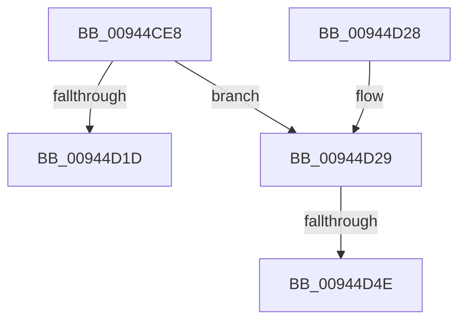

# CmpKeyEnumStackNotifyPromotion

- RVA: `0x00944CE8`–`0x00944D59` (길이 `113` bytes)
- VA: `0x0000000140944CE8`
- 실행 섹션: `PAGE`
- PDB 이름 있음: `예`; PDB Function 태그: `예`
- unwind 정보 RVA: `0x00062F94`
- 디코드: `32`개 명령, `113/113` bytes 표시
- 미해석 바이트: `0` (있으면 어셈블리에 `.byte`로 보존)

> 이 문서는 커널 이미지의 기계어와 PDB 기호를 분석해 생성했습니다. 4번과 5번은 함수 원형과 자료형을 바이너리 사용 방식에서 추정한 C 해석이며 원본 소스 복구 결과는 아닙니다.

## 1. Dependencies

- 직접 호출 지점: **5**; 고유 호출 대상: **5**
- 직접 호출자로 확인된 함수: **2**
- RIP 상대 이미지 참조: **0**

### Outgoing calls
- `0x00944CF8` → [CmpKeyEnumStackGetEntryAtLayerHeight](CmpKeyEnumStackGetEntryAtLayerHeight_function_00946A30.md) (function, `0x00946A30`)
- `0x00944D03` → [CmpKeyEnumStackEntryNotifyPromotion](CmpKeyEnumStackEntryNotifyPromotion_function_00944B74.md) (function, `0x00944B74`)
- `0x00944D0F` → [CmpKeyNodeStackGetEntryAtLayerHeight](CmpKeyNodeStackGetEntryAtLayerHeight_function_00946ABC.md) (function, `0x00946ABC`)
- `0x00944D2C` → [CmpKeyNodeStackEntryReset](CmpKeyNodeStackEntryReset_function_009467E0.md) (function, `0x009467E0`)
- `0x00944D4E` → [HvpGetCellFlat](../85/HvpGetCellFlat_function_00854C60.md) (function, `0x00854C60`)

### Direct callers
- [CmpPartialPromoteSubkeys](../7F/CmpPartialPromoteSubkeys_function_007F4070.md) at `0x007F420E`
- [CmpPromoteSubtree](CmpPromoteSubtree_function_00944D60.md) at `0x00944ED1`

### Static image references
- 디코드된 RIP-relative 메모리 참조가 없습니다.

## 2. Other-region calls and transfers

- 다른 실행 섹션으로 향하는 call: **0**
- call이 아닌 외부 분기/꼬리 이동: **2**
  - `0x00944D48` → [sub_00B25578](../B2/Unknown_function_00B25578.md) (`tail-transfer`)
  - `0x00944D54` → [sub_00B25578 + 0x5](../B2/Unknown_function_00B25578.md) (`tail-transfer`)

## 3. Assembly (complete function range)

```asm
00944CE8  48 89 5C 24 08                  mov qword ptr [rsp + 8], rbx
00944CED  57                              push rdi
00944CEE  48 83 EC 20                     sub rsp, 0x20
00944CF2  0F B7 11                        movzx edx, word ptr [rcx]
00944CF5  48 8B D9                        mov rbx, rcx
00944CF8  E8 33 1D 00 00                  call 0x140946a30
00944CFD  48 8B C8                        mov rcx, rax
00944D00  48 8B F8                        mov rdi, rax
00944D03  E8 6C FE FF FF                  call 0x140944b74
00944D08  0F B7 13                        movzx edx, word ptr [rbx]
00944D0B  48 8D 4B 08                     lea rcx, [rbx + 8]
00944D0F  E8 A8 1D 00 00                  call 0x140946abc
00944D14  48 8B D8                        mov rbx, rax
00944D17  83 78 08 FF                     cmp dword ptr [rax + 8], -1
00944D1B  74 0C                           je 0x140944d29
00944D1D  48 8B 5C 24 30                  mov rbx, qword ptr [rsp + 0x30]
00944D22  48 83 C4 20                     add rsp, 0x20
00944D26  5F                              pop rdi
00944D27  C3                              ret
00944D28  CC                              int3
00944D29  48 8B CB                        mov rcx, rbx
00944D2C  E8 AF 1A 00 00                  call 0x1409467e0
00944D31  48 8B 0F                        mov rcx, qword ptr [rdi]
00944D34  4C 8D 43 18                     lea r8, [rbx + 0x18]
00944D38  8B 57 70                        mov edx, dword ptr [rdi + 0x70]
00944D3B  48 89 0B                        mov qword ptr [rbx], rcx
00944D3E  89 53 08                        mov dword ptr [rbx + 8], edx
00944D41  F6 81 8C 00 00 00 01            test byte ptr [rcx + 0x8c], 1
00944D48  0F 84 2A 08 1E 00               je 0x140b25578
00944D4E  E8 0D FF F0 FF                  call 0x140854c60
00944D53  90                              nop
00944D54  E9 24 08 1E 00                  jmp 0x140b2557d
```

## 4. C-style interpretation (structured pseudocode)

```c
__int64 __fastcall CmpKeyEnumStackNotifyPromotion(__int64 a1)
{
    __int64 result;
    __int64 v_rsp;
    unsigned __int64 v_stack_p8;

    v_stack_p8 = v_rbx;
    v_rsp = (v_rsp) - (32);
    result = CmpKeyEnumStackGetEntryAtLayerHeight(a1, *(unsigned __int16 *)(a1), a3, a4);
    result = CmpKeyEnumStackEntryNotifyPromotion(result, *(unsigned __int16 *)(a1), a3, a4);
    result = CmpKeyNodeStackGetEntryAtLayerHeight(a1 + 8, *(unsigned __int16 *)(a1), a3, a4);
    if ((*(unsigned int *)(result + 8)) == -1) goto loc_00944D29;
    v_rsp = (v_rsp) + (32);
    return result;
loc_00944D29:
    result = CmpKeyNodeStackEntryReset(v_stack_p8, *(unsigned __int16 *)(a1), a3, a4);
    *(unsigned __int64 *)(v_stack_p8) = *(unsigned __int64 *)(result);
    *(unsigned int *)(v_stack_p8 + 8) = (unsigned int)((unsigned int)(*(unsigned int *)(result + 112)));
    result = HvpGetCellFlat(*(unsigned __int64 *)(result), (unsigned int)(*(unsigned int *)(result + 112)), v_stack_p8 + 24, a4);
}
```

## 5. (Beta) C Style

```c
int64_t CmpKeyEnumStackNotifyPromotion(void *Arg1)
{
    uint8_t *arg1 = (uint8_t *)Arg1;

    int64_t result;
    int64_t local_rsp;
    uint64_t v_stack_p8;

    v_stack_p8 = local_rbx;
    local_rsp = (local_rsp) - (32);
    result = CmpKeyEnumStackGetEntryAtLayerHeight(Arg1, *(uint16_t *)(arg1), a3, a4);
    result = CmpKeyEnumStackEntryNotifyPromotion(result, *(uint16_t *)(arg1), a3, a4);
    result = CmpKeyNodeStackGetEntryAtLayerHeight(Arg1 + 8, *(uint16_t *)(arg1), a3, a4);
    if ((*(uint32_t *)(result + 0x8)) == -1) goto loc_00944D29;
    local_rsp = (local_rsp) + (32);
    return result;
loc_00944D29:
    result = CmpKeyNodeStackEntryReset(v_stack_p8, *(uint16_t *)(arg1), a3, a4);
    *(uint64_t *)(v_stack_p8) = *(uint64_t *)(result);
    *(uint32_t *)(v_stack_p8 + 0x8) = (uint32_t)((uint32_t)(*(uint32_t *)(result + 0x70)));
    result = HvpGetCellFlat(*(uint64_t *)(result), (uint32_t)(*(uint32_t *)(result + 0x70)), v_stack_p8 + 24, a4);
}
```

### 관측된 메모리 오프셋

구조체 형식이 확인되지 않은 접근은 인자 기준의 오프셋으로만 기록했습니다.

| 기준 인자 | 오프셋 표현 | 폭 (bit) | 접근 |
|---|---:|---:|---|
| `Arg1` | `+ 0x0` | `16` | `R` |
| `Arg1` | `+ 0x8` | `64` | `R` |

## 6. Execution-region graph

[열기: 2D/3D 그래프와 함수 탐색 컨트롤 패널](../../../control-panel.html?section=page&rva=0x00944CE8&view=graph)

- 2D 그래프는 위에서 아래로 흐르고, 3D 그래프는 빈 공간을 드래그해 회전합니다. Shift+드래그는 이동, 휠은 확대·축소, 함수 노드 선택은 대상 보고서 이동입니다.

### Static fallback


