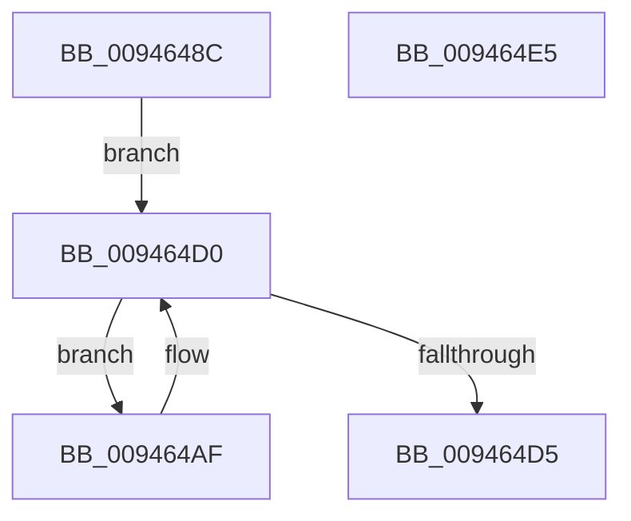

# CmpKeyEnumStackReset

- RVA: `0x0094648C`–`0x009464E6` (길이 `90` bytes)
- VA: `0x000000014094648C`
- 실행 섹션: `PAGE`
- PDB 이름 있음: `예`; PDB Function 태그: `아니요`
- unwind 정보 RVA: `0x00060BC4`
- 디코드: `27`개 명령, `90/90` bytes 표시
- 미해석 바이트: `0` (있으면 어셈블리에 `.byte`로 보존)

> 이 문서는 커널 이미지의 기계어와 PDB 기호를 분석해 생성했습니다. 4번과 5번은 함수 원형과 자료형을 바이너리 사용 방식에서 추정한 C 해석이며 원본 소스 복구 결과는 아닙니다.

## 1. Dependencies

- 직접 호출 지점: **4**; 고유 호출 대상: **4**
- 직접 호출자로 확인된 함수: **2**
- RIP 상대 이미지 참조: **0**

### Outgoing calls
- `0x009464A8` → [CmpResetKeyNodeStack](CmpResetKeyNodeStack_function_00945E14.md) (function, `0x00945E14`)
- `0x009464B5` → [CmpKeyEnumStackGetEntryAtLayerHeight](CmpKeyEnumStackGetEntryAtLayerHeight_function_00946A30.md) (function, `0x00946A30`)
- `0x009464C0` → [CmpKeyEnumStackEntryCleanup](CmpKeyEnumStackEntryCleanup_function_00946B20.md) (function, `0x00946B20`)
- `0x009464C8` → [CmpKeyEnumStackEntryInitialize](CmpKeyEnumStackEntryInitialize_function_00946D88.md) (function, `0x00946D88`)

### Direct callers
- [CmRenameKey](../7E/CmRenameKey_function_007E8F48.md) at `0x007E9F16`
- [CmpSubtreeEnumeratorAdvance](CmpSubtreeEnumeratorAdvance_function_00946590.md) at `0x00946601`

### Static image references
- 디코드된 RIP-relative 메모리 참조가 없습니다.

## 2. Other-region calls and transfers

- 다른 실행 섹션으로 향하는 call: **0**
- 별도 외부 분기/꼬리 이동을 확인하지 못했습니다.

## 3. Assembly (complete function range)

```asm
0094648C  48 89 5C 24 08                  mov qword ptr [rsp + 8], rbx
00946491  48 89 74 24 10                  mov qword ptr [rsp + 0x10], rsi
00946496  57                              push rdi
00946497  48 83 EC 20                     sub rsp, 0x20
0094649B  33 FF                           xor edi, edi
0094649D  48 8B F1                        mov rsi, rcx
009464A0  40 88 79 04                     mov byte ptr [rcx + 4], dil
009464A4  48 83 C1 08                     add rcx, 8
009464A8  E8 67 F9 FF FF                  call 0x140945e14
009464AD  EB 21                           jmp 0x1409464d0
009464AF  0F B7 D7                        movzx edx, di
009464B2  48 8B CE                        mov rcx, rsi
009464B5  E8 76 05 00 00                  call 0x140946a30
009464BA  48 8B C8                        mov rcx, rax
009464BD  48 8B D8                        mov rbx, rax
009464C0  E8 5B 06 00 00                  call 0x140946b20
009464C5  48 8B CB                        mov rcx, rbx
009464C8  E8 BB 08 00 00                  call 0x140946d88
009464CD  66 FF C7                        inc di
009464D0  66 3B 3E                        cmp di, word ptr [rsi]
009464D3  7E DA                           jle 0x1409464af
009464D5  48 8B 5C 24 30                  mov rbx, qword ptr [rsp + 0x30]
009464DA  48 8B 74 24 38                  mov rsi, qword ptr [rsp + 0x38]
009464DF  48 83 C4 20                     add rsp, 0x20
009464E3  5F                              pop rdi
009464E4  C3                              ret
009464E5  CC                              int3
```

## 4. C-style interpretation (structured pseudocode)

```c
__int64 __fastcall CmpKeyEnumStackReset(__int64 a1)
{
    __int64 result;
    __int64 v_rdi;
    __int64 v_rsp;
    unsigned __int64 v_stack_p10;
    unsigned __int64 v_stack_p8;

    v_stack_p8 = v_rbx;
    v_stack_p10 = v_rsi;
    v_rsp = (v_rsp) - (32);
    v_rdi = 0;
    *(unsigned __int8 *)(a1 + 4) = 0;
    a1 = (a1) + (8);
    result = CmpResetKeyNodeStack(a1, a2, a3, a4);
    goto loc_009464D0;
loc_009464AF:
    result = CmpKeyEnumStackGetEntryAtLayerHeight(a1, 0, a3, a4);
    result = CmpKeyEnumStackEntryCleanup(result, 0, a3, a4);
    result = CmpKeyEnumStackEntryInitialize(result, 0, a3, a4);
    v_rdi = (unsigned __int16)((v_rdi) + 1);
loc_009464D0:
    if (((unsigned __int16)(v_rdi)) <= (*(unsigned __int16 *)(a1))) goto loc_009464AF;
    v_rsp = (v_rsp) + (32);
    return result;
}
```

## 5. (Beta) C Style

```c
int64_t CmpKeyEnumStackReset(void *Arg1)
{
    uint8_t *arg1 = (uint8_t *)Arg1;

    int64_t result;
    int64_t local_rdi;
    int64_t local_rsp;
    uint64_t v_stack_p10;
    uint64_t v_stack_p8;

    v_stack_p8 = local_rbx;
    v_stack_p10 = local_rsi;
    local_rsp = (local_rsp) - (32);
    local_rdi = 0;
    *(uint8_t *)(arg1 + 0x4) = 0;
    Arg1 = (Arg1) + (8);
    result = CmpResetKeyNodeStack(Arg1, a2, a3, a4);
    goto loc_009464D0;
loc_009464AF:
    result = CmpKeyEnumStackGetEntryAtLayerHeight(Arg1, 0, a3, a4);
    result = CmpKeyEnumStackEntryCleanup(result, 0, a3, a4);
    result = CmpKeyEnumStackEntryInitialize(result, 0, a3, a4);
    local_rdi = (uint16_t)((local_rdi) + 1);
loc_009464D0:
    if (((uint16_t)(local_rdi)) <= (*(uint16_t *)(arg1))) goto loc_009464AF;
    local_rsp = (local_rsp) + (32);
    return result;
}
```

### 관측된 메모리 오프셋

구조체 형식이 확인되지 않은 접근은 인자 기준의 오프셋으로만 기록했습니다.

| 기준 인자 | 오프셋 표현 | 폭 (bit) | 접근 |
|---|---:|---:|---|
| `Arg1` | `+ 0x0` | `16` | `R` |
| `Arg1` | `+ 0x4` | `8` | `W` |

## 6. Execution-region graph

[열기: 2D/3D 그래프와 함수 탐색 컨트롤 패널](../../../control-panel.html?section=page&rva=0x0094648C&view=graph)

- 2D 그래프는 위에서 아래로 흐르고, 3D 그래프는 빈 공간을 드래그해 회전합니다. Shift+드래그는 이동, 휠은 확대·축소, 함수 노드 선택은 대상 보고서 이동입니다.

### Static fallback


