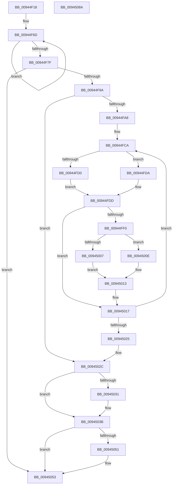

# CmpKeyEnumStackStartFromKcbStack

- RVA: `0x00944F18`–`0x0094508B` (길이 `371` bytes)
- VA: `0x0000000140944F18`
- 실행 섹션: `PAGE`
- PDB 이름 있음: `예`; PDB Function 태그: `아니요`
- unwind 정보 RVA: `0x000907E4`
- 디코드: `104`개 명령, `371/371` bytes 표시
- 미해석 바이트: `0` (있으면 어셈블리에 `.byte`로 보존)

> 이 문서는 커널 이미지의 기계어와 PDB 기호를 분석해 생성했습니다. 4번과 5번은 함수 원형과 자료형을 바이너리 사용 방식에서 추정한 C 해석이며 원본 소스 복구 결과는 아닙니다.

## 1. Dependencies

- 직접 호출 지점: **9**; 고유 호출 대상: **9**
- 직접 호출자로 확인된 함수: **2**
- RIP 상대 이미지 참조: **1**

### Outgoing calls
- `0x00944F5D` → [memset](../../text/6C/memset_function_006C6C40.md) (function, `0x006C6C40`)
- `0x00944F70` → [CmpKeyNodeStackEntryInitialize](CmpKeyNodeStackEntryInitialize_function_00946840.md) (function, `0x00946840`)
- `0x00944F89` → [CmpStartKeyNodeStack](CmpStartKeyNodeStack_function_00945338.md) (function, `0x00945338`)
- `0x00944FE3` → [CmpGetKcbAtLayerHeight](CmpGetKcbAtLayerHeight_function_00949210.md) (function, `0x00949210`)
- `0x00945007` → [HvpGetCellFlat](../85/HvpGetCellFlat_function_00854C60.md) (function, `0x00854C60`)
- `0x0094500E` → [HvpGetCellPaged](../85/HvpGetCellPaged_function_00854CB0.md) (function, `0x00854CB0`)
- `0x00945046` → [CmpKeyEnumStackStartFromKeyNodeStack](CmpKeyEnumStackStartFromKeyNodeStack_function_00945094.md) (function, `0x00945094`)
- `0x00945058` → [CmpCleanupKeyNodeStack](CmpCleanupKeyNodeStack_function_00946A5C.md) (function, `0x00946A5C`)
- `0x0094506A` → [_security_check_cookie](../../text/6A/_security_check_cookie_function_006AC640.md) (function, `0x006AC640`)

### Direct callers
- [CmpPartialPromoteSubkeys](../7F/CmpPartialPromoteSubkeys_function_007F4070.md) at `0x007F4114`
- [CmpEnumerateLayeredKey](CmpEnumerateLayeredKey_function_00945E58.md) at `0x00946019`

### Static image references
- `0x00944F2F` → RVA `0x00E0A740` (`.data`; read)

## 2. Other-region calls and transfers

- 다른 실행 섹션으로 향하는 call: **2**
  - `0x00944F5D` → [memset](../../text/6C/memset_function_006C6C40.md) (`PAGE` → `.text`)
  - `0x0094506A` → [_security_check_cookie](../../text/6A/_security_check_cookie_function_006AC640.md) (`PAGE` → `.text`)
- 별도 외부 분기/꼬리 이동을 확인하지 못했습니다.

## 3. Assembly (complete function range)

```asm
00944F18  48 89 5C 24 18                  mov qword ptr [rsp + 0x18], rbx
00944F1D  55                              push rbp
00944F1E  56                              push rsi
00944F1F  57                              push rdi
00944F20  41 54                           push r12
00944F22  41 55                           push r13
00944F24  41 56                           push r14
00944F26  41 57                           push r15
00944F28  48 81 EC 90 00 00 00            sub rsp, 0x90
00944F2F  48 8B 05 0A 58 4C 00            mov rax, qword ptr [rip + 0x4c580a]
00944F36  48 33 C4                        xor rax, rsp
00944F39  48 89 84 24 80 00 00 00         mov qword ptr [rsp + 0x80], rax
00944F41  4C 8B FA                        mov r15, rdx
00944F44  4C 89 4C 24 20                  mov qword ptr [rsp + 0x20], r9
00944F49  33 D2                           xor edx, edx
00944F4B  4D 8B F0                        mov r14, r8
00944F4E  4C 8B E9                        mov r13, rcx
00944F51  4D 8B E1                        mov r12, r9
00944F54  48 8D 4C 24 30                  lea rcx, [rsp + 0x30]
00944F59  44 8D 42 50                     lea r8d, [rdx + 0x50]
00944F5D  E8 DE 1C D8 FF                  call 0x1406c6c40
00944F62  4C 8D 4C 24 38                  lea r9, [rsp + 0x38]
00944F67  41 B8 02 00 00 00               mov r8d, 2
00944F6D  49 8B C9                        mov rcx, r9
00944F70  E8 CB 18 00 00                  call 0x140946840
00944F75  49 83 C1 20                     add r9, 0x20
00944F79  49 83 E8 01                     sub r8, 1
00944F7D  75 EE                           jne 0x140944f6d
00944F7F  41 0F B7 57 02                  movzx edx, word ptr [r15 + 2]
00944F84  48 8D 4C 24 30                  lea rcx, [rsp + 0x30]
00944F89  E8 AA 03 00 00                  call 0x140945338
00944F8E  33 FF                           xor edi, edi
00944F90  8B D8                           mov ebx, eax
00944F92  85 C0                           test eax, eax
00944F94  0F 88 B9 00 00 00               js 0x140945053
00944F9A  49 0F BF 5F 02                  movsx rbx, word ptr [r15 + 2]
00944F9F  66 85 DB                        test bx, bx
00944FA2  0F 88 84 00 00 00               js 0x14094502c
00944FA8  44 8D 67 02                     lea r12d, [rdi + 2]
00944FAC  48 8B C3                        mov rax, rbx
00944FAF  48 C1 E0 05                     shl rax, 5
00944FB3  48 8D 6C 24 38                  lea rbp, [rsp + 0x38]
00944FB8  48 03 E8                        add rbp, rax
00944FBB  0F B7 C3                        movzx eax, bx
00944FBE  66 41 2B C4                     sub ax, r12w
00944FC2  48 0F BF F8                     movsx rdi, ax
00944FC6  48 C1 E7 05                     shl rdi, 5
00944FCA  66 41 3B DC                     cmp bx, r12w
00944FCE  72 0A                           jb 0x140944fda
00944FD0  48 8B 74 24 78                  mov rsi, qword ptr [rsp + 0x78]
00944FD5  48 03 F7                        add rsi, rdi
00944FD8  EB 03                           jmp 0x140944fdd
00944FDA  48 8B F5                        mov rsi, rbp
00944FDD  0F B7 D3                        movzx edx, bx
00944FE0  49 8B CF                        mov rcx, r15
00944FE3  E8 28 42 00 00                  call 0x140949210
00944FE8  8B 50 28                        mov edx, dword ptr [rax + 0x28]
00944FEB  83 FA FF                        cmp edx, -1
00944FEE  74 27                           je 0x140945017
00944FF0  48 8B 48 20                     mov rcx, qword ptr [rax + 0x20]
00944FF4  4C 8D 46 18                     lea r8, [rsi + 0x18]
00944FF8  48 89 0E                        mov qword ptr [rsi], rcx
00944FFB  89 56 08                        mov dword ptr [rsi + 8], edx
00944FFE  F6 81 8C 00 00 00 01            test byte ptr [rcx + 0x8c], 1
00945005  74 07                           je 0x14094500e
00945007  E8 54 FC F0 FF                  call 0x140854c60
0094500C  EB 05                           jmp 0x140945013
0094500E  E8 9D FC F0 FF                  call 0x140854cb0
00945013  48 89 46 10                     mov qword ptr [rsi + 0x10], rax
00945017  48 83 EF 20                     sub rdi, 0x20
0094501B  48 83 ED 20                     sub rbp, 0x20
0094501F  66 83 EB 01                     sub bx, 1
00945023  79 A5                           jns 0x140944fca
00945025  4C 8B 64 24 20                  mov r12, qword ptr [rsp + 0x20]
0094502A  33 FF                           xor edi, edi
0094502C  4D 85 F6                        test r14, r14
0094502F  74 0A                           je 0x14094503b
00945031  41 0F B7 46 04                  movzx eax, word ptr [r14 + 4]
00945036  66 41 89 45 02                  mov word ptr [r13 + 2], ax
0094503B  4D 8B C4                        mov r8, r12
0094503E  48 8D 54 24 30                  lea rdx, [rsp + 0x30]
00945043  49 8B CD                        mov rcx, r13
00945046  E8 49 00 00 00                  call 0x140945094
0094504B  8B D8                           mov ebx, eax
0094504D  85 C0                           test eax, eax
0094504F  78 02                           js 0x140945053
00945051  8B DF                           mov ebx, edi
00945053  48 8D 4C 24 30                  lea rcx, [rsp + 0x30]
00945058  E8 FF 19 00 00                  call 0x140946a5c
0094505D  8B C3                           mov eax, ebx
0094505F  48 8B 8C 24 80 00 00 00         mov rcx, qword ptr [rsp + 0x80]
00945067  48 33 CC                        xor rcx, rsp
0094506A  E8 D1 75 D6 FF                  call 0x1406ac640
0094506F  48 8B 9C 24 E0 00 00 00         mov rbx, qword ptr [rsp + 0xe0]
00945077  48 81 C4 90 00 00 00            add rsp, 0x90
0094507E  41 5F                           pop r15
00945080  41 5E                           pop r14
00945082  41 5D                           pop r13
00945084  41 5C                           pop r12
00945086  5F                              pop rdi
00945087  5E                              pop rsi
00945088  5D                              pop rbp
00945089  C3                              ret
0094508A  CC                              int3
```

## 4. C-style interpretation (structured pseudocode)

```c
__int64 __fastcall CmpKeyEnumStackStartFromKcbStack(__int64 a1, __int64 a2, __int64 a3, __int64 a4)
{
    __int64 result;
    __int64 v_rbp;
    __int64 v_rbx;
    __int64 v_rdi;
    __int64 v_rsi;
    __int64 v_rsp;
    unsigned __int64 v_stack_m48;
    unsigned __int64 v_stack_m50;
    unsigned __int64 v_stack_m90;
    unsigned __int64 v_stack_m98;
    unsigned __int64 v_stack_mA8;
    unsigned __int64 v_stack_p18;

    v_stack_p18 = v_rbx;
    v_rsp = (v_rsp) - (144);
    result = (*(unsigned __int64 *)(v_rip + 5003274)) ^ (v_rsp);
    v_stack_m48 = result;
    v_stack_mA8 = a4;
    a2 = 0;
    result = memset(v_stack_m98, a2, a2 + 80, a4);
loc_00944F6D:
    result = CmpKeyNodeStackEntryInitialize(v_stack_m90, a2, 2, v_stack_m90);
    a4 = (v_stack_m90) + (32);
    a3 = (2) - (1);
    if (condition_is_not_equal) goto loc_00944F6D;
    result = CmpStartKeyNodeStack(v_stack_m98, *(unsigned __int16 *)(a2 + 2), a3, a4);
    v_rdi = 0;
    if (sign_flag) goto loc_00945053;
    if (sign_flag) goto loc_0094502C;
    result = ((__int16)(*(unsigned __int16 *)(a2 + 2))) << (5);
    v_rbp = (v_stack_m90) + (result);
    result = (unsigned __int16)(((unsigned __int16)((__int16)(*(unsigned __int16 *)(a2 + 2)))) - ((unsigned __int16)(v_rdi + 2)));
    v_rdi = ((__int16)((unsigned __int16)(result))) << (5);
loc_00944FCA:
    if (((unsigned __int16)((__int16)(*(unsigned __int16 *)(a2 + 2)))) < ((unsigned __int16)(v_rdi + 2))) goto loc_00944FDA;
    v_rsi = (v_stack_m50) + (v_rdi);
    goto loc_00944FDD;
loc_00944FDA:
loc_00944FDD:
    result = CmpGetKcbAtLayerHeight(0, (unsigned __int16)((__int16)(*(unsigned __int16 *)(a2 + 2))), a3, a4);
    if (((unsigned int)((unsigned int)(*(unsigned int *)(result + 40)))) == -1) goto loc_00945017;
    *(unsigned __int64 *)(v_rbp) = *(unsigned __int64 *)(result + 32);
    *(unsigned int *)(v_rbp + 8) = (unsigned int)((unsigned int)(*(unsigned int *)(result + 40)));
    if (((*(unsigned __int8 *)(*(unsigned __int64 *)(result + 32) + 140)) & (1)) == 0) goto loc_0094500E;
    result = HvpGetCellFlat(*(unsigned __int64 *)(result + 32), (unsigned int)(*(unsigned int *)(result + 40)), v_rbp + 24, a4);
    goto loc_00945013;
loc_0094500E:
    result = HvpGetCellPaged(*(unsigned __int64 *)(result + 32), (unsigned int)(*(unsigned int *)(result + 40)), v_rbp + 24, a4);
loc_00945013:
    *(unsigned __int64 *)(v_rbp + 16) = result;
loc_00945017:
    v_rdi = (v_rdi) - (32);
    v_rbp = (v_rbp) - (32);
    v_rbx = (unsigned __int16)(((__int16)(*(unsigned __int16 *)(a2 + 2))) - (1));
    if (!sign_flag) goto loc_00944FCA;
    v_rdi = 0;
loc_0094502C:
    if (a3 != 0) {
        result = *(unsigned __int16 *)(a3 + 4);
        *(unsigned __int16 *)(a1 + 2) = (unsigned __int16)(result);
    }
    result = CmpKeyEnumStackStartFromKeyNodeStack(a1, v_stack_m98, v_stack_mA8, a4);
    v_rbx = (unsigned int)((unsigned int)(result));
    if (!(sign_flag)) {
        v_rbx = 0;
    }
    result = CmpCleanupKeyNodeStack(v_stack_m98, v_stack_m98, v_stack_mA8, a4);
    a1 = (v_stack_m48) ^ (v_rsp);
    result = _security_check_cookie(a1, v_stack_m98, v_stack_mA8, a4);
    v_rsp = (v_rsp) + (144);
    return result;
}
```

## 5. (Beta) C Style

```c
int64_t CmpKeyEnumStackStartFromKcbStack(void *Arg1, void *Arg2, int64_t Arg3, int64_t Arg4)
{
    uint8_t *arg1 = (uint8_t *)Arg1;
    uint8_t *arg2 = (uint8_t *)Arg2;

    int64_t result;
    int64_t local_rbp;
    int64_t local_rbx;
    int64_t local_rdi;
    int64_t local_rsi;
    int64_t local_rsp;
    uint64_t v_stack_m48;
    uint64_t v_stack_m50;
    uint64_t v_stack_m90;
    uint64_t v_stack_m98;
    uint64_t v_stack_mA8;
    uint64_t v_stack_p18;

    v_stack_p18 = local_rbx;
    local_rsp = (local_rsp) - (144);
    result = (*(uint64_t *)(v_rip + 0x4C580A)) ^ (local_rsp);
    v_stack_m48 = result;
    v_stack_mA8 = Arg4;
    Arg2 = 0;
    result = memset(v_stack_m98, Arg2, Arg2 + 80, Arg4);
loc_00944F6D:
    result = CmpKeyNodeStackEntryInitialize(v_stack_m90, Arg2, 2, v_stack_m90);
    Arg4 = (v_stack_m90) + (32);
    Arg3 = (2) - (1);
    if (condition_is_not_equal) goto loc_00944F6D;
    result = CmpStartKeyNodeStack(v_stack_m98, *(uint16_t *)(arg2 + 0x2), Arg3, Arg4);
    local_rdi = 0;
    if (sign_flag) goto loc_00945053;
    if (sign_flag) goto loc_0094502C;
    result = ((int16_t)(*(uint16_t *)(arg2 + 0x2))) << (5);
    local_rbp = (v_stack_m90) + (result);
    result = (uint16_t)(((uint16_t)((int16_t)(*(uint16_t *)(arg2 + 0x2)))) - ((uint16_t)(local_rdi + 2)));
    local_rdi = ((int16_t)((uint16_t)(result))) << (5);
loc_00944FCA:
    if (((uint16_t)((int16_t)(*(uint16_t *)(arg2 + 0x2)))) < ((uint16_t)(local_rdi + 2))) goto loc_00944FDA;
    local_rsi = (v_stack_m50) + (local_rdi);
    goto loc_00944FDD;
loc_00944FDA:
loc_00944FDD:
    result = CmpGetKcbAtLayerHeight(0, (uint16_t)((int16_t)(*(uint16_t *)(arg2 + 0x2))), Arg3, Arg4);
    if (((uint32_t)((uint32_t)(*(uint32_t *)(result + 0x28)))) == -1) goto loc_00945017;
    *(uint64_t *)(local_rbp) = *(uint64_t *)(result + 0x20);
    *(uint32_t *)(local_rbp + 0x8) = (uint32_t)((uint32_t)(*(uint32_t *)(result + 0x28)));
    if (((*(uint8_t *)(*(uint64_t *)(result + 0x20) + 0x8C)) & (1)) == 0) goto loc_0094500E;
    result = HvpGetCellFlat(*(uint64_t *)(result + 0x20), (uint32_t)(*(uint32_t *)(result + 0x28)), local_rbp + 24, Arg4);
    goto loc_00945013;
loc_0094500E:
    result = HvpGetCellPaged(*(uint64_t *)(result + 0x20), (uint32_t)(*(uint32_t *)(result + 0x28)), local_rbp + 24, Arg4);
loc_00945013:
    *(uint64_t *)(local_rbp + 0x10) = result;
loc_00945017:
    local_rdi = (local_rdi) - (32);
    local_rbp = (local_rbp) - (32);
    local_rbx = (uint16_t)(((int16_t)(*(uint16_t *)(arg2 + 0x2))) - (1));
    if (!sign_flag) goto loc_00944FCA;
    local_rdi = 0;
loc_0094502C:
    if (Arg3 != 0) {
        result = *(uint16_t *)(Arg3 + 0x4);
        *(uint16_t *)(arg1 + 0x2) = (uint16_t)(result);
    }
    result = CmpKeyEnumStackStartFromKeyNodeStack(Arg1, v_stack_m98, v_stack_mA8, Arg4);
    local_rbx = (uint32_t)((uint32_t)(result));
    if (!(sign_flag)) {
        local_rbx = 0;
    }
    result = CmpCleanupKeyNodeStack(v_stack_m98, v_stack_m98, v_stack_mA8, Arg4);
    Arg1 = (v_stack_m48) ^ (local_rsp);
    result = _security_check_cookie(Arg1, v_stack_m98, v_stack_mA8, Arg4);
    local_rsp = (local_rsp) + (144);
    return result;
}
```

### 관측된 메모리 오프셋

구조체 형식이 확인되지 않은 접근은 인자 기준의 오프셋으로만 기록했습니다.

| 기준 인자 | 오프셋 표현 | 폭 (bit) | 접근 |
|---|---:|---:|---|
| `Arg1` | `+ 0x2` | `16` | `W` |
| `Arg2` | `+ 0x2` | `16` | `R` |

## 6. Execution-region graph

[열기: 2D/3D 그래프와 함수 탐색 컨트롤 패널](../../../control-panel.html?section=page&rva=0x00944F18&view=graph)

- 2D 그래프는 위에서 아래로 흐르고, 3D 그래프는 빈 공간을 드래그해 회전합니다. Shift+드래그는 이동, 휠은 확대·축소, 함수 노드 선택은 대상 보고서 이동입니다.

### Static fallback


