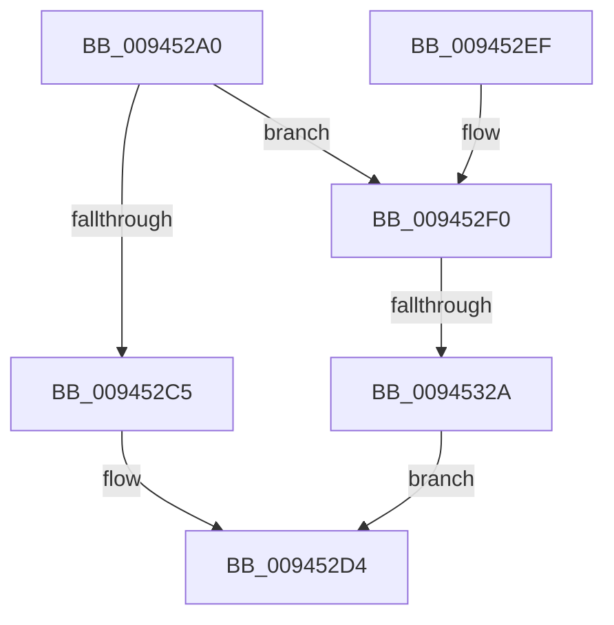

# CmpKeyEnumStackStart

- RVA: `0x009452A0`–`0x00945331` (길이 `145` bytes)
- VA: `0x00000001409452A0`
- 실행 섹션: `PAGE`
- PDB 이름 있음: `예`; PDB Function 태그: `예`
- unwind 정보 RVA: `0x0009083C`
- 디코드: `38`개 명령, `145/145` bytes 표시
- 미해석 바이트: `0` (있으면 어셈블리에 `.byte`로 보존)

> 이 문서는 커널 이미지의 기계어와 PDB 기호를 분석해 생성했습니다. 4번과 5번은 함수 원형과 자료형을 바이너리 사용 방식에서 추정한 C 해석이며 원본 소스 복구 결과는 아닙니다.

## 1. Dependencies

- 직접 호출 지점: **2**; 고유 호출 대상: **2**
- 직접 호출자로 확인된 함수: **3**
- RIP 상대 이미지 참조: **0**

### Outgoing calls
- `0x009452CF` → [CmpStartKeyNodeStack](CmpStartKeyNodeStack_function_00945338.md) (function, `0x00945338`)
- `0x00945313` → [CmpAllocatePool](../../text/3C/CmpAllocatePool_function_003CD504.md) (function, `0x003CD504`)

### Direct callers
- [CmpKeyEnumStackStartFromKeyNodeStack](CmpKeyEnumStackStartFromKeyNodeStack_function_00945094.md) at `0x009450AF`
- [CmpSubtreeEnumeratorStart](CmpSubtreeEnumeratorStart_function_009450E0.md) at `0x0094519C`
- [CmpGetSubKeyCountForKeyNodeStack](CmpGetSubKeyCountForKeyNodeStack_function_00945624.md) at `0x00945748`

### Static image references
- 디코드된 RIP-relative 메모리 참조가 없습니다.

## 2. Other-region calls and transfers

- 다른 실행 섹션으로 향하는 call: **1**
  - `0x00945313` → [CmpAllocatePool](../../text/3C/CmpAllocatePool_function_003CD504.md) (`PAGE` → `.text`)
- call이 아닌 외부 분기/꼬리 이동: **1**
  - `0x00945324` → [sub_00B25586](../B2/Unknown_function_00B25586.md) (`tail-transfer`)

## 3. Assembly (complete function range)

```asm
009452A0  48 8B C4                        mov rax, rsp
009452A3  48 89 58 08                     mov qword ptr [rax + 8], rbx
009452A7  48 89 68 10                     mov qword ptr [rax + 0x10], rbp
009452AB  48 89 70 18                     mov qword ptr [rax + 0x18], rsi
009452AF  48 89 78 20                     mov qword ptr [rax + 0x20], rdi
009452B3  41 56                           push r14
009452B5  48 83 EC 20                     sub rsp, 0x20
009452B9  48 0F BF DA                     movsx rbx, dx
009452BD  48 8B F9                        mov rdi, rcx
009452C0  83 FB 02                        cmp ebx, 2
009452C3  7D 2B                           jge 0x1409452f0
009452C5  48 8D 4F 08                     lea rcx, [rdi + 8]
009452C9  66 89 1F                        mov word ptr [rdi], bx
009452CC  0F B7 D3                        movzx edx, bx
009452CF  E8 64 00 00 00                  call 0x140945338
009452D4  48 8B 5C 24 30                  mov rbx, qword ptr [rsp + 0x30]
009452D9  48 8B 6C 24 38                  mov rbp, qword ptr [rsp + 0x38]
009452DE  48 8B 74 24 40                  mov rsi, qword ptr [rsp + 0x40]
009452E3  48 8B 7C 24 48                  mov rdi, qword ptr [rsp + 0x48]
009452E8  48 83 C4 20                     add rsp, 0x20
009452EC  41 5E                           pop r14
009452EE  C3                              ret
009452EF  CC                              int3
009452F0  48 8B D3                        mov rdx, rbx
009452F3  0F B7 EB                        movzx ebp, bx
009452F6  48 C1 E2 07                     shl rdx, 7
009452FA  41 BE 01 00 00 00               mov r14d, 1
00945300  48 83 C2 80                     add rdx, -0x80
00945304  B9 00 01 00 00                  mov ecx, 0x100
00945309  41 B8 43 4D 36 38               mov r8d, 0x38364d43
0094530F  66 41 2B EE                     sub bp, r14w
00945313  E8 EC 81 A8 FF                  call 0x1403cd504
00945318  33 F6                           xor esi, esi
0094531A  48 89 87 58 01 00 00            mov qword ptr [rdi + 0x158], rax
00945321  48 85 C0                        test rax, rax
00945324  0F 85 5C 02 1E 00               jne 0x140b25586
0094532A  B8 9A 00 00 C0                  mov eax, 0xc000009a
0094532F  EB A3                           jmp 0x1409452d4
```

## 4. C-style interpretation (structured pseudocode)

```c
__int64 __fastcall CmpKeyEnumStackStart(__int64 a1, unsigned __int16 a2)
{
    __int64 result;
    __int64 v_rbp;
    __int64 v_rsi;
    __int64 v_rsp;
    unsigned __int64 v_stack_p10;
    unsigned __int64 v_stack_p18;
    unsigned __int64 v_stack_p20;
    unsigned __int64 v_stack_p8;

    *(unsigned __int64 *)(v_rsp + 8) = v_rbx;
    *(unsigned __int64 *)(v_rsp + 16) = v_rbp;
    *(unsigned __int64 *)(v_rsp + 24) = v_rsi;
    *(unsigned __int64 *)(v_rsp + 32) = v_rdi;
    v_rsp = (v_rsp) - (32);
    if (((unsigned int)((__int16)(a2))) >= 2) goto loc_009452F0;
    *(unsigned __int16 *)(a1) = (unsigned __int16)((__int16)(a2));
    result = CmpStartKeyNodeStack(a1 + 8, (unsigned __int16)((__int16)(a2)), a3, a4);
loc_009452D4:
    v_rsp = (v_rsp) + (32);
    return result;
loc_009452F0:
    a2 = (v_stack_p8) << (7);
    a2 = (a2) + (-128);
    v_rbp = (unsigned __int16)(((unsigned __int16)(v_stack_p8)) - (1));
    result = CmpAllocatePool(256, a2, (unsigned int)(0x38364D43ULL), a4);
    v_rsi = 0;
    *(unsigned __int64 *)(v_stack_p20 + 344) = result;
    goto loc_009452D4;
}
```

## 5. (Beta) C Style

```c
int64_t CmpKeyEnumStackStart(void *Arg1, uint16_t Arg2)
{
    uint8_t *arg1 = (uint8_t *)Arg1;

    int64_t result;
    int64_t local_rbp;
    int64_t local_rsi;
    int64_t local_rsp;
    uint64_t v_stack_p10;
    uint64_t v_stack_p18;
    uint64_t v_stack_p20;
    uint64_t v_stack_p8;

    *(uint64_t *)(local_rsp + 0x8) = local_rbx;
    *(uint64_t *)(local_rsp + 0x10) = local_rbp;
    *(uint64_t *)(local_rsp + 0x18) = local_rsi;
    *(uint64_t *)(local_rsp + 0x20) = local_rdi;
    local_rsp = (local_rsp) - (32);
    if (((uint32_t)((int16_t)(Arg2))) >= 2) goto loc_009452F0;
    *(uint16_t *)(arg1) = (uint16_t)((int16_t)(Arg2));
    result = CmpStartKeyNodeStack(Arg1 + 8, (uint16_t)((int16_t)(Arg2)), a3, a4);
loc_009452D4:
    local_rsp = (local_rsp) + (32);
    return result;
loc_009452F0:
    Arg2 = (v_stack_p8) << (7);
    Arg2 = (Arg2) + (-128);
    local_rbp = (uint16_t)(((uint16_t)(v_stack_p8)) - (1));
    result = CmpAllocatePool(256, Arg2, (uint32_t)(0x38364D43ULL), a4);
    local_rsi = 0;
    *(uint64_t *)(v_stack_p20 + 0x158) = result;
    goto loc_009452D4;
}
```

### 관측된 메모리 오프셋

구조체 형식이 확인되지 않은 접근은 인자 기준의 오프셋으로만 기록했습니다.

| 기준 인자 | 오프셋 표현 | 폭 (bit) | 접근 |
|---|---:|---:|---|
| `Arg1` | `+ 0x0` | `16` | `W` |
| `Arg1` | `+ 0x8` | `64` | `R` |
| `Arg1` | `+ 0x158` | `64` | `W` |

## 6. Execution-region graph

[열기: 2D/3D 그래프와 함수 탐색 컨트롤 패널](../../../control-panel.html?section=page&rva=0x009452A0&view=graph)

- 2D 그래프는 위에서 아래로 흐르고, 3D 그래프는 빈 공간을 드래그해 회전합니다. Shift+드래그는 이동, 휠은 확대·축소, 함수 노드 선택은 대상 보고서 이동입니다.

### Static fallback


