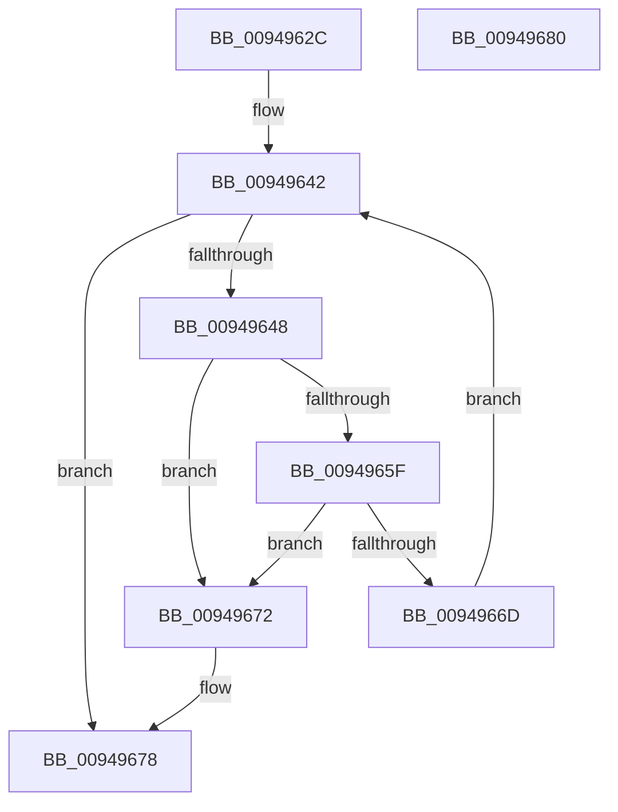

# CmpKeyEnumStackVerifyResumeContext

- RVA: `0x0094962C`–`0x00949681` (길이 `85` bytes)
- VA: `0x000000014094962C`
- 실행 섹션: `PAGE`
- PDB 이름 있음: `예`; PDB Function 태그: `아니요`
- unwind 정보 RVA: `0x0005C788`
- 디코드: `24`개 명령, `85/85` bytes 표시
- 미해석 바이트: `0` (있으면 어셈블리에 `.byte`로 보존)

> 이 문서는 커널 이미지의 기계어와 PDB 기호를 분석해 생성했습니다. 4번과 5번은 함수 원형과 자료형을 바이너리 사용 방식에서 추정한 C 해석이며 원본 소스 복구 결과는 아닙니다.

## 1. Dependencies

- 직접 호출 지점: **1**; 고유 호출 대상: **1**
- 직접 호출자로 확인된 함수: **1**
- RIP 상대 이미지 참조: **0**

### Outgoing calls
- `0x0094964B` → [CmpGetKcbAtLayerHeight](CmpGetKcbAtLayerHeight_function_00949210.md) (function, `0x00949210`)

### Direct callers
- [CmpEnumerateLayeredKey](CmpEnumerateLayeredKey_function_00945E58.md) at `0x00946365`

### Static image references
- 디코드된 RIP-relative 메모리 참조가 없습니다.

## 2. Other-region calls and transfers

- 다른 실행 섹션으로 향하는 call: **0**
- 별도 외부 분기/꼬리 이동을 확인하지 못했습니다.

## 3. Assembly (complete function range)

```asm
0094962C  48 83 EC 28                     sub rsp, 0x28
00949630  44 0F B7 59 02                  movzx r11d, word ptr [rcx + 2]
00949635  45 33 C0                        xor r8d, r8d
00949638  4C 8B CA                        mov r9, rdx
0094963B  4C 8B D1                        mov r10, rcx
0094963E  41 0F B7 D0                     movzx edx, r8w
00949642  66 41 3B D3                     cmp dx, r11w
00949646  7F 30                           jg 0x140949678
00949648  49 8B CA                        mov rcx, r10
0094964B  E8 C0 FB FF FF                  call 0x140949210
00949650  48 0F BF CA                     movsx rcx, dx
00949654  48 8D 0C 49                     lea rcx, [rcx + rcx*2]
00949658  49 3B 44 C9 10                  cmp rax, qword ptr [r9 + rcx*8 + 0x10]
0094965D  75 13                           jne 0x140949672
0094965F  49 8B 4C C9 08                  mov rcx, qword ptr [r9 + rcx*8 + 8]
00949664  48 39 88 30 01 00 00            cmp qword ptr [rax + 0x130], rcx
0094966B  75 05                           jne 0x140949672
0094966D  66 FF C2                        inc dx
00949670  EB D0                           jmp 0x140949642
00949672  41 B8 59 00 00 C0               mov r8d, 0xc0000059
00949678  41 8B C0                        mov eax, r8d
0094967B  48 83 C4 28                     add rsp, 0x28
0094967F  C3                              ret
00949680  CC                              int3
```

## 4. C-style interpretation (structured pseudocode)

```c
__int64 __fastcall CmpKeyEnumStackVerifyResumeContext(__int64 a1, __int64 a2, int a3)
{
    __int64 result;
    __int64 v_rsp;

    v_rsp = (v_rsp) - (40);
    a3 = 0;
loc_00949642:
    if (0 > ((unsigned __int16)(*(unsigned __int16 *)(a1 + 2)))) goto loc_00949678;
    result = CmpGetKcbAtLayerHeight(a1, 0, a3, a2);
    if (result != (*(unsigned __int64 *)(a2 + (__int16)(0) + (__int16)(0) * 2 * 8 + 16))) goto loc_00949672;
    if ((*(unsigned __int64 *)(result + 304)) != (*(unsigned __int64 *)(a2 + (__int16)(0) + (__int16)(0) * 2 * 8 + 8))) goto loc_00949672;
    a2 = (unsigned __int16)((0) + 1);
    goto loc_00949642;
loc_00949672:
loc_00949678:
    v_rsp = (v_rsp) + (40);
    return (unsigned int)((unsigned int)((unsigned int)(0xC0000059ULL)));
}
```

## 5. (Beta) C Style

```c
int64_t CmpKeyEnumStackVerifyResumeContext(void *Arg1, int64_t Arg2, int32_t Arg3)
{
    uint8_t *arg1 = (uint8_t *)Arg1;

    int64_t result;
    int64_t local_rsp;

    local_rsp = (local_rsp) - (40);
    Arg3 = 0;
loc_00949642:
    if (0 > ((uint16_t)(*(uint16_t *)(arg1 + 0x2)))) goto loc_00949678;
    result = CmpGetKcbAtLayerHeight(Arg1, 0, Arg3, Arg2);
    if (result != (*(uint64_t *)(Arg2 + (int16_t)(0) + (int16_t)(0) * 2 * 8 + 0x10))) goto loc_00949672;
    if ((*(uint64_t *)(result + 0x130)) != (*(uint64_t *)(Arg2 + (int16_t)(0) + (int16_t)(0) * 2 * 8 + 0x8))) goto loc_00949672;
    Arg2 = (uint16_t)((0) + 1);
    goto loc_00949642;
loc_00949672:
loc_00949678:
    local_rsp = (local_rsp) + (40);
    return (uint32_t)((uint32_t)((uint32_t)(0xC0000059ULL)));
}
```

### 관측된 메모리 오프셋

구조체 형식이 확인되지 않은 접근은 인자 기준의 오프셋으로만 기록했습니다.

| 기준 인자 | 오프셋 표현 | 폭 (bit) | 접근 |
|---|---:|---:|---|
| `Arg1` | `+ 0x2` | `16` | `R` |

## 6. Execution-region graph

[열기: 2D/3D 그래프와 함수 탐색 컨트롤 패널](../../../control-panel.html?section=page&rva=0x0094962C&view=graph)

- 2D 그래프는 위에서 아래로 흐르고, 3D 그래프는 빈 공간을 드래그해 회전합니다. Shift+드래그는 이동, 휠은 확대·축소, 함수 노드 선택은 대상 보고서 이동입니다.

### Static fallback


