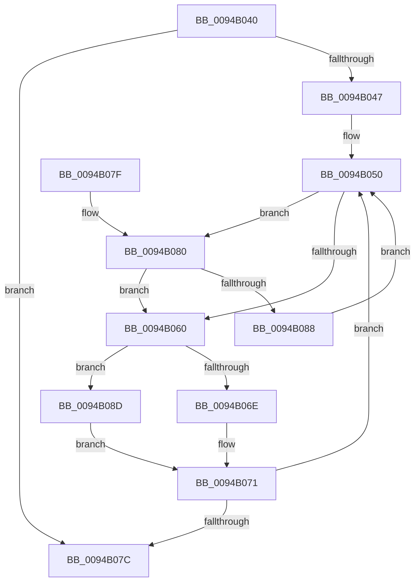

# CmpKeyFullNameLength

- RVA: `0x0094B040`–`0x0094B091` (길이 `81` bytes)
- VA: `0x000000014094B040`
- 실행 섹션: `PAGE`
- PDB 이름 있음: `예`; PDB Function 태그: `아니요`
- unwind 정보 RVA: `0x000DB714`
- 디코드: `27`개 명령, `81/81` bytes 표시
- 미해석 바이트: `0` (있으면 어셈블리에 `.byte`로 보존)

> 이 문서는 커널 이미지의 기계어와 PDB 기호를 분석해 생성했습니다. 4번과 5번은 함수 원형과 자료형을 바이너리 사용 방식에서 추정한 C 해석이며 원본 소스 복구 결과는 아닙니다.

## 1. Dependencies

- 직접 호출 지점: **0**; 고유 호출 대상: **0**
- 직접 호출자로 확인된 함수: **2**
- RIP 상대 이미지 참조: **0**

### Outgoing calls
- 직접 디코드된 call 명령이 없습니다.

### Direct callers
- [CmpConstructNameFromKcbNameBlocks](../84/CmpConstructNameFromKcbNameBlocks_function_0084D510.md) at `0x0084D533`
- [sub_0094AD50](Unknown_function_0094AD50.md) at `0x0094AD68`

### Static image references
- 디코드된 RIP-relative 메모리 참조가 없습니다.

## 2. Other-region calls and transfers

- 다른 실행 섹션으로 향하는 call: **0**
- 별도 외부 분기/꼬리 이동을 확인하지 못했습니다.

## 3. Assembly (complete function range)

```asm
0094B040  33 D2                           xor edx, edx
0094B042  48 85 C9                        test rcx, rcx
0094B045  74 35                           je 0x14094b07c
0094B047  66 0F 1F 84 00 00 00 00 00      nop word ptr [rax + rax]
0094B050  F7 81 B8 00 00 00 00 00 04 00   test dword ptr [rcx + 0xb8], 0x40000
0094B05A  4C 8D 41 48                     lea r8, [rcx + 0x48]
0094B05E  75 20                           jne 0x14094b080
0094B060  48 8B 41 50                     mov rax, qword ptr [rcx + 0x50]
0094B064  0F B7 48 18                     movzx ecx, word ptr [rax + 0x18]
0094B068  8B 00                           mov eax, dword ptr [rax]
0094B06A  A8 01                           test al, 1
0094B06C  74 1F                           je 0x14094b08d
0094B06E  8D 14 4A                        lea edx, [rdx + rcx*2]
0094B071  49 8B 08                        mov rcx, qword ptr [r8]
0094B074  83 C2 02                        add edx, 2
0094B077  48 85 C9                        test rcx, rcx
0094B07A  75 D4                           jne 0x14094b050
0094B07C  8B C2                           mov eax, edx
0094B07E  C3                              ret
0094B07F  CC                              int3
0094B080  49 8B 00                        mov rax, qword ptr [r8]
0094B083  48 85 C0                        test rax, rax
0094B086  74 D8                           je 0x14094b060
0094B088  48 8B C8                        mov rcx, rax
0094B08B  EB C3                           jmp 0x14094b050
0094B08D  03 D1                           add edx, ecx
0094B08F  EB E0                           jmp 0x14094b071
```

## 4. C-style interpretation (structured pseudocode)

```c
__int64 __fastcall CmpKeyFullNameLength(__int64 a1, int a2)
{
    a2 = 0;
    if (a1 == 0) goto loc_0094B07C;
loc_0094B050:
    if (((*(unsigned int *)(a1 + 184)) & (0x40000ULL)) != 0) goto loc_0094B080;
loc_0094B060:
    if ((((unsigned __int8)((unsigned int)(*(unsigned int *)(*(unsigned __int64 *)(a1 + 80))))) & (1)) == 0) goto loc_0094B08D;
loc_0094B071:
    a2 = (unsigned int)((a2 + *(unsigned __int16 *)(*(unsigned __int64 *)(a1 + 80) + 24) * 2) + (2));
    if (*(unsigned __int64 *)(a1 + 72) != 0) goto loc_0094B050;
loc_0094B07C:
    return (unsigned int)(a2);
loc_0094B080:
    if (*(unsigned __int64 *)(a1 + 72) == 0) goto loc_0094B060;
    goto loc_0094B050;
loc_0094B08D:
    a2 = (unsigned int)((a2) + ((unsigned int)(*(unsigned __int64 *)(a1 + 72))));
    goto loc_0094B071;
}
```

## 5. (Beta) C Style

```c
int64_t CmpKeyFullNameLength(int64_t Arg1, int32_t Arg2)
{
    Arg2 = 0;
    if (Arg1 == 0) goto loc_0094B07C;
loc_0094B050:
    if (((*(uint32_t *)(Arg1 + 0xB8)) & (0x40000ULL)) != 0) goto loc_0094B080;
loc_0094B060:
    if ((((uint8_t)((uint32_t)(*(uint32_t *)(*(uint64_t *)(Arg1 + 0x50))))) & (1)) == 0) goto loc_0094B08D;
loc_0094B071:
    Arg2 = (uint32_t)((Arg2 + *(uint16_t *)(*(uint64_t *)(Arg1 + 0x50) + 0x18) * 2) + (2));
    if (*(uint64_t *)(Arg1 + 0x48) != 0) goto loc_0094B050;
loc_0094B07C:
    return (uint32_t)(Arg2);
loc_0094B080:
    if (*(uint64_t *)(Arg1 + 0x48) == 0) goto loc_0094B060;
    goto loc_0094B050;
loc_0094B08D:
    Arg2 = (uint32_t)((Arg2) + ((uint32_t)(*(uint64_t *)(Arg1 + 0x48))));
    goto loc_0094B071;
}
```

## 6. Execution-region graph

[열기: 2D/3D 그래프와 함수 탐색 컨트롤 패널](../../../control-panel.html?section=page&rva=0x0094B040&view=graph)

- 2D 그래프는 위에서 아래로 흐르고, 3D 그래프는 빈 공간을 드래그해 회전합니다. Shift+드래그는 이동, 휠은 확대·축소, 함수 노드 선택은 대상 보고서 이동입니다.

### Static fallback


