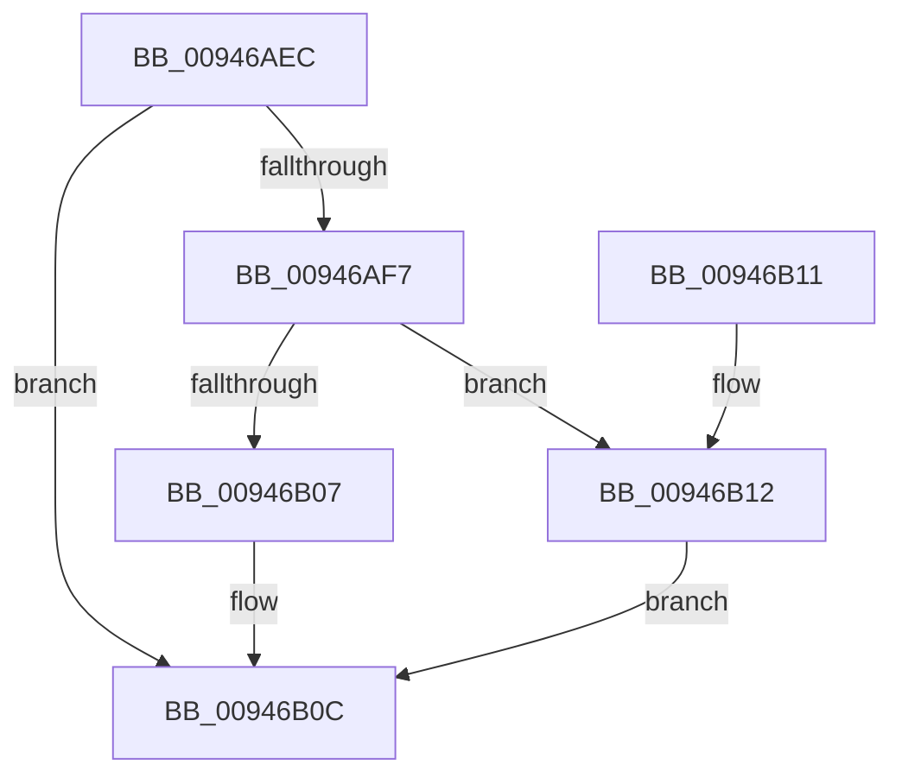

# CmpKeyNodeStackEntryCleanup

- RVA: `0x00946AEC`–`0x00946B19` (길이 `45` bytes)
- VA: `0x0000000140946AEC`
- 실행 섹션: `PAGE`
- PDB 이름 있음: `예`; PDB Function 태그: `아니요`
- unwind 정보 RVA: `0x0005CEE8`
- 디코드: `13`개 명령, `45/45` bytes 표시
- 미해석 바이트: `0` (있으면 어셈블리에 `.byte`로 보존)

> 이 문서는 커널 이미지의 기계어와 PDB 기호를 분석해 생성했습니다. 4번과 5번은 함수 원형과 자료형을 바이너리 사용 방식에서 추정한 C 해석이며 원본 소스 복구 결과는 아닙니다.

## 1. Dependencies

- 직접 호출 지점: **2**; 고유 호출 대상: **2**
- 직접 호출자로 확인된 함수: **2**
- RIP 상대 이미지 참조: **0**

### Outgoing calls
- `0x00946B07` → [HvpReleaseCellPaged](../85/HvpReleaseCellPaged_function_00855F40.md) (function, `0x00855F40`)
- `0x00946B12` → [HvpReleaseCellFlat](../85/HvpReleaseCellFlat_function_0085CC20.md) (function, `0x0085CC20`)

### Direct callers
- [CmpKeyNodeStackEntryReset](CmpKeyNodeStackEntryReset_function_009467E0.md) at `0x009467E9`
- [CmpCleanupKeyNodeStack](CmpCleanupKeyNodeStack_function_00946A5C.md) at `0x00946A86`

### Static image references
- 디코드된 RIP-relative 메모리 참조가 없습니다.

## 2. Other-region calls and transfers

- 다른 실행 섹션으로 향하는 call: **0**
- 별도 외부 분기/꼬리 이동을 확인하지 못했습니다.

## 3. Assembly (complete function range)

```asm
00946AEC  48 83 EC 28                     sub rsp, 0x28
00946AF0  48 83 79 10 00                  cmp qword ptr [rcx + 0x10], 0
00946AF5  74 15                           je 0x140946b0c
00946AF7  48 8D 51 18                     lea rdx, [rcx + 0x18]
00946AFB  48 8B 09                        mov rcx, qword ptr [rcx]
00946AFE  F6 81 8C 00 00 00 01            test byte ptr [rcx + 0x8c], 1
00946B05  75 0B                           jne 0x140946b12
00946B07  E8 34 F4 F0 FF                  call 0x140855f40
00946B0C  48 83 C4 28                     add rsp, 0x28
00946B10  C3                              ret
00946B11  CC                              int3
00946B12  E8 09 61 F1 FF                  call 0x14085cc20
00946B17  EB F3                           jmp 0x140946b0c
```

## 4. C-style interpretation (structured pseudocode)

```c
__int64 __fastcall CmpKeyNodeStackEntryCleanup(__int64 a1)
{
    __int64 result;
    __int64 v_rsp;

    v_rsp = (v_rsp) - (40);
    if ((*(unsigned __int64 *)(a1 + 16)) == 0) goto loc_00946B0C;
    if (((*(unsigned __int8 *)(*(unsigned __int64 *)(a1) + 140)) & (1)) != 0) goto loc_00946B12;
    result = HvpReleaseCellPaged(*(unsigned __int64 *)(a1), a1 + 24, a3, a4);
loc_00946B0C:
    v_rsp = (v_rsp) + (40);
    return result;
loc_00946B12:
    result = HvpReleaseCellFlat(*(unsigned __int64 *)(a1), a1 + 24, a3, a4);
    goto loc_00946B0C;
}
```

## 5. (Beta) C Style

```c
int64_t CmpKeyNodeStackEntryCleanup(void *Arg1)
{
    uint8_t *arg1 = (uint8_t *)Arg1;

    int64_t result;
    int64_t local_rsp;

    local_rsp = (local_rsp) - (40);
    if ((*(uint64_t *)(arg1 + 0x10)) == 0) goto loc_00946B0C;
    if (((*(uint8_t *)(*(uint64_t *)(arg1) + 0x8C)) & (1)) != 0) goto loc_00946B12;
    result = HvpReleaseCellPaged(*(uint64_t *)(arg1), Arg1 + 24, a3, a4);
loc_00946B0C:
    local_rsp = (local_rsp) + (40);
    return result;
loc_00946B12:
    result = HvpReleaseCellFlat(*(uint64_t *)(arg1), Arg1 + 24, a3, a4);
    goto loc_00946B0C;
}
```

### 관측된 메모리 오프셋

구조체 형식이 확인되지 않은 접근은 인자 기준의 오프셋으로만 기록했습니다.

| 기준 인자 | 오프셋 표현 | 폭 (bit) | 접근 |
|---|---:|---:|---|
| `Arg1` | `+ 0x0` | `64` | `R` |
| `Arg1` | `+ 0x10` | `64` | `R` |
| `Arg1` | `+ 0x18` | `64` | `R` |

## 6. Execution-region graph

[열기: 2D/3D 그래프와 함수 탐색 컨트롤 패널](../../../control-panel.html?section=page&rva=0x00946AEC&view=graph)

- 2D 그래프는 위에서 아래로 흐르고, 3D 그래프는 빈 공간을 드래그해 회전합니다. Shift+드래그는 이동, 휠은 확대·축소, 함수 노드 선택은 대상 보고서 이동입니다.

### Static fallback


