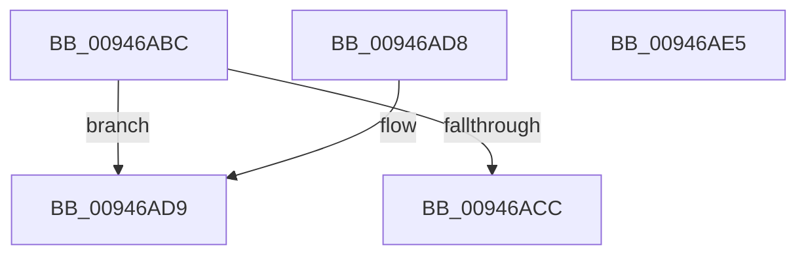

# CmpKeyNodeStackGetEntryAtLayerHeight

- RVA: `0x00946ABC`–`0x00946AE6` (길이 `42` bytes)
- VA: `0x0000000140946ABC`
- 실행 섹션: `PAGE`
- PDB 이름 있음: `예`; PDB Function 태그: `아니요`
- unwind 정보 RVA: `0x000DB714`
- 디코드: `14`개 명령, `42/42` bytes 표시
- 미해석 바이트: `0` (있으면 어셈블리에 `.byte`로 보존)

> 이 문서는 커널 이미지의 기계어와 PDB 기호를 분석해 생성했습니다. 4번과 5번은 함수 원형과 자료형을 바이너리 사용 방식에서 추정한 C 해석이며 원본 소스 복구 결과는 아닙니다.

## 1. Dependencies

- 직접 호출 지점: **0**; 고유 호출 대상: **0**
- 직접 호출자로 확인된 함수: **25**
- RIP 상대 이미지 참조: **0**

### Outgoing calls
- 직접 디코드된 call 명령이 없습니다.

### Direct callers
- [CmpQueryKeyDataFromKeyNodeStack](../../text/46/CmpQueryKeyDataFromKeyNodeStack_function_0046AC40.md) at `0x0046ACC5`
- [CmpQueryKeyDataFromKeyNodeStack](../../text/46/CmpQueryKeyDataFromKeyNodeStack_function_0046AC40.md) at `0x0046AE80`
- [CmpGetValueCountForKeyNodeStack](../../text/46/CmpGetValueCountForKeyNodeStack_function_0046B118.md) at `0x0046B1D9`
- [CmpGetValueCountForKeyNodeStack](../../text/46/CmpGetValueCountForKeyNodeStack_function_0046B118.md) at `0x0046B2A0`
- [CmpValueEnumStackStartFromKeyNodeStack](../../text/46/CmpValueEnumStackStartFromKeyNodeStack_function_0046B2E0.md) at `0x0046B32C`
- [CmSaveKey](../7D/CmSaveKey_function_007DDBDC.md) at `0x007DDEF5`
- [CmRenameKey](../7E/CmRenameKey_function_007E8F48.md) at `0x007E9AFA`
- [CmRenameKey](../7E/CmRenameKey_function_007E8F48.md) at `0x007E9F8D`
- [CmpSubtreeEnumeratorBeginForKeyNodeStack](../7F/CmpSubtreeEnumeratorBeginForKeyNodeStack_function_007F192C.md) at `0x007F195F`
- [CmpSubtreeEnumeratorBeginForKeyNodeStack](../7F/CmpSubtreeEnumeratorBeginForKeyNodeStack_function_007F192C.md) at `0x007F196A`
- [CmpFullPromoteHiveRootFromKcbStack](../7F/CmpFullPromoteHiveRootFromKcbStack_function_007F3F90.md) at `0x007F4019`
- [CmpPartialPromoteSubkeys](../7F/CmpPartialPromoteSubkeys_function_007F4070.md) at `0x007F414D`
- [CmpPromoteSingleKeyFromParentKcbAndChildKeyNode](../7F/CmpPromoteSingleKeyFromParentKcbAndChildKeyNode_function_007F426C.md) at `0x007F42F8`
- [CmpPromoteSingleKeyFromParentKcbAndChildKeyNode](../7F/CmpPromoteSingleKeyFromParentKcbAndChildKeyNode_function_007F426C.md) at `0x007F4303`
- [CmpFullPromoteSingleKeyFromKeyNodeStacks](../8B/CmpFullPromoteSingleKeyFromKeyNodeStacks_function_008B1A40.md) at `0x008B1ADC`
- [CmpFullPromoteSingleKeyFromKeyNodeStacks](../8B/CmpFullPromoteSingleKeyFromKeyNodeStacks_function_008B1A40.md) at `0x008B1AF0`
- [CmpFullPromoteSingleKeyFromKeyNodeStacks](../8B/CmpFullPromoteSingleKeyFromKeyNodeStacks_function_008B1A40.md) at `0x008B1B20`
- [CmpPromoteSingleKeyFromKcbStacks](CmpPromoteSingleKeyFromKcbStacks_function_009446E8.md) at `0x0094487A`
- [CmpPromoteSingleKeyFromKcbStacks](CmpPromoteSingleKeyFromKcbStacks_function_009446E8.md) at `0x00944886`
- [CmpKeyEnumStackNotifyPromotion](CmpKeyEnumStackNotifyPromotion_function_00944CE8.md) at `0x00944D0F`
- [CmpPromoteSubtree](CmpPromoteSubtree_function_00944D60.md) at `0x00944E32`
- [CmpPopulateKeyNodeStackFromKcbStack](CmpPopulateKeyNodeStackFromKcbStack_function_009453CC.md) at `0x00945421`
- [CmpGetSubKeyCountForKeyNodeStack](CmpGetSubKeyCountForKeyNodeStack_function_00945624.md) at `0x0094571C`
- [CmpGetSubKeyCountForKeyNodeStack](CmpGetSubKeyCountForKeyNodeStack_function_00945624.md) at `0x0094576A`
- [CmpPartialPromoteSingleKeyFromKeyNodeStacks](CmpPartialPromoteSingleKeyFromKeyNodeStacks_function_00945808.md) at `0x00945838`
- [CmpPartialPromoteSingleKeyFromKeyNodeStacks](CmpPartialPromoteSingleKeyFromKeyNodeStacks_function_00945808.md) at `0x00945843`
- [CmpPartialPromoteSingleKeyFromKeyNodeStacks](CmpPartialPromoteSingleKeyFromKeyNodeStacks_function_00945808.md) at `0x00945862`
- [CmpCopyMergeOfLayeredKeyNode](CmpCopyMergeOfLayeredKeyNode_function_00945A78.md) at `0x00945AEF`
- [CmpCopyMergeOfLayeredKeyNode](CmpCopyMergeOfLayeredKeyNode_function_00945A78.md) at `0x00945CFF`
- [CmpResetKeyNodeStack](CmpResetKeyNodeStack_function_00945E14.md) at `0x00945E2E`
- [CmpGetSecurityCellForKeyNodeStack](CmpGetSecurityCellForKeyNodeStack_function_009464EC.md) at `0x00946528`
- [CmpKeyEnumStackAdvance](CmpKeyEnumStackAdvance_function_0094668C.md) at `0x009466B9`
- [CmpKeyEnumStackBeginEnumerationForKeyNodeStack](CmpKeyEnumStackBeginEnumerationForKeyNodeStack_function_00946718.md) at `0x00946753`
- [CmpKeyEnumStackAdvanceInternal](CmpKeyEnumStackAdvanceInternal_function_009468D4.md) at `0x0094690A`
- [CmpKeyEnumStackAdvanceInternal](CmpKeyEnumStackAdvanceInternal_function_009468D4.md) at `0x009469DF`
- [CmpCleanupKeyNodeStack](CmpCleanupKeyNodeStack_function_00946A5C.md) at `0x00946A7E`
- [CmpSortedValueEnumStackStartFromKeyNodeStack](../A3/CmpSortedValueEnumStackStartFromKeyNodeStack_function_00A30CF0.md) at `0x00A30D32`
- [sub_00B255E8](../B2/Unknown_function_00B255E8.md) at `0x00B255F0`

### Static image references
- 디코드된 RIP-relative 메모리 참조가 없습니다.

## 2. Other-region calls and transfers

- 다른 실행 섹션으로 향하는 call: **0**
- 별도 외부 분기/꼬리 이동을 확인하지 못했습니다.

## 3. Assembly (complete function range)

```asm
00946ABC  41 B8 02 00 00 00               mov r8d, 2
00946AC2  48 0F BF C2                     movsx rax, dx
00946AC6  66 41 3B D0                     cmp dx, r8w
00946ACA  7D 0D                           jge 0x140946ad9
00946ACC  48 C1 E0 05                     shl rax, 5
00946AD0  48 83 C0 08                     add rax, 8
00946AD4  48 03 C1                        add rax, rcx
00946AD7  C3                              ret
00946AD8  CC                              int3
00946AD9  49 2B C0                        sub rax, r8
00946ADC  48 C1 E0 05                     shl rax, 5
00946AE0  48 03 41 48                     add rax, qword ptr [rcx + 0x48]
00946AE4  C3                              ret
00946AE5  CC                              int3
```

## 4. C-style interpretation (structured pseudocode)

```c
__int64 __fastcall CmpKeyNodeStackGetEntryAtLayerHeight(__int64 a1, unsigned __int16 a2)
{
    __int64 result;

    if (a2 >= 2) goto loc_00946AD9;
    result = ((__int16)(a2)) << (5);
    result = (result) + (8);
    result = (result) + (a1);
    return result;
loc_00946AD9:
    result = (result) - (2);
    result = (result) << (5);
    result = (result) + (*(unsigned __int64 *)(a1 + 72));
    return result;
}
```

## 5. (Beta) C Style

```c
int64_t CmpKeyNodeStackGetEntryAtLayerHeight(void *Arg1, uint16_t Arg2)
{
    uint8_t *arg1 = (uint8_t *)Arg1;

    int64_t result;

    if (Arg2 >= 2) goto loc_00946AD9;
    result = ((int16_t)(Arg2)) << (5);
    result = (result) + (8);
    result = (result) + (Arg1);
    return result;
loc_00946AD9:
    result = (result) - (2);
    result = (result) << (5);
    result = (result) + (*(uint64_t *)(arg1 + 0x48));
    return result;
}
```

### 관측된 메모리 오프셋

구조체 형식이 확인되지 않은 접근은 인자 기준의 오프셋으로만 기록했습니다.

| 기준 인자 | 오프셋 표현 | 폭 (bit) | 접근 |
|---|---:|---:|---|
| `Arg1` | `+ 0x48` | `64` | `R` |

## 6. Execution-region graph

[열기: 2D/3D 그래프와 함수 탐색 컨트롤 패널](../../../control-panel.html?section=page&rva=0x00946ABC&view=graph)

- 2D 그래프는 위에서 아래로 흐르고, 3D 그래프는 빈 공간을 드래그해 회전합니다. Shift+드래그는 이동, 휠은 확대·축소, 함수 노드 선택은 대상 보고서 이동입니다.

### Static fallback


