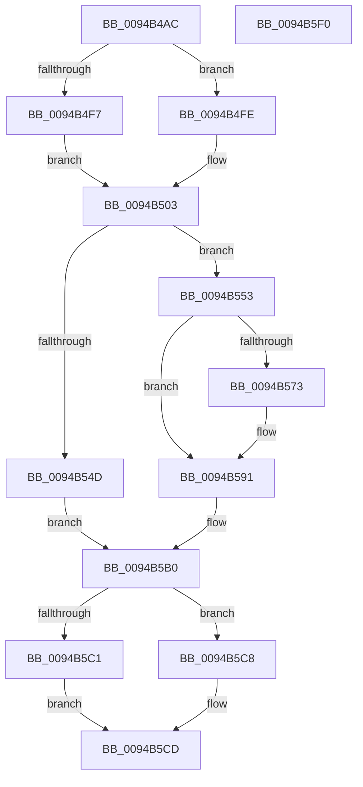

# CmpLightWeightCommitSetSecDescUoW

- RVA: `0x0094B4AC`–`0x0094B5F1` (길이 `325` bytes)
- VA: `0x000000014094B4AC`
- 실행 섹션: `PAGE`
- PDB 이름 있음: `예`; PDB Function 태그: `아니요`
- unwind 정보 RVA: `0x00090F98`
- 디코드: `91`개 명령, `325/325` bytes 표시
- 미해석 바이트: `0` (있으면 어셈블리에 `.byte`로 보존)

> 이 문서는 커널 이미지의 기계어와 PDB 기호를 분석해 생성했습니다. 4번과 5번은 함수 원형과 자료형을 바이너리 사용 방식에서 추정한 C 해석이며 원본 소스 복구 결과는 아닙니다.

## 1. Dependencies

- 직접 호출 지점: **10**; 고유 호출 대상: **10**
- 직접 호출자로 확인된 함수: **1**
- RIP 상대 이미지 참조: **0**

### Outgoing calls
- `0x0094B4F7` → [HvpGetCellFlat](../85/HvpGetCellFlat_function_00854C60.md) (function, `0x00854C60`)
- `0x0094B4FE` → [HvpGetCellPaged](../85/HvpGetCellPaged_function_00854CB0.md) (function, `0x00854CB0`)
- `0x0094B512` → [CmpDereferenceSecurityNode](../../text/4A/CmpDereferenceSecurityNode_function_004A672C.md) (function, `0x004A672C`)
- `0x0094B55A` → [CmLockHiveSecurityShared](../../pagecmrc/BC/CmLockHiveSecurityShared_function_00BC996C.md) (function, `0x00BC996C`)
- `0x0094B56A` → [CmpFindSecurityCellCacheIndex](../../text/42/CmpFindSecurityCellCacheIndex_function_00428060.md) (function, `0x00428060`)
- `0x0094B58B` → [KeBugCheckEx](../../text/4F/KeBugCheckEx_function_004FD660.md) (function, `0x004FD660`)
- `0x0094B5AB` → [CmUnlockHiveSecurity](../../pagecmrc/BC/CmUnlockHiveSecurity_function_00BC99C8.md) (function, `0x00BC99C8`)
- `0x0094B5C1` → [HvpReleaseCellFlat](../85/HvpReleaseCellFlat_function_0085CC20.md) (function, `0x0085CC20`)
- `0x0094B5C8` → [HvpReleaseCellPaged](../85/HvpReleaseCellPaged_function_00855F40.md) (function, `0x00855F40`)
- `0x0094B5D0` → [CmpLightWeightCleanupSetSecDescUoW](CmpLightWeightCleanupSetSecDescUoW_function_0094B374.md) (function, `0x0094B374`)

### Direct callers
- [sub_00B2DAE6](../B2/Unknown_function_00B2DAE6.md) at `0x00B2DB18`

### Static image references
- 디코드된 RIP-relative 메모리 참조가 없습니다.

## 2. Other-region calls and transfers

- 다른 실행 섹션으로 향하는 call: **5**
  - `0x0094B512` → [CmpDereferenceSecurityNode](../../text/4A/CmpDereferenceSecurityNode_function_004A672C.md) (`PAGE` → `.text`)
  - `0x0094B55A` → [CmLockHiveSecurityShared](../../pagecmrc/BC/CmLockHiveSecurityShared_function_00BC996C.md) (`PAGE` → `PAGECMRC`)
  - `0x0094B56A` → [CmpFindSecurityCellCacheIndex](../../text/42/CmpFindSecurityCellCacheIndex_function_00428060.md) (`PAGE` → `.text`)
  - `0x0094B58B` → [KeBugCheckEx](../../text/4F/KeBugCheckEx_function_004FD660.md) (`PAGE` → `.text`)
  - `0x0094B5AB` → [CmUnlockHiveSecurity](../../pagecmrc/BC/CmUnlockHiveSecurity_function_00BC99C8.md) (`PAGE` → `PAGECMRC`)
- 별도 외부 분기/꼬리 이동을 확인하지 못했습니다.

## 3. Assembly (complete function range)

```asm
0094B4AC  4C 8B DC                        mov r11, rsp
0094B4AF  49 89 5B 18                     mov qword ptr [r11 + 0x18], rbx
0094B4B3  49 89 6B 20                     mov qword ptr [r11 + 0x20], rbp
0094B4B7  56                              push rsi
0094B4B8  57                              push rdi
0094B4B9  41 54                           push r12
0094B4BB  41 56                           push r14
0094B4BD  41 57                           push r15
0094B4BF  48 83 EC 30                     sub rsp, 0x30
0094B4C3  48 8B 41 30                     mov rax, qword ptr [rcx + 0x30]
0094B4C7  4D 8D 43 10                     lea r8, [r11 + 0x10]
0094B4CB  4C 8B 79 68                     mov r15, qword ptr [rcx + 0x68]
0094B4CF  41 83 CE FF                     or r14d, 0xffffffff
0094B4D3  45 33 E4                        xor r12d, r12d
0094B4D6  45 89 73 10                     mov dword ptr [r11 + 0x10], r14d
0094B4DA  48 8B F2                        mov rsi, rdx
0094B4DD  45 89 63 14                     mov dword ptr [r11 + 0x14], r12d
0094B4E1  48 8B 58 20                     mov rbx, qword ptr [rax + 0x20]
0094B4E5  48 8B E9                        mov rbp, rcx
0094B4E8  8B 50 28                        mov edx, dword ptr [rax + 0x28]
0094B4EB  48 8B CB                        mov rcx, rbx
0094B4EE  F6 83 8C 00 00 00 01            test byte ptr [rbx + 0x8c], 1
0094B4F5  74 07                           je 0x14094b4fe
0094B4F7  E8 64 97 F0 FF                  call 0x140854c60
0094B4FC  EB 05                           jmp 0x14094b503
0094B4FE  E8 AD 97 F0 FF                  call 0x140854cb0
0094B503  8B 50 2C                        mov edx, dword ptr [rax + 0x2c]
0094B506  48 8B F8                        mov rdi, rax
0094B509  41 8B 07                        mov eax, dword ptr [r15]
0094B50C  48 8B CB                        mov rcx, rbx
0094B50F  89 47 2C                        mov dword ptr [rdi + 0x2c], eax
0094B512  E8 15 B2 B5 FF                  call 0x1404a672c
0094B517  45 89 37                        mov dword ptr [r15], r14d
0094B51A  48 8B 06                        mov rax, qword ptr [rsi]
0094B51D  48 89 47 04                     mov qword ptr [rdi + 4], rax
0094B521  48 8B 06                        mov rax, qword ptr [rsi]
0094B524  48 8B 4D 30                     mov rcx, qword ptr [rbp + 0x30]
0094B528  44 89 64 24 60                  mov dword ptr [rsp + 0x60], r12d
0094B52D  48 89 81 A8 00 00 00            mov qword ptr [rcx + 0xa8], rax
0094B534  48 8B 45 30                     mov rax, qword ptr [rbp + 0x30]
0094B538  48 FF 80 30 01 00 00            inc qword ptr [rax + 0x130]
0094B53F  44 8B 77 2C                     mov r14d, dword ptr [rdi + 0x2c]
0094B543  48 8B 7D 30                     mov rdi, qword ptr [rbp + 0x30]
0094B547  41 83 FE FF                     cmp r14d, -1
0094B54B  75 06                           jne 0x14094b553
0094B54D  4C 89 67 58                     mov qword ptr [rdi + 0x58], r12
0094B551  EB 5D                           jmp 0x14094b5b0
0094B553  48 8B 77 20                     mov rsi, qword ptr [rdi + 0x20]
0094B557  48 8B CE                        mov rcx, rsi
0094B55A  E8 0D E4 27 00                  call 0x140bc996c
0094B55F  4C 8D 44 24 60                  lea r8, [rsp + 0x60]
0094B564  41 8B D6                        mov edx, r14d
0094B567  48 8B CE                        mov rcx, rsi
0094B56A  E8 F1 CA AD FF                  call 0x140428060
0094B56F  84 C0                           test al, al
0094B571  75 1E                           jne 0x14094b591
0094B573  BA 04 00 00 00                  mov edx, 4
0094B578  4C 89 67 58                     mov qword ptr [rdi + 0x58], r12
0094B57C  4C 8B CF                        mov r9, rdi
0094B57F  4C 89 74 24 20                  mov qword ptr [rsp + 0x20], r14
0094B584  8D 4A 4D                        lea ecx, [rdx + 0x4d]
0094B587  44 8D 42 FD                     lea r8d, [rdx - 3]
0094B58B  E8 D0 20 BB FF                  call 0x1404fd660
0094B590  CC                              int3
0094B591  48 8B 86 60 07 00 00            mov rax, qword ptr [rsi + 0x760]
0094B598  8B 54 24 60                     mov edx, dword ptr [rsp + 0x60]
0094B59C  48 03 D2                        add rdx, rdx
0094B59F  48 8B 54 D0 08                  mov rdx, qword ptr [rax + rdx*8 + 8]
0094B5A4  48 89 57 58                     mov qword ptr [rdi + 0x58], rdx
0094B5A8  48 8B CE                        mov rcx, rsi
0094B5AB  E8 18 E4 27 00                  call 0x140bc99c8
0094B5B0  F6 83 8C 00 00 00 01            test byte ptr [rbx + 0x8c], 1
0094B5B7  48 8D 54 24 68                  lea rdx, [rsp + 0x68]
0094B5BC  48 8B CB                        mov rcx, rbx
0094B5BF  74 07                           je 0x14094b5c8
0094B5C1  E8 5A 16 F1 FF                  call 0x14085cc20
0094B5C6  EB 05                           jmp 0x14094b5cd
0094B5C8  E8 73 A9 F0 FF                  call 0x140855f40
0094B5CD  49 8B CF                        mov rcx, r15
0094B5D0  E8 9F FD FF FF                  call 0x14094b374
0094B5D5  48 8B 5C 24 70                  mov rbx, qword ptr [rsp + 0x70]
0094B5DA  4C 89 65 68                     mov qword ptr [rbp + 0x68], r12
0094B5DE  48 8B 6C 24 78                  mov rbp, qword ptr [rsp + 0x78]
0094B5E3  48 83 C4 30                     add rsp, 0x30
0094B5E7  41 5F                           pop r15
0094B5E9  41 5E                           pop r14
0094B5EB  41 5C                           pop r12
0094B5ED  5F                              pop rdi
0094B5EE  5E                              pop rsi
0094B5EF  C3                              ret
0094B5F0  CC                              int3
```

## 4. C-style interpretation (structured pseudocode)

```c
__int64 __fastcall CmpLightWeightCommitSetSecDescUoW(__int64 a1, __int64 a2)
{
    __int64 result;
    __int64 v_r12;
    __int64 v_r14;
    __int64 v_rsp;
    unsigned __int64 v_stack_m38;
    unsigned __int64 v_stack_p10;
    unsigned __int64 v_stack_p18;
    unsigned __int64 v_stack_p20;
    unsigned int v_stack_p8;

    *(unsigned __int64 *)(v_rsp + 24) = v_rbx;
    *(unsigned __int64 *)(v_rsp + 32) = v_rbp;
    v_rsp = (v_rsp) - (48);
    v_r14 = (unsigned int)((v_r14) | (0xFFFFFFFFULL));
    v_r12 = 0;
    *(unsigned int *)(v_rsp + 16) = (unsigned int)(v_r14);
    *(unsigned int *)(v_rsp + 20) = 0;
    if (((*(unsigned __int8 *)(*(unsigned __int64 *)(*(unsigned __int64 *)(a1 + 48) + 32) + 140)) & (1)) == 0) goto loc_0094B4FE;
    result = HvpGetCellFlat(*(unsigned __int64 *)(*(unsigned __int64 *)(a1 + 48) + 32), (unsigned int)(*(unsigned int *)(*(unsigned __int64 *)(a1 + 48) + 40)), v_rsp + 16, a4);
    goto loc_0094B503;
loc_0094B4FE:
    result = HvpGetCellPaged(*(unsigned __int64 *)(*(unsigned __int64 *)(a1 + 48) + 32), (unsigned int)(*(unsigned int *)(*(unsigned __int64 *)(a1 + 48) + 40)), v_rsp + 16, a4);
loc_0094B503:
    *(unsigned int *)(result + 44) = (unsigned int)((unsigned int)(*(unsigned int *)(*(unsigned __int64 *)(a1 + 104))));
    result = CmpDereferenceSecurityNode(*(unsigned __int64 *)(*(unsigned __int64 *)(a1 + 48) + 32), (unsigned int)(*(unsigned int *)(result + 44)), v_rsp + 16, a4);
    *(unsigned int *)(*(unsigned __int64 *)(a1 + 104)) = (unsigned int)(v_r14);
    *(unsigned __int64 *)(result + 4) = *(unsigned __int64 *)(a2);
    v_stack_p8 = 0;
    *(unsigned __int64 *)(*(unsigned __int64 *)(a1 + 48) + 168) = *(unsigned __int64 *)(a2);
    if (((unsigned int)((unsigned int)(*(unsigned int *)(result + 44)))) != -1) goto loc_0094B553;
    *(unsigned __int64 *)(*(unsigned __int64 *)(a1 + 48) + 88) = 0;
    goto loc_0094B5B0;
loc_0094B553:
    result = CmLockHiveSecurityShared(*(unsigned __int64 *)(*(unsigned __int64 *)(a1 + 48) + 32), (unsigned int)(*(unsigned int *)(result + 44)), v_rsp + 16, a4);
    result = CmpFindSecurityCellCacheIndex(*(unsigned __int64 *)(*(unsigned __int64 *)(a1 + 48) + 32), (unsigned int)((unsigned int)((unsigned int)(*(unsigned int *)(result + 44)))), v_stack_p8, a4);
    if ((unsigned __int8)(result) == 0) {
        a2 = 4;
        *(unsigned __int64 *)(*(unsigned __int64 *)(a1 + 48) + 88) = 0;
        a4 = *(unsigned __int64 *)(a1 + 48);
        v_stack_m38 = (unsigned int)(*(unsigned int *)(result + 44));
        a1 = a2 + 77;
        a3 = a2 - 3;
        result = KeBugCheckEx(a1, a2, a3, a4);
    }
    a2 = ((unsigned int)(v_stack_p8)) + ((unsigned int)(v_stack_p8));
    *(unsigned __int64 *)(*(unsigned __int64 *)(a1 + 48) + 88) = *(unsigned __int64 *)(*(unsigned __int64 *)(*(unsigned __int64 *)(*(unsigned __int64 *)(a1 + 48) + 32) + 1888) + a2 * 8 + 8);
    result = CmUnlockHiveSecurity(*(unsigned __int64 *)(*(unsigned __int64 *)(a1 + 48) + 32), *(unsigned __int64 *)(*(unsigned __int64 *)(*(unsigned __int64 *)(*(unsigned __int64 *)(a1 + 48) + 32) + 1888) + a2 * 8 + 8), a3, a4);
loc_0094B5B0:
    if (((*(unsigned __int8 *)(*(unsigned __int64 *)(*(unsigned __int64 *)(a1 + 48) + 32) + 140)) & (1)) == 0) goto loc_0094B5C8;
    result = HvpReleaseCellFlat(*(unsigned __int64 *)(*(unsigned __int64 *)(a1 + 48) + 32), v_stack_p10, a3, a4);
    goto loc_0094B5CD;
loc_0094B5C8:
    result = HvpReleaseCellPaged(*(unsigned __int64 *)(*(unsigned __int64 *)(a1 + 48) + 32), v_stack_p10, a3, a4);
loc_0094B5CD:
    result = CmpLightWeightCleanupSetSecDescUoW(*(unsigned __int64 *)(a1 + 104), v_stack_p10, a3, a4);
    *(unsigned __int64 *)(a1 + 104) = 0;
    v_rsp = (v_rsp) + (48);
    return result;
}
```

## 5. (Beta) C Style

```c
int64_t CmpLightWeightCommitSetSecDescUoW(void *Arg1, void *Arg2)
{
    uint8_t *arg1 = (uint8_t *)Arg1;
    uint8_t *arg2 = (uint8_t *)Arg2;

    int64_t result;
    int64_t local_r12;
    int64_t local_r14;
    int64_t local_rsp;
    uint64_t v_stack_m38;
    uint64_t v_stack_p10;
    uint64_t v_stack_p18;
    uint64_t v_stack_p20;
    uint32_t v_stack_p8;

    *(uint64_t *)(local_rsp + 0x18) = local_rbx;
    *(uint64_t *)(local_rsp + 0x20) = local_rbp;
    local_rsp = (local_rsp) - (48);
    local_r14 = (uint32_t)((local_r14) | (0xFFFFFFFFULL));
    local_r12 = 0;
    *(uint32_t *)(local_rsp + 0x10) = (uint32_t)(local_r14);
    *(uint32_t *)(local_rsp + 0x14) = 0;
    if (((*(uint8_t *)(*(uint64_t *)(*(uint64_t *)(arg1 + 0x30) + 0x20) + 0x8C)) & (1)) == 0) goto loc_0094B4FE;
    result = HvpGetCellFlat(*(uint64_t *)(*(uint64_t *)(arg1 + 0x30) + 0x20), (uint32_t)(*(uint32_t *)(*(uint64_t *)(arg1 + 0x30) + 0x28)), local_rsp + 16, a4);
    goto loc_0094B503;
loc_0094B4FE:
    result = HvpGetCellPaged(*(uint64_t *)(*(uint64_t *)(arg1 + 0x30) + 0x20), (uint32_t)(*(uint32_t *)(*(uint64_t *)(arg1 + 0x30) + 0x28)), local_rsp + 16, a4);
loc_0094B503:
    *(uint32_t *)(result + 0x2C) = (uint32_t)((uint32_t)(*(uint32_t *)(*(uint64_t *)(arg1 + 0x68))));
    result = CmpDereferenceSecurityNode(*(uint64_t *)(*(uint64_t *)(arg1 + 0x30) + 0x20), (uint32_t)(*(uint32_t *)(result + 0x2C)), local_rsp + 16, a4);
    *(uint32_t *)(*(uint64_t *)(arg1 + 0x68)) = (uint32_t)(local_r14);
    *(uint64_t *)(result + 0x4) = *(uint64_t *)(arg2);
    v_stack_p8 = 0;
    *(uint64_t *)(*(uint64_t *)(arg1 + 0x30) + 0xA8) = *(uint64_t *)(arg2);
    if (((uint32_t)((uint32_t)(*(uint32_t *)(result + 0x2C)))) != -1) goto loc_0094B553;
    *(uint64_t *)(*(uint64_t *)(arg1 + 0x30) + 0x58) = 0;
    goto loc_0094B5B0;
loc_0094B553:
    result = CmLockHiveSecurityShared(*(uint64_t *)(*(uint64_t *)(arg1 + 0x30) + 0x20), (uint32_t)(*(uint32_t *)(result + 0x2C)), local_rsp + 16, a4);
    result = CmpFindSecurityCellCacheIndex(*(uint64_t *)(*(uint64_t *)(arg1 + 0x30) + 0x20), (uint32_t)((uint32_t)((uint32_t)(*(uint32_t *)(result + 0x2C)))), v_stack_p8, a4);
    if ((uint8_t)(result) == 0) {
        Arg2 = 4;
        *(uint64_t *)(*(uint64_t *)(arg1 + 0x30) + 0x58) = 0;
        a4 = *(uint64_t *)(arg1 + 0x30);
        v_stack_m38 = (uint32_t)(*(uint32_t *)(result + 0x2C));
        Arg1 = Arg2 + 77;
        a3 = Arg2 - 3;
        result = KeBugCheckEx(Arg1, Arg2, a3, a4);
    }
    Arg2 = ((uint32_t)(v_stack_p8)) + ((uint32_t)(v_stack_p8));
    *(uint64_t *)(*(uint64_t *)(arg1 + 0x30) + 0x58) = *(uint64_t *)(*(uint64_t *)(*(uint64_t *)(*(uint64_t *)(arg1 + 0x30) + 0x20) + 0x760) + arg2 * 8 + 0x8);
    result = CmUnlockHiveSecurity(*(uint64_t *)(*(uint64_t *)(arg1 + 0x30) + 0x20), *(uint64_t *)(*(uint64_t *)(*(uint64_t *)(*(uint64_t *)(arg1 + 0x30) + 0x20) + 0x760) + arg2 * 8 + 0x8), a3, a4);
loc_0094B5B0:
    if (((*(uint8_t *)(*(uint64_t *)(*(uint64_t *)(arg1 + 0x30) + 0x20) + 0x8C)) & (1)) == 0) goto loc_0094B5C8;
    result = HvpReleaseCellFlat(*(uint64_t *)(*(uint64_t *)(arg1 + 0x30) + 0x20), v_stack_p10, a3, a4);
    goto loc_0094B5CD;
loc_0094B5C8:
    result = HvpReleaseCellPaged(*(uint64_t *)(*(uint64_t *)(arg1 + 0x30) + 0x20), v_stack_p10, a3, a4);
loc_0094B5CD:
    result = CmpLightWeightCleanupSetSecDescUoW(*(uint64_t *)(arg1 + 0x68), v_stack_p10, a3, a4);
    *(uint64_t *)(arg1 + 0x68) = 0;
    local_rsp = (local_rsp) + (48);
    return result;
}
```

### 관측된 메모리 오프셋

구조체 형식이 확인되지 않은 접근은 인자 기준의 오프셋으로만 기록했습니다.

| 기준 인자 | 오프셋 표현 | 폭 (bit) | 접근 |
|---|---:|---:|---|
| `Arg1` | `+ 0x30` | `64` | `R` |
| `Arg1` | `+ 0x68` | `64` | `R` |
| `Arg1` | `+ 0x68` | `64` | `W` |
| `Arg2` | `+ 0x0` | `64` | `R` |

## 6. Execution-region graph

[열기: 2D/3D 그래프와 함수 탐색 컨트롤 패널](../../../control-panel.html?section=page&rva=0x0094B4AC&view=graph)

- 2D 그래프는 위에서 아래로 흐르고, 3D 그래프는 빈 공간을 드래그해 회전합니다. Shift+드래그는 이동, 휠은 확대·축소, 함수 노드 선택은 대상 보고서 이동입니다.

### Static fallback


