# CmpLightWeightPrepareSetSecDescUoW

- RVA: `0x0094B098`–`0x0094B36C` (길이 `724` bytes)
- VA: `0x000000014094B098`
- 실행 섹션: `PAGE`
- PDB 이름 있음: `예`; PDB Function 태그: `예`
- unwind 정보 RVA: `0x00090F6C`
- 디코드: `197`개 명령, `724/724` bytes 표시
- 미해석 바이트: `0` (있으면 어셈블리에 `.byte`로 보존)

> 이 문서는 커널 이미지의 기계어와 PDB 기호를 분석해 생성했습니다. 4번과 5번은 함수 원형과 자료형을 바이너리 사용 방식에서 추정한 C 해석이며 원본 소스 복구 결과는 아닙니다.

## 1. Dependencies

- 직접 호출 지점: **23**; 고유 호출 대상: **8**
- 직접 호출자로 확인된 함수: **1**
- RIP 상대 이미지 참조: **0**

### Outgoing calls
- `0x0094B0EA` → [ExAllocatePool2](../../poolcode/B8/ExAllocatePool2_function_00B820F0.md) (function, `0x00B820F0`)
- `0x0094B119` → [HvpGetCellFlat](../85/HvpGetCellFlat_function_00854C60.md) (function, `0x00854C60`)
- `0x0094B136` → [HvpMarkCellDirty](../85/HvpMarkCellDirty_function_00858080.md) (function, `0x00858080`)
- `0x0094B160` → [HvpGetCellFlat](../85/HvpGetCellFlat_function_00854C60.md) (function, `0x00854C60`)
- `0x0094B18B` → [HvpGetCellFlat](../85/HvpGetCellFlat_function_00854C60.md) (function, `0x00854C60`)
- `0x0094B1B4` → [HvpMarkCellDirty](../85/HvpMarkCellDirty_function_00858080.md) (function, `0x00858080`)
- `0x0094B1CF` → [HvpMarkCellDirty](../85/HvpMarkCellDirty_function_00858080.md) (function, `0x00858080`)
- `0x0094B1EA` → [HvpMarkCellDirty](../85/HvpMarkCellDirty_function_00858080.md) (function, `0x00858080`)
- `0x0094B21C` → [CmpGetSecurityDescriptorNodeEx](CmpGetSecurityDescriptorNodeEx_function_00949268.md) (function, `0x00949268`)
- `0x0094B23F` → [HvpReleaseCellPaged](../85/HvpReleaseCellPaged_function_00855F40.md) (function, `0x00855F40`)
- `0x0094B25B` → [HvpGetCellFlat](../85/HvpGetCellFlat_function_00854C60.md) (function, `0x00854C60`)
- `0x0094B273` → [HvpMarkCellDirty](../85/HvpMarkCellDirty_function_00858080.md) (function, `0x00858080`)
- `0x0094B28E` → [HvpMarkCellDirty](../85/HvpMarkCellDirty_function_00858080.md) (function, `0x00858080`)
- `0x0094B2B3` → [HvpReleaseCellPaged](../85/HvpReleaseCellPaged_function_00855F40.md) (function, `0x00855F40`)
- `0x0094B2DA` → [HvpGetCellPaged](../85/HvpGetCellPaged_function_00854CB0.md) (function, `0x00854CB0`)
- `0x0094B2E4` → [HvpGetCellPaged](../85/HvpGetCellPaged_function_00854CB0.md) (function, `0x00854CB0`)
- `0x0094B2EE` → [HvpGetCellPaged](../85/HvpGetCellPaged_function_00854CB0.md) (function, `0x00854CB0`)
- `0x0094B2F8` → [HvpGetCellPaged](../85/HvpGetCellPaged_function_00854CB0.md) (function, `0x00854CB0`)
- `0x0094B302` → [HvpReleaseCellFlat](../85/HvpReleaseCellFlat_function_0085CC20.md) (function, `0x0085CC20`)
- `0x0094B30C` → [HvpReleaseCellFlat](../85/HvpReleaseCellFlat_function_0085CC20.md) (function, `0x0085CC20`)
- `0x0094B316` → [CmpLightWeightCleanupSetSecDescUoW](CmpLightWeightCleanupSetSecDescUoW_function_0094B374.md) (function, `0x0094B374`)
- `0x0094B344` → [HvpReleaseCellFlat](../85/HvpReleaseCellFlat_function_0085CC20.md) (function, `0x0085CC20`)
- `0x0094B362` → [HvpReleaseCellFlat](../85/HvpReleaseCellFlat_function_0085CC20.md) (function, `0x0085CC20`)

### Direct callers
- [CmpProcessLightWeightUOW](../9B/CmpProcessLightWeightUOW_function_009B0EAC.md) at `0x009B10DB`

### Static image references
- 디코드된 RIP-relative 메모리 참조가 없습니다.

## 2. Other-region calls and transfers

- 다른 실행 섹션으로 향하는 call: **1**
  - `0x0094B0EA` → [ExAllocatePool2](../../poolcode/B8/ExAllocatePool2_function_00B820F0.md) (`PAGE` → `POOLCODE`)
- call이 아닌 외부 분기/꼬리 이동: **2**
  - `0x0094B33E` → [sub_00B25F4A](../B2/Unknown_function_00B25F4A.md) (`tail-transfer`)
  - `0x0094B35C` → [sub_00B25F4A + 0xB](../B2/Unknown_function_00B25F4A.md) (`tail-transfer`)

## 3. Assembly (complete function range)

```asm
0094B098  48 89 4C 24 08                  mov qword ptr [rsp + 8], rcx
0094B09D  55                              push rbp
0094B09E  53                              push rbx
0094B09F  56                              push rsi
0094B0A0  57                              push rdi
0094B0A1  41 54                           push r12
0094B0A3  41 55                           push r13
0094B0A5  41 56                           push r14
0094B0A7  41 57                           push r15
0094B0A9  48 8B EC                        mov rbp, rsp
0094B0AC  48 83 EC 58                     sub rsp, 0x58
0094B0B0  48 8B 41 30                     mov rax, qword ptr [rcx + 0x30]
0094B0B4  33 FF                           xor edi, edi
0094B0B6  41 83 CD FF                     or r13d, 0xffffffff
0094B0BA  89 7D EC                        mov dword ptr [rbp - 0x14], edi
0094B0BD  B9 00 01 00 00                  mov ecx, 0x100
0094B0C2  44 89 6D E8                     mov dword ptr [rbp - 0x18], r13d
0094B0C6  41 B8 43 4D 55 77               mov r8d, 0x77554d43
0094B0CC  44 89 6D 60                     mov dword ptr [rbp + 0x60], r13d
0094B0D0  48 8B 58 20                     mov rbx, qword ptr [rax + 0x20]
0094B0D4  8D 57 10                        lea edx, [rdi + 0x10]
0094B0D7  44 8B 60 28                     mov r12d, dword ptr [rax + 0x28]
0094B0DB  8B F7                           mov esi, edi
0094B0DD  89 7D 64                        mov dword ptr [rbp + 0x64], edi
0094B0E0  44 8B F7                        mov r14d, edi
0094B0E3  44 89 6D F0                     mov dword ptr [rbp - 0x10], r13d
0094B0E7  89 7D F4                        mov dword ptr [rbp - 0xc], edi
0094B0EA  E8 01 70 23 00                  call 0x140b820f0
0094B0EF  4C 8B F8                        mov r15, rax
0094B0F2  48 85 C0                        test rax, rax
0094B0F5  0F 84 27 02 00 00               je 0x14094b322
0094B0FB  48 89 58 08                     mov qword ptr [rax + 8], rbx
0094B0FF  4C 8D 45 E8                     lea r8, [rbp - 0x18]
0094B103  44 89 28                        mov dword ptr [rax], r13d
0094B106  41 8B D4                        mov edx, r12d
0094B109  F6 83 8C 00 00 00 01            test byte ptr [rbx + 0x8c], 1
0094B110  48 8B CB                        mov rcx, rbx
0094B113  0F 84 C1 01 00 00               je 0x14094b2da
0094B119  E8 42 9B F0 FF                  call 0x140854c60
0094B11E  4C 8B E8                        mov r13, rax
0094B121  48 85 C0                        test rax, rax
0094B124  0F 84 FF 01 00 00               je 0x14094b329
0094B12A  45 33 C9                        xor r9d, r9d
0094B12D  41 B0 01                        mov r8b, 1
0094B130  41 8B D4                        mov edx, r12d
0094B133  48 8B CB                        mov rcx, rbx
0094B136  E8 45 CF F0 FF                  call 0x140858080
0094B13B  8B F8                           mov edi, eax
0094B13D  85 C0                           test eax, eax
0094B13F  0F 88 CE 01 00 00               js 0x14094b313
0094B145  F6 83 8C 00 00 00 01            test byte ptr [rbx + 0x8c], 1
0094B14C  4C 8D 45 60                     lea r8, [rbp + 0x60]
0094B150  48 8B 55 48                     mov rdx, qword ptr [rbp + 0x48]
0094B154  48 8B CB                        mov rcx, rbx
0094B157  8B 52 60                        mov edx, dword ptr [rdx + 0x60]
0094B15A  0F 84 84 01 00 00               je 0x14094b2e4
0094B160  E8 FB 9A F0 FF                  call 0x140854c60
0094B165  48 8B F0                        mov rsi, rax
0094B168  48 85 C0                        test rax, rax
0094B16B  0F 84 B8 01 00 00               je 0x14094b329
0094B171  F6 83 8C 00 00 00 01            test byte ptr [rbx + 0x8c], 1
0094B178  4C 8D 45 F0                     lea r8, [rbp - 0x10]
0094B17C  41 8B 7D 2C                     mov edi, dword ptr [r13 + 0x2c]
0094B180  48 8B CB                        mov rcx, rbx
0094B183  8B D7                           mov edx, edi
0094B185  0F 84 63 01 00 00               je 0x14094b2ee
0094B18B  E8 D0 9A F0 FF                  call 0x140854c60
0094B190  4C 8B F0                        mov r14, rax
0094B193  48 85 C0                        test rax, rax
0094B196  0F 84 8D 01 00 00               je 0x14094b329
0094B19C  8B 40 08                        mov eax, dword ptr [rax + 8]
0094B19F  45 33 C9                        xor r9d, r9d
0094B1A2  89 45 50                        mov dword ptr [rbp + 0x50], eax
0094B1A5  41 B0 01                        mov r8b, 1
0094B1A8  41 8B 46 04                     mov eax, dword ptr [r14 + 4]
0094B1AC  8B D7                           mov edx, edi
0094B1AE  48 8B CB                        mov rcx, rbx
0094B1B1  89 45 58                        mov dword ptr [rbp + 0x58], eax
0094B1B4  E8 C7 CE F0 FF                  call 0x140858080
0094B1B9  8B F8                           mov edi, eax
0094B1BB  85 C0                           test eax, eax
0094B1BD  0F 88 50 01 00 00               js 0x14094b313
0094B1C3  8B 55 50                        mov edx, dword ptr [rbp + 0x50]
0094B1C6  45 33 C9                        xor r9d, r9d
0094B1C9  41 B0 01                        mov r8b, 1
0094B1CC  48 8B CB                        mov rcx, rbx
0094B1CF  E8 AC CE F0 FF                  call 0x140858080
0094B1D4  8B F8                           mov edi, eax
0094B1D6  85 C0                           test eax, eax
0094B1D8  0F 88 35 01 00 00               js 0x14094b313
0094B1DE  8B 55 58                        mov edx, dword ptr [rbp + 0x58]
0094B1E1  45 33 C9                        xor r9d, r9d
0094B1E4  41 B0 01                        mov r8b, 1
0094B1E7  48 8B CB                        mov rcx, rbx
0094B1EA  E8 91 CE F0 FF                  call 0x140858080
0094B1EF  8B F8                           mov edi, eax
0094B1F1  85 C0                           test eax, eax
0094B1F3  0F 88 1A 01 00 00               js 0x14094b313
0094B1F9  45 8B CC                        mov r9d, r12d
0094B1FC  4C 89 7C 24 30                  mov qword ptr [rsp + 0x30], r15
0094B201  48 8D 46 14                     lea rax, [rsi + 0x14]
0094B205  41 C1 E9 1F                     shr r9d, 0x1f
0094B209  C6 44 24 28 01                  mov byte ptr [rsp + 0x28], 1
0094B20E  4D 8B C5                        mov r8, r13
0094B211  41 8B D4                        mov edx, r12d
0094B214  48 89 44 24 20                  mov qword ptr [rsp + 0x20], rax
0094B219  48 8B CB                        mov rcx, rbx
0094B21C  E8 47 E0 FF FF                  call 0x140949268
0094B221  8B F8                           mov edi, eax
0094B223  85 C0                           test eax, eax
0094B225  0F 88 E8 00 00 00               js 0x14094b313
0094B22B  F6 83 8C 00 00 00 01            test byte ptr [rbx + 0x8c], 1
0094B232  48 8D 55 60                     lea rdx, [rbp + 0x60]
0094B236  48 8B CB                        mov rcx, rbx
0094B239  0F 85 C3 00 00 00               jne 0x14094b302
0094B23F  E8 FC AC F0 FF                  call 0x140855f40
0094B244  F6 83 8C 00 00 00 01            test byte ptr [rbx + 0x8c], 1
0094B24B  4C 8D 45 60                     lea r8, [rbp + 0x60]
0094B24F  41 8B 17                        mov edx, dword ptr [r15]
0094B252  48 8B CB                        mov rcx, rbx
0094B255  0F 84 9D 00 00 00               je 0x14094b2f8
0094B25B  E8 00 9A F0 FF                  call 0x140854c60
0094B260  8B 50 08                        mov edx, dword ptr [rax + 8]
0094B263  45 33 C9                        xor r9d, r9d
0094B266  44 8B 60 04                     mov r12d, dword ptr [rax + 4]
0094B26A  41 B0 01                        mov r8b, 1
0094B26D  48 8B CB                        mov rcx, rbx
0094B270  48 8B F0                        mov rsi, rax
0094B273  E8 08 CE F0 FF                  call 0x140858080
0094B278  8B F8                           mov edi, eax
0094B27A  85 C0                           test eax, eax
0094B27C  0F 88 91 00 00 00               js 0x14094b313
0094B282  45 33 C9                        xor r9d, r9d
0094B285  41 B0 01                        mov r8b, 1
0094B288  41 8B D4                        mov edx, r12d
0094B28B  48 8B CB                        mov rcx, rbx
0094B28E  E8 ED CD F0 FF                  call 0x140858080
0094B293  8B F8                           mov edi, eax
0094B295  85 C0                           test eax, eax
0094B297  78 7A                           js 0x14094b313
0094B299  48 8B 45 48                     mov rax, qword ptr [rbp + 0x48]
0094B29D  33 FF                           xor edi, edi
0094B29F  4C 89 78 68                     mov qword ptr [rax + 0x68], r15
0094B2A3  F6 83 8C 00 00 00 01            test byte ptr [rbx + 0x8c], 1
0094B2AA  48 8D 55 E8                     lea rdx, [rbp - 0x18]
0094B2AE  48 8B CB                        mov rcx, rbx
0094B2B1  75 59                           jne 0x14094b30c
0094B2B3  E8 88 AC F0 FF                  call 0x140855f40
0094B2B8  48 85 F6                        test rsi, rsi
0094B2BB  75 73                           jne 0x14094b330
0094B2BD  4D 85 F6                        test r14, r14
0094B2C0  0F 85 88 00 00 00               jne 0x14094b34e
0094B2C6  8B C7                           mov eax, edi
0094B2C8  48 83 C4 58                     add rsp, 0x58
0094B2CC  41 5F                           pop r15
0094B2CE  41 5E                           pop r14
0094B2D0  41 5D                           pop r13
0094B2D2  41 5C                           pop r12
0094B2D4  5F                              pop rdi
0094B2D5  5E                              pop rsi
0094B2D6  5B                              pop rbx
0094B2D7  5D                              pop rbp
0094B2D8  C3                              ret
0094B2D9  CC                              int3
0094B2DA  E8 D1 99 F0 FF                  call 0x140854cb0
0094B2DF  E9 3A FE FF FF                  jmp 0x14094b11e
0094B2E4  E8 C7 99 F0 FF                  call 0x140854cb0
0094B2E9  E9 77 FE FF FF                  jmp 0x14094b165
0094B2EE  E8 BD 99 F0 FF                  call 0x140854cb0
0094B2F3  E9 98 FE FF FF                  jmp 0x14094b190
0094B2F8  E8 B3 99 F0 FF                  call 0x140854cb0
0094B2FD  E9 5E FF FF FF                  jmp 0x14094b260
0094B302  E8 19 19 F1 FF                  call 0x14085cc20
0094B307  E9 38 FF FF FF                  jmp 0x14094b244
0094B30C  E8 0F 19 F1 FF                  call 0x14085cc20
0094B311  EB A5                           jmp 0x14094b2b8
0094B313  49 8B CF                        mov rcx, r15
0094B316  E8 59 00 00 00                  call 0x14094b374
0094B31B  4D 85 ED                        test r13, r13
0094B31E  75 83                           jne 0x14094b2a3
0094B320  EB 96                           jmp 0x14094b2b8
0094B322  BF 9A 00 00 C0                  mov edi, 0xc000009a
0094B327  EB 9D                           jmp 0x14094b2c6
0094B329  BF 9A 00 00 C0                  mov edi, 0xc000009a
0094B32E  EB E3                           jmp 0x14094b313
0094B330  F6 83 8C 00 00 00 01            test byte ptr [rbx + 0x8c], 1
0094B337  48 8D 55 60                     lea rdx, [rbp + 0x60]
0094B33B  48 8B CB                        mov rcx, rbx
0094B33E  0F 84 06 AC 1D 00               je 0x140b25f4a
0094B344  E8 D7 18 F1 FF                  call 0x14085cc20
0094B349  E9 6F FF FF FF                  jmp 0x14094b2bd
0094B34E  F6 83 8C 00 00 00 01            test byte ptr [rbx + 0x8c], 1
0094B355  48 8D 55 F0                     lea rdx, [rbp - 0x10]
0094B359  48 8B CB                        mov rcx, rbx
0094B35C  0F 84 F3 AB 1D 00               je 0x140b25f55
0094B362  E8 B9 18 F1 FF                  call 0x14085cc20
0094B367  E9 5A FF FF FF                  jmp 0x14094b2c6
```

## 4. C-style interpretation (structured pseudocode)

```c
__int64 __fastcall CmpLightWeightPrepareSetSecDescUoW(__int64 a1, __int64 a2, __int64 a3, int a4)
{
    __int64 result;
    __int64 v_r13;
    __int64 v_rdi;
    __int64 v_rsp;
    unsigned int v_stack_m4C;
    unsigned int v_stack_m50;
    unsigned int v_stack_m54;
    unsigned int v_stack_m58;
    unsigned __int64 v_stack_m68;
    unsigned __int8 v_stack_m70;
    unsigned __int64 v_stack_m78;
    unsigned int v_stack_p10;
    unsigned int v_stack_p18;
    unsigned int v_stack_p20;
    unsigned int v_stack_p24;
    unsigned __int64 v_stack_p8;

    v_stack_p8 = a1;
    v_rsp = (v_rsp) - (88);
    v_rdi = 0;
    v_r13 = (unsigned int)((v_r13) | (0xFFFFFFFFULL));
    v_stack_m54 = 0;
    v_stack_m58 = (unsigned int)(v_r13);
    v_stack_p20 = (unsigned int)(v_r13);
    v_stack_p24 = 0;
    v_stack_m50 = (unsigned int)(v_r13);
    v_stack_m4C = 0;
    result = ExAllocatePool2(256, v_rdi + 16, (unsigned int)(0x77554D43ULL), a4);
    if (result == 0) goto loc_0094B322;
    *(unsigned __int64 *)(result + 8) = *(unsigned __int64 *)(*(unsigned __int64 *)(a1 + 48) + 32);
    *(unsigned int *)(result) = (unsigned int)(v_r13);
    if (((*(unsigned __int8 *)(*(unsigned __int64 *)(*(unsigned __int64 *)(a1 + 48) + 32) + 140)) & (1)) == 0) goto loc_0094B2DA;
    result = HvpGetCellFlat(*(unsigned __int64 *)(*(unsigned __int64 *)(a1 + 48) + 32), (unsigned int)((unsigned int)((unsigned int)(*(unsigned int *)(*(unsigned __int64 *)(a1 + 48) + 40)))), v_stack_m58, a4);
loc_0094B11E:
    if (result == 0) goto loc_0094B329;
    a4 = 0;
    result = HvpMarkCellDirty(*(unsigned __int64 *)(*(unsigned __int64 *)(a1 + 48) + 32), (unsigned int)((unsigned int)((unsigned int)(*(unsigned int *)(*(unsigned __int64 *)(a1 + 48) + 40)))), 1, a4);
    if (sign_flag) goto loc_0094B313;
    if (((*(unsigned __int8 *)(*(unsigned __int64 *)(*(unsigned __int64 *)(a1 + 48) + 32) + 140)) & (1)) == 0) goto loc_0094B2E4;
    result = HvpGetCellFlat(*(unsigned __int64 *)(*(unsigned __int64 *)(a1 + 48) + 32), (unsigned int)(*(unsigned int *)(v_stack_p8 + 96)), v_stack_p20, a4);
loc_0094B165:
    if (result == 0) goto loc_0094B329;
    if (((*(unsigned __int8 *)(*(unsigned __int64 *)(*(unsigned __int64 *)(a1 + 48) + 32) + 140)) & (1)) == 0) goto loc_0094B2EE;
    result = HvpGetCellFlat(*(unsigned __int64 *)(*(unsigned __int64 *)(a1 + 48) + 32), (unsigned int)((unsigned int)((unsigned int)(*(unsigned int *)(result + 44)))), v_stack_m50, a4);
loc_0094B190:
    if (result == 0) goto loc_0094B329;
    a4 = 0;
    v_stack_p10 = (unsigned int)((unsigned int)(*(unsigned int *)(result + 8)));
    v_stack_p18 = (unsigned int)((unsigned int)(*(unsigned int *)(result + 4)));
    result = HvpMarkCellDirty(*(unsigned __int64 *)(*(unsigned __int64 *)(a1 + 48) + 32), (unsigned int)((unsigned int)((unsigned int)(*(unsigned int *)(result + 44)))), 1, a4);
    if (sign_flag) goto loc_0094B313;
    a4 = 0;
    result = HvpMarkCellDirty(*(unsigned __int64 *)(*(unsigned __int64 *)(a1 + 48) + 32), (unsigned int)(v_stack_p10), 1, a4);
    if (sign_flag) goto loc_0094B313;
    a4 = 0;
    result = HvpMarkCellDirty(*(unsigned __int64 *)(*(unsigned __int64 *)(a1 + 48) + 32), (unsigned int)(v_stack_p18), 1, a4);
    if (sign_flag) goto loc_0094B313;
    v_stack_m68 = result;
    a4 = (unsigned int)(((unsigned int)((unsigned int)((unsigned int)(*(unsigned int *)(*(unsigned __int64 *)(a1 + 48) + 40))))) >> (31));
    v_stack_m70 = 1;
    v_stack_m78 = result + 20;
    result = CmpGetSecurityDescriptorNodeEx(*(unsigned __int64 *)(*(unsigned __int64 *)(a1 + 48) + 32), (unsigned int)((unsigned int)((unsigned int)(*(unsigned int *)(*(unsigned __int64 *)(a1 + 48) + 40)))), result, a4);
    if (sign_flag) goto loc_0094B313;
    if (((*(unsigned __int8 *)(*(unsigned __int64 *)(*(unsigned __int64 *)(a1 + 48) + 32) + 140)) & (1)) != 0) goto loc_0094B302;
    result = HvpReleaseCellPaged(*(unsigned __int64 *)(*(unsigned __int64 *)(a1 + 48) + 32), v_stack_p20, result, a4);
loc_0094B244:
    if (((*(unsigned __int8 *)(*(unsigned __int64 *)(*(unsigned __int64 *)(a1 + 48) + 32) + 140)) & (1)) == 0) goto loc_0094B2F8;
    result = HvpGetCellFlat(*(unsigned __int64 *)(*(unsigned __int64 *)(a1 + 48) + 32), (unsigned int)(*(unsigned int *)(result)), v_stack_p20, a4);
loc_0094B260:
    a4 = 0;
    result = HvpMarkCellDirty(*(unsigned __int64 *)(*(unsigned __int64 *)(a1 + 48) + 32), (unsigned int)(*(unsigned int *)(result + 8)), 1, a4);
    if (sign_flag) goto loc_0094B313;
    a4 = 0;
    result = HvpMarkCellDirty(*(unsigned __int64 *)(*(unsigned __int64 *)(a1 + 48) + 32), (unsigned int)((unsigned int)((unsigned int)(*(unsigned int *)(result + 4)))), 1, a4);
    if (sign_flag) goto loc_0094B313;
    v_rdi = 0;
    *(unsigned __int64 *)(v_stack_p8 + 104) = result;
loc_0094B2A3:
    if (((*(unsigned __int8 *)(*(unsigned __int64 *)(*(unsigned __int64 *)(a1 + 48) + 32) + 140)) & (1)) != 0) goto loc_0094B30C;
    result = HvpReleaseCellPaged(*(unsigned __int64 *)(*(unsigned __int64 *)(a1 + 48) + 32), v_stack_m58, 1, a4);
loc_0094B2B8:
    if (result != 0) goto loc_0094B330;
loc_0094B2BD:
    if (result != 0) goto loc_0094B34E;
loc_0094B2C6:
    v_rsp = (v_rsp) + (88);
    return 0;
loc_0094B2DA:
    result = HvpGetCellPaged(*(unsigned __int64 *)(*(unsigned __int64 *)(a1 + 48) + 32), v_stack_m58, 1, a4);
    goto loc_0094B11E;
loc_0094B2E4:
    result = HvpGetCellPaged(*(unsigned __int64 *)(*(unsigned __int64 *)(a1 + 48) + 32), v_stack_m58, 1, a4);
    goto loc_0094B165;
loc_0094B2EE:
    result = HvpGetCellPaged(*(unsigned __int64 *)(*(unsigned __int64 *)(a1 + 48) + 32), v_stack_m58, 1, a4);
    goto loc_0094B190;
loc_0094B2F8:
    result = HvpGetCellPaged(*(unsigned __int64 *)(*(unsigned __int64 *)(a1 + 48) + 32), v_stack_m58, 1, a4);
    goto loc_0094B260;
loc_0094B302:
    result = HvpReleaseCellFlat(*(unsigned __int64 *)(*(unsigned __int64 *)(a1 + 48) + 32), v_stack_m58, 1, a4);
    goto loc_0094B244;
loc_0094B30C:
    result = HvpReleaseCellFlat(*(unsigned __int64 *)(*(unsigned __int64 *)(a1 + 48) + 32), v_stack_m58, 1, a4);
    goto loc_0094B2B8;
loc_0094B313:
    result = CmpLightWeightCleanupSetSecDescUoW(result, v_stack_m58, 1, a4);
    if (result != 0) goto loc_0094B2A3;
    goto loc_0094B2B8;
loc_0094B322:
    goto loc_0094B2C6;
loc_0094B329:
    goto loc_0094B313;
loc_0094B330:
    result = HvpReleaseCellFlat(*(unsigned __int64 *)(*(unsigned __int64 *)(a1 + 48) + 32), v_stack_p20, 1, a4);
    goto loc_0094B2BD;
loc_0094B34E:
    result = HvpReleaseCellFlat(*(unsigned __int64 *)(*(unsigned __int64 *)(a1 + 48) + 32), v_stack_m50, 1, a4);
    goto loc_0094B2C6;
}
```

## 5. (Beta) C Style

```c
int64_t CmpLightWeightPrepareSetSecDescUoW(void *Arg1, int64_t Arg2, int64_t Arg3, int32_t Arg4)
{
    uint8_t *arg1 = (uint8_t *)Arg1;

    int64_t result;
    int64_t local_r13;
    int64_t local_rdi;
    int64_t local_rsp;
    uint32_t v_stack_m4C;
    uint32_t v_stack_m50;
    uint32_t v_stack_m54;
    uint32_t v_stack_m58;
    uint64_t v_stack_m68;
    uint8_t v_stack_m70;
    uint64_t v_stack_m78;
    uint32_t v_stack_p10;
    uint32_t v_stack_p18;
    uint32_t v_stack_p20;
    uint32_t v_stack_p24;
    uint64_t v_stack_p8;

    v_stack_p8 = Arg1;
    local_rsp = (local_rsp) - (88);
    local_rdi = 0;
    local_r13 = (uint32_t)((local_r13) | (0xFFFFFFFFULL));
    v_stack_m54 = 0;
    v_stack_m58 = (uint32_t)(local_r13);
    v_stack_p20 = (uint32_t)(local_r13);
    v_stack_p24 = 0;
    v_stack_m50 = (uint32_t)(local_r13);
    v_stack_m4C = 0;
    result = ExAllocatePool2(256, local_rdi + 16, (uint32_t)(0x77554D43ULL), Arg4);
    if (result == 0) goto loc_0094B322;
    *(uint64_t *)(result + 0x8) = *(uint64_t *)(*(uint64_t *)(arg1 + 0x30) + 0x20);
    *(uint32_t *)(result) = (uint32_t)(local_r13);
    if (((*(uint8_t *)(*(uint64_t *)(*(uint64_t *)(arg1 + 0x30) + 0x20) + 0x8C)) & (1)) == 0) goto loc_0094B2DA;
    result = HvpGetCellFlat(*(uint64_t *)(*(uint64_t *)(arg1 + 0x30) + 0x20), (uint32_t)((uint32_t)((uint32_t)(*(uint32_t *)(*(uint64_t *)(arg1 + 0x30) + 0x28)))), v_stack_m58, Arg4);
loc_0094B11E:
    if (result == 0) goto loc_0094B329;
    Arg4 = 0;
    result = HvpMarkCellDirty(*(uint64_t *)(*(uint64_t *)(arg1 + 0x30) + 0x20), (uint32_t)((uint32_t)((uint32_t)(*(uint32_t *)(*(uint64_t *)(arg1 + 0x30) + 0x28)))), 1, Arg4);
    if (sign_flag) goto loc_0094B313;
    if (((*(uint8_t *)(*(uint64_t *)(*(uint64_t *)(arg1 + 0x30) + 0x20) + 0x8C)) & (1)) == 0) goto loc_0094B2E4;
    result = HvpGetCellFlat(*(uint64_t *)(*(uint64_t *)(arg1 + 0x30) + 0x20), (uint32_t)(*(uint32_t *)(v_stack_p8 + 0x60)), v_stack_p20, Arg4);
loc_0094B165:
    if (result == 0) goto loc_0094B329;
    if (((*(uint8_t *)(*(uint64_t *)(*(uint64_t *)(arg1 + 0x30) + 0x20) + 0x8C)) & (1)) == 0) goto loc_0094B2EE;
    result = HvpGetCellFlat(*(uint64_t *)(*(uint64_t *)(arg1 + 0x30) + 0x20), (uint32_t)((uint32_t)((uint32_t)(*(uint32_t *)(result + 0x2C)))), v_stack_m50, Arg4);
loc_0094B190:
    if (result == 0) goto loc_0094B329;
    Arg4 = 0;
    v_stack_p10 = (uint32_t)((uint32_t)(*(uint32_t *)(result + 0x8)));
    v_stack_p18 = (uint32_t)((uint32_t)(*(uint32_t *)(result + 0x4)));
    result = HvpMarkCellDirty(*(uint64_t *)(*(uint64_t *)(arg1 + 0x30) + 0x20), (uint32_t)((uint32_t)((uint32_t)(*(uint32_t *)(result + 0x2C)))), 1, Arg4);
    if (sign_flag) goto loc_0094B313;
    Arg4 = 0;
    result = HvpMarkCellDirty(*(uint64_t *)(*(uint64_t *)(arg1 + 0x30) + 0x20), (uint32_t)(v_stack_p10), 1, Arg4);
    if (sign_flag) goto loc_0094B313;
    Arg4 = 0;
    result = HvpMarkCellDirty(*(uint64_t *)(*(uint64_t *)(arg1 + 0x30) + 0x20), (uint32_t)(v_stack_p18), 1, Arg4);
    if (sign_flag) goto loc_0094B313;
    v_stack_m68 = result;
    Arg4 = (uint32_t)(((uint32_t)((uint32_t)((uint32_t)(*(uint32_t *)(*(uint64_t *)(arg1 + 0x30) + 0x28))))) >> (31));
    v_stack_m70 = 1;
    v_stack_m78 = result + 20;
    result = CmpGetSecurityDescriptorNodeEx(*(uint64_t *)(*(uint64_t *)(arg1 + 0x30) + 0x20), (uint32_t)((uint32_t)((uint32_t)(*(uint32_t *)(*(uint64_t *)(arg1 + 0x30) + 0x28)))), result, Arg4);
    if (sign_flag) goto loc_0094B313;
    if (((*(uint8_t *)(*(uint64_t *)(*(uint64_t *)(arg1 + 0x30) + 0x20) + 0x8C)) & (1)) != 0) goto loc_0094B302;
    result = HvpReleaseCellPaged(*(uint64_t *)(*(uint64_t *)(arg1 + 0x30) + 0x20), v_stack_p20, result, Arg4);
loc_0094B244:
    if (((*(uint8_t *)(*(uint64_t *)(*(uint64_t *)(arg1 + 0x30) + 0x20) + 0x8C)) & (1)) == 0) goto loc_0094B2F8;
    result = HvpGetCellFlat(*(uint64_t *)(*(uint64_t *)(arg1 + 0x30) + 0x20), (uint32_t)(*(uint32_t *)(result)), v_stack_p20, Arg4);
loc_0094B260:
    Arg4 = 0;
    result = HvpMarkCellDirty(*(uint64_t *)(*(uint64_t *)(arg1 + 0x30) + 0x20), (uint32_t)(*(uint32_t *)(result + 0x8)), 1, Arg4);
    if (sign_flag) goto loc_0094B313;
    Arg4 = 0;
    result = HvpMarkCellDirty(*(uint64_t *)(*(uint64_t *)(arg1 + 0x30) + 0x20), (uint32_t)((uint32_t)((uint32_t)(*(uint32_t *)(result + 0x4)))), 1, Arg4);
    if (sign_flag) goto loc_0094B313;
    local_rdi = 0;
    *(uint64_t *)(v_stack_p8 + 0x68) = result;
loc_0094B2A3:
    if (((*(uint8_t *)(*(uint64_t *)(*(uint64_t *)(arg1 + 0x30) + 0x20) + 0x8C)) & (1)) != 0) goto loc_0094B30C;
    result = HvpReleaseCellPaged(*(uint64_t *)(*(uint64_t *)(arg1 + 0x30) + 0x20), v_stack_m58, 1, Arg4);
loc_0094B2B8:
    if (result != 0) goto loc_0094B330;
loc_0094B2BD:
    if (result != 0) goto loc_0094B34E;
loc_0094B2C6:
    local_rsp = (local_rsp) + (88);
    return 0;
loc_0094B2DA:
    result = HvpGetCellPaged(*(uint64_t *)(*(uint64_t *)(arg1 + 0x30) + 0x20), v_stack_m58, 1, Arg4);
    goto loc_0094B11E;
loc_0094B2E4:
    result = HvpGetCellPaged(*(uint64_t *)(*(uint64_t *)(arg1 + 0x30) + 0x20), v_stack_m58, 1, Arg4);
    goto loc_0094B165;
loc_0094B2EE:
    result = HvpGetCellPaged(*(uint64_t *)(*(uint64_t *)(arg1 + 0x30) + 0x20), v_stack_m58, 1, Arg4);
    goto loc_0094B190;
loc_0094B2F8:
    result = HvpGetCellPaged(*(uint64_t *)(*(uint64_t *)(arg1 + 0x30) + 0x20), v_stack_m58, 1, Arg4);
    goto loc_0094B260;
loc_0094B302:
    result = HvpReleaseCellFlat(*(uint64_t *)(*(uint64_t *)(arg1 + 0x30) + 0x20), v_stack_m58, 1, Arg4);
    goto loc_0094B244;
loc_0094B30C:
    result = HvpReleaseCellFlat(*(uint64_t *)(*(uint64_t *)(arg1 + 0x30) + 0x20), v_stack_m58, 1, Arg4);
    goto loc_0094B2B8;
loc_0094B313:
    result = CmpLightWeightCleanupSetSecDescUoW(result, v_stack_m58, 1, Arg4);
    if (result != 0) goto loc_0094B2A3;
    goto loc_0094B2B8;
loc_0094B322:
    goto loc_0094B2C6;
loc_0094B329:
    goto loc_0094B313;
loc_0094B330:
    result = HvpReleaseCellFlat(*(uint64_t *)(*(uint64_t *)(arg1 + 0x30) + 0x20), v_stack_p20, 1, Arg4);
    goto loc_0094B2BD;
loc_0094B34E:
    result = HvpReleaseCellFlat(*(uint64_t *)(*(uint64_t *)(arg1 + 0x30) + 0x20), v_stack_m50, 1, Arg4);
    goto loc_0094B2C6;
}
```

### 관측된 메모리 오프셋

구조체 형식이 확인되지 않은 접근은 인자 기준의 오프셋으로만 기록했습니다.

| 기준 인자 | 오프셋 표현 | 폭 (bit) | 접근 |
|---|---:|---:|---|
| `Arg1` | `+ 0x30` | `64` | `R` |

## 6. Execution-region graph

[열기: 2D/3D 그래프와 함수 탐색 컨트롤 패널](../../../control-panel.html?section=page&rva=0x0094B098&view=graph)

- 2D 그래프는 위에서 아래로 흐르고, 3D 그래프는 빈 공간을 드래그해 회전합니다. Shift+드래그는 이동, 휠은 확대·축소, 함수 노드 선택은 대상 보고서 이동입니다.

### Static fallback

```mermaid
flowchart TD
  bb_0094B098[BB_0094B098]
  bb_0094B0FB[BB_0094B0FB]
  bb_0094B119[BB_0094B119]
  bb_0094B11E[BB_0094B11E]
  bb_0094B12A[BB_0094B12A]
  bb_0094B145[BB_0094B145]
  bb_0094B160[BB_0094B160]
  bb_0094B165[BB_0094B165]
  bb_0094B171[BB_0094B171]
  bb_0094B18B[BB_0094B18B]
  bb_0094B190[BB_0094B190]
  bb_0094B19C[BB_0094B19C]
  bb_0094B1C3[BB_0094B1C3]
  bb_0094B1DE[BB_0094B1DE]
  bb_0094B1F9[BB_0094B1F9]
  bb_0094B22B[BB_0094B22B]
  bb_0094B23F[BB_0094B23F]
  bb_0094B244[BB_0094B244]
  bb_0094B25B[BB_0094B25B]
  bb_0094B260[BB_0094B260]
  bb_0094B282[BB_0094B282]
  bb_0094B299[BB_0094B299]
  bb_0094B2A3[BB_0094B2A3]
  bb_0094B2B3[BB_0094B2B3]
  bb_0094B2B8[BB_0094B2B8]
  bb_0094B2BD[BB_0094B2BD]
  bb_0094B2C6[BB_0094B2C6]
  bb_0094B2D9[BB_0094B2D9]
  bb_0094B2DA[BB_0094B2DA]
  bb_0094B2E4[BB_0094B2E4]
  bb_0094B2EE[BB_0094B2EE]
  bb_0094B2F8[BB_0094B2F8]
  bb_0094B302[BB_0094B302]
  bb_0094B30C[BB_0094B30C]
  bb_0094B313[BB_0094B313]
  bb_0094B320[BB_0094B320]
  bb_0094B322[BB_0094B322]
  bb_0094B329[BB_0094B329]
  bb_0094B330[BB_0094B330]
  bb_0094B344[BB_0094B344]
  bb_0094B34E[BB_0094B34E]
  bb_0094B362[BB_0094B362]
  bb_0094B098 -->|branch| bb_0094B322
  bb_0094B098 -->|fallthrough| bb_0094B0FB
  bb_0094B0FB -->|branch| bb_0094B2DA
  bb_0094B0FB -->|fallthrough| bb_0094B119
  bb_0094B119 -->|flow| bb_0094B11E
  bb_0094B11E -->|branch| bb_0094B329
  bb_0094B11E -->|fallthrough| bb_0094B12A
  bb_0094B12A -->|branch| bb_0094B313
  bb_0094B12A -->|fallthrough| bb_0094B145
  bb_0094B145 -->|branch| bb_0094B2E4
  bb_0094B145 -->|fallthrough| bb_0094B160
  bb_0094B160 -->|flow| bb_0094B165
  bb_0094B165 -->|branch| bb_0094B329
  bb_0094B165 -->|fallthrough| bb_0094B171
  bb_0094B171 -->|branch| bb_0094B2EE
  bb_0094B171 -->|fallthrough| bb_0094B18B
  bb_0094B18B -->|flow| bb_0094B190
  bb_0094B190 -->|branch| bb_0094B329
  bb_0094B190 -->|fallthrough| bb_0094B19C
  bb_0094B19C -->|branch| bb_0094B313
  bb_0094B19C -->|fallthrough| bb_0094B1C3
  bb_0094B1C3 -->|branch| bb_0094B313
  bb_0094B1C3 -->|fallthrough| bb_0094B1DE
  bb_0094B1DE -->|branch| bb_0094B313
  bb_0094B1DE -->|fallthrough| bb_0094B1F9
  bb_0094B1F9 -->|branch| bb_0094B313
  bb_0094B1F9 -->|fallthrough| bb_0094B22B
  bb_0094B22B -->|branch| bb_0094B302
  bb_0094B22B -->|fallthrough| bb_0094B23F
  bb_0094B23F -->|flow| bb_0094B244
  bb_0094B244 -->|branch| bb_0094B2F8
  bb_0094B244 -->|fallthrough| bb_0094B25B
  bb_0094B25B -->|flow| bb_0094B260
  bb_0094B260 -->|branch| bb_0094B313
  bb_0094B260 -->|fallthrough| bb_0094B282
  bb_0094B282 -->|branch| bb_0094B313
  bb_0094B282 -->|fallthrough| bb_0094B299
  bb_0094B299 -->|flow| bb_0094B2A3
  bb_0094B2A3 -->|branch| bb_0094B30C
  bb_0094B2A3 -->|fallthrough| bb_0094B2B3
  bb_0094B2B3 -->|flow| bb_0094B2B8
  bb_0094B2B8 -->|branch| bb_0094B330
  bb_0094B2B8 -->|fallthrough| bb_0094B2BD
  bb_0094B2BD -->|branch| bb_0094B34E
  bb_0094B2BD -->|fallthrough| bb_0094B2C6
  bb_0094B2D9 -->|flow| bb_0094B2DA
  bb_0094B2DA -->|branch| bb_0094B11E
  bb_0094B2E4 -->|branch| bb_0094B165
  bb_0094B2EE -->|branch| bb_0094B190
  bb_0094B2F8 -->|branch| bb_0094B260
  bb_0094B302 -->|branch| bb_0094B244
  bb_0094B30C -->|branch| bb_0094B2B8
  bb_0094B313 -->|branch| bb_0094B2A3
  bb_0094B313 -->|fallthrough| bb_0094B320
  bb_0094B320 -->|branch| bb_0094B2B8
  bb_0094B322 -->|branch| bb_0094B2C6
  bb_0094B329 -->|branch| bb_0094B313
  bb_0094B330 -->|fallthrough| bb_0094B344
  bb_0094B344 -->|branch| bb_0094B2BD
  bb_0094B34E -->|fallthrough| bb_0094B362
  bb_0094B362 -->|branch| bb_0094B2C6
```


