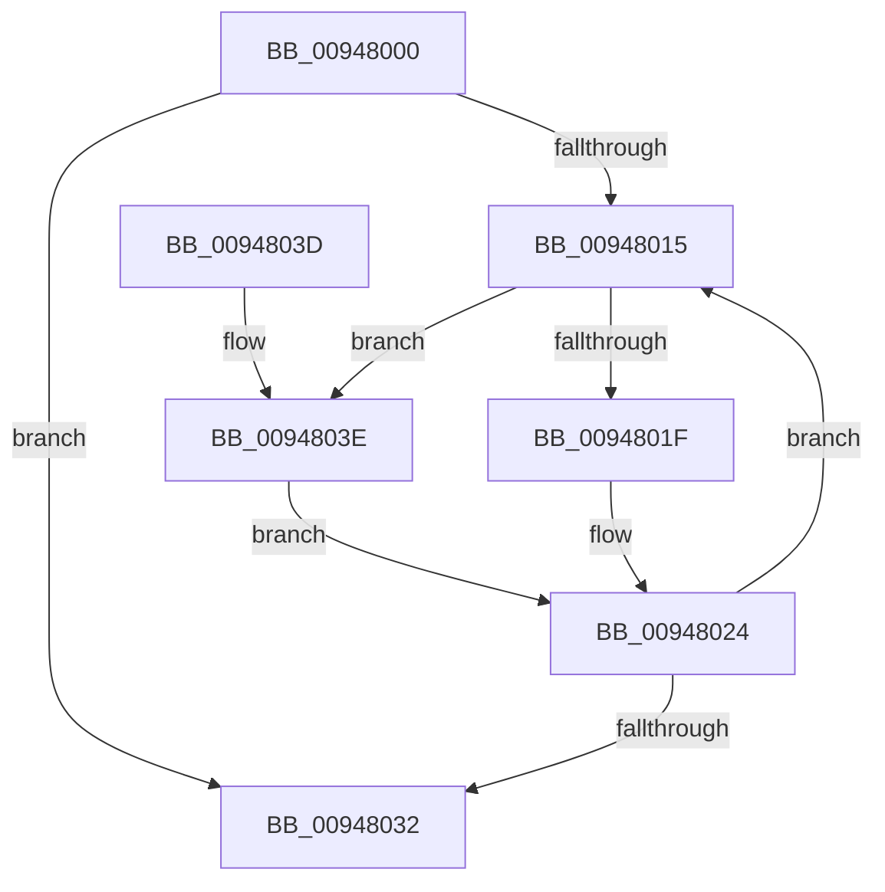

# CmpLockKcbStackShared

- RVA: `0x00948000`–`0x00948049` (길이 `73` bytes)
- VA: `0x0000000140948000`
- 실행 섹션: `PAGE`
- PDB 이름 있음: `예`; PDB Function 태그: `아니요`
- unwind 정보 RVA: `0x00069334`
- 디코드: `23`개 명령, `73/73` bytes 표시
- 미해석 바이트: `0` (있으면 어셈블리에 `.byte`로 보존)

> 이 문서는 커널 이미지의 기계어와 PDB 기호를 분석해 생성했습니다. 4번과 5번은 함수 원형과 자료형을 바이너리 사용 방식에서 추정한 C 해석이며 원본 소스 복구 결과는 아닙니다.

## 1. Dependencies

- 직접 호출 지점: **1**; 고유 호출 대상: **1**
- 직접 호출자로 확인된 함수: **8**
- RIP 상대 이미지 참조: **0**

### Outgoing calls
- `0x00948024` → [CmpLockKcbShared](../../pagecmrc/BC/CmpLockKcbShared_function_00BC9A1C.md) (function, `0x00BC9A1C`)

### Direct callers
- [CmQueryLayeredKey](../../text/46/CmQueryLayeredKey_function_0046A930.md) at `0x0046A9FA`
- [CmSaveKey](../7D/CmSaveKey_function_007DDBDC.md) at `0x007DDCE2`
- [sub_00855472](../85/Unknown_function_00855472.md) at `0x00855480`
- [sub_00857A33](../85/Unknown_function_00857A33.md) at `0x00857B06`
- [CmpDoParseKey](../85/CmpDoParseKey_function_0085F750.md) at `0x0085FF33`
- [CmpDoParseKey](../85/CmpDoParseKey_function_0085F750.md) at `0x00860770`
- [CmpDoParseKey](../85/CmpDoParseKey_function_0085F750.md) at `0x0086077D`
- [CmEnumerateValueFromLayeredKey](../8B/CmEnumerateValueFromLayeredKey_function_008B31FC.md) at `0x008B32D5`
- [CmpEnumerateLayeredKey](CmpEnumerateLayeredKey_function_00945E58.md) at `0x00945F63`
- [CmQueryMultipleValueForLayeredKey](../A8/CmQueryMultipleValueForLayeredKey_function_00A8DE80.md) at `0x00A8DF80`

### Static image references
- 디코드된 RIP-relative 메모리 참조가 없습니다.

## 2. Other-region calls and transfers

- 다른 실행 섹션으로 향하는 call: **1**
  - `0x00948024` → [CmpLockKcbShared](../../pagecmrc/BC/CmpLockKcbShared_function_00BC9A1C.md) (`PAGE` → `PAGECMRC`)
- 별도 외부 분기/꼬리 이동을 확인하지 못했습니다.

## 3. Assembly (complete function range)

```asm
00948000  48 89 5C 24 08                  mov qword ptr [rsp + 8], rbx
00948005  57                              push rdi
00948006  48 83 EC 20                     sub rsp, 0x20
0094800A  33 DB                           xor ebx, ebx
0094800C  48 8B F9                        mov rdi, rcx
0094800F  66 3B 59 02                     cmp bx, word ptr [rcx + 2]
00948013  7F 1D                           jg 0x140948032
00948015  48 0F BF CB                     movsx rcx, bx
00948019  66 83 FB 02                     cmp bx, 2
0094801D  7D 1F                           jge 0x14094803e
0094801F  48 8B 4C CF 08                  mov rcx, qword ptr [rdi + rcx*8 + 8]
00948024  E8 F3 19 28 00                  call 0x140bc9a1c
00948029  66 FF C3                        inc bx
0094802C  66 3B 5F 02                     cmp bx, word ptr [rdi + 2]
00948030  7E E3                           jle 0x140948015
00948032  48 8B 5C 24 30                  mov rbx, qword ptr [rsp + 0x30]
00948037  48 83 C4 20                     add rsp, 0x20
0094803B  5F                              pop rdi
0094803C  C3                              ret
0094803D  CC                              int3
0094803E  48 8B 47 18                     mov rax, qword ptr [rdi + 0x18]
00948042  48 8B 4C C8 F0                  mov rcx, qword ptr [rax + rcx*8 - 0x10]
00948047  EB DB                           jmp 0x140948024
```

## 4. C-style interpretation (structured pseudocode)

```c
__int64 __fastcall CmpLockKcbStackShared(__int64 a1)
{
    __int64 result;
    __int64 v_rbx;
    __int64 v_rsp;
    unsigned __int64 v_stack_p8;

    v_stack_p8 = v_rbx;
    v_rsp = (v_rsp) - (32);
    v_rbx = 0;
    if (0 > (*(unsigned __int16 *)(a1 + 2))) goto loc_00948032;
loc_00948015:
    if (0 >= 2) goto loc_0094803E;
loc_00948024:
    result = CmpLockKcbShared(*(unsigned __int64 *)(a1 + (__int16)(0) * 8 + 8), a2, a3, a4);
    v_rbx = (unsigned __int16)((v_rbx) + 1);
    if (((unsigned __int16)(v_rbx)) <= (*(unsigned __int16 *)(a1 + 2))) goto loc_00948015;
loc_00948032:
    v_rsp = (v_rsp) + (32);
    return result;
loc_0094803E:
    goto loc_00948024;
}
```

## 5. (Beta) C Style

```c
int64_t CmpLockKcbStackShared(void *Arg1)
{
    uint8_t *arg1 = (uint8_t *)Arg1;

    int64_t result;
    int64_t local_rbx;
    int64_t local_rsp;
    uint64_t v_stack_p8;

    v_stack_p8 = local_rbx;
    local_rsp = (local_rsp) - (32);
    local_rbx = 0;
    if (0 > (*(uint16_t *)(arg1 + 0x2))) goto loc_00948032;
loc_00948015:
    if (0 >= 2) goto loc_0094803E;
loc_00948024:
    result = CmpLockKcbShared(*(uint64_t *)(arg1 + (int16_t)(0) * 8 + 0x8), a2, a3, a4);
    local_rbx = (uint16_t)((local_rbx) + 1);
    if (((uint16_t)(local_rbx)) <= (*(uint16_t *)(arg1 + 0x2))) goto loc_00948015;
loc_00948032:
    local_rsp = (local_rsp) + (32);
    return result;
loc_0094803E:
    goto loc_00948024;
}
```

### 관측된 메모리 오프셋

구조체 형식이 확인되지 않은 접근은 인자 기준의 오프셋으로만 기록했습니다.

| 기준 인자 | 오프셋 표현 | 폭 (bit) | 접근 |
|---|---:|---:|---|
| `Arg1` | `+ 0x2` | `16` | `R` |
| `Arg1` | `+ 0x8 + rcx*8` | `64` | `R` |
| `Arg1` | `+ 0x18` | `64` | `R` |

## 6. Execution-region graph

[열기: 2D/3D 그래프와 함수 탐색 컨트롤 패널](../../../control-panel.html?section=page&rva=0x00948000&view=graph)

- 2D 그래프는 위에서 아래로 흐르고, 3D 그래프는 빈 공간을 드래그해 회전합니다. Shift+드래그는 이동, 휠은 확대·축소, 함수 노드 선택은 대상 보고서 이동입니다.

### Static fallback


