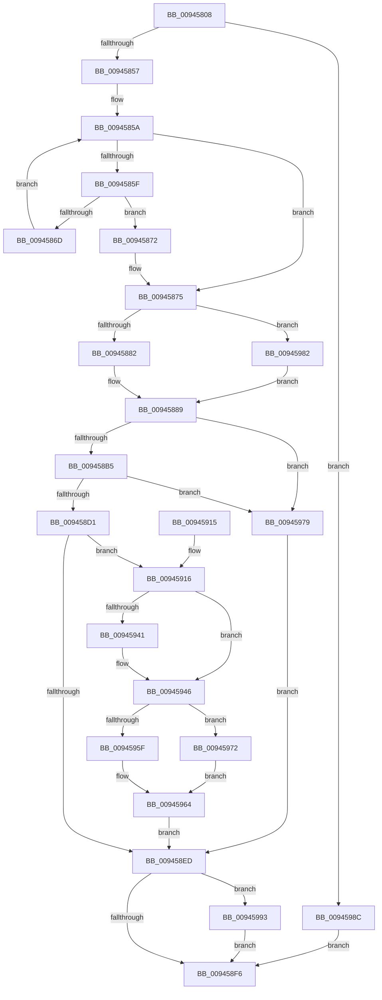

# CmpPartialPromoteSingleKeyFromKeyNodeStacks

- RVA: `0x00945808`–`0x009459A5` (길이 `413` bytes)
- VA: `0x0000000140945808`
- 실행 섹션: `PAGE`
- PDB 이름 있음: `예`; PDB Function 태그: `아니요`
- unwind 정보 RVA: `0x00090900`
- 디코드: `120`개 명령, `413/413` bytes 표시
- 미해석 바이트: `0` (있으면 어셈블리에 `.byte`로 보존)

> 이 문서는 커널 이미지의 기계어와 PDB 기호를 분석해 생성했습니다. 4번과 5번은 함수 원형과 자료형을 바이너리 사용 방식에서 추정한 C 해석이며 원본 소스 복구 결과는 아닙니다.

## 1. Dependencies

- 직접 호출 지점: **9**; 고유 호출 대상: **7**
- 직접 호출자로 확인된 함수: **3**
- RIP 상대 이미지 참조: **0**

### Outgoing calls
- `0x00945838` → [CmpKeyNodeStackGetEntryAtLayerHeight](CmpKeyNodeStackGetEntryAtLayerHeight_function_00946ABC.md) (function, `0x00946ABC`)
- `0x00945843` → [CmpKeyNodeStackGetEntryAtLayerHeight](CmpKeyNodeStackGetEntryAtLayerHeight_function_00946ABC.md) (function, `0x00946ABC`)
- `0x00945862` → [CmpKeyNodeStackGetEntryAtLayerHeight](CmpKeyNodeStackGetEntryAtLayerHeight_function_00946ABC.md) (function, `0x00946ABC`)
- `0x009458A6` → [CmpCopyMergeOfLayeredKeyNode](CmpCopyMergeOfLayeredKeyNode_function_00945A78.md) (function, `0x00945A78`)
- `0x009458C2` → [HvpMarkCellDirty](../85/HvpMarkCellDirty_function_00858080.md) (function, `0x00858080`)
- `0x009458E2` → [CmpAddSubKeyEx](../84/CmpAddSubKeyEx_function_0084C940.md) (function, `0x0084C940`)
- `0x0094595F` → [HvpGetCellFlat](../85/HvpGetCellFlat_function_00854C60.md) (function, `0x00854C60`)
- `0x00945972` → [HvpGetCellPaged](../85/HvpGetCellPaged_function_00854CB0.md) (function, `0x00854CB0`)
- `0x0094599B` → [CmpFreeKeyByCell](../84/CmpFreeKeyByCell_function_0084AD70.md) (function, `0x0084AD70`)

### Direct callers
- [CmpPromoteSingleKeyFromParentKcbAndChildKeyNode](../7F/CmpPromoteSingleKeyFromParentKcbAndChildKeyNode_function_007F426C.md) at `0x007F4316`
- [CmpPromoteSingleKeyFromKcbStacks](CmpPromoteSingleKeyFromKcbStacks_function_009446E8.md) at `0x0094489E`
- [CmpPromoteSubtree](CmpPromoteSubtree_function_00944D60.md) at `0x00944E4F`

### Static image references
- 디코드된 RIP-relative 메모리 참조가 없습니다.

## 2. Other-region calls and transfers

- 다른 실행 섹션으로 향하는 call: **0**
- 별도 외부 분기/꼬리 이동을 확인하지 못했습니다.

## 3. Assembly (complete function range)

```asm
00945808  48 8B C4                        mov rax, rsp
0094580B  48 89 58 10                     mov qword ptr [rax + 0x10], rbx
0094580F  48 89 68 18                     mov qword ptr [rax + 0x18], rbp
00945813  48 89 70 20                     mov qword ptr [rax + 0x20], rsi
00945817  57                              push rdi
00945818  41 54                           push r12
0094581A  41 55                           push r13
0094581C  41 56                           push r14
0094581E  41 57                           push r15
00945820  48 83 EC 30                     sub rsp, 0x30
00945824  4C 8B D2                        mov r10, rdx
00945827  4C 8B C9                        mov r9, rcx
0094582A  0F B7 11                        movzx edx, word ptr [rcx]
0094582D  41 83 CC FF                     or r12d, 0xffffffff
00945831  49 8B CA                        mov rcx, r10
00945834  44 89 60 08                     mov dword ptr [rax + 8], r12d
00945838  E8 7F 12 00 00                  call 0x140946abc
0094583D  49 8B C9                        mov rcx, r9
00945840  4C 8B F0                        mov r14, rax
00945843  E8 74 12 00 00                  call 0x140946abc
00945848  33 DB                           xor ebx, ebx
0094584A  4C 8B F8                        mov r15, rax
0094584D  45 39 66 08                     cmp dword ptr [r14 + 8], r12d
00945851  0F 85 35 01 00 00               jne 0x14094598c
00945857  44 8B EB                        mov r13d, ebx
0094585A  66 85 D2                        test dx, dx
0094585D  78 16                           js 0x140945875
0094585F  49 8B CA                        mov rcx, r10
00945862  E8 55 12 00 00                  call 0x140946abc
00945867  44 39 60 08                     cmp dword ptr [rax + 8], r12d
0094586B  75 05                           jne 0x140945872
0094586D  66 FF CA                        dec dx
00945870  EB E8                           jmp 0x14094585a
00945872  4C 8B E8                        mov r13, rax
00945875  45 8B 47 08                     mov r8d, dword ptr [r15 + 8]
00945879  45 85 C0                        test r8d, r8d
0094587C  0F 88 00 01 00 00               js 0x140945982
00945882  41 8B 45 08                     mov eax, dword ptr [r13 + 8]
00945886  C1 E8 1F                        shr eax, 0x1f
00945889  49 8B 2F                        mov rbp, qword ptr [r15]
0094588C  48 8D 4C 24 60                  lea rcx, [rsp + 0x60]
00945891  48 89 4C 24 28                  mov qword ptr [rsp + 0x28], rcx
00945896  41 B9 02 00 00 00               mov r9d, 2
0094589C  49 8B CA                        mov rcx, r10
0094589F  89 44 24 20                     mov dword ptr [rsp + 0x20], eax
009458A3  48 8B D5                        mov rdx, rbp
009458A6  E8 CD 01 00 00                  call 0x140945a78
009458AB  8B F0                           mov esi, eax
009458AD  85 C0                           test eax, eax
009458AF  0F 88 C4 00 00 00               js 0x140945979
009458B5  41 8B 57 08                     mov edx, dword ptr [r15 + 8]
009458B9  45 33 C9                        xor r9d, r9d
009458BC  45 33 C0                        xor r8d, r8d
009458BF  48 8B CD                        mov rcx, rbp
009458C2  E8 B9 27 F1 FF                  call 0x140858080
009458C7  8B F0                           mov esi, eax
009458C9  85 C0                           test eax, eax
009458CB  0F 88 A8 00 00 00               js 0x140945979
009458D1  8B 7C 24 60                     mov edi, dword ptr [rsp + 0x60]
009458D5  45 33 C9                        xor r9d, r9d
009458D8  41 8B 57 08                     mov edx, dword ptr [r15 + 8]
009458DC  44 8B C7                        mov r8d, edi
009458DF  48 8B CD                        mov rcx, rbp
009458E2  E8 59 70 F0 FF                  call 0x14084c940
009458E7  8B F0                           mov esi, eax
009458E9  85 C0                           test eax, eax
009458EB  79 29                           jns 0x140945916
009458ED  41 3B FC                        cmp edi, r12d
009458F0  0F 85 9D 00 00 00               jne 0x140945993
009458F6  48 8B 5C 24 68                  mov rbx, qword ptr [rsp + 0x68]
009458FB  8B C6                           mov eax, esi
009458FD  48 8B 74 24 78                  mov rsi, qword ptr [rsp + 0x78]
00945902  48 8B 6C 24 70                  mov rbp, qword ptr [rsp + 0x70]
00945907  48 83 C4 30                     add rsp, 0x30
0094590B  41 5F                           pop r15
0094590D  41 5E                           pop r14
0094590F  41 5D                           pop r13
00945911  41 5C                           pop r12
00945913  5F                              pop rdi
00945914  C3                              ret
00945915  CC                              int3
00945916  49 8B 45 10                     mov rax, qword ptr [r13 + 0x10]
0094591A  8A 48 02                        mov cl, byte ptr [rax + 2]
0094591D  0F B7 50 48                     movzx edx, word ptr [rax + 0x48]
00945921  0F B7 C2                        movzx eax, dx
00945924  66 03 C0                        add ax, ax
00945927  F6 C1 20                        test cl, 0x20
0094592A  66 0F 44 C2                     cmove ax, dx
0094592E  49 8B 57 10                     mov rdx, qword ptr [r15 + 0x10]
00945932  44 0F B7 C0                     movzx r8d, ax
00945936  8B 42 34                        mov eax, dword ptr [rdx + 0x34]
00945939  0F B7 C8                        movzx ecx, ax
0094593C  41 3B C8                        cmp ecx, r8d
0094593F  73 05                           jae 0x140945946
00945941  66 44 89 42 34                  mov word ptr [rdx + 0x34], r8w
00945946  49 89 2E                        mov qword ptr [r14], rbp
00945949  4D 8D 46 18                     lea r8, [r14 + 0x18]
0094594D  41 89 7E 08                     mov dword ptr [r14 + 8], edi
00945951  8B D7                           mov edx, edi
00945953  F6 85 8C 00 00 00 01            test byte ptr [rbp + 0x8c], 1
0094595A  48 8B CD                        mov rcx, rbp
0094595D  74 13                           je 0x140945972
0094595F  E8 FC F2 F0 FF                  call 0x140854c60
00945964  49 89 46 10                     mov qword ptr [r14 + 0x10], rax
00945968  41 8B FC                        mov edi, r12d
0094596B  8B F3                           mov esi, ebx
0094596D  E9 7B FF FF FF                  jmp 0x1409458ed
00945972  E8 39 F3 F0 FF                  call 0x140854cb0
00945977  EB EB                           jmp 0x140945964
00945979  8B 7C 24 60                     mov edi, dword ptr [rsp + 0x60]
0094597D  E9 6B FF FF FF                  jmp 0x1409458ed
00945982  B8 01 00 00 00                  mov eax, 1
00945987  E9 FD FE FF FF                  jmp 0x140945889
0094598C  8B F3                           mov esi, ebx
0094598E  E9 63 FF FF FF                  jmp 0x1409458f6
00945993  45 33 C0                        xor r8d, r8d
00945996  8B D7                           mov edx, edi
00945998  48 8B CD                        mov rcx, rbp
0094599B  E8 D0 53 F0 FF                  call 0x14084ad70
009459A0  E9 51 FF FF FF                  jmp 0x1409458f6
```

## 4. C-style interpretation (structured pseudocode)

```c
__int64 __fastcall CmpPartialPromoteSingleKeyFromKeyNodeStacks(__int64 a1, __int64 a2)
{
    __int64 result;
    __int64 v_r12;
    __int64 v_rbx;
    __int64 v_rsp;
    unsigned __int64 v_stack_m30;
    unsigned int v_stack_m38;
    unsigned __int64 v_stack_p10;
    unsigned __int64 v_stack_p18;
    unsigned __int64 v_stack_p20;
    unsigned int v_stack_p60;
    unsigned __int64 v_stack_p8;

    *(unsigned __int64 *)(v_rsp + 16) = v_rbx;
    *(unsigned __int64 *)(v_rsp + 24) = v_rbp;
    *(unsigned __int64 *)(v_rsp + 32) = v_rsi;
    v_rsp = (v_rsp) - (48);
    v_r12 = (unsigned int)((v_r12) | (0xFFFFFFFFULL));
    *(unsigned int *)(v_rsp + 8) = (unsigned int)(v_r12);
    result = CmpKeyNodeStackGetEntryAtLayerHeight(a2, *(unsigned __int16 *)(a1), a3, a1);
    result = CmpKeyNodeStackGetEntryAtLayerHeight(a1, *(unsigned __int16 *)(a1), a3, a1);
    v_rbx = 0;
    if ((*(unsigned int *)(result + 8)) != ((unsigned int)(v_r12))) goto loc_0094598C;
loc_0094585A:
    if (sign_flag) goto loc_00945875;
    result = CmpKeyNodeStackGetEntryAtLayerHeight(a2, *(unsigned __int16 *)(a1), a3, a1);
    if ((*(unsigned int *)(result + 8)) != ((unsigned int)(v_r12))) goto loc_00945872;
    a2 = (unsigned __int16)((*(unsigned __int16 *)(a1)) - 1);
    goto loc_0094585A;
loc_00945872:
loc_00945875:
    if (sign_flag) goto loc_00945982;
    result = (unsigned int)(((unsigned int)(*(unsigned int *)(result + 8))) >> (31));
loc_00945889:
    v_stack_m30 = v_stack_p8;
    v_stack_m38 = (unsigned int)(result);
    result = CmpCopyMergeOfLayeredKeyNode(a2, *(unsigned __int64 *)(result), (unsigned int)(*(unsigned int *)(result + 8)), 2);
    if (sign_flag) goto loc_00945979;
    a4 = 0;
    a3 = 0;
    result = HvpMarkCellDirty(*(unsigned __int64 *)(result), (unsigned int)(*(unsigned int *)(result + 8)), a3, a4);
    if (sign_flag) goto loc_00945979;
    a4 = 0;
    result = CmpAddSubKeyEx(*(unsigned __int64 *)(result), (unsigned int)(*(unsigned int *)(result + 8)), (unsigned int)((unsigned int)((unsigned int)(v_stack_p8))), a4);
    if (!sign_flag) goto loc_00945916;
loc_009458ED:
    if (((unsigned int)((unsigned int)(v_stack_p8))) != ((unsigned int)(v_r12))) goto loc_00945993;
loc_009458F6:
    v_rsp = (v_rsp) + (48);
    return (unsigned int)((unsigned int)((unsigned int)((unsigned int)(result))));
loc_00945916:
    result = (unsigned __int16)(((unsigned __int16)(*(unsigned __int16 *)(*(unsigned __int64 *)(result + 16) + 72))) + ((unsigned __int16)((unsigned __int16)(*(unsigned __int16 *)(*(unsigned __int64 *)(result + 16) + 72)))));
    if ((((unsigned __int8)(*(unsigned __int8 *)(*(unsigned __int64 *)(result + 16) + 2))) & (32)) == 0) { result = (unsigned __int16)(*(unsigned __int16 *)(*(unsigned __int64 *)(result + 16) + 72)); }
    if (((unsigned int)((unsigned __int16)((unsigned int)(*(unsigned int *)(*(unsigned __int64 *)(result + 16) + 52))))) < ((unsigned int)((unsigned __int16)(result)))) {
        *(unsigned __int16 *)(*(unsigned __int64 *)(result + 16) + 52) = (unsigned __int16)((unsigned __int16)(result));
    }
    *(unsigned __int64 *)(result) = v_stack_p18;
    *(unsigned int *)(result + 8) = (unsigned int)((unsigned int)(v_stack_p8));
    if (((*(unsigned __int8 *)(v_stack_p18 + 140)) & (1)) == 0) goto loc_00945972;
    result = HvpGetCellFlat(v_stack_p18, (unsigned int)((unsigned int)((unsigned int)(v_stack_p8))), result + 24, a4);
loc_00945964:
    *(unsigned __int64 *)(result + 16) = result;
    goto loc_009458ED;
loc_00945972:
    result = HvpGetCellPaged(v_stack_p18, (unsigned int)((unsigned int)((unsigned int)(v_stack_p8))), result + 24, a4);
    goto loc_00945964;
loc_00945979:
    goto loc_009458ED;
loc_00945982:
    goto loc_00945889;
loc_0094598C:
    goto loc_009458F6;
loc_00945993:
    a3 = 0;
    result = CmpFreeKeyByCell(v_stack_p18, (unsigned int)((unsigned int)((unsigned int)(v_stack_p60))), a3, a4);
    goto loc_009458F6;
}
```

## 5. (Beta) C Style

```c
int64_t CmpPartialPromoteSingleKeyFromKeyNodeStacks(void *Arg1, int64_t Arg2)
{
    uint8_t *arg1 = (uint8_t *)Arg1;

    int64_t result;
    int64_t local_r12;
    int64_t local_rbx;
    int64_t local_rsp;
    uint64_t v_stack_m30;
    uint32_t v_stack_m38;
    uint64_t v_stack_p10;
    uint64_t v_stack_p18;
    uint64_t v_stack_p20;
    uint32_t v_stack_p60;
    uint64_t v_stack_p8;

    *(uint64_t *)(local_rsp + 0x10) = local_rbx;
    *(uint64_t *)(local_rsp + 0x18) = local_rbp;
    *(uint64_t *)(local_rsp + 0x20) = local_rsi;
    local_rsp = (local_rsp) - (48);
    local_r12 = (uint32_t)((local_r12) | (0xFFFFFFFFULL));
    *(uint32_t *)(local_rsp + 0x8) = (uint32_t)(local_r12);
    result = CmpKeyNodeStackGetEntryAtLayerHeight(Arg2, *(uint16_t *)(arg1), a3, Arg1);
    result = CmpKeyNodeStackGetEntryAtLayerHeight(Arg1, *(uint16_t *)(arg1), a3, Arg1);
    local_rbx = 0;
    if ((*(uint32_t *)(result + 0x8)) != ((uint32_t)(local_r12))) goto loc_0094598C;
loc_0094585A:
    if (sign_flag) goto loc_00945875;
    result = CmpKeyNodeStackGetEntryAtLayerHeight(Arg2, *(uint16_t *)(arg1), a3, Arg1);
    if ((*(uint32_t *)(result + 0x8)) != ((uint32_t)(local_r12))) goto loc_00945872;
    Arg2 = (uint16_t)((*(uint16_t *)(arg1)) - 1);
    goto loc_0094585A;
loc_00945872:
loc_00945875:
    if (sign_flag) goto loc_00945982;
    result = (uint32_t)(((uint32_t)(*(uint32_t *)(result + 0x8))) >> (31));
loc_00945889:
    v_stack_m30 = v_stack_p8;
    v_stack_m38 = (uint32_t)(result);
    result = CmpCopyMergeOfLayeredKeyNode(Arg2, *(uint64_t *)(result), (uint32_t)(*(uint32_t *)(result + 0x8)), 2);
    if (sign_flag) goto loc_00945979;
    a4 = 0;
    a3 = 0;
    result = HvpMarkCellDirty(*(uint64_t *)(result), (uint32_t)(*(uint32_t *)(result + 0x8)), a3, a4);
    if (sign_flag) goto loc_00945979;
    a4 = 0;
    result = CmpAddSubKeyEx(*(uint64_t *)(result), (uint32_t)(*(uint32_t *)(result + 0x8)), (uint32_t)((uint32_t)((uint32_t)(v_stack_p8))), a4);
    if (!sign_flag) goto loc_00945916;
loc_009458ED:
    if (((uint32_t)((uint32_t)(v_stack_p8))) != ((uint32_t)(local_r12))) goto loc_00945993;
loc_009458F6:
    local_rsp = (local_rsp) + (48);
    return (uint32_t)((uint32_t)((uint32_t)((uint32_t)(result))));
loc_00945916:
    result = (uint16_t)(((uint16_t)(*(uint16_t *)(*(uint64_t *)(result + 0x10) + 0x48))) + ((uint16_t)((uint16_t)(*(uint16_t *)(*(uint64_t *)(result + 0x10) + 0x48)))));
    if ((((uint8_t)(*(uint8_t *)(*(uint64_t *)(result + 0x10) + 0x2))) & (32)) == 0) { result = (uint16_t)(*(uint16_t *)(*(uint64_t *)(result + 0x10) + 0x48)); }
    if (((uint32_t)((uint16_t)((uint32_t)(*(uint32_t *)(*(uint64_t *)(result + 0x10) + 0x34))))) < ((uint32_t)((uint16_t)(result)))) {
        *(uint16_t *)(*(uint64_t *)(result + 0x10) + 0x34) = (uint16_t)((uint16_t)(result));
    }
    *(uint64_t *)(result) = v_stack_p18;
    *(uint32_t *)(result + 0x8) = (uint32_t)((uint32_t)(v_stack_p8));
    if (((*(uint8_t *)(v_stack_p18 + 0x8C)) & (1)) == 0) goto loc_00945972;
    result = HvpGetCellFlat(v_stack_p18, (uint32_t)((uint32_t)((uint32_t)(v_stack_p8))), result + 24, a4);
loc_00945964:
    *(uint64_t *)(result + 0x10) = result;
    goto loc_009458ED;
loc_00945972:
    result = HvpGetCellPaged(v_stack_p18, (uint32_t)((uint32_t)((uint32_t)(v_stack_p8))), result + 24, a4);
    goto loc_00945964;
loc_00945979:
    goto loc_009458ED;
loc_00945982:
    goto loc_00945889;
loc_0094598C:
    goto loc_009458F6;
loc_00945993:
    a3 = 0;
    result = CmpFreeKeyByCell(v_stack_p18, (uint32_t)((uint32_t)((uint32_t)(v_stack_p60))), a3, a4);
    goto loc_009458F6;
}
```

### 관측된 메모리 오프셋

구조체 형식이 확인되지 않은 접근은 인자 기준의 오프셋으로만 기록했습니다.

| 기준 인자 | 오프셋 표현 | 폭 (bit) | 접근 |
|---|---:|---:|---|
| `Arg1` | `+ 0x0` | `16` | `R` |

## 6. Execution-region graph

[열기: 2D/3D 그래프와 함수 탐색 컨트롤 패널](../../../control-panel.html?section=page&rva=0x00945808&view=graph)

- 2D 그래프는 위에서 아래로 흐르고, 3D 그래프는 빈 공간을 드래그해 회전합니다. Shift+드래그는 이동, 휠은 확대·축소, 함수 노드 선택은 대상 보고서 이동입니다.

### Static fallback


