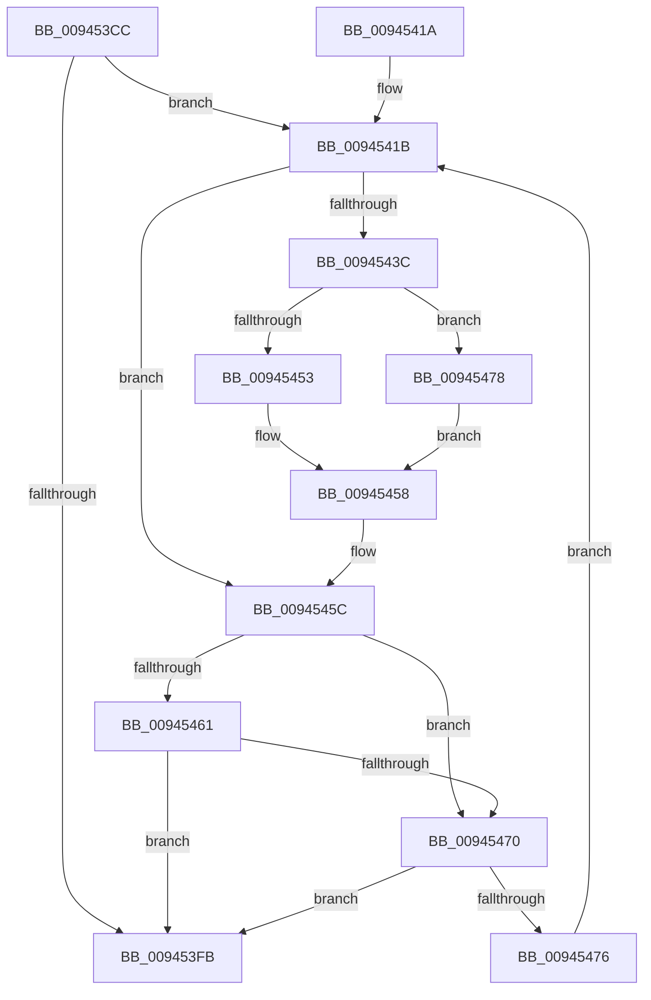

# CmpPopulateKeyNodeStackFromKcbStack

- RVA: `0x009453CC`–`0x0094547F` (길이 `179` bytes)
- VA: `0x00000001409453CC`
- 실행 섹션: `PAGE`
- PDB 이름 있음: `예`; PDB Function 태그: `아니요`
- unwind 정보 RVA: `0x00090894`
- 디코드: `55`개 명령, `179/179` bytes 표시
- 미해석 바이트: `0` (있으면 어셈블리에 `.byte`로 보존)

> 이 문서는 커널 이미지의 기계어와 PDB 기호를 분석해 생성했습니다. 4번과 5번은 함수 원형과 자료형을 바이너리 사용 방식에서 추정한 C 해석이며 원본 소스 복구 결과는 아닙니다.

## 1. Dependencies

- 직접 호출 지점: **5**; 고유 호출 대상: **5**
- 직접 호출자로 확인된 함수: **5**
- RIP 상대 이미지 참조: **0**

### Outgoing calls
- `0x00945421` → [CmpKeyNodeStackGetEntryAtLayerHeight](CmpKeyNodeStackGetEntryAtLayerHeight_function_00946ABC.md) (function, `0x00946ABC`)
- `0x0094542C` → [CmpGetKcbAtLayerHeight](CmpGetKcbAtLayerHeight_function_00949210.md) (function, `0x00949210`)
- `0x00945453` → [HvpGetCellFlat](../85/HvpGetCellFlat_function_00854C60.md) (function, `0x00854C60`)
- `0x00945467` → [CmpGetEffectiveKcbSemantics](../84/CmpGetEffectiveKcbSemantics_function_00848E20.md) (function, `0x00848E20`)
- `0x00945478` → [HvpGetCellPaged](../85/HvpGetCellPaged_function_00854CB0.md) (function, `0x00854CB0`)

### Direct callers
- [CmSaveKey](../7D/CmSaveKey_function_007DDBDC.md) at `0x007DDD59`
- [CmpSubtreeEnumeratorBeginForKcbStack](../7F/CmpSubtreeEnumeratorBeginForKcbStack_function_007F18DC.md) at `0x007F18FF`
- [CmpGetSubKeyCountForKcbStack](CmpGetSubKeyCountForKcbStack_function_00944628.md) at `0x0094469A`
- [CmpValueEnumStackStartFromKcbStack](CmpValueEnumStackStartFromKcbStack_function_00944AA4.md) at `0x00944B20`
- [CmpStartKeyNodeStackFromKcbStack](CmpStartKeyNodeStackFromKcbStack_function_00945254.md) at `0x00945282`

### Static image references
- 디코드된 RIP-relative 메모리 참조가 없습니다.

## 2. Other-region calls and transfers

- 다른 실행 섹션으로 향하는 call: **0**
- 별도 외부 분기/꼬리 이동을 확인하지 못했습니다.

## 3. Assembly (complete function range)

```asm
009453CC  48 8B C4                        mov rax, rsp
009453CF  48 89 58 08                     mov qword ptr [rax + 8], rbx
009453D3  48 89 68 10                     mov qword ptr [rax + 0x10], rbp
009453D7  48 89 70 18                     mov qword ptr [rax + 0x18], rsi
009453DB  48 89 78 20                     mov qword ptr [rax + 0x20], rdi
009453DF  41 54                           push r12
009453E1  41 56                           push r14
009453E3  41 57                           push r15
009453E5  48 83 EC 20                     sub rsp, 0x20
009453E9  0F B7 5A 02                     movzx ebx, word ptr [rdx + 2]
009453ED  49 8B F0                        mov rsi, r8
009453F0  4C 8B F2                        mov r14, rdx
009453F3  4C 8B F9                        mov r15, rcx
009453F6  66 85 DB                        test bx, bx
009453F9  79 20                           jns 0x14094541b
009453FB  48 8B 5C 24 40                  mov rbx, qword ptr [rsp + 0x40]
00945400  48 8B 6C 24 48                  mov rbp, qword ptr [rsp + 0x48]
00945405  48 8B 74 24 50                  mov rsi, qword ptr [rsp + 0x50]
0094540A  48 8B 7C 24 58                  mov rdi, qword ptr [rsp + 0x58]
0094540F  48 83 C4 20                     add rsp, 0x20
00945413  41 5F                           pop r15
00945415  41 5E                           pop r14
00945417  41 5C                           pop r12
00945419  C3                              ret
0094541A  CC                              int3
0094541B  0F B7 D3                        movzx edx, bx
0094541E  49 8B CF                        mov rcx, r15
00945421  E8 96 16 00 00                  call 0x140946abc
00945426  49 8B CE                        mov rcx, r14
00945429  48 8B F8                        mov rdi, rax
0094542C  E8 DF 3D 00 00                  call 0x140949210
00945431  48 8B E8                        mov rbp, rax
00945434  8B 50 28                        mov edx, dword ptr [rax + 0x28]
00945437  83 FA FF                        cmp edx, -1
0094543A  74 20                           je 0x14094545c
0094543C  48 8B 48 20                     mov rcx, qword ptr [rax + 0x20]
00945440  4C 8D 47 18                     lea r8, [rdi + 0x18]
00945444  48 89 0F                        mov qword ptr [rdi], rcx
00945447  89 57 08                        mov dword ptr [rdi + 8], edx
0094544A  F6 81 8C 00 00 00 01            test byte ptr [rcx + 0x8c], 1
00945451  74 25                           je 0x140945478
00945453  E8 08 F8 F0 FF                  call 0x140854c60
00945458  48 89 47 10                     mov qword ptr [rdi + 0x10], rax
0094545C  48 85 F6                        test rsi, rsi
0094545F  74 0F                           je 0x140945470
00945461  48 8B D6                        mov rdx, rsi
00945464  48 8B CD                        mov rcx, rbp
00945467  E8 B4 39 F0 FF                  call 0x140848e20
0094546C  85 C0                           test eax, eax
0094546E  75 8B                           jne 0x1409453fb
00945470  66 83 EB 01                     sub bx, 1
00945474  78 85                           js 0x1409453fb
00945476  EB A3                           jmp 0x14094541b
00945478  E8 33 F8 F0 FF                  call 0x140854cb0
0094547D  EB D9                           jmp 0x140945458
```

## 4. C-style interpretation (structured pseudocode)

```c
__int64 __fastcall CmpPopulateKeyNodeStackFromKcbStack(__int64 a1, __int64 a2, __int64 a3)
{
    __int64 result;
    __int64 v_rbx;
    __int64 v_rsp;
    unsigned __int64 v_stack_p10;
    unsigned __int64 v_stack_p18;
    unsigned __int64 v_stack_p20;
    unsigned __int64 v_stack_p8;

    *(unsigned __int64 *)(v_rsp + 8) = v_rbx;
    *(unsigned __int64 *)(v_rsp + 16) = v_rbp;
    *(unsigned __int64 *)(v_rsp + 24) = v_rsi;
    *(unsigned __int64 *)(v_rsp + 32) = v_rdi;
    v_rsp = (v_rsp) - (32);
    if (!sign_flag) goto loc_0094541B;
loc_009453FB:
    v_rsp = (v_rsp) + (32);
    return v_rsp;
loc_0094541B:
    result = CmpKeyNodeStackGetEntryAtLayerHeight(a1, (unsigned __int16)(v_stack_p8), a3, a4);
    result = CmpGetKcbAtLayerHeight(a2, (unsigned __int16)(v_stack_p8), a3, a4);
    if (((unsigned int)((unsigned int)(*(unsigned int *)(result + 40)))) == -1) goto loc_0094545C;
    *(unsigned __int64 *)(result) = *(unsigned __int64 *)(result + 32);
    *(unsigned int *)(result + 8) = (unsigned int)((unsigned int)(*(unsigned int *)(result + 40)));
    if (((*(unsigned __int8 *)(*(unsigned __int64 *)(result + 32) + 140)) & (1)) == 0) goto loc_00945478;
    result = HvpGetCellFlat(*(unsigned __int64 *)(result + 32), (unsigned int)(*(unsigned int *)(result + 40)), result + 24, a4);
loc_00945458:
    *(unsigned __int64 *)(result + 16) = result;
loc_0094545C:
    if (v_stack_p18 == 0) goto loc_00945470;
    result = CmpGetEffectiveKcbSemantics(result, v_stack_p18, result + 24, a4);
    if ((unsigned int)(result) != 0) goto loc_009453FB;
loc_00945470:
    v_rbx = (unsigned __int16)((v_stack_p8) - (1));
    if (sign_flag) goto loc_009453FB;
    goto loc_0094541B;
loc_00945478:
    result = HvpGetCellPaged(result, v_stack_p18, result + 24, a4);
    goto loc_00945458;
}
```

## 5. (Beta) C Style

```c
int64_t CmpPopulateKeyNodeStackFromKcbStack(int64_t Arg1, void *Arg2, int64_t Arg3)
{
    uint8_t *arg2 = (uint8_t *)Arg2;

    int64_t result;
    int64_t local_rbx;
    int64_t local_rsp;
    uint64_t v_stack_p10;
    uint64_t v_stack_p18;
    uint64_t v_stack_p20;
    uint64_t v_stack_p8;

    *(uint64_t *)(local_rsp + 0x8) = local_rbx;
    *(uint64_t *)(local_rsp + 0x10) = local_rbp;
    *(uint64_t *)(local_rsp + 0x18) = local_rsi;
    *(uint64_t *)(local_rsp + 0x20) = local_rdi;
    local_rsp = (local_rsp) - (32);
    if (!sign_flag) goto loc_0094541B;
loc_009453FB:
    local_rsp = (local_rsp) + (32);
    return local_rsp;
loc_0094541B:
    result = CmpKeyNodeStackGetEntryAtLayerHeight(Arg1, (uint16_t)(v_stack_p8), Arg3, a4);
    result = CmpGetKcbAtLayerHeight(Arg2, (uint16_t)(v_stack_p8), Arg3, a4);
    if (((uint32_t)((uint32_t)(*(uint32_t *)(result + 0x28)))) == -1) goto loc_0094545C;
    *(uint64_t *)(result) = *(uint64_t *)(result + 0x20);
    *(uint32_t *)(result + 0x8) = (uint32_t)((uint32_t)(*(uint32_t *)(result + 0x28)));
    if (((*(uint8_t *)(*(uint64_t *)(result + 0x20) + 0x8C)) & (1)) == 0) goto loc_00945478;
    result = HvpGetCellFlat(*(uint64_t *)(result + 0x20), (uint32_t)(*(uint32_t *)(result + 0x28)), result + 24, a4);
loc_00945458:
    *(uint64_t *)(result + 0x10) = result;
loc_0094545C:
    if (v_stack_p18 == 0) goto loc_00945470;
    result = CmpGetEffectiveKcbSemantics(result, v_stack_p18, result + 24, a4);
    if ((uint32_t)(result) != 0) goto loc_009453FB;
loc_00945470:
    local_rbx = (uint16_t)((v_stack_p8) - (1));
    if (sign_flag) goto loc_009453FB;
    goto loc_0094541B;
loc_00945478:
    result = HvpGetCellPaged(result, v_stack_p18, result + 24, a4);
    goto loc_00945458;
}
```

### 관측된 메모리 오프셋

구조체 형식이 확인되지 않은 접근은 인자 기준의 오프셋으로만 기록했습니다.

| 기준 인자 | 오프셋 표현 | 폭 (bit) | 접근 |
|---|---:|---:|---|
| `Arg2` | `+ 0x2` | `16` | `R` |

## 6. Execution-region graph

[열기: 2D/3D 그래프와 함수 탐색 컨트롤 패널](../../../control-panel.html?section=page&rva=0x009453CC&view=graph)

- 2D 그래프는 위에서 아래로 흐르고, 3D 그래프는 빈 공간을 드래그해 회전합니다. Shift+드래그는 이동, 휠은 확대·축소, 함수 노드 선택은 대상 보고서 이동입니다.

### Static fallback


