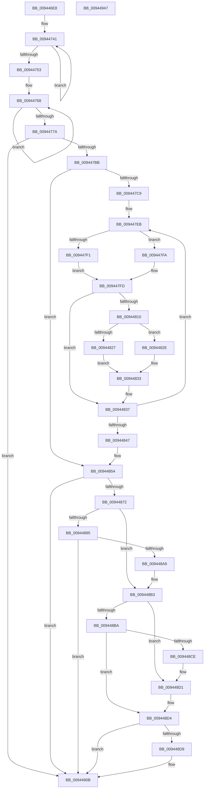

# CmpPromoteSingleKeyFromKcbStacks

- RVA: `0x009446E8`–`0x00944948` (길이 `608` bytes)
- VA: `0x00000001409446E8`
- 실행 섹션: `PAGE`
- PDB 이름 있음: `예`; PDB Function 태그: `아니요`
- unwind 정보 RVA: `0x000876E8`
- 디코드: `169`개 명령, `608/608` bytes 표시
- 미해석 바이트: `0` (있으면 어셈블리에 `.byte`로 보존)

> 이 문서는 커널 이미지의 기계어와 PDB 기호를 분석해 생성했습니다. 4번과 5번은 함수 원형과 자료형을 바이너리 사용 방식에서 추정한 C 해석이며 원본 소스 복구 결과는 아닙니다.

## 1. Dependencies

- 직접 호출 지점: **20**; 고유 호출 대상: **13**
- 직접 호출자로 확인된 함수: **3**
- RIP 상대 이미지 참조: **1**

### Outgoing calls
- `0x00944731` → [memset](../../text/6C/memset_function_006C6C40.md) (function, `0x006C6C40`)
- `0x00944744` → [CmpKeyNodeStackEntryInitialize](CmpKeyNodeStackEntryInitialize_function_00946840.md) (function, `0x00946840`)
- `0x0094475C` → [memset](../../text/6C/memset_function_006C6C40.md) (function, `0x006C6C40`)
- `0x0094476B` → [CmpKeyNodeStackEntryInitialize](CmpKeyNodeStackEntryInitialize_function_00946840.md) (function, `0x00946840`)
- `0x0094478F` → [CmpGetKcbAtLayerHeight](CmpGetKcbAtLayerHeight_function_00949210.md) (function, `0x00949210`)
- `0x0094479F` → [CmpGetKcbAtLayerHeight](CmpGetKcbAtLayerHeight_function_00949210.md) (function, `0x00949210`)
- `0x009447AC` → [CmpStartKeyNodeStack](CmpStartKeyNodeStack_function_00945338.md) (function, `0x00945338`)
- `0x00944803` → [CmpGetKcbAtLayerHeight](CmpGetKcbAtLayerHeight_function_00949210.md) (function, `0x00949210`)
- `0x00944827` → [HvpGetCellFlat](../85/HvpGetCellFlat_function_00854C60.md) (function, `0x00854C60`)
- `0x0094482E` → [HvpGetCellPaged](../85/HvpGetCellPaged_function_00854CB0.md) (function, `0x00854CB0`)
- `0x00944860` → [CmpStartKeyNodeStackFromKcbStack](CmpStartKeyNodeStackFromKcbStack_function_00945254.md) (function, `0x00945254`)
- `0x0094487A` → [CmpKeyNodeStackGetEntryAtLayerHeight](CmpKeyNodeStackGetEntryAtLayerHeight_function_00946ABC.md) (function, `0x00946ABC`)
- `0x00944886` → [CmpKeyNodeStackGetEntryAtLayerHeight](CmpKeyNodeStackGetEntryAtLayerHeight_function_00946ABC.md) (function, `0x00946ABC`)
- `0x0094489E` → [CmpPartialPromoteSingleKeyFromKeyNodeStacks](CmpPartialPromoteSingleKeyFromKeyNodeStacks_function_00945808.md) (function, `0x00945808`)
- `0x009448C3` → [CmpFullPromoteSingleKeyFromKeyNodeStacks](../8B/CmpFullPromoteSingleKeyFromKeyNodeStacks_function_008B1A40.md) (function, `0x008B1A40`)
- `0x009448ED` → [CmpRebuildKcbCacheFromNode](../84/CmpRebuildKcbCacheFromNode_function_0084C5A8.md) (function, `0x0084C5A8`)
- `0x00944906` → [CmpRebuildKcbCacheFromNode](../84/CmpRebuildKcbCacheFromNode_function_0084C5A8.md) (function, `0x0084C5A8`)
- `0x0094490F` → [CmpCleanupKeyNodeStack](CmpCleanupKeyNodeStack_function_00946A5C.md) (function, `0x00946A5C`)
- `0x00944919` → [CmpCleanupKeyNodeStack](CmpCleanupKeyNodeStack_function_00946A5C.md) (function, `0x00946A5C`)
- `0x00944927` → [_security_check_cookie](../../text/6A/_security_check_cookie_function_006AC640.md) (function, `0x006AC640`)

### Direct callers
- [CmpPartialPromoteSubkeys](../7F/CmpPartialPromoteSubkeys_function_007F4070.md) at `0x007F41EC`
- [CmpPromoteSubtree](CmpPromoteSubtree_function_00944D60.md) at `0x00944EA7`
- [sub_00B16026](../B1/Unknown_function_00B16026.md) at `0x00B16039`

### Static image references
- `0x00944704` → RVA `0x00E0A740` (`.data`; read)

## 2. Other-region calls and transfers

- 다른 실행 섹션으로 향하는 call: **3**
  - `0x00944731` → [memset](../../text/6C/memset_function_006C6C40.md) (`PAGE` → `.text`)
  - `0x0094475C` → [memset](../../text/6C/memset_function_006C6C40.md) (`PAGE` → `.text`)
  - `0x00944927` → [_security_check_cookie](../../text/6A/_security_check_cookie_function_006AC640.md) (`PAGE` → `.text`)
- 별도 외부 분기/꼬리 이동을 확인하지 못했습니다.

## 3. Assembly (complete function range)

```asm
009446E8  48 89 5C 24 18                  mov qword ptr [rsp + 0x18], rbx
009446ED  55                              push rbp
009446EE  56                              push rsi
009446EF  57                              push rdi
009446F0  41 54                           push r12
009446F2  41 55                           push r13
009446F4  41 56                           push r14
009446F6  41 57                           push r15
009446F8  48 8D 6C 24 D9                  lea rbp, [rsp - 0x27]
009446FD  48 81 EC F0 00 00 00            sub rsp, 0xf0
00944704  48 8B 05 35 60 4C 00            mov rax, qword ptr [rip + 0x4c6035]
0094470B  48 33 C4                        xor rax, rsp
0094470E  48 89 45 17                     mov qword ptr [rbp + 0x17], rax
00944712  44 88 44 24 21                  mov byte ptr [rsp + 0x21], r8b
00944717  48 8B DA                        mov rbx, rdx
0094471A  48 89 54 24 30                  mov qword ptr [rsp + 0x30], rdx
0094471F  4C 8B E9                        mov r13, rcx
00944722  BF 50 00 00 00                  mov edi, 0x50
00944727  48 8D 4C 24 40                  lea rcx, [rsp + 0x40]
0094472C  44 8B C7                        mov r8d, edi
0094472F  33 D2                           xor edx, edx
00944731  E8 0A 25 D8 FF                  call 0x1406c6c40
00944736  8D 77 B2                        lea esi, [rdi - 0x4e]
00944739  44 8B CE                        mov r9d, esi
0094473C  48 8D 54 24 48                  lea rdx, [rsp + 0x48]
00944741  48 8B CA                        mov rcx, rdx
00944744  E8 F7 20 00 00                  call 0x140946840
00944749  48 83 C2 20                     add rdx, 0x20
0094474D  49 83 E9 01                     sub r9, 1
00944751  75 EE                           jne 0x140944741
00944753  4C 8B C7                        mov r8, rdi
00944756  48 8D 4D C7                     lea rcx, [rbp - 0x39]
0094475A  33 D2                           xor edx, edx
0094475C  E8 DF 24 D8 FF                  call 0x1406c6c40
00944761  48 8D 55 CF                     lea rdx, [rbp - 0x31]
00944765  4C 8B C6                        mov r8, rsi
00944768  48 8B CA                        mov rcx, rdx
0094476B  E8 D0 20 00 00                  call 0x140946840
00944770  48 83 C2 20                     add rdx, 0x20
00944774  49 83 E8 01                     sub r8, 1
00944778  75 EE                           jne 0x140944768
0094477A  41 0F B7 7D 02                  movzx edi, word ptr [r13 + 2]
0094477F  33 F6                           xor esi, esi
00944781  0F B7 D7                        movzx edx, di
00944784  66 89 7C 24 22                  mov word ptr [rsp + 0x22], di
00944789  49 8B CD                        mov rcx, r13
0094478C  44 8A E6                        mov r12b, sil
0094478F  E8 7C 4A 00 00                  call 0x140949210
00944794  48 8B CB                        mov rcx, rbx
00944797  48 89 44 24 28                  mov qword ptr [rsp + 0x28], rax
0094479C  4C 8B F8                        mov r15, rax
0094479F  E8 6C 4A 00 00                  call 0x140949210
009447A4  48 8D 4C 24 40                  lea rcx, [rsp + 0x40]
009447A9  4C 8B F0                        mov r14, rax
009447AC  E8 87 0B 00 00                  call 0x140945338
009447B1  8B D8                           mov ebx, eax
009447B3  85 C0                           test eax, eax
009447B5  0F 88 50 01 00 00               js 0x14094490b
009447BB  49 0F BF 5D 02                  movsx rbx, word ptr [r13 + 2]
009447C0  66 85 DB                        test bx, bx
009447C3  0F 88 8B 00 00 00               js 0x140944854
009447C9  48 8B CB                        mov rcx, rbx
009447CC  44 8D 66 02                     lea r12d, [rsi + 2]
009447D0  48 C1 E1 05                     shl rcx, 5
009447D4  4C 8D 7C 24 48                  lea r15, [rsp + 0x48]
009447D9  0F B7 C3                        movzx eax, bx
009447DC  4C 03 F9                        add r15, rcx
009447DF  66 41 2B C4                     sub ax, r12w
009447E3  48 0F BF F8                     movsx rdi, ax
009447E7  48 C1 E7 05                     shl rdi, 5
009447EB  66 41 3B DC                     cmp bx, r12w
009447EF  72 09                           jb 0x1409447fa
009447F1  48 8B 75 BF                     mov rsi, qword ptr [rbp - 0x41]
009447F5  48 03 F7                        add rsi, rdi
009447F8  EB 03                           jmp 0x1409447fd
009447FA  49 8B F7                        mov rsi, r15
009447FD  0F B7 D3                        movzx edx, bx
00944800  49 8B CD                        mov rcx, r13
00944803  E8 08 4A 00 00                  call 0x140949210
00944808  8B 50 28                        mov edx, dword ptr [rax + 0x28]
0094480B  83 FA FF                        cmp edx, -1
0094480E  74 27                           je 0x140944837
00944810  48 8B 48 20                     mov rcx, qword ptr [rax + 0x20]
00944814  4C 8D 46 18                     lea r8, [rsi + 0x18]
00944818  48 89 0E                        mov qword ptr [rsi], rcx
0094481B  89 56 08                        mov dword ptr [rsi + 8], edx
0094481E  F6 81 8C 00 00 00 01            test byte ptr [rcx + 0x8c], 1
00944825  74 07                           je 0x14094482e
00944827  E8 34 04 F1 FF                  call 0x140854c60
0094482C  EB 05                           jmp 0x140944833
0094482E  E8 7D 04 F1 FF                  call 0x140854cb0
00944833  48 89 46 10                     mov qword ptr [rsi + 0x10], rax
00944837  48 83 EF 20                     sub rdi, 0x20
0094483B  49 83 EF 20                     sub r15, 0x20
0094483F  33 C0                           xor eax, eax
00944841  66 83 EB 01                     sub bx, 1
00944845  79 A4                           jns 0x1409447eb
00944847  0F B7 7C 24 22                  movzx edi, word ptr [rsp + 0x22]
0094484C  44 8A E0                        mov r12b, al
0094484F  4C 8B 7C 24 28                  mov r15, qword ptr [rsp + 0x28]
00944854  48 8B 54 24 30                  mov rdx, qword ptr [rsp + 0x30]
00944859  48 8D 4D C7                     lea rcx, [rbp - 0x39]
0094485D  45 33 C0                        xor r8d, r8d
00944860  E8 EF 09 00 00                  call 0x140945254
00944865  45 33 ED                        xor r13d, r13d
00944868  8B D8                           mov ebx, eax
0094486A  85 C0                           test eax, eax
0094486C  0F 88 99 00 00 00               js 0x14094490b
00944872  0F B7 D7                        movzx edx, di
00944875  48 8D 4C 24 40                  lea rcx, [rsp + 0x40]
0094487A  E8 3D 22 00 00                  call 0x140946abc
0094487F  48 8D 4D C7                     lea rcx, [rbp - 0x39]
00944883  48 8B F0                        mov rsi, rax
00944886  E8 31 22 00 00                  call 0x140946abc
0094488B  41 83 7E 28 FF                  cmp dword ptr [r14 + 0x28], -1
00944890  48 8B F8                        mov rdi, rax
00944893  75 1E                           jne 0x1409448b3
00944895  48 8D 55 C7                     lea rdx, [rbp - 0x39]
00944899  48 8D 4C 24 40                  lea rcx, [rsp + 0x40]
0094489E  E8 65 0F 00 00                  call 0x140945808
009448A3  8B D8                           mov ebx, eax
009448A5  85 C0                           test eax, eax
009448A7  78 62                           js 0x14094490b
009448A9  8B 4F 08                        mov ecx, dword ptr [rdi + 8]
009448AC  41 B4 01                        mov r12b, 1
009448AF  41 89 4E 28                     mov dword ptr [r14 + 0x28], ecx
009448B3  44 38 6C 24 21                  cmp byte ptr [rsp + 0x21], r13b
009448B8  74 17                           je 0x1409448d1
009448BA  48 8D 55 C7                     lea rdx, [rbp - 0x39]
009448BE  48 8D 4C 24 40                  lea rcx, [rsp + 0x40]
009448C3  E8 78 D1 F6 FF                  call 0x1408b1a40
009448C8  8B D8                           mov ebx, eax
009448CA  85 C0                           test eax, eax
009448CC  78 06                           js 0x1409448d4
009448CE  41 B4 01                        mov r12b, 1
009448D1  41 8B DD                        mov ebx, r13d
009448D4  45 84 E4                        test r12b, r12b
009448D7  74 32                           je 0x14094490b
009448D9  49 FF 86 30 01 00 00            inc qword ptr [r14 + 0x130]
009448E0  45 33 C9                        xor r9d, r9d
009448E3  48 8B 57 10                     mov rdx, qword ptr [rdi + 0x10]
009448E7  45 33 C0                        xor r8d, r8d
009448EA  49 8B CE                        mov rcx, r14
009448ED  E8 B6 7C F0 FF                  call 0x14084c5a8
009448F2  49 FF 87 30 01 00 00            inc qword ptr [r15 + 0x130]
009448F9  45 33 C9                        xor r9d, r9d
009448FC  48 8B 56 10                     mov rdx, qword ptr [rsi + 0x10]
00944900  45 33 C0                        xor r8d, r8d
00944903  49 8B CF                        mov rcx, r15
00944906  E8 9D 7C F0 FF                  call 0x14084c5a8
0094490B  48 8D 4D C7                     lea rcx, [rbp - 0x39]
0094490F  E8 48 21 00 00                  call 0x140946a5c
00944914  48 8D 4C 24 40                  lea rcx, [rsp + 0x40]
00944919  E8 3E 21 00 00                  call 0x140946a5c
0094491E  8B C3                           mov eax, ebx
00944920  48 8B 4D 17                     mov rcx, qword ptr [rbp + 0x17]
00944924  48 33 CC                        xor rcx, rsp
00944927  E8 14 7D D6 FF                  call 0x1406ac640
0094492C  48 8B 9C 24 40 01 00 00         mov rbx, qword ptr [rsp + 0x140]
00944934  48 81 C4 F0 00 00 00            add rsp, 0xf0
0094493B  41 5F                           pop r15
0094493D  41 5E                           pop r14
0094493F  41 5D                           pop r13
00944941  41 5C                           pop r12
00944943  5F                              pop rdi
00944944  5E                              pop rsi
00944945  5D                              pop rbp
00944946  C3                              ret
00944947  CC                              int3
```

## 4. C-style interpretation (structured pseudocode)

```c
__int64 __fastcall CmpPromoteSingleKeyFromKcbStacks(__int64 a1, __int64 a2, unsigned __int8 a3)
{
    __int64 result;
    __int64 v_r13;
    __int64 v_r15;
    __int64 v_rbx;
    __int64 v_rdi;
    __int64 v_rsi;
    __int64 v_rsp;
    unsigned __int64 v_stack_m100;
    unsigned __int16 v_stack_m106;
    unsigned __int8 v_stack_m107;
    unsigned __int64 v_stack_m48;
    unsigned __int64 v_stack_m5F;
    unsigned __int64 v_stack_m90;
    unsigned __int64 v_stack_m98;
    unsigned __int64 v_stack_mA0;
    unsigned __int64 v_stack_mE0;
    unsigned __int64 v_stack_mE8;
    unsigned __int64 v_stack_mF8;
    unsigned __int64 v_stack_p18;

    v_stack_p18 = v_rbx;
    v_rsp = (v_rsp) - (240);
    result = (*(unsigned __int64 *)(v_rip + 5005365)) ^ (v_rsp);
    v_stack_m48 = result;
    v_stack_m107 = a3;
    v_stack_mF8 = a2;
    a2 = 0;
    result = memset(v_stack_mE8, a2, 80, a4);
loc_00944741:
    result = CmpKeyNodeStackEntryInitialize(v_stack_mE0, v_stack_mE0, 80, (unsigned int)((unsigned int)(80 - 78)));
    a2 = (v_stack_mE0) + (32);
    a4 = ((unsigned int)((unsigned int)(80 - 78))) - (1);
    if (condition_is_not_equal) goto loc_00944741;
    a2 = 0;
    result = memset(v_stack_m98, a2, 80, a4);
loc_00944768:
    result = CmpKeyNodeStackEntryInitialize(v_stack_m90, v_stack_m90, 80 - 78, a4);
    a2 = (v_stack_m90) + (32);
    a3 = (80 - 78) - (1);
    if (condition_is_not_equal) goto loc_00944768;
    v_rsi = 0;
    v_stack_m106 = (unsigned __int16)(*(unsigned __int16 *)(a1 + 2));
    result = CmpGetKcbAtLayerHeight(a1, (unsigned __int16)(*(unsigned __int16 *)(a1 + 2)), a3, a4);
    v_stack_m100 = result;
    result = CmpGetKcbAtLayerHeight(a2, (unsigned __int16)(*(unsigned __int16 *)(a1 + 2)), a3, a4);
    result = CmpStartKeyNodeStack(v_stack_mE8, (unsigned __int16)(*(unsigned __int16 *)(a1 + 2)), a3, a4);
    if (sign_flag) goto loc_0094490B;
    if (sign_flag) goto loc_00944854;
    a1 = ((__int16)(*(unsigned __int16 *)(a1 + 2))) << (5);
    v_r15 = (v_stack_mE0) + (a1);
    result = (unsigned __int16)(((unsigned __int16)((__int16)(*(unsigned __int16 *)(a1 + 2)))) - ((unsigned __int16)(v_rsi + 2)));
    v_rdi = ((__int16)((unsigned __int16)(result))) << (5);
loc_009447EB:
    if (((unsigned __int16)((__int16)(*(unsigned __int16 *)(a1 + 2)))) < ((unsigned __int16)(v_rsi + 2))) goto loc_009447FA;
    v_rsi = (v_stack_mA0) + (v_rdi);
    goto loc_009447FD;
loc_009447FA:
loc_009447FD:
    result = CmpGetKcbAtLayerHeight(a1, (unsigned __int16)((__int16)(*(unsigned __int16 *)(a1 + 2))), a3, a4);
    if (((unsigned int)((unsigned int)(*(unsigned int *)(result + 40)))) == -1) goto loc_00944837;
    *(unsigned __int64 *)(v_r15) = *(unsigned __int64 *)(result + 32);
    *(unsigned int *)(v_r15 + 8) = (unsigned int)((unsigned int)(*(unsigned int *)(result + 40)));
    if (((*(unsigned __int8 *)(*(unsigned __int64 *)(result + 32) + 140)) & (1)) == 0) goto loc_0094482E;
    result = HvpGetCellFlat(*(unsigned __int64 *)(result + 32), (unsigned int)(*(unsigned int *)(result + 40)), v_r15 + 24, a4);
    goto loc_00944833;
loc_0094482E:
    result = HvpGetCellPaged(*(unsigned __int64 *)(result + 32), (unsigned int)(*(unsigned int *)(result + 40)), v_r15 + 24, a4);
loc_00944833:
    *(unsigned __int64 *)(v_r15 + 16) = result;
loc_00944837:
    v_rdi = (v_rdi) - (32);
    v_r15 = (v_r15) - (32);
    result = 0;
    v_rbx = (unsigned __int16)(((__int16)(*(unsigned __int16 *)(a1 + 2))) - (1));
    if (!sign_flag) goto loc_009447EB;
loc_00944854:
    a3 = 0;
    result = CmpStartKeyNodeStackFromKcbStack(v_stack_m98, v_stack_mF8, a3, a4);
    v_r13 = 0;
    if (sign_flag) goto loc_0094490B;
    result = CmpKeyNodeStackGetEntryAtLayerHeight(v_stack_mE8, (unsigned __int16)(v_stack_m106), a3, a4);
    result = CmpKeyNodeStackGetEntryAtLayerHeight(v_stack_m98, (unsigned __int16)(v_stack_m106), a3, a4);
    if ((*(unsigned int *)(result + 40)) != -1) goto loc_009448B3;
    result = CmpPartialPromoteSingleKeyFromKeyNodeStacks(v_stack_mE8, v_stack_m98, a3, a4);
    if (sign_flag) goto loc_0094490B;
    *(unsigned int *)(result + 40) = (unsigned int)((unsigned int)(*(unsigned int *)(result + 8)));
loc_009448B3:
    if (v_stack_m107 == 0) goto loc_009448D1;
    result = CmpFullPromoteSingleKeyFromKeyNodeStacks(v_stack_mE8, v_stack_m98, a3, a4);
    if (sign_flag) goto loc_009448D4;
loc_009448D1:
loc_009448D4:
    if (1 != 0) {
        a4 = 0;
        a2 = *(unsigned __int64 *)(result + 16);
        a3 = 0;
        a1 = result;
        result = CmpRebuildKcbCacheFromNode(a1, a2, a3, a4);
        a4 = 0;
        a2 = *(unsigned __int64 *)(result + 16);
        a3 = 0;
        a1 = v_stack_m100;
        result = CmpRebuildKcbCacheFromNode(a1, a2, a3, a4);
    }
    result = CmpCleanupKeyNodeStack(v_stack_m98, a2, a3, a4);
    result = CmpCleanupKeyNodeStack(v_stack_mE8, a2, a3, a4);
    a1 = (v_stack_m48) ^ (v_rsp);
    result = _security_check_cookie(a1, a2, a3, a4);
    v_rsp = (v_rsp) + (240);
    return result;
}
```

## 5. (Beta) C Style

```c
int64_t CmpPromoteSingleKeyFromKcbStacks(void *Arg1, int64_t Arg2, uint8_t Arg3)
{
    uint8_t *arg1 = (uint8_t *)Arg1;

    int64_t result;
    int64_t local_r13;
    int64_t local_r15;
    int64_t local_rbx;
    int64_t local_rdi;
    int64_t local_rsi;
    int64_t local_rsp;
    uint64_t v_stack_m100;
    uint16_t v_stack_m106;
    uint8_t v_stack_m107;
    uint64_t v_stack_m48;
    uint64_t v_stack_m5F;
    uint64_t v_stack_m90;
    uint64_t v_stack_m98;
    uint64_t v_stack_mA0;
    uint64_t v_stack_mE0;
    uint64_t v_stack_mE8;
    uint64_t v_stack_mF8;
    uint64_t v_stack_p18;

    v_stack_p18 = local_rbx;
    local_rsp = (local_rsp) - (240);
    result = (*(uint64_t *)(v_rip + 0x4C6035)) ^ (local_rsp);
    v_stack_m48 = result;
    v_stack_m107 = Arg3;
    v_stack_mF8 = Arg2;
    Arg2 = 0;
    result = memset(v_stack_mE8, Arg2, 80, a4);
loc_00944741:
    result = CmpKeyNodeStackEntryInitialize(v_stack_mE0, v_stack_mE0, 80, (uint32_t)((uint32_t)(80 - 78)));
    Arg2 = (v_stack_mE0) + (32);
    a4 = ((uint32_t)((uint32_t)(80 - 78))) - (1);
    if (condition_is_not_equal) goto loc_00944741;
    Arg2 = 0;
    result = memset(v_stack_m98, Arg2, 80, a4);
loc_00944768:
    result = CmpKeyNodeStackEntryInitialize(v_stack_m90, v_stack_m90, 80 - 78, a4);
    Arg2 = (v_stack_m90) + (32);
    Arg3 = (80 - 78) - (1);
    if (condition_is_not_equal) goto loc_00944768;
    local_rsi = 0;
    v_stack_m106 = (uint16_t)(*(uint16_t *)(arg1 + 0x2));
    result = CmpGetKcbAtLayerHeight(Arg1, (uint16_t)(*(uint16_t *)(arg1 + 0x2)), Arg3, a4);
    v_stack_m100 = result;
    result = CmpGetKcbAtLayerHeight(Arg2, (uint16_t)(*(uint16_t *)(arg1 + 0x2)), Arg3, a4);
    result = CmpStartKeyNodeStack(v_stack_mE8, (uint16_t)(*(uint16_t *)(arg1 + 0x2)), Arg3, a4);
    if (sign_flag) goto loc_0094490B;
    if (sign_flag) goto loc_00944854;
    Arg1 = ((int16_t)(*(uint16_t *)(arg1 + 0x2))) << (5);
    local_r15 = (v_stack_mE0) + (Arg1);
    result = (uint16_t)(((uint16_t)((int16_t)(*(uint16_t *)(arg1 + 0x2)))) - ((uint16_t)(local_rsi + 2)));
    local_rdi = ((int16_t)((uint16_t)(result))) << (5);
loc_009447EB:
    if (((uint16_t)((int16_t)(*(uint16_t *)(arg1 + 0x2)))) < ((uint16_t)(local_rsi + 2))) goto loc_009447FA;
    local_rsi = (v_stack_mA0) + (local_rdi);
    goto loc_009447FD;
loc_009447FA:
loc_009447FD:
    result = CmpGetKcbAtLayerHeight(Arg1, (uint16_t)((int16_t)(*(uint16_t *)(arg1 + 0x2))), Arg3, a4);
    if (((uint32_t)((uint32_t)(*(uint32_t *)(result + 0x28)))) == -1) goto loc_00944837;
    *(uint64_t *)(local_r15) = *(uint64_t *)(result + 0x20);
    *(uint32_t *)(local_r15 + 0x8) = (uint32_t)((uint32_t)(*(uint32_t *)(result + 0x28)));
    if (((*(uint8_t *)(*(uint64_t *)(result + 0x20) + 0x8C)) & (1)) == 0) goto loc_0094482E;
    result = HvpGetCellFlat(*(uint64_t *)(result + 0x20), (uint32_t)(*(uint32_t *)(result + 0x28)), local_r15 + 24, a4);
    goto loc_00944833;
loc_0094482E:
    result = HvpGetCellPaged(*(uint64_t *)(result + 0x20), (uint32_t)(*(uint32_t *)(result + 0x28)), local_r15 + 24, a4);
loc_00944833:
    *(uint64_t *)(local_r15 + 0x10) = result;
loc_00944837:
    local_rdi = (local_rdi) - (32);
    local_r15 = (local_r15) - (32);
    result = 0;
    local_rbx = (uint16_t)(((int16_t)(*(uint16_t *)(arg1 + 0x2))) - (1));
    if (!sign_flag) goto loc_009447EB;
loc_00944854:
    Arg3 = 0;
    result = CmpStartKeyNodeStackFromKcbStack(v_stack_m98, v_stack_mF8, Arg3, a4);
    local_r13 = 0;
    if (sign_flag) goto loc_0094490B;
    result = CmpKeyNodeStackGetEntryAtLayerHeight(v_stack_mE8, (uint16_t)(v_stack_m106), Arg3, a4);
    result = CmpKeyNodeStackGetEntryAtLayerHeight(v_stack_m98, (uint16_t)(v_stack_m106), Arg3, a4);
    if ((*(uint32_t *)(result + 0x28)) != -1) goto loc_009448B3;
    result = CmpPartialPromoteSingleKeyFromKeyNodeStacks(v_stack_mE8, v_stack_m98, Arg3, a4);
    if (sign_flag) goto loc_0094490B;
    *(uint32_t *)(result + 0x28) = (uint32_t)((uint32_t)(*(uint32_t *)(result + 0x8)));
loc_009448B3:
    if (v_stack_m107 == 0) goto loc_009448D1;
    result = CmpFullPromoteSingleKeyFromKeyNodeStacks(v_stack_mE8, v_stack_m98, Arg3, a4);
    if (sign_flag) goto loc_009448D4;
loc_009448D1:
loc_009448D4:
    if (1 != 0) {
        a4 = 0;
        Arg2 = *(uint64_t *)(result + 0x10);
        Arg3 = 0;
        Arg1 = result;
        result = CmpRebuildKcbCacheFromNode(Arg1, Arg2, Arg3, a4);
        a4 = 0;
        Arg2 = *(uint64_t *)(result + 0x10);
        Arg3 = 0;
        Arg1 = v_stack_m100;
        result = CmpRebuildKcbCacheFromNode(Arg1, Arg2, Arg3, a4);
    }
    result = CmpCleanupKeyNodeStack(v_stack_m98, Arg2, Arg3, a4);
    result = CmpCleanupKeyNodeStack(v_stack_mE8, Arg2, Arg3, a4);
    Arg1 = (v_stack_m48) ^ (local_rsp);
    result = _security_check_cookie(Arg1, Arg2, Arg3, a4);
    local_rsp = (local_rsp) + (240);
    return result;
}
```

### 관측된 메모리 오프셋

구조체 형식이 확인되지 않은 접근은 인자 기준의 오프셋으로만 기록했습니다.

| 기준 인자 | 오프셋 표현 | 폭 (bit) | 접근 |
|---|---:|---:|---|
| `Arg1` | `+ 0x2` | `16` | `R` |

## 6. Execution-region graph

[열기: 2D/3D 그래프와 함수 탐색 컨트롤 패널](../../../control-panel.html?section=page&rva=0x009446E8&view=graph)

- 2D 그래프는 위에서 아래로 흐르고, 3D 그래프는 빈 공간을 드래그해 회전합니다. Shift+드래그는 이동, 휠은 확대·축소, 함수 노드 선택은 대상 보고서 이동입니다.

### Static fallback


