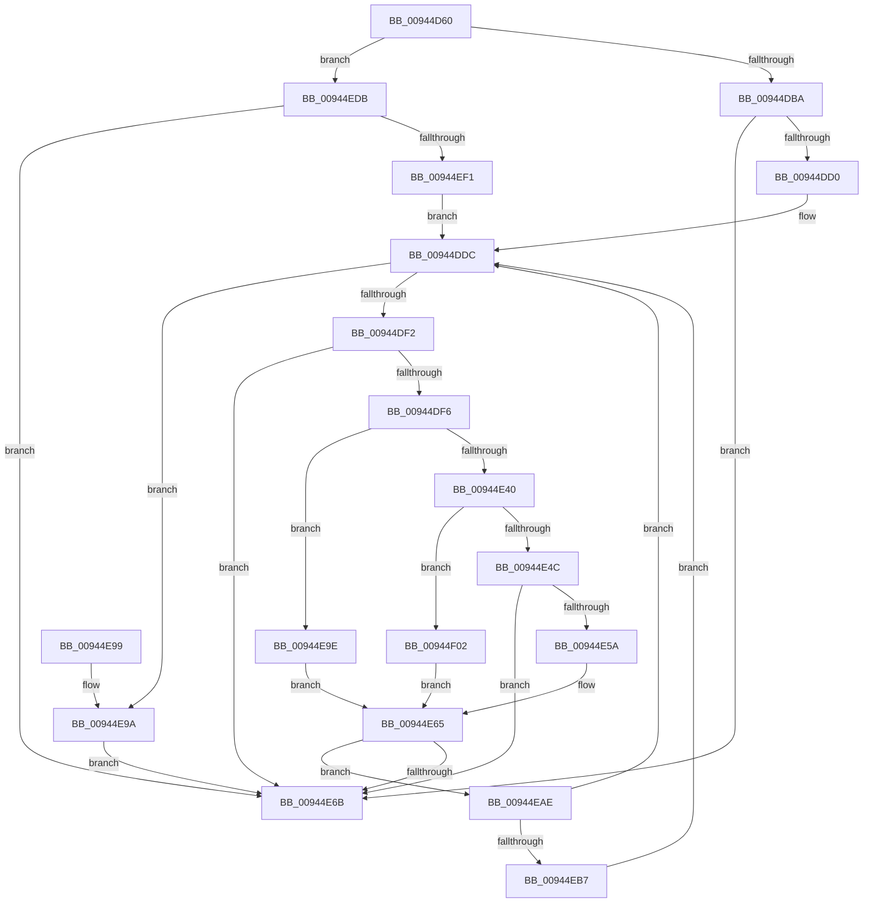

# CmpPromoteSubtree

- RVA: `0x00944D60`–`0x00944F12` (길이 `434` bytes)
- VA: `0x0000000140944D60`
- 실행 섹션: `PAGE`
- PDB 이름 있음: `예`; PDB Function 태그: `아니요`
- unwind 정보 RVA: `0x000907C0`
- 디코드: `116`개 명령, `434/434` bytes 표시
- 미해석 바이트: `0` (있으면 어셈블리에 `.byte`로 보존)

> 이 문서는 커널 이미지의 기계어와 PDB 기호를 분석해 생성했습니다. 4번과 5번은 함수 원형과 자료형을 바이너리 사용 방식에서 추정한 C 해석이며 원본 소스 복구 결과는 아닙니다.

## 1. Dependencies

- 직접 호출 지점: **15**; 고유 호출 대상: **14**
- 직접 호출자로 확인된 함수: **2**
- RIP 상대 이미지 참조: **1**

### Outgoing calls
- `0x00944D96` → [memset](../../text/6C/memset_function_006C6C40.md) (function, `0x006C6C40`)
- `0x00944DA8` → [CmpInitializeKeyNodeStack](CmpInitializeKeyNodeStack_function_00946804.md) (function, `0x00946804`)
- `0x00944DC1` → [CmpSubtreeEnumeratorStart](CmpSubtreeEnumeratorStart_function_009450E0.md) (function, `0x009450E0`)
- `0x00944DD7` → [CmpSubtreeEnumeratorBeginForKeyNodeStack](../7F/CmpSubtreeEnumeratorBeginForKeyNodeStack_function_007F192C.md) (function, `0x007F192C`)
- `0x00944DE0` → [CmpSubtreeEnumeratorAdvance](CmpSubtreeEnumeratorAdvance_function_00946590.md) (function, `0x00946590`)
- `0x00944E32` → [CmpKeyNodeStackGetEntryAtLayerHeight](CmpKeyNodeStackGetEntryAtLayerHeight_function_00946ABC.md) (function, `0x00946ABC`)
- `0x00944E4F` → [CmpPartialPromoteSingleKeyFromKeyNodeStacks](CmpPartialPromoteSingleKeyFromKeyNodeStacks_function_00945808.md) (function, `0x00945808`)
- `0x00944E60` → [CmpFullPromoteSingleKeyFromKeyNodeStacks](../8B/CmpFullPromoteSingleKeyFromKeyNodeStacks_function_008B1A40.md) (function, `0x008B1A40`)
- `0x00944E6F` → [CmpSubtreeEnumeratorCleanup](CmpSubtreeEnumeratorCleanup_function_00945D98.md) (function, `0x00945D98`)
- `0x00944E7D` → [_security_check_cookie](../../text/6A/_security_check_cookie_function_006AC640.md) (function, `0x006AC640`)
- `0x00944EA7` → [CmpPromoteSingleKeyFromKcbStacks](CmpPromoteSingleKeyFromKcbStacks_function_009446E8.md) (function, `0x009446E8`)
- `0x00944ED1` → [CmpKeyEnumStackNotifyPromotion](CmpKeyEnumStackNotifyPromotion_function_00944CE8.md) (function, `0x00944CE8`)
- `0x00944EE2` → [CmpSubtreeEnumeratorStart](CmpSubtreeEnumeratorStart_function_009450E0.md) (function, `0x009450E0`)
- `0x00944EF8` → [CmpSubtreeEnumeratorBeginForKcbStack](../7F/CmpSubtreeEnumeratorBeginForKcbStack_function_007F18DC.md) (function, `0x007F18DC`)
- `0x00944F08` → [CmpPromoteSingleKeyFromParentKcbAndChildKeyNode](../7F/CmpPromoteSingleKeyFromParentKcbAndChildKeyNode_function_007F426C.md) (function, `0x007F426C`)

### Direct callers
- [CmSaveKey](../7D/CmSaveKey_function_007DDBDC.md) at `0x007DDF42`
- [CmRenameKey](../7E/CmRenameKey_function_007E8F48.md) at `0x007E9926`

### Static image references
- `0x00944D78` → RVA `0x00E0A740` (`.data`; read)

## 2. Other-region calls and transfers

- 다른 실행 섹션으로 향하는 call: **2**
  - `0x00944D96` → [memset](../../text/6C/memset_function_006C6C40.md) (`PAGE` → `.text`)
  - `0x00944E7D` → [_security_check_cookie](../../text/6A/_security_check_cookie_function_006AC640.md) (`PAGE` → `.text`)
- 별도 외부 분기/꼬리 이동을 확인하지 못했습니다.

## 3. Assembly (complete function range)

```asm
00944D60  48 89 5C 24 18                  mov qword ptr [rsp + 0x18], rbx
00944D65  55                              push rbp
00944D66  56                              push rsi
00944D67  57                              push rdi
00944D68  41 56                           push r14
00944D6A  41 57                           push r15
00944D6C  48 8D 6C 24 C9                  lea rbp, [rsp - 0x37]
00944D71  48 81 EC A0 00 00 00            sub rsp, 0xa0
00944D78  48 8B 05 C1 59 4C 00            mov rax, qword ptr [rip + 0x4c59c1]
00944D7F  48 33 C4                        xor rax, rsp
00944D82  48 89 45 27                     mov qword ptr [rbp + 0x27], rax
00944D86  4C 8B F2                        mov r14, rdx
00944D89  48 8B F9                        mov rdi, rcx
00944D8C  33 D2                           xor edx, edx
00944D8E  48 8D 4D B9                     lea rcx, [rbp - 0x47]
00944D92  44 8D 42 66                     lea r8d, [rdx + 0x66]
00944D96  E8 A5 1E D8 FF                  call 0x1406c6c40
00944D9B  B8 FE FF FF FF                  mov eax, 0xfffffffe
00944DA0  48 8D 4D C7                     lea rcx, [rbp - 0x39]
00944DA4  66 89 45 B7                     mov word ptr [rbp - 0x49], ax
00944DA8  E8 57 1A 00 00                  call 0x140946804
00944DAD  48 8D 4D B7                     lea rcx, [rbp - 0x49]
00944DB1  48 85 FF                        test rdi, rdi
00944DB4  0F 85 21 01 00 00               jne 0x140944edb
00944DBA  41 0F B7 36                     movzx esi, word ptr [r14]
00944DBE  0F B7 D6                        movzx edx, si
00944DC1  E8 1A 03 00 00                  call 0x1409450e0
00944DC6  8B D8                           mov ebx, eax
00944DC8  85 C0                           test eax, eax
00944DCA  0F 88 9B 00 00 00               js 0x140944e6b
00944DD0  49 8B D6                        mov rdx, r14
00944DD3  48 8D 4D B7                     lea rcx, [rbp - 0x49]
00944DD7  E8 50 CB EA FF                  call 0x1407f192c
00944DDC  48 8D 4D B7                     lea rcx, [rbp - 0x49]
00944DE0  E8 AB 17 00 00                  call 0x140946590
00944DE5  8B D8                           mov ebx, eax
00944DE7  3D 1A 00 00 80                  cmp eax, 0x8000001a
00944DEC  0F 84 A8 00 00 00               je 0x140944e9a
00944DF2  85 C0                           test eax, eax
00944DF4  78 75                           js 0x140944e6b
00944DF6  4C 8B 4D 17                     mov r9, qword ptr [rbp + 0x17]
00944DFA  0F B7 D6                        movzx edx, si
00944DFD  48 0F BF 45 B7                  movsx rax, word ptr [rbp - 0x49]
00944E02  48 69 C8 98 01 00 00            imul rcx, rax, 0x198
00944E09  48 0F BF 45 B7                  movsx rax, word ptr [rbp - 0x49]
00944E0E  4C 69 C0 98 01 00 00            imul r8, rax, 0x198
00944E15  4A 8B 7C 09 10                  mov rdi, qword ptr [rcx + r9 + 0x10]
00944E1A  4E 8B 5C 09 08                  mov r11, qword ptr [rcx + r9 + 8]
00944E1F  48 8B CF                        mov rcx, rdi
00944E22  4F 8B 94 08 70 FE FF FF         mov r10, qword ptr [r8 + r9 - 0x190]
00944E2A  4F 8B B4 08 78 FE FF FF         mov r14, qword ptr [r8 + r9 - 0x188]
00944E32  E8 85 1C 00 00                  call 0x140946abc
00944E37  4C 8B 78 10                     mov r15, qword ptr [rax + 0x10]
00944E3B  4D 85 DB                        test r11, r11
00944E3E  75 5E                           jne 0x140944e9e
00944E40  48 8B D7                        mov rdx, rdi
00944E43  4D 85 D2                        test r10, r10
00944E46  0F 85 B6 00 00 00               jne 0x140944f02
00944E4C  49 8B CE                        mov rcx, r14
00944E4F  E8 B4 09 00 00                  call 0x140945808
00944E54  8B D8                           mov ebx, eax
00944E56  85 C0                           test eax, eax
00944E58  78 11                           js 0x140944e6b
00944E5A  48 8B D7                        mov rdx, rdi
00944E5D  49 8B CE                        mov rcx, r14
00944E60  E8 DB CB F6 FF                  call 0x1408b1a40
00944E65  8B D8                           mov ebx, eax
00944E67  85 C0                           test eax, eax
00944E69  79 43                           jns 0x140944eae
00944E6B  48 8D 4D B7                     lea rcx, [rbp - 0x49]
00944E6F  E8 24 0F 00 00                  call 0x140945d98
00944E74  8B C3                           mov eax, ebx
00944E76  48 8B 4D 27                     mov rcx, qword ptr [rbp + 0x27]
00944E7A  48 33 CC                        xor rcx, rsp
00944E7D  E8 BE 77 D6 FF                  call 0x1406ac640
00944E82  48 8B 9C 24 E0 00 00 00         mov rbx, qword ptr [rsp + 0xe0]
00944E8A  48 81 C4 A0 00 00 00            add rsp, 0xa0
00944E91  41 5F                           pop r15
00944E93  41 5E                           pop r14
00944E95  5F                              pop rdi
00944E96  5E                              pop rsi
00944E97  5D                              pop rbp
00944E98  C3                              ret
00944E99  CC                              int3
00944E9A  33 DB                           xor ebx, ebx
00944E9C  EB CD                           jmp 0x140944e6b
00944E9E  41 B0 01                        mov r8b, 1
00944EA1  49 8B D3                        mov rdx, r11
00944EA4  49 8B CA                        mov rcx, r10
00944EA7  E8 3C F8 FF FF                  call 0x1409446e8
00944EAC  EB B7                           jmp 0x140944e65
00944EAE  4D 85 FF                        test r15, r15
00944EB1  0F 85 25 FF FF FF               jne 0x140944ddc
00944EB7  0F BF 45 B7                     movsx eax, word ptr [rbp - 0x49]
00944EBB  FF C8                           dec eax
00944EBD  48 98                           cdqe
00944EBF  48 69 C8 98 01 00 00            imul rcx, rax, 0x198
00944EC6  48 8B 45 17                     mov rax, qword ptr [rbp + 0x17]
00944ECA  48 83 C0 38                     add rax, 0x38
00944ECE  48 03 C8                        add rcx, rax
00944ED1  E8 12 FE FF FF                  call 0x140944ce8
00944ED6  E9 01 FF FF FF                  jmp 0x140944ddc
00944EDB  0F B7 77 02                     movzx esi, word ptr [rdi + 2]
00944EDF  0F B7 D6                        movzx edx, si
00944EE2  E8 F9 01 00 00                  call 0x1409450e0
00944EE7  8B D8                           mov ebx, eax
00944EE9  85 C0                           test eax, eax
00944EEB  0F 88 7A FF FF FF               js 0x140944e6b
00944EF1  48 8B D7                        mov rdx, rdi
00944EF4  48 8D 4D B7                     lea rcx, [rbp - 0x49]
00944EF8  E8 DF C9 EA FF                  call 0x1407f18dc
00944EFD  E9 DA FE FF FF                  jmp 0x140944ddc
00944F02  41 B0 01                        mov r8b, 1
00944F05  49 8B CA                        mov rcx, r10
00944F08  E8 5F F3 EA FF                  call 0x1407f426c
00944F0D  E9 53 FF FF FF                  jmp 0x140944e65
```

## 4. C-style interpretation (structured pseudocode)

```c
__int64 __fastcall CmpPromoteSubtree(__int64 a1, __int64 a2)
{
    __int64 result;
    __int64 v_rbx;
    __int64 v_rsp;
    unsigned __int64 v_stack_m38;
    unsigned __int64 v_stack_m48;
    unsigned __int64 v_stack_m5F;
    unsigned __int64 v_stack_m98;
    unsigned __int64 v_stack_mA6;
    unsigned __int16 v_stack_mA8;
    unsigned __int64 v_stack_p18;

    v_stack_p18 = v_rbx;
    v_rsp = (v_rsp) - (160);
    result = (*(unsigned __int64 *)(v_rip + 5003713)) ^ (v_rsp);
    v_stack_m38 = result;
    a2 = 0;
    result = memset(v_stack_mA6, a2, a2 + 102, a4);
    v_stack_mA8 = (unsigned __int16)((unsigned int)(0xFFFFFFFEULL));
    result = CmpInitializeKeyNodeStack(v_stack_m98, a2, a2 + 102, a4);
    if (a1 != 0) goto loc_00944EDB;
    result = CmpSubtreeEnumeratorStart(v_stack_mA8, (unsigned __int16)(*(unsigned __int16 *)(a2)), a2 + 102, a4);
    if (sign_flag) goto loc_00944E6B;
    result = CmpSubtreeEnumeratorBeginForKeyNodeStack(v_stack_mA8, 0, a2 + 102, a4);
loc_00944DDC:
    result = CmpSubtreeEnumeratorAdvance(v_stack_mA8, 0, a2 + 102, a4);
    if (((unsigned int)(result)) == 0x8000001AULL) goto loc_00944E9A;
    if (sign_flag) goto loc_00944E6B;
    a1 = (v_stack_mA8) * ((__int16)(v_stack_mA8));
    a3 = (a2 + 102) * ((__int16)(v_stack_mA8));
    result = CmpKeyNodeStackGetEntryAtLayerHeight(*(unsigned __int64 *)(a1 + v_stack_m48 * 1 + 16), (unsigned __int16)(*(unsigned __int16 *)(a2)), a3, v_stack_m48);
    if (*(unsigned __int64 *)(a1 + v_stack_m48 * 1 + 8) != 0) goto loc_00944E9E;
    if (*(unsigned __int64 *)(a3 + v_stack_m48 * 1 - 400) != 0) goto loc_00944F02;
    result = CmpPartialPromoteSingleKeyFromKeyNodeStacks(*(unsigned __int64 *)(a3 + v_stack_m48 * 1 - 392), *(unsigned __int64 *)(a1 + v_stack_m48 * 1 + 16), a3, v_stack_m48);
    if (sign_flag) goto loc_00944E6B;
    result = CmpFullPromoteSingleKeyFromKeyNodeStacks(*(unsigned __int64 *)(a3 + v_stack_m48 * 1 - 392), *(unsigned __int64 *)(a1 + v_stack_m48 * 1 + 16), a3, v_stack_m48);
loc_00944E65:
    if (!sign_flag) goto loc_00944EAE;
loc_00944E6B:
    result = CmpSubtreeEnumeratorCleanup(v_stack_mA8, *(unsigned __int64 *)(a1 + v_stack_m48 * 1 + 16), a3, v_stack_m48);
    a1 = (v_stack_m38) ^ (v_rsp);
    result = _security_check_cookie(a1, *(unsigned __int64 *)(a1 + v_stack_m48 * 1 + 16), a3, v_stack_m48);
    v_rsp = (v_rsp) + (160);
    return result;
loc_00944E9A:
    v_rbx = 0;
    goto loc_00944E6B;
loc_00944E9E:
    result = CmpPromoteSingleKeyFromKcbStacks(*(unsigned __int64 *)(a3 + v_stack_m48 * 1 - 400), *(unsigned __int64 *)(a1 + v_stack_m48 * 1 + 8), 1, v_stack_m48);
    goto loc_00944E65;
loc_00944EAE:
    if (*(unsigned __int64 *)(result + 16) != 0) goto loc_00944DDC;
    result = (unsigned int)(((__int16)(v_stack_mA8)) - 1);
    a1 = (*(unsigned __int64 *)(a3 + v_stack_m48 * 1 - 400)) * (result);
    result = (v_stack_m48) + (56);
    a1 = (a1) + (result);
    result = CmpKeyEnumStackNotifyPromotion(a1, *(unsigned __int64 *)(a1 + v_stack_m48 * 1 + 8), 1, v_stack_m48);
    goto loc_00944DDC;
loc_00944EDB:
    result = CmpSubtreeEnumeratorStart(a1, (unsigned __int16)(*(unsigned __int16 *)(*(unsigned __int64 *)(a1 + v_stack_m48 * 1 + 16) + 2)), 1, v_stack_m48);
    if (sign_flag) goto loc_00944E6B;
    result = CmpSubtreeEnumeratorBeginForKcbStack(v_stack_mA8, *(unsigned __int64 *)(a1 + v_stack_m48 * 1 + 16), 1, v_stack_m48);
    goto loc_00944DDC;
loc_00944F02:
    result = CmpPromoteSingleKeyFromParentKcbAndChildKeyNode(*(unsigned __int64 *)(a3 + v_stack_m48 * 1 - 400), *(unsigned __int64 *)(a1 + v_stack_m48 * 1 + 16), 1, v_stack_m48);
    goto loc_00944E65;
}
```

## 5. (Beta) C Style

```c
int64_t CmpPromoteSubtree(int64_t Arg1, void *Arg2)
{
    uint8_t *arg2 = (uint8_t *)Arg2;

    int64_t result;
    int64_t local_rbx;
    int64_t local_rsp;
    uint64_t v_stack_m38;
    uint64_t v_stack_m48;
    uint64_t v_stack_m5F;
    uint64_t v_stack_m98;
    uint64_t v_stack_mA6;
    uint16_t v_stack_mA8;
    uint64_t v_stack_p18;

    v_stack_p18 = local_rbx;
    local_rsp = (local_rsp) - (160);
    result = (*(uint64_t *)(v_rip + 0x4C59C1)) ^ (local_rsp);
    v_stack_m38 = result;
    Arg2 = 0;
    result = memset(v_stack_mA6, Arg2, Arg2 + 102, a4);
    v_stack_mA8 = (uint16_t)((uint32_t)(0xFFFFFFFEULL));
    result = CmpInitializeKeyNodeStack(v_stack_m98, Arg2, Arg2 + 102, a4);
    if (Arg1 != 0) goto loc_00944EDB;
    result = CmpSubtreeEnumeratorStart(v_stack_mA8, (uint16_t)(*(uint16_t *)(arg2)), Arg2 + 102, a4);
    if (sign_flag) goto loc_00944E6B;
    result = CmpSubtreeEnumeratorBeginForKeyNodeStack(v_stack_mA8, 0, Arg2 + 102, a4);
loc_00944DDC:
    result = CmpSubtreeEnumeratorAdvance(v_stack_mA8, 0, Arg2 + 102, a4);
    if (((uint32_t)(result)) == 0x8000001AULL) goto loc_00944E9A;
    if (sign_flag) goto loc_00944E6B;
    Arg1 = (v_stack_mA8) * ((int16_t)(v_stack_mA8));
    a3 = (Arg2 + 102) * ((int16_t)(v_stack_mA8));
    result = CmpKeyNodeStackGetEntryAtLayerHeight(*(uint64_t *)(Arg1 + v_stack_m48 * 1 + 0x10), (uint16_t)(*(uint16_t *)(arg2)), a3, v_stack_m48);
    if (*(uint64_t *)(Arg1 + v_stack_m48 * 1 + 0x8) != 0) goto loc_00944E9E;
    if (*(uint64_t *)(a3 + v_stack_m48 * 1 - 0x190) != 0) goto loc_00944F02;
    result = CmpPartialPromoteSingleKeyFromKeyNodeStacks(*(uint64_t *)(a3 + v_stack_m48 * 1 - 0x188), *(uint64_t *)(Arg1 + v_stack_m48 * 1 + 0x10), a3, v_stack_m48);
    if (sign_flag) goto loc_00944E6B;
    result = CmpFullPromoteSingleKeyFromKeyNodeStacks(*(uint64_t *)(a3 + v_stack_m48 * 1 - 0x188), *(uint64_t *)(Arg1 + v_stack_m48 * 1 + 0x10), a3, v_stack_m48);
loc_00944E65:
    if (!sign_flag) goto loc_00944EAE;
loc_00944E6B:
    result = CmpSubtreeEnumeratorCleanup(v_stack_mA8, *(uint64_t *)(Arg1 + v_stack_m48 * 1 + 0x10), a3, v_stack_m48);
    Arg1 = (v_stack_m38) ^ (local_rsp);
    result = _security_check_cookie(Arg1, *(uint64_t *)(Arg1 + v_stack_m48 * 1 + 0x10), a3, v_stack_m48);
    local_rsp = (local_rsp) + (160);
    return result;
loc_00944E9A:
    local_rbx = 0;
    goto loc_00944E6B;
loc_00944E9E:
    result = CmpPromoteSingleKeyFromKcbStacks(*(uint64_t *)(a3 + v_stack_m48 * 1 - 0x190), *(uint64_t *)(Arg1 + v_stack_m48 * 1 + 0x8), 1, v_stack_m48);
    goto loc_00944E65;
loc_00944EAE:
    if (*(uint64_t *)(result + 0x10) != 0) goto loc_00944DDC;
    result = (uint32_t)(((int16_t)(v_stack_mA8)) - 1);
    Arg1 = (*(uint64_t *)(a3 + v_stack_m48 * 1 - 0x190)) * (result);
    result = (v_stack_m48) + (56);
    Arg1 = (Arg1) + (result);
    result = CmpKeyEnumStackNotifyPromotion(Arg1, *(uint64_t *)(Arg1 + v_stack_m48 * 1 + 0x8), 1, v_stack_m48);
    goto loc_00944DDC;
loc_00944EDB:
    result = CmpSubtreeEnumeratorStart(Arg1, (uint16_t)(*(uint16_t *)(*(uint64_t *)(Arg1 + v_stack_m48 * 1 + 0x10) + 0x2)), 1, v_stack_m48);
    if (sign_flag) goto loc_00944E6B;
    result = CmpSubtreeEnumeratorBeginForKcbStack(v_stack_mA8, *(uint64_t *)(Arg1 + v_stack_m48 * 1 + 0x10), 1, v_stack_m48);
    goto loc_00944DDC;
loc_00944F02:
    result = CmpPromoteSingleKeyFromParentKcbAndChildKeyNode(*(uint64_t *)(a3 + v_stack_m48 * 1 - 0x190), *(uint64_t *)(Arg1 + v_stack_m48 * 1 + 0x10), 1, v_stack_m48);
    goto loc_00944E65;
}
```

### 관측된 메모리 오프셋

구조체 형식이 확인되지 않은 접근은 인자 기준의 오프셋으로만 기록했습니다.

| 기준 인자 | 오프셋 표현 | 폭 (bit) | 접근 |
|---|---:|---:|---|
| `Arg2` | `+ 0x0` | `16` | `R` |

## 6. Execution-region graph

[열기: 2D/3D 그래프와 함수 탐색 컨트롤 패널](../../../control-panel.html?section=page&rva=0x00944D60&view=graph)

- 2D 그래프는 위에서 아래로 흐르고, 3D 그래프는 빈 공간을 드래그해 회전합니다. Shift+드래그는 이동, 휠은 확대·축소, 함수 노드 선택은 대상 보고서 이동입니다.

### Static fallback


