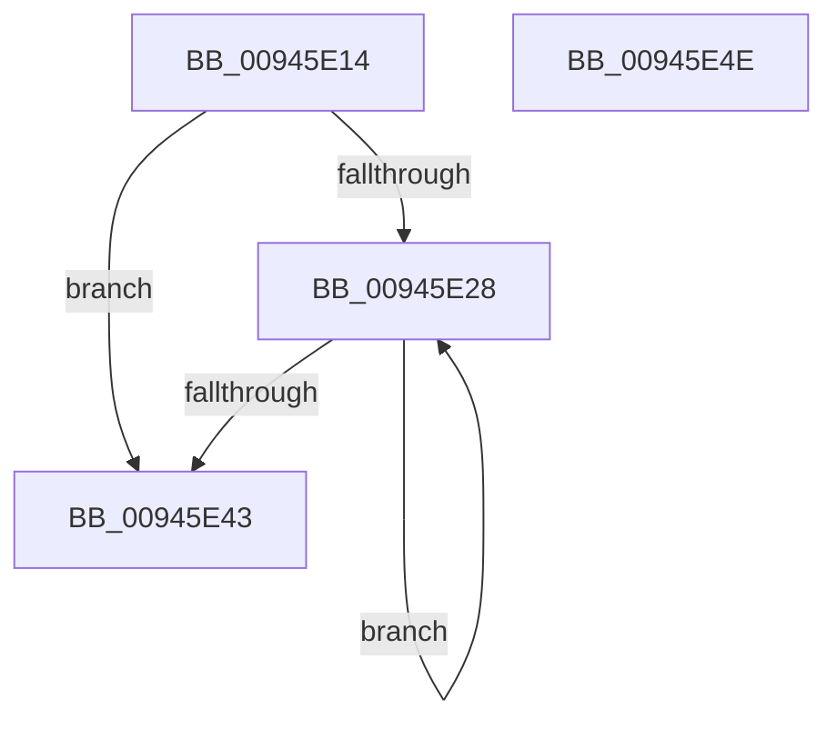

# CmpResetKeyNodeStack

- RVA: `0x00945E14`–`0x00945E4F` (길이 `59` bytes)
- VA: `0x0000000140945E14`
- 실행 섹션: `PAGE`
- PDB 이름 있음: `예`; PDB Function 태그: `아니요`
- unwind 정보 RVA: `0x0005CAAC`
- 디코드: `20`개 명령, `59/59` bytes 표시
- 미해석 바이트: `0` (있으면 어셈블리에 `.byte`로 보존)

> 이 문서는 커널 이미지의 기계어와 PDB 기호를 분석해 생성했습니다. 4번과 5번은 함수 원형과 자료형을 바이너리 사용 방식에서 추정한 C 해석이며 원본 소스 복구 결과는 아닙니다.

## 1. Dependencies

- 직접 호출 지점: **2**; 고유 호출 대상: **2**
- 직접 호출자로 확인된 함수: **2**
- RIP 상대 이미지 참조: **0**

### Outgoing calls
- `0x00945E2E` → [CmpKeyNodeStackGetEntryAtLayerHeight](CmpKeyNodeStackGetEntryAtLayerHeight_function_00946ABC.md) (function, `0x00946ABC`)
- `0x00945E36` → [CmpKeyNodeStackEntryReset](CmpKeyNodeStackEntryReset_function_009467E0.md) (function, `0x009467E0`)

### Direct callers
- [CmRenameKey](../7E/CmRenameKey_function_007E8F48.md) at `0x007E9F3F`
- [CmpKeyEnumStackReset](CmpKeyEnumStackReset_function_0094648C.md) at `0x009464A8`

### Static image references
- 디코드된 RIP-relative 메모리 참조가 없습니다.

## 2. Other-region calls and transfers

- 다른 실행 섹션으로 향하는 call: **0**
- 별도 외부 분기/꼬리 이동을 확인하지 못했습니다.

## 3. Assembly (complete function range)

```asm
00945E14  48 89 5C 24 08                  mov qword ptr [rsp + 8], rbx
00945E19  57                              push rdi
00945E1A  48 83 EC 20                     sub rsp, 0x20
00945E1E  33 DB                           xor ebx, ebx
00945E20  48 8B F9                        mov rdi, rcx
00945E23  66 3B 19                        cmp bx, word ptr [rcx]
00945E26  7F 1B                           jg 0x140945e43
00945E28  0F B7 D3                        movzx edx, bx
00945E2B  48 8B CF                        mov rcx, rdi
00945E2E  E8 89 0C 00 00                  call 0x140946abc
00945E33  48 8B C8                        mov rcx, rax
00945E36  E8 A5 09 00 00                  call 0x1409467e0
00945E3B  66 FF C3                        inc bx
00945E3E  66 3B 1F                        cmp bx, word ptr [rdi]
00945E41  7E E5                           jle 0x140945e28
00945E43  48 8B 5C 24 30                  mov rbx, qword ptr [rsp + 0x30]
00945E48  48 83 C4 20                     add rsp, 0x20
00945E4C  5F                              pop rdi
00945E4D  C3                              ret
00945E4E  CC                              int3
```

## 4. C-style interpretation (structured pseudocode)

```c
__int64 __fastcall CmpResetKeyNodeStack(__int64 a1)
{
    __int64 result;
    __int64 v_rbx;
    __int64 v_rsp;
    unsigned __int64 v_stack_p8;

    v_stack_p8 = v_rbx;
    v_rsp = (v_rsp) - (32);
    v_rbx = 0;
    if (0 > (*(unsigned __int16 *)(a1))) goto loc_00945E43;
loc_00945E28:
    result = CmpKeyNodeStackGetEntryAtLayerHeight(a1, 0, a3, a4);
    result = CmpKeyNodeStackEntryReset(result, 0, a3, a4);
    v_rbx = (unsigned __int16)((v_rbx) + 1);
    if (((unsigned __int16)(v_rbx)) <= (*(unsigned __int16 *)(a1))) goto loc_00945E28;
loc_00945E43:
    v_rsp = (v_rsp) + (32);
    return result;
}
```

## 5. (Beta) C Style

```c
int64_t CmpResetKeyNodeStack(void *Arg1)
{
    uint8_t *arg1 = (uint8_t *)Arg1;

    int64_t result;
    int64_t local_rbx;
    int64_t local_rsp;
    uint64_t v_stack_p8;

    v_stack_p8 = local_rbx;
    local_rsp = (local_rsp) - (32);
    local_rbx = 0;
    if (0 > (*(uint16_t *)(arg1))) goto loc_00945E43;
loc_00945E28:
    result = CmpKeyNodeStackGetEntryAtLayerHeight(Arg1, 0, a3, a4);
    result = CmpKeyNodeStackEntryReset(result, 0, a3, a4);
    local_rbx = (uint16_t)((local_rbx) + 1);
    if (((uint16_t)(local_rbx)) <= (*(uint16_t *)(arg1))) goto loc_00945E28;
loc_00945E43:
    local_rsp = (local_rsp) + (32);
    return result;
}
```

### 관측된 메모리 오프셋

구조체 형식이 확인되지 않은 접근은 인자 기준의 오프셋으로만 기록했습니다.

| 기준 인자 | 오프셋 표현 | 폭 (bit) | 접근 |
|---|---:|---:|---|
| `Arg1` | `+ 0x0` | `16` | `R` |

## 6. Execution-region graph

[열기: 2D/3D 그래프와 함수 탐색 컨트롤 패널](../../../control-panel.html?section=page&rva=0x00945E14&view=graph)

- 2D 그래프는 위에서 아래로 흐르고, 3D 그래프는 빈 공간을 드래그해 회전합니다. Shift+드래그는 이동, 휠은 확대·축소, 함수 노드 선택은 대상 보고서 이동입니다.

### Static fallback


