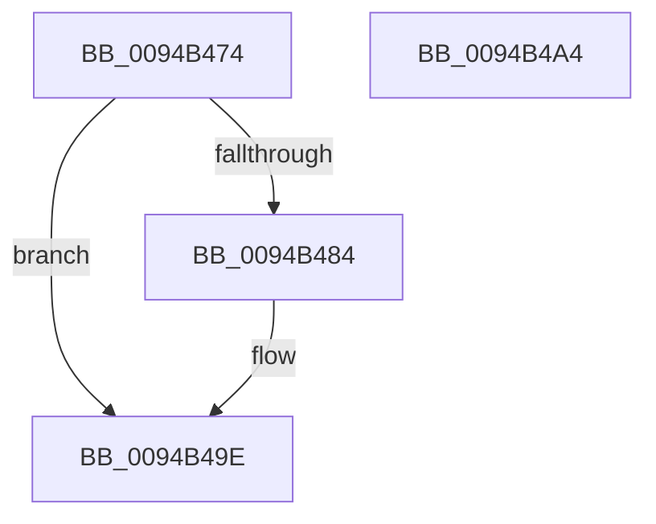

# CmpRetryBackOff

- RVA: `0x0094B474`–`0x0094B4A5` (길이 `49` bytes)
- VA: `0x000000014094B474`
- 실행 섹션: `PAGE`
- PDB 이름 있음: `예`; PDB Function 태그: `아니요`
- unwind 정보 RVA: `0x0005CF00`
- 디코드: `16`개 명령, `49/49` bytes 표시
- 미해석 바이트: `0` (있으면 어셈블리에 `.byte`로 보존)

> 이 문서는 커널 이미지의 기계어와 PDB 기호를 분석해 생성했습니다. 4번과 5번은 함수 원형과 자료형을 바이너리 사용 방식에서 추정한 C 해석이며 원본 소스 복구 결과는 아닙니다.

## 1. Dependencies

- 직접 호출 지점: **1**; 고유 호출 대상: **1**
- 직접 호출자로 확인된 함수: **5**
- RIP 상대 이미지 참조: **0**

### Outgoing calls
- `0x0094B496` → [KeDelayExecutionThread](../../text/20/KeDelayExecutionThread_function_00209550.md) (function, `0x00209550`)

### Direct callers
- [CmpSaveBootControlSet](../7D/CmpSaveBootControlSet_function_007DC744.md) at `0x007DCA77`
- [CmRestoreKey](../7D/CmRestoreKey_function_007DCF04.md) at `0x007DD3DC`
- [CmRestoreKey](../7D/CmRestoreKey_function_007DCF04.md) at `0x007DD4B0`
- [CmSetLastWriteTimeKey](../84/CmSetLastWriteTimeKey_function_00843368.md) at `0x00843514`
- [CmpRollbackTransactionArray](CmpRollbackTransactionArray_function_0094B3AC.md) at `0x0094B444`
- [sub_00B2D804](../B2/Unknown_function_00B2D804.md) at `0x00B2D843`

### Static image references
- 디코드된 RIP-relative 메모리 참조가 없습니다.

## 2. Other-region calls and transfers

- 다른 실행 섹션으로 향하는 call: **1**
  - `0x0094B496` → [KeDelayExecutionThread](../../text/20/KeDelayExecutionThread_function_00209550.md) (`PAGE` → `.text`)
- 별도 외부 분기/꼬리 이동을 확인하지 못했습니다.

## 3. Assembly (complete function range)

```asm
0094B474  40 53                           push rbx
0094B476  48 83 EC 20                     sub rsp, 0x20
0094B47A  FF 01                           inc dword ptr [rcx]
0094B47C  48 8B D9                        mov rbx, rcx
0094B47F  83 39 0A                        cmp dword ptr [rcx], 0xa
0094B482  76 1A                           jbe 0x14094b49e
0094B484  4C 8D 44 24 30                  lea r8, [rsp + 0x30]
0094B489  48 C7 44 24 30 80 69 67 FF      mov qword ptr [rsp + 0x30], 0xffffffffff676980
0094B492  33 D2                           xor edx, edx
0094B494  33 C9                           xor ecx, ecx
0094B496  E8 B5 E0 8B FF                  call 0x140209550
0094B49B  83 23 00                        and dword ptr [rbx], 0
0094B49E  48 83 C4 20                     add rsp, 0x20
0094B4A2  5B                              pop rbx
0094B4A3  C3                              ret
0094B4A4  CC                              int3
```

## 4. C-style interpretation (structured pseudocode)

```c
__int64 __fastcall CmpRetryBackOff(__int64 a1, int a2)
{
    __int64 result;
    __int64 v_rsp;
    unsigned __int64 v_stack_p8;

    v_rsp = (v_rsp) - (32);
    if ((*(unsigned int *)(a1)) >= = 10) {
        a3 = v_stack_p8;
        v_stack_p8 = 0xFFFFFFFFFF676980ULL;
        a2 = 0;
        a1 = 0;
        result = KeDelayExecutionThread(a1, a2, a3, a4);
    }
    v_rsp = (v_rsp) + (32);
    return result;
}
```

## 5. (Beta) C Style

```c
int64_t CmpRetryBackOff(void *Arg1, int32_t Arg2)
{
    uint8_t *arg1 = (uint8_t *)Arg1;

    int64_t result;
    int64_t local_rsp;
    uint64_t v_stack_p8;

    local_rsp = (local_rsp) - (32);
    if ((*(uint32_t *)(arg1)) >= = 10) {
        a3 = v_stack_p8;
        v_stack_p8 = 0xFFFFFFFFFF676980ULL;
        Arg2 = 0;
        Arg1 = 0;
        result = KeDelayExecutionThread(Arg1, Arg2, a3, a4);
    }
    local_rsp = (local_rsp) + (32);
    return result;
}
```

### 관측된 메모리 오프셋

구조체 형식이 확인되지 않은 접근은 인자 기준의 오프셋으로만 기록했습니다.

| 기준 인자 | 오프셋 표현 | 폭 (bit) | 접근 |
|---|---:|---:|---|
| `Arg1` | `+ 0x0` | `32` | `R` |
| `Arg1` | `+ 0x0` | `32` | `R/W` |

## 6. Execution-region graph

[열기: 2D/3D 그래프와 함수 탐색 컨트롤 패널](../../../control-panel.html?section=page&rva=0x0094B474&view=graph)

- 2D 그래프는 위에서 아래로 흐르고, 3D 그래프는 빈 공간을 드래그해 회전합니다. Shift+드래그는 이동, 휠은 확대·축소, 함수 노드 선택은 대상 보고서 이동입니다.

### Static fallback


