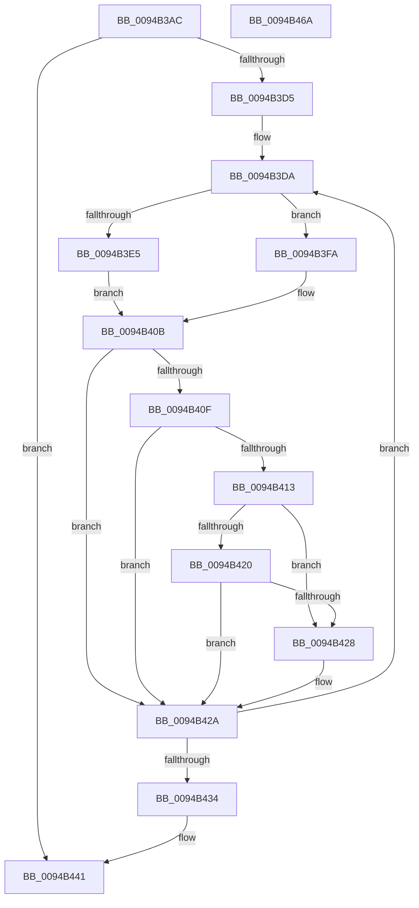

# CmpRollbackTransactionArray

- RVA: `0x0094B3AC`–`0x0094B46B` (길이 `191` bytes)
- VA: `0x000000014094B3AC`
- 실행 섹션: `PAGE`
- PDB 이름 있음: `예`; PDB Function 태그: `아니요`
- unwind 정보 RVA: `0x0005FEF8`
- 디코드: `60`개 명령, `191/191` bytes 표시
- 미해석 바이트: `0` (있으면 어셈블리에 `.byte`로 보존)

> 이 문서는 커널 이미지의 기계어와 PDB 기호를 분석해 생성했습니다. 4번과 5번은 함수 원형과 자료형을 바이너리 사용 방식에서 추정한 C 해석이며 원본 소스 복구 결과는 아닙니다.

## 1. Dependencies

- 직접 호출 지점: **6**; 고유 호출 대상: **6**
- 직접 호출자로 확인된 함수: **6**
- RIP 상대 이미지 참조: **0**

### Outgoing calls
- `0x0094B3E9` → [CmpRollbackLightWeightTransaction](../9B/CmpRollbackLightWeightTransaction_function_009B1158.md) (function, `0x009B1158`)
- `0x0094B3F3` → [CmpTransDereferenceTransaction](../87/CmpTransDereferenceTransaction_function_00873608.md) (function, `0x00873608`)
- `0x0094B3FC` → [TmRollbackEnlistment](../../text/4F/TmRollbackEnlistment_function_004FE380.md) (function, `0x004FE380`)
- `0x0094B406` → [ObfDereferenceObject](../../text/2F/ObfDereferenceObject_function_002F9350.md) (function, `0x002F9350`)
- `0x0094B43C` → [ExFreePoolWithTag](../../poolcode/B8/ExFreePoolWithTag_function_00B82870.md) (function, `0x00B82870`)
- `0x0094B444` → [CmpRetryBackOff](CmpRetryBackOff_function_0094B474.md) (function, `0x0094B474`)

### Direct callers
- [CmDeleteValueKey](../84/CmDeleteValueKey_function_008476E8.md) at `0x00847FFC`
- [CmDeleteKey](../84/CmDeleteKey_function_00848E5C.md) at `0x00849443`
- [CmDeleteKey](../84/CmDeleteKey_function_00848E5C.md) at `0x00849690`
- [CmpParseKey](../89/CmpParseKey_function_0089DDC0.md) at `0x0089E49C`
- [CmpSetKeySecurity](CmpSetKeySecurity_function_0094A124.md) at `0x0094A59F`
- [sub_00B160F4](../B1/Unknown_function_00B160F4.md) at `0x00B1611D`
- [sub_00B25E36](../B2/Unknown_function_00B25E36.md) at `0x00B25E71`

### Static image references
- 디코드된 RIP-relative 메모리 참조가 없습니다.

## 2. Other-region calls and transfers

- 다른 실행 섹션으로 향하는 call: **3**
  - `0x0094B3FC` → [TmRollbackEnlistment](../../text/4F/TmRollbackEnlistment_function_004FE380.md) (`PAGE` → `.text`)
  - `0x0094B406` → [ObfDereferenceObject](../../text/2F/ObfDereferenceObject_function_002F9350.md) (`PAGE` → `.text`)
  - `0x0094B43C` → [ExFreePoolWithTag](../../poolcode/B8/ExFreePoolWithTag_function_00B82870.md) (`PAGE` → `POOLCODE`)
- 별도 외부 분기/꼬리 이동을 확인하지 못했습니다.

## 3. Assembly (complete function range)

```asm
0094B3AC  48 8B C4                        mov rax, rsp
0094B3AF  48 89 58 08                     mov qword ptr [rax + 8], rbx
0094B3B3  48 89 68 10                     mov qword ptr [rax + 0x10], rbp
0094B3B7  48 89 70 18                     mov qword ptr [rax + 0x18], rsi
0094B3BB  48 89 78 20                     mov qword ptr [rax + 0x20], rdi
0094B3BF  41 54                           push r12
0094B3C1  41 56                           push r14
0094B3C3  41 57                           push r15
0094B3C5  48 83 EC 20                     sub rsp, 0x20
0094B3C9  33 FF                           xor edi, edi
0094B3CB  4D 8B E1                        mov r12, r9
0094B3CE  4C 8B FA                        mov r15, rdx
0094B3D1  85 C9                           test ecx, ecx
0094B3D3  74 6C                           je 0x14094b441
0094B3D5  4C 8B F2                        mov r14, rdx
0094B3D8  8B E9                           mov ebp, ecx
0094B3DA  49 8B 1E                        mov rbx, qword ptr [r14]
0094B3DD  48 8B CB                        mov rcx, rbx
0094B3E0  F6 C3 01                        test bl, 1
0094B3E3  74 15                           je 0x14094b3fa
0094B3E5  48 83 E1 FE                     and rcx, 0xfffffffffffffffe
0094B3E9  E8 6A 5D 06 00                  call 0x1409b1158
0094B3EE  48 8B CB                        mov rcx, rbx
0094B3F1  8B F0                           mov esi, eax
0094B3F3  E8 10 82 F2 FF                  call 0x140873608
0094B3F8  EB 11                           jmp 0x14094b40b
0094B3FA  33 D2                           xor edx, edx
0094B3FC  E8 7F 2F BB FF                  call 0x1404fe380
0094B401  49 8B 0E                        mov rcx, qword ptr [r14]
0094B404  8B F0                           mov esi, eax
0094B406  E8 45 DF 9A FF                  call 0x1402f9350
0094B40B  85 F6                           test esi, esi
0094B40D  79 1B                           jns 0x14094b42a
0094B40F  85 FF                           test edi, edi
0094B411  78 17                           js 0x14094b42a
0094B413  8D 86 ED FF E6 3F               lea eax, [rsi + 0x3fe6ffed]
0094B419  A9 FC FF FF FF                  test eax, 0xfffffffc
0094B41E  75 08                           jne 0x14094b428
0094B420  81 FE 14 00 19 C0               cmp esi, 0xc0190014
0094B426  75 02                           jne 0x14094b42a
0094B428  8B FE                           mov edi, esi
0094B42A  49 83 C6 08                     add r14, 8
0094B42E  48 83 ED 01                     sub rbp, 1
0094B432  75 A6                           jne 0x14094b3da
0094B434  BA 43 4D 34 36                  mov edx, 0x36344d43
0094B439  49 8B CF                        mov rcx, r15
0094B43C  E8 2F 74 23 00                  call 0x140b82870
0094B441  49 8B CC                        mov rcx, r12
0094B444  E8 2B 00 00 00                  call 0x14094b474
0094B449  48 8B 5C 24 40                  mov rbx, qword ptr [rsp + 0x40]
0094B44E  8B C7                           mov eax, edi
0094B450  48 8B 7C 24 58                  mov rdi, qword ptr [rsp + 0x58]
0094B455  48 8B 6C 24 48                  mov rbp, qword ptr [rsp + 0x48]
0094B45A  48 8B 74 24 50                  mov rsi, qword ptr [rsp + 0x50]
0094B45F  48 83 C4 20                     add rsp, 0x20
0094B463  41 5F                           pop r15
0094B465  41 5E                           pop r14
0094B467  41 5C                           pop r12
0094B469  C3                              ret
0094B46A  CC                              int3
```

## 4. C-style interpretation (structured pseudocode)

```c
__int64 __fastcall CmpRollbackTransactionArray(int a1, __int64 a2, __int64 a3, __int64 a4)
{
    __int64 result;
    __int64 v_r14;
    __int64 v_rbp;
    __int64 v_rdi;
    __int64 v_rsp;
    unsigned __int64 v_stack_p10;
    unsigned __int64 v_stack_p18;
    unsigned __int64 v_stack_p20;
    unsigned __int64 v_stack_p8;

    *(unsigned __int64 *)(v_rsp + 8) = v_rbx;
    *(unsigned __int64 *)(v_rsp + 16) = v_rbp;
    *(unsigned __int64 *)(v_rsp + 24) = v_rsi;
    *(unsigned __int64 *)(v_rsp + 32) = v_rdi;
    v_rsp = (v_rsp) - (32);
    v_rdi = 0;
    if (a1 == 0) goto loc_0094B441;
loc_0094B3DA:
    if ((((unsigned __int8)(*(unsigned __int64 *)(a2))) & (1)) == 0) goto loc_0094B3FA;
    a1 = (*(unsigned __int64 *)(a2)) & (-2);
    result = CmpRollbackLightWeightTransaction(a1, a2, a3, a4);
    result = CmpTransDereferenceTransaction(*(unsigned __int64 *)(a2), a2, a3, a4);
    goto loc_0094B40B;
loc_0094B3FA:
    a2 = 0;
    result = TmRollbackEnlistment(*(unsigned __int64 *)(a2), a2, a3, a4);
    result = ObfDereferenceObject(*(unsigned __int64 *)(a2), a2, a3, a4);
loc_0094B40B:
    if (!sign_flag) goto loc_0094B42A;
    if (sign_flag) goto loc_0094B42A;
    if ((((unsigned int)((unsigned int)((unsigned int)(result)) + 1072103405)) & (0xFFFFFFFCULL)) != 0) goto loc_0094B428;
    if (((unsigned int)((unsigned int)((unsigned int)(result)))) == 0xC0190014ULL) {
        v_rdi = (unsigned int)((unsigned int)((unsigned int)(result)));
    }
    v_r14 = (a2) + (8);
    v_rbp = ((unsigned int)(a1)) - (1);
    if (condition_is_not_equal) goto loc_0094B3DA;
    result = ExFreePoolWithTag(0, (unsigned int)(0x36344D43ULL), a3, a4);
loc_0094B441:
    result = CmpRetryBackOff(a4, (unsigned int)(0x36344D43ULL), a3, a4);
    v_rsp = (v_rsp) + (32);
    return (unsigned int)((unsigned int)(v_rdi));
}
```

## 5. (Beta) C Style

```c
int64_t CmpRollbackTransactionArray(int32_t Arg1, void *Arg2, int64_t Arg3, int64_t Arg4)
{
    uint8_t *arg2 = (uint8_t *)Arg2;

    int64_t result;
    int64_t local_r14;
    int64_t local_rbp;
    int64_t local_rdi;
    int64_t local_rsp;
    uint64_t v_stack_p10;
    uint64_t v_stack_p18;
    uint64_t v_stack_p20;
    uint64_t v_stack_p8;

    *(uint64_t *)(local_rsp + 0x8) = local_rbx;
    *(uint64_t *)(local_rsp + 0x10) = local_rbp;
    *(uint64_t *)(local_rsp + 0x18) = local_rsi;
    *(uint64_t *)(local_rsp + 0x20) = local_rdi;
    local_rsp = (local_rsp) - (32);
    local_rdi = 0;
    if (Arg1 == 0) goto loc_0094B441;
loc_0094B3DA:
    if ((((uint8_t)(*(uint64_t *)(arg2))) & (1)) == 0) goto loc_0094B3FA;
    Arg1 = (*(uint64_t *)(arg2)) & (-2);
    result = CmpRollbackLightWeightTransaction(Arg1, Arg2, Arg3, Arg4);
    result = CmpTransDereferenceTransaction(*(uint64_t *)(arg2), Arg2, Arg3, Arg4);
    goto loc_0094B40B;
loc_0094B3FA:
    Arg2 = 0;
    result = TmRollbackEnlistment(*(uint64_t *)(arg2), Arg2, Arg3, Arg4);
    result = ObfDereferenceObject(*(uint64_t *)(arg2), Arg2, Arg3, Arg4);
loc_0094B40B:
    if (!sign_flag) goto loc_0094B42A;
    if (sign_flag) goto loc_0094B42A;
    if ((((uint32_t)((uint32_t)((uint32_t)(result)) + 1072103405)) & (0xFFFFFFFCULL)) != 0) goto loc_0094B428;
    if (((uint32_t)((uint32_t)((uint32_t)(result)))) == 0xC0190014ULL) {
        local_rdi = (uint32_t)((uint32_t)((uint32_t)(result)));
    }
    local_r14 = (Arg2) + (8);
    local_rbp = ((uint32_t)(Arg1)) - (1);
    if (condition_is_not_equal) goto loc_0094B3DA;
    result = ExFreePoolWithTag(0, (uint32_t)(0x36344D43ULL), Arg3, Arg4);
loc_0094B441:
    result = CmpRetryBackOff(Arg4, (uint32_t)(0x36344D43ULL), Arg3, Arg4);
    local_rsp = (local_rsp) + (32);
    return (uint32_t)((uint32_t)(local_rdi));
}
```

### 관측된 메모리 오프셋

구조체 형식이 확인되지 않은 접근은 인자 기준의 오프셋으로만 기록했습니다.

| 기준 인자 | 오프셋 표현 | 폭 (bit) | 접근 |
|---|---:|---:|---|
| `Arg2` | `+ 0x0` | `64` | `R` |

## 6. Execution-region graph

[열기: 2D/3D 그래프와 함수 탐색 컨트롤 패널](../../../control-panel.html?section=page&rva=0x0094B3AC&view=graph)

- 2D 그래프는 위에서 아래로 흐르고, 3D 그래프는 빈 공간을 드래그해 회전합니다. Shift+드래그는 이동, 휠은 확대·축소, 함수 노드 선택은 대상 보고서 이동입니다.

### Static fallback


